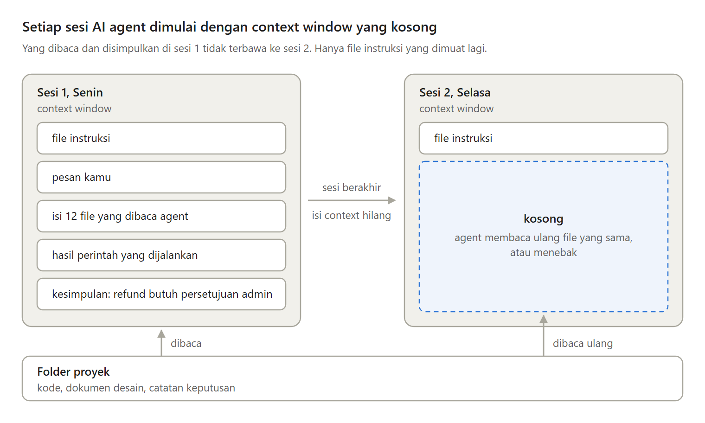
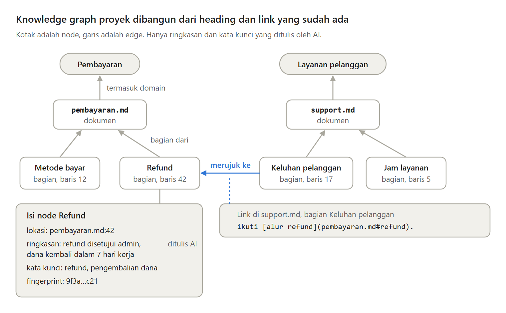

Kemarin kamu sudah menjelaskan proyekmu panjang lebar ke AI agent. Hari ini kamu membuka sesi baru, dan ia bertanya hal yang sama lagi.

Ini bukan salah Claude Code, Codex, atau Cursor. Ini cara kerja context window. Di thread ini, kenapa itu terjadi, dan kapan knowledge graph dari dokumen proyekmu membantu.

---

Semua yang diketahui AI agent selama bekerja ada di context window, yaitu seluruh teks yang bisa dibaca model saat menjawab. Dokumentasi Claude Code menulis bahwa setiap sesi dimulai dengan context window yang baru.

Context window yang makin besar juga bukan jawaban. Makin banyak token di dalamnya, makin turun ketepatan model mengingat isinya. Gejala ini disebut context rot.

---

Ada tiga cara yang biasa dipakai, dan masing-masing punya celah:

- CLAUDE.md atau AGENTS.md dimuat utuh di setiap sesi, jadi harus kecil. Dokumentasi Claude Code menganjurkan di bawah 200 baris.
- grep selalu membaca file terbaru, tetapi mencari kata, bukan makna. "Pengembalian dana" tidak ketemu saat agent mencari "refund".
- RAG dengan embedding menemukan makna, tetapi memotong dokumen sehingga potongannya kehilangan tempat.

---

Knowledge graph proyek menyimpan dokumen markdown sebagai node dan edge.

Setiap file menjadi node dokumen. Setiap heading menjadi node bagian, lengkap dengan nama file dan nomor barisnya. Domain mengelompokkan topik seperti Pembayaran. Setiap link markdown menjadi edge "merujuk ke".

Struktur ini dibaca langsung dari markdown, tanpa AI.

---

AI hanya dipakai untuk menulis ringkasan dan kata kunci setiap bagian. Supaya murah, setiap bagian punya fingerprint, yaitu angka pendek yang dihitung dari teksnya.

Saat sinkronisasi, fingerprint dihitung ulang. Yang sama tidak disentuh, yang berubah ditandai, dan hanya bagian itu yang dikirim ke AI. Biaya AI mengikuti jumlah perubahan, bukan ukuran proyek.

---

AI agent membaca graph ini lewat MCP, standar open source untuk menghubungkan aplikasi AI ke sistem lain. Claude Code, Codex, dan Cursor bisa memakai server MCP yang sama.

Setiap jawaban membawa alamatnya, yaitu nama file dan nomor baris. Agent cukup membuka baris itu, dan kamu bisa memeriksa apakah kesimpulannya memang tertulis di sana.

---

Knowledge graph juga punya kelemahan. Ringkasan AI ada biayanya, bisa usang atau salah, dan graph hanya sebaru sinkronisasi terakhir. Edge pun hanya ada kalau penulis dokumen menulis link.

Untuk proyek kecil, grep atau satu CLAUDE.md sudah cukup. Untuk teks tanpa heading dan link, RAG dengan embedding lebih cocok.

---

Artikel lengkapnya membahas juga langkah sinkronisasi, cara agent bertanya, dan kapan kamu tidak membutuhkan knowledge graph:

Kenapa AI agent lupa proyekmu setiap sesi, dan kapan ia butuh knowledge graph?
https://medium.com/p/ae5e424cfb0d
