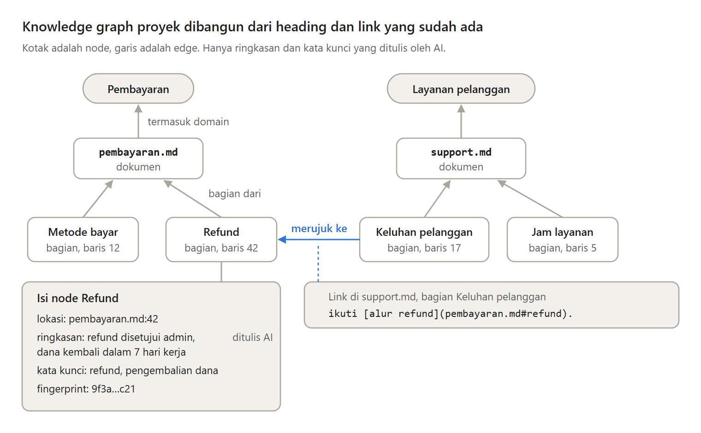
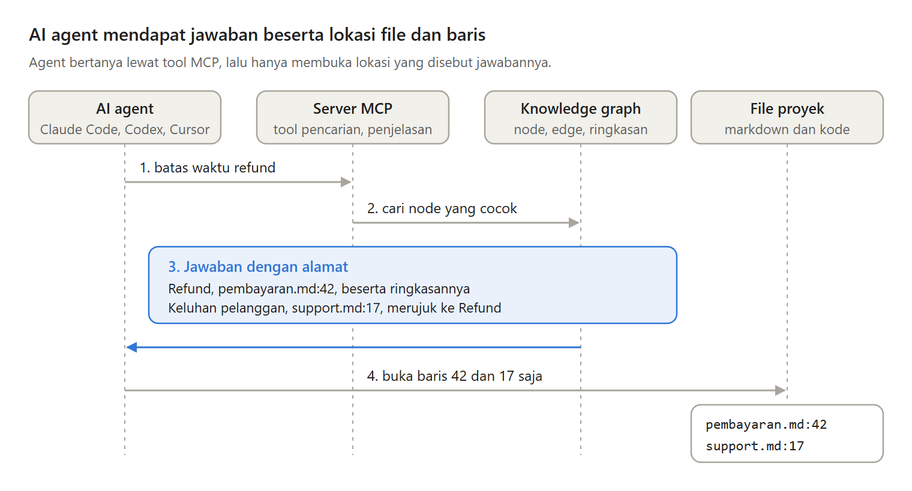

AI agent yang hanya membaca kode bisa "merapikan" sesuatu yang sengaja dibuat begitu.

Kode menjelaskan apa yang terjadi, bukan kenapa. Alasan seperti kenapa refund harus disetujui admin biasanya tertulis di dokumen. Thread ini tentang bagaimana dokumen markdown proyekmu sendiri bisa menjadi peta untuk AI agent.

---

Tempat pertama untuk alasan-alasan itu biasanya file instruksi, seperti CLAUDE.md untuk Claude Code atau AGENTS.md untuk Codex. Isinya dimuat utuh di setiap sesi.

Masalahnya, ukurannya terbatas. Dokumentasi Claude Code menganjurkan setiap CLAUDE.md di bawah 200 baris, dan Codex secara bawaan berhenti menambah isi AGENTS.md setelah 32 KiB. Dokumen desain dan catatan keputusan tidak muat di sana.

---

Padahal dokumen markdown sudah berisi peta. Heading memecah dokumen menjadi bagian, dan link menghubungkan satu bagian ke bagian lain.

Misalnya, bagian Keluhan pelanggan di support.md menulis "ikuti alur refund", dengan link ke bagian Refund di pembayaran.md. Di knowledge graph, link itu menjadi satu edge "merujuk ke", tanpa AI, tanpa menebak, dan tanpa embedding.

---

Bukankah knowledge graph biasanya dibangun oleh AI?

Microsoft GraphRAG memakai model AI untuk mengekstrak graph dari teks mentah, dan cara itu cocok untuk teks tanpa struktur. Tetapi dokumentasi GraphRAG sendiri memperingatkan bahwa cara ini bisa menghabiskan banyak sumber daya model AI.

Dokumen yang sudah punya heading dan link bisa dibaca tanpa AI. AI cukup menulis ringkasan dan kata kunci.

---

Ikuti satu permintaan, yaitu memperpanjang batas waktu refund menjadi 14 hari kerja.

Agent bertanya ke graph dengan kata "batas waktu refund". Graph menjawab dengan bagian Refund di pembayaran.md baris 42, dan tetangganya, Keluhan pelanggan di support.md baris 17, yang merujuk ke sana. Agent membuka dua lokasi itu saja, lalu memperbarui keduanya.

---

Tetangga itulah gunanya link. Tanpa link dari support.md, graph tidak tahu bahwa dokumen layanan pelanggan ikut terdampak, dan dokumen itu bisa tertinggal dengan batas waktu yang lama.

Jadi link di dokumen bukan hiasan. Link memberi tahu agent bagian mana lagi yang harus dibaca saat satu keputusan berubah.

---

Kelemahannya, graph hanya sebaik dokumenmu. Dokumen tanpa heading menjadi satu node besar, dan dua dokumen yang berhubungan tetapi tidak saling link tidak punya edge di antaranya.

Knowledge graph proyek cocok jika dokumenmu banyak dan saling merujuk, dan alasan di balik keputusan memang tertulis. Kurang cocok jika dokumenmu sedikit, jarang diperbarui, atau tidak pernah saling link.

---

Artikel lengkapnya membahas juga kenapa AI agent lupa di setiap sesi, sinkronisasi dengan fingerprint, dan kapan grep, CLAUDE.md, atau RAG sudah cukup:

Kenapa AI agent lupa proyekmu setiap sesi, dan kapan ia butuh knowledge graph?
https://medium.com/@archetipe/kenapa-ai-agent-lupa-proyekmu-setiap-sesi-dan-kapan-ia-butuh-knowledge-graph-ae5e424cfb0d
