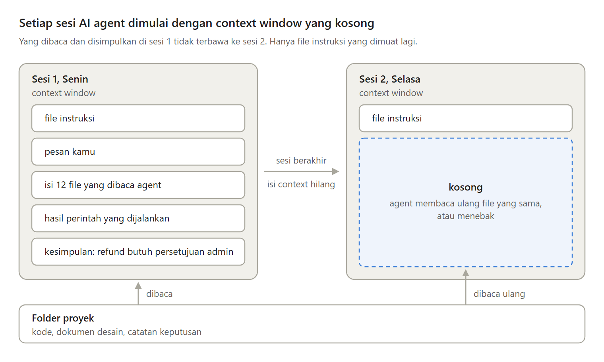
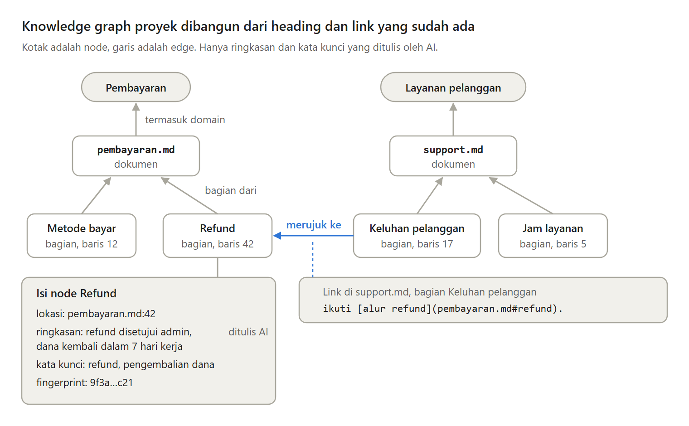
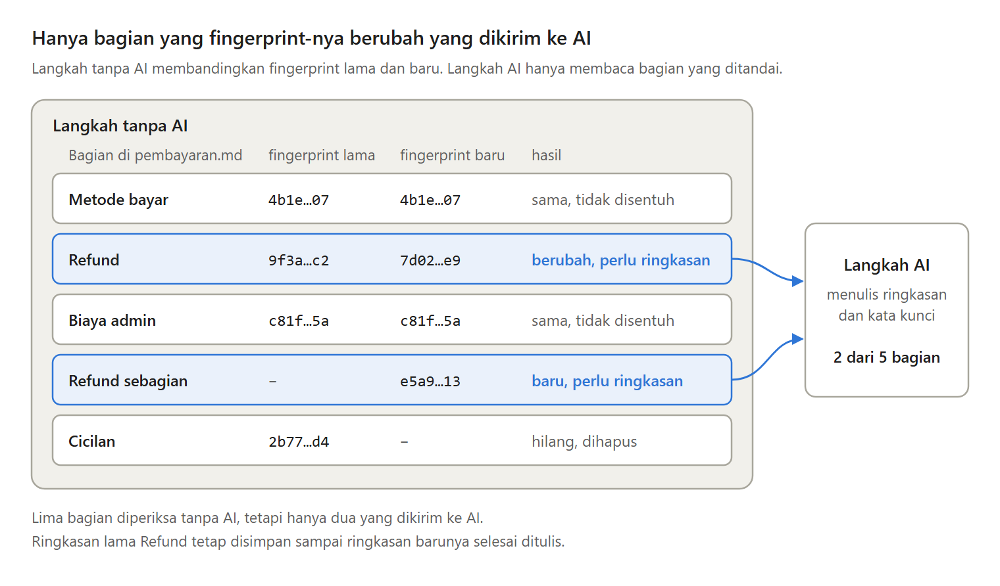
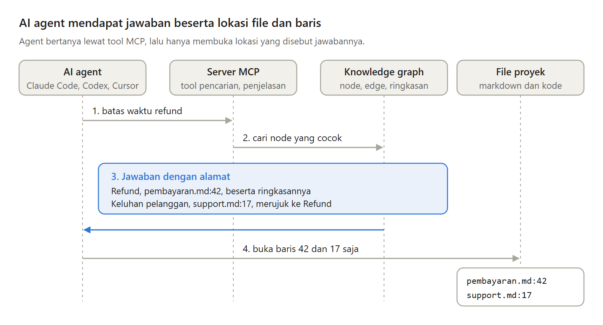

Kemarin kamu menjelaskan proyekmu ke AI agent. Hari ini, di sesi baru, ia bertanya hal yang sama lagi.

Ini bukan salah Claude Code, Codex, atau Cursor. Ini cara kerja context window. Kenapa itu terjadi, dan kapan knowledge graph membantu.

---

Semua yang diketahui agent ada di context window, yaitu teks yang bisa dibaca model saat menjawab. Setiap sesi dimulai dengan context window baru.

Memperbesarnya bukan jawaban. Makin banyak token, makin turun ketepatan model mengingat isinya, yang disebut context rot.

---

Tiga cara yang biasa dipakai, dan celahnya:

- CLAUDE.md atau AGENTS.md dimuat utuh tiap sesi, jadi harus kecil.
- grep selalu membaca file terbaru, tetapi mencari kata, bukan makna.
- RAG dengan embedding menemukan makna, tetapi memotong dokumen dari tempatnya.

---

Knowledge graph proyek membaca markdown-mu tanpa AI.

Tiap file jadi node dokumen. Tiap heading jadi node bagian, dengan nama file dan nomor barisnya. Domain mengelompokkan topik. Tiap link markdown jadi edge "merujuk ke".

---

AI hanya menulis ringkasan dan kata kunci tiap bagian. Tiap bagian punya fingerprint, angka pendek dari teksnya.

Saat sinkronisasi, yang fingerprint-nya sama tidak disentuh. Hanya yang berubah dikirim ke AI, jadi biayanya mengikuti jumlah perubahan.

---

Agent membaca graph ini lewat MCP, standar open source untuk menghubungkan aplikasi AI ke sistem lain. Claude Code, Codex, dan Cursor bisa memakai server yang sama.

Tiap jawaban membawa nama file dan nomor baris, jadi agent hanya membuka baris itu.

---

Kelemahannya, ringkasan AI ada biayanya, bisa usang atau salah, dan graph hanya sebaru sinkronisasi terakhir.

Untuk proyek kecil, grep atau satu CLAUDE.md sudah cukup. Untuk teks tanpa heading dan link, RAG dengan embedding lebih cocok.

---

Artikel lengkapnya, "Kenapa AI agent lupa proyekmu setiap sesi, dan kapan ia butuh knowledge graph?":
https://medium.com/p/ae5e424cfb0d
