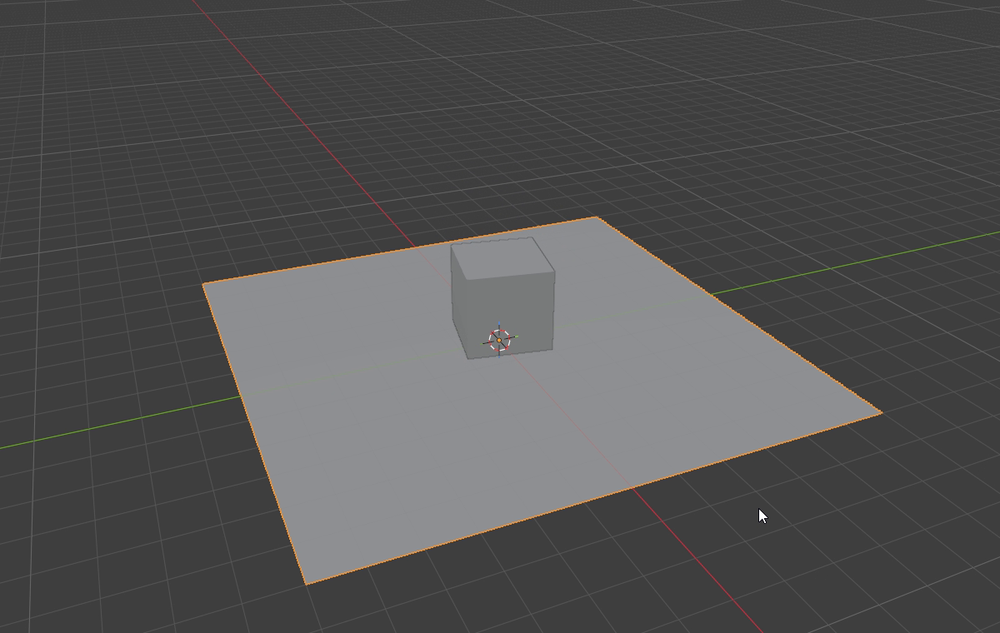
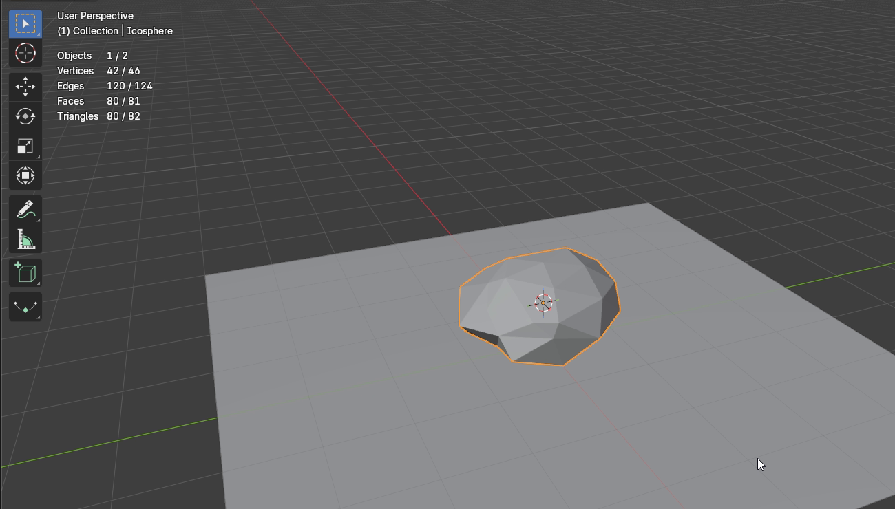
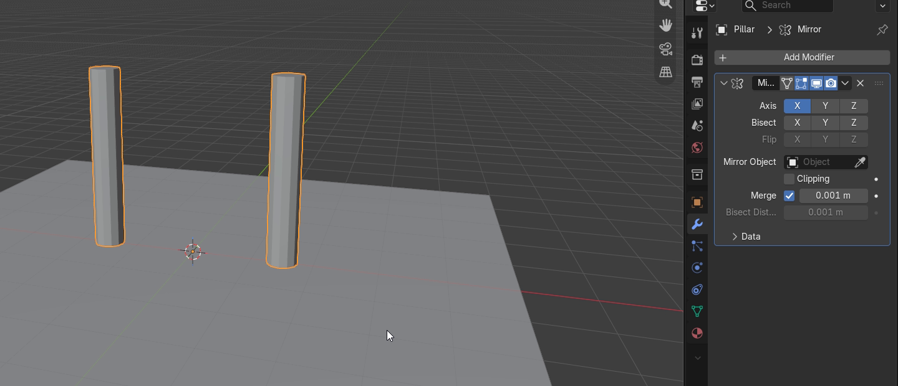

# Belajar Blender untuk aset game, dari kubus yang jatuh sampai gerbang yang simetris

*Catatan belajar pemula tentang kenapa objek di Blender tidak jatuh sendiri, apa itu collision shape, cara membuat batu low poly, dan cara kerja Mirror modifier.*

Tulisan ini adalah catatan saya setelah satu hari belajar Blender dari nol, dengan satu tujuan, yaitu membuat aset game. Aset game adalah objek 3D yang nantinya dipakai di dalam sebuah game, seperti tanah, batu, peti, atau gerbang. Semua langkah di sini saya coba di Blender 5.2 dengan pengaturan bawaan.

Urutannya sama dengan urutan saya belajar. Kita mulai dari apa yang membuat aset game berbeda, lalu origin, fisika dan collision shape, batu low poly, dan terakhir Mirror modifier untuk membuat tiang gerbang yang simetris.

## Aset game adalah "model yang harus ringan"

Aset game harus ringan karena game menggambar ulang seluruh layar puluhan kali setiap detik. Setiap model tersusun dari face, yaitu bidang-bidang kecil yang membentuk permukaannya, dan setiap face ikut dihitung setiap kali layar digambar. Model untuk film boleh punya jutaan face, tetapi aset game dibuat dengan sesedikit mungkin face, dan gaya ini disebut low poly.

Tapi bukankah komputer dan ponsel sekarang sudah kuat? Itu benar untuk satu model, tetapi satu adegan game berisi ratusan model sekaligus, dan game yang sama sering juga harus jalan di ponsel. Jadi, detail kecil dipindahkan ke tekstur, yaitu gambar yang dibungkus ke permukaan model, sementara bentuknya sendiri dibuat sederhana.

Selain ringan, ada beberapa aturan lain yang membuat model siap dipakai di game. Aturan-aturan itu adalah:

- Ukurannya nyata. Di Blender, satu unit sama dengan satu meter, jadi peti setinggi satu meter juga setinggi 1 di Blender.
- Skalanya sudah di-apply, yaitu diubah menjadi bentuk asli objek sehingga nilai Scale kembali ke 1. Caranya lewat menu Object, Apply, Scale.
- Teksturnya berupa gambar. Material yang disusun dari node, yaitu kotak-kotak pengaturan yang disambung satu sama lain di Blender, tidak terbawa begitu saja ke game. Hasilnya perlu di-bake, yaitu disimpan menjadi gambar.
- Formatnya glTF, format file 3D terbuka yang bisa diimpor langsung oleh game engine, yaitu program yang menjalankan game, seperti Godot.
- Namanya jelas. Objek bernama "Icosphere.003" tidak berarti apa-apa ketika jumlah objek sudah ratusan.

## Origin adalah "titik pegangan" sebuah objek

Setiap objek di Blender punya origin, yaitu titik kecil berwarna oranye yang biasanya ada di tengah objek. Nilai Location sebuah objek adalah posisi origin itu, bukan posisi permukaannya. Kubus bawaan Blender tingginya 2 meter dengan origin di tengah, jadi kubus itu baru berdiri tepat di atas tanah kalau Location Z-nya 1.

Blender punya dua mode untuk mengubah objek. Di Object Mode, kamu memindahkan seluruh objek beserta origin-nya. Di Edit Mode, kamu mengubah bentuknya saja dengan memindahkan titik-titiknya, sementara origin tetap di tempat.

Kenapa tidak digeser saja sampai terlihat pas? Mata mudah tertipu oleh sudut pandang, dan saat belajar, kubus saya ternyata tenggelam 12 cm ke dalam tanah tanpa terlihat. Angka di Sidebar (menu View, Sidebar) lebih bisa dipercaya, dan nanti fisika serta Mirror modifier sama-sama bergantung pada posisi origin.

## Fisika di Blender adalah "tidak ada yang otomatis"

Objek di Blender tidak punya gravitasi dan tidak saling bertabrakan sampai kamu memintanya. Dua objek bisa saling menembus, dan kubus yang melayang di udara tetap melayang ketika animasi diputar. Fisika untuk benda padat di Blender disebut rigid body.

Setiap objek yang ikut fisika diberi salah satu dari dua peran. Kedua peran itu adalah:

- Active, untuk objek yang digerakkan oleh gravitasi dan tabrakan, seperti kubus yang jatuh.
- Passive, untuk objek yang padat tetapi tidak pernah bergerak, seperti tanah atau dinding.

Untuk membuat kubus jatuh ke tanah, langkahnya pendek. Caranya adalah:

1. Klik kubus, buka tab Physics di panel Properties di kanan bawah, lalu klik Rigid Body. Type-nya langsung Active.
2. Klik tanah, klik Rigid Body juga, lalu ubah Type menjadi Passive.
3. Kembali ke frame pertama, yaitu gambar pertama dari animasi, lalu tekan Space untuk memutar animasi.

*Kubus yang sudah diberi Rigid Body dengan Type Active.*

Saat Rigid Body pertama ditambahkan, Blender juga membuat Rigid Body World di tab Scene. Di sana ada gravitasi bawaan sebesar 9,81 m/s² ke bawah, sama seperti di Bumi. Dalam percobaan saya, kubus yang dilepas dari ketinggian 4,5 meter jatuh, sedikit berguling, lalu diam rata di tanah dalam waktu sekitar satu detik.

*Kubus Active setelah jatuh ke tanah Passive.*

Masalahnya, fisika dan keyframe saling berebut. Keyframe adalah posisi objek yang kamu simpan pada frame tertentu, dan objek Active mengabaikannya karena posisinya ditentukan oleh fisika. Untuk penghalang yang kamu gerakkan sendiri dengan keyframe, seperti pintu atau platform, pakai Passive lalu centang Animated di bagian Settings.

## Objek yang butuh rigid body adalah "yang perlu disentuh"

Kalau rigid body membuat objek bisa jatuh dan bertabrakan, kenapa tidak diberikan ke semua objek saja? Karena setiap objek rigid body ikut dihitung di setiap frame, sehingga simulasi makin berat tanpa hasil yang terlihat. Rumput, gunung di kejauhan, dan awan tidak pernah disentuh apa pun, jadi tidak perlu ikut.

Ada dua pertanyaan yang cukup untuk memutuskan setiap objek. Keduanya adalah:

- Apakah ada benda yang perlu menabrak objek ini atau mendarat di atasnya, atau apakah objek ini perlu jatuh? Kalau tidak, objek itu tidak butuh rigid body.
- Kalau perlu, apakah objek ini harus bergerak karena fisika? Kalau ya, pilih Active, dan kalau tidak, pilih Passive.

Kamera dan lampu tidak bisa diberi rigid body sama sekali, karena keduanya bukan benda padat.

## Collision shape adalah "bentuk yang dilihat fisika"

Fisika tidak menghitung tabrakan dengan model yang kamu lihat. Menghitung tabrakan setiap face dengan setiap face lain di setiap frame terlalu berat, jadi fisika memakai bentuk pengganti yang lebih sederhana dan tidak terlihat. Bentuk pengganti itu disebut collision shape, dan kamu memilihnya di bagian Collisions, Shape.

Mesh adalah kumpulan titik, garis, dan face yang membentuk sebuah objek. Blender menyediakan delapan pilihan Shape, yang terbagi menjadi dua kelompok. Keduanya adalah:

- Bentuk dasar, yaitu Box, Sphere, Capsule, Cylinder, dan Cone. Hitungannya paling ringan, tetapi bentuknya belum tentu sama dengan objeknya.
- Bentuk dari mesh, yaitu Convex Hull, Mesh, dan Compound Parent. Bentuknya mengikuti objek dengan lebih persis.

Convex Hull membungkus objek seperti plastik yang ditarik rapat. Bentuknya convex, yaitu tidak punya lekukan atau lubang, jadi setiap lekukan objek ikut tertutup. Untuk batu hal itu tidak masalah, tetapi untuk cangkir, bola tidak akan pernah bisa masuk ke dalamnya.

*Bentuk yang sama, tiga collision shape yang berbeda.*

Bukankah Mesh selalu paling persis? Memang, hanya saja manual Blender sendiri menyebut Mesh "rather slow and unstable", yaitu cukup lambat dan tidak stabil. Sebaliknya, manual yang sama menyebut Convex Hull punya performa dan stabilitas yang baik, dan paling cocok untuk objek dengan sedikit titik.

Jadi, pilih bentuk paling sederhana yang masih cukup mirip dengan objeknya. Contohnya adalah:

- Box untuk kubus, peti, dinding, dan tanah yang datar. Manual Blender menyebut Box juga cocok untuk bidang seperti tanah.
- Convex Hull untuk batu dan bentuk tidak beraturan lain yang lekukannya tidak penting.
- Mesh hanya untuk bentuk yang lekukannya benar-benar penting, seperti cangkir atau tanah berbukit.

Ada satu hal kecil yang saya temukan saat mencoba. Ketika Rigid Body ditambahkan lewat tombol di tab Physics, Blender 5.2 langsung memilih Convex Hull, termasuk untuk kubus dan tanah datar. Jadi, Shape perlu diganti sendiri kalau kamu ingin Box.

## Fisika di game adalah "tugas game engine, bukan Blender"

Simulasi rigid body di Blender tidak ikut terbawa ketika model diekspor ke game. Game engine seperti Godot atau Unity menghitung fisikanya sendiri saat game berjalan. Yang tetap harus kamu lakukan adalah memberi tahu game engine objek mana yang padat dan bagaimana bentuk tabrakannya.

Idenya sama, hanya namanya yang berbeda. Di Godot 4, padanannya adalah:

- StaticBody3D untuk objek padat yang tidak digerakkan oleh fisika, sama seperti Passive.
- RigidBody3D untuk objek yang digerakkan oleh fisika, sama seperti Active.
- CharacterBody3D untuk karakter yang digerakkan oleh kode, misalnya oleh tombol keyboard. Ia bisa bertabrakan, tetapi tidak didorong oleh fisika.
- CollisionShape3D untuk collision shape-nya.

Godot juga bisa membuat sebagian dari ini secara otomatis saat mengimpor, dari akhiran nama objek yang kamu beri di Blender. Contohnya adalah:

- Akhiran `-col`, seperti pada objek bernama Tanah-col, menambahkan collision statis dengan bentuk yang sama seperti mesh-nya.
- Akhiran `-convcol` membuat bentuk convex, bukan bentuk yang mengikuti setiap lekukan.
- Akhiran `-colonly` membuang mesh-nya dan hanya menyisakan StaticBody3D, sehingga hasilnya penghalang yang tidak terlihat.
- Akhiran `-rigid` membuat objek diimpor sebagai RigidBody3D.

Lalu untuk apa belajar fisika di Blender kalau tidak dipakai di game? Karena konsepnya sama, dan Blender adalah tempat paling mudah untuk melihatnya bekerja tanpa menulis kode. Fisika Blender juga tetap berguna untuk animasi yang di-render, yaitu diubah menjadi video, di Blender sendiri.

## Batu low poly adalah "Ico Sphere yang diacak"

Batu muncul di hampir setiap game, dan bentuk dasarnya bisa dibuat dalam beberapa langkah. Titik awalnya adalah Ico Sphere, yaitu bola yang tersusun dari segitiga dengan ukuran hampir sama. Berbeda dengan UV Sphere yang garis-garisnya berkumpul di kutub atas dan bawah, Ico Sphere tidak punya titik yang menumpuk, sehingga hasil acakannya merata.

Langkahnya hanya lima. Caranya adalah:

1. Tambahkan Ico Sphere lewat Shift+A, Mesh, Ico Sphere. Dengan pengaturan bawaan, bola ini punya 80 face segitiga.
2. Tekan Tab untuk masuk Edit Mode. Semua titik bola yang baru dibuat langsung terpilih.
3. Buka menu Mesh, Transform, Randomize. Setiap titik digeser ke arah acak sejauh Amount di panel kiri bawah, yang saya isi `0.25`.
4. Tekan S, lalu Z, ketik `0.6`, dan tekan Enter. Batu jadi lebih pipih, karena batu biasanya lebih lebar daripada tingginya.
5. Tekan Tab lagi untuk kembali ke Object Mode.

Jumlah face bisa kamu lihat sendiri lewat menu Overlays, Statistics di viewport, yaitu area 3D tempat objek ditampilkan. Batu ini tetap 80 segitiga, karena Randomize dan Scale hanya memindahkan titik tanpa menambahnya.

*Batu dari Ico Sphere yang diacak dan dipipihkan, tetap 80 segitiga.*

Kenapa tidak memahat batu dengan Sculpt Mode, yaitu mode untuk membentuk model seperti tanah liat, atau mengunduh model batu yang sudah jadi? Sculpt menghasilkan detail yang indah, tetapi jumlah face-nya cepat membengkak dan harus dikurangi lagi sebelum masuk game. Model unduhan juga perlu dicek dulu jumlah face, ukuran, dan lisensinya.

Jadi, untuk batu yang banyak dan tidak dilihat dari dekat, Ico Sphere yang diacak sudah cukup. Kelemahannya, batu-batu yang dibuat dengan angka yang sama akan terlihat kembar. Ubah Random Seed di panel Randomize untuk setiap batu supaya bentuknya berbeda.

## Mirror modifier adalah "cermin di origin"

Torii, yaitu gerbang kuil Jepang, simetris kiri dan kanan, dan Blender punya Mirror modifier untuk objek seperti ini. Modifier adalah efek yang ditumpuk di atas objek dan mengubah tampilannya tanpa mengubah bentuk aslinya. Karena itu, modifier bisa dimatikan, diubah, atau dihapus kapan saja.

Mirror modifier menampilkan salinan terbalik dari objek, dan cerminnya selalu berada di origin. Ini memberi satu kejutan saat pertama kali dipakai. Kalau origin ada di tengah tiang, salinannya jatuh tepat di atas tiang asli dan tidak ada yang terlihat berubah.

Untuk mendapatkan dua tiang dari satu tiang, bentuknya perlu digeser menjauhi origin. Caranya adalah:

1. Klik tiang, buka tab Modifier di panel Properties, lalu pilih Add Modifier, Generate, Mirror.
2. Tekan Tab untuk masuk Edit Mode, lalu tekan A untuk memilih semua titik.
3. Tekan G, lalu X, ketik `1.5`, dan tekan Enter. Bentuk tiang bergeser 1,5 meter ke kanan, sementara origin tetap di tengah.
4. Tekan Tab lagi untuk kembali ke Object Mode. Tiang kedua muncul 1,5 meter di sebelah kiri.

*Salinan dari Mirror selalu berjarak sama dari origin, di sisi yang berlawanan.*

Jarak antar tiang selalu dua kali jarak bentuk ke origin. Kalau jaraknya mau diubah, geser bentuknya di Edit Mode, bukan objeknya di Object Mode, karena di Object Mode origin ikut bergeser dan cerminnya ikut pindah. Kalau yang ingin kamu pindah justru garis cerminnya, letakkan 3D cursor, yaitu lingkaran merah putih yang menandai tempat objek baru muncul, di tempat baru, lalu pakai menu Object, Set Origin, Origin to 3D Cursor.

*Satu tiang yang dimodelkan, satu tiang dari Mirror modifier.*

Ada dua pilihan lain di panel Mirror yang penting untuk bagian yang melintasi garis tengah, seperti balok atas gerbang. Keduanya adalah:

- Clipping mencegah titik melewati garis cermin, sehingga dua sisi bertemu tepat di tengah tanpa saling tumpang tindih.
- Merge menyatukan titik-titik yang bertemu di garis cermin menjadi satu bagian. Pilihan ini sudah menyala secara bawaan.

Kenapa tidak menduplikat tiangnya saja, lalu menggesernya? Untuk satu objek yang tidak akan diubah lagi, duplikat memang cukup. Masalahnya muncul ketika bentuknya diubah, karena setiap perubahan harus dikerjakan dua kali, dan lama-lama kedua sisi tidak lagi sama persis.

Jadi, Mirror modifier cocok untuk objek simetris yang masih akan diubah, dan kurang cocok untuk objek yang memang tidak simetris. Kelemahannya, kamu harus selalu sadar di mana origin berada. Saat mengekspor ke glTF, centang juga Apply Modifiers, karena pilihan ini mati secara bawaan dan tanpa itu salinan dari Mirror tidak ikut terbawa.

## Kelemahan cara membuat aset game di tulisan ini

Semua yang dibahas di sini sengaja dibuat sederhana supaya bisa dicoba dalam satu hari. Tetapi masih ada empat kelemahan yang perlu kamu tahu. Keempatnya adalah:

- Belum ada tekstur. Batu dan tiang di sini masih abu-abu, dan langkah UV unwrap, yaitu membuka permukaan model menjadi bidang datar supaya gambar bisa ditempel, belum dibahas.
- Fisika Blender hanya latihan untuk konsepnya. Pengaturan rigid body tidak ikut ke game, jadi harus disusun ulang di game engine.
- Batu dari Ico Sphere masih kasar kalau dilihat dari dekat. Untuk batu utama yang sering dilihat pemain, bentuk ini perlu detail tambahan atau tekstur yang baik.
- Langkah dan posisi tombol di sini diambil dari Blender 5.2 dengan pengaturan bawaan, sehingga versi lain bisa sedikit berbeda.

Langkah berikutnya adalah memberi batu dan gerbang ini tekstur, lalu mengekspornya ke game engine dan memasang collision di sana.
