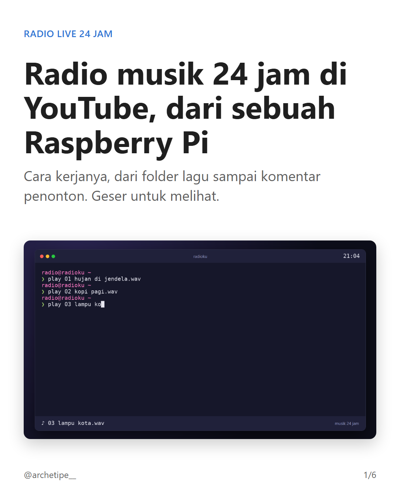
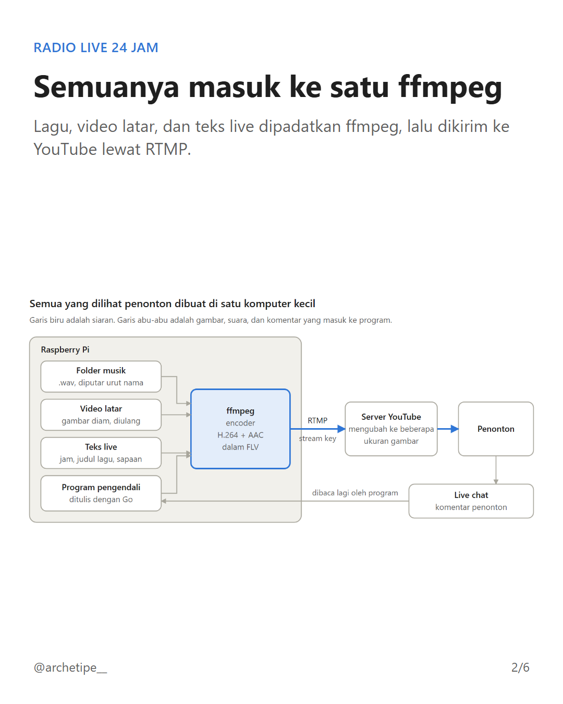
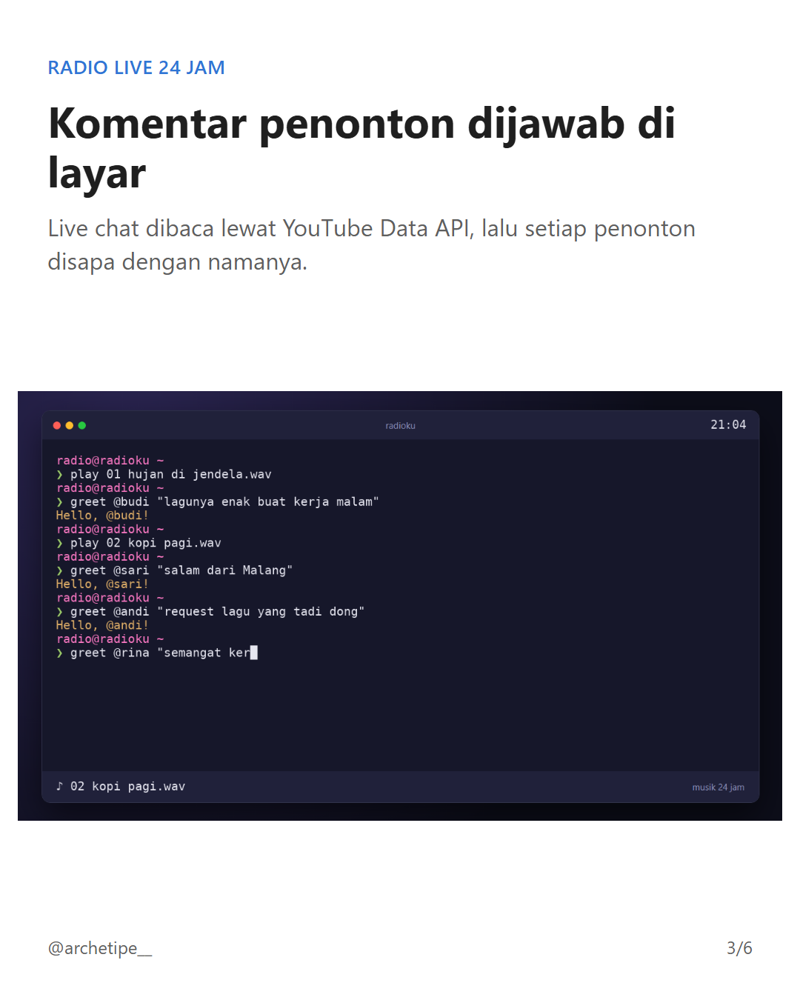
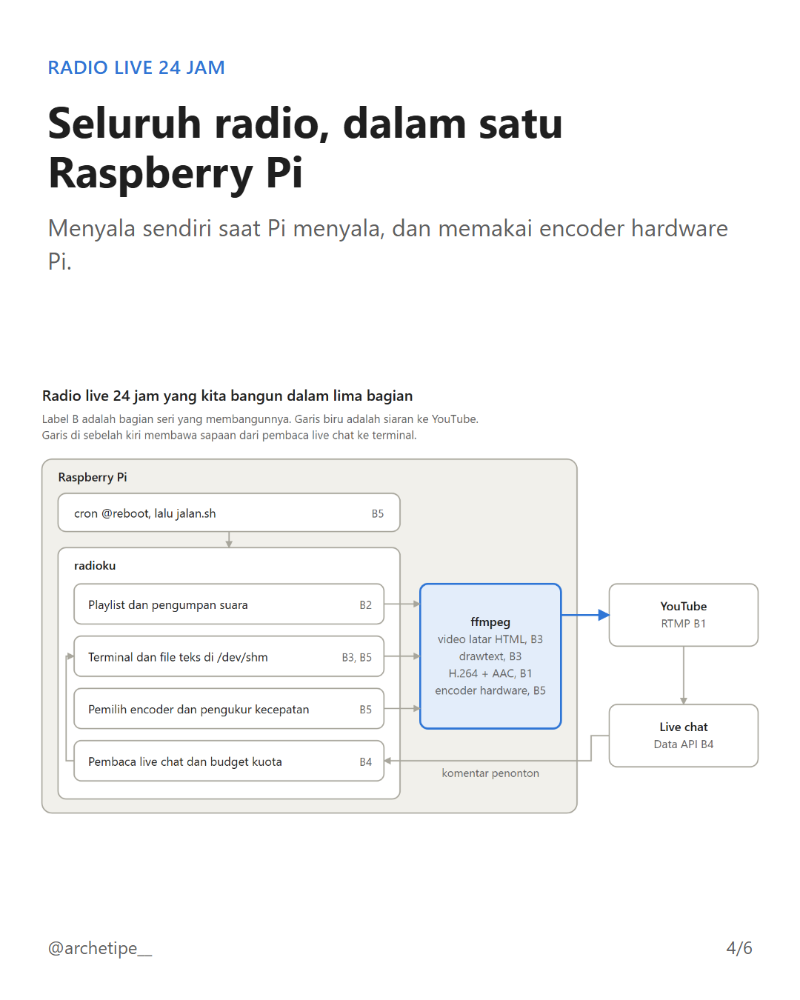
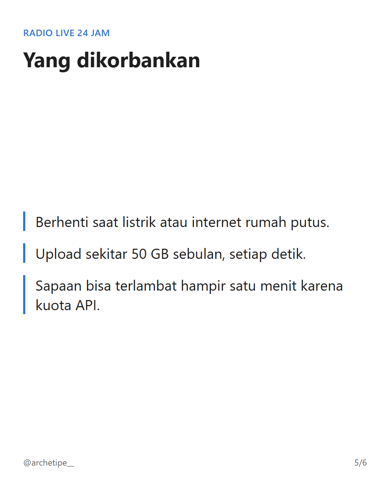
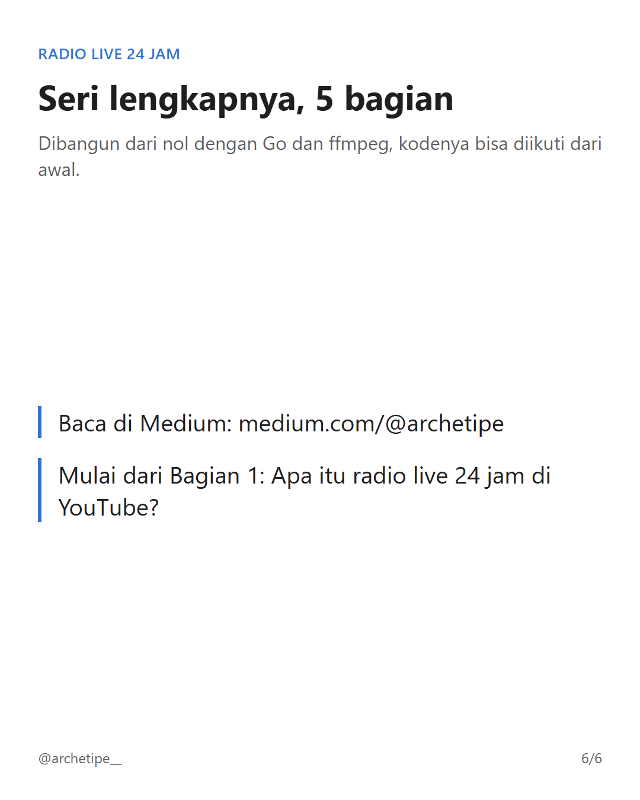

#raspberrypi #youtube #livestreaming #ffmpeg #golang #programming #itindonesia

Channel musik santai 24 jam di YouTube ternyata bisa berjalan di sebuah Raspberry Pi, komputer kecil seukuran kartu nama.

Di carousel ini: bagaimana lagu, video latar, dan teks live masuk ke satu ffmpeg, bagaimana komentar penonton dijawab di layar, dan apa yang dikorbankan desain seperti ini.

Saya membangunnya dari nol dengan Go dan ffmpeg dalam seri 5 bagian. Seri lengkapnya ada di Medium: medium.com/@archetipe

