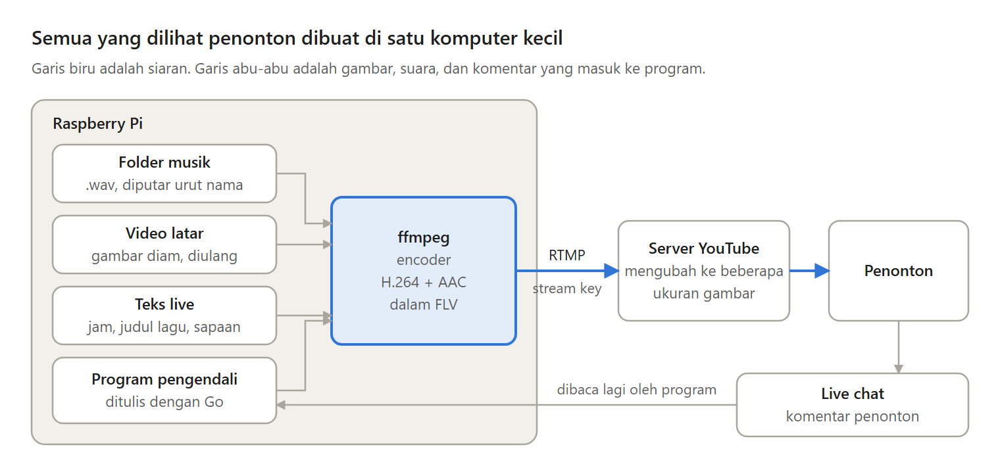
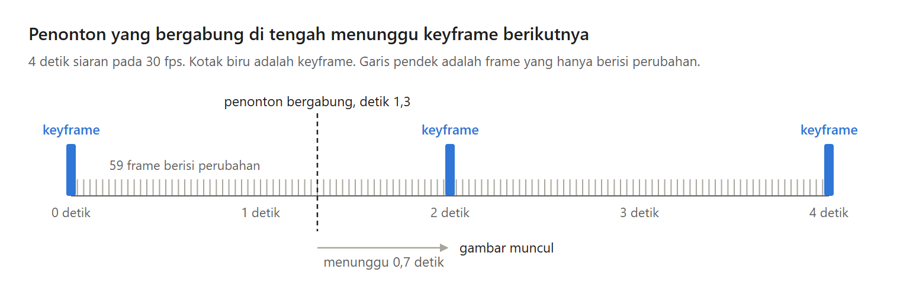

Radio live 24 jam adalah siaran yang tidak pernah selesai. Isinya musik yang terus berganti, dengan gambar yang hampir diam. Penonton datang kapan saja, mendengarkan sebentar atau berjam-jam, lalu pergi, dan siarannya tetap berjalan.

Di Bagian 1 seri Membuat Radio Live 24 Jam, kita membedah cara kerjanya, sampai siaran pertama dari satu perintah ffmpeg.

---

Kenapa live, dan bukan video musik satu jam biasa?

Siaran live punya live chat, yaitu kolom komentar di samping siaran. Lagu baru bisa ditambahkan tanpa upload ulang. Dan penonton yang kembali besok menemukan radio yang sama, masih berjalan.

Yang dikorbankan: sebuah komputer harus menyala terus, upload berjalan setiap detik, dan siaran yang lebih panjang dari 12 jam mungkin tidak tersimpan sebagai video.

---

Radio live 24 jam terdiri dari enam bagian: folder musik, video latar yang diulang, teks live di atasnya, encoder yang memadatkan gambar dan suara, server YouTube yang mengirim siaran ke penonton, dan live chat.

Empat bagian pertama berjalan di satu komputer kecil, diatur oleh satu program yang kita tulis sendiri.

---

Satu detik siaran berisi 30 frame dan 44.100 sampel suara untuk setiap telinga.

Program membuka lagu menjadi suara mentah, yang disebut PCM. Encoder menggambar teks live di atas frame video latar, memadatkan gambar dengan H.264 dan suara dengan AAC, lalu mengirimnya ke YouTube lewat RTMP. Dengan pengaturan latency paling rendah di YouTube, kebanyakan penonton melihat detik itu kurang dari 5 detik kemudian.

---

H.264 tidak menyimpan setiap frame secara utuh. Kebanyakan frame hanya berisi bagian yang berubah, jadi gambar yang hampir diam butuh sedikit sekali data.

Frame yang disimpan utuh disebut keyframe. Penonton yang baru bergabung harus menunggu keyframe berikutnya sebelum gambarnya muncul, karena itu YouTube menganjurkan satu keyframe setiap 2 detik.

---

YouTube menganjurkan bitrate yang tetap, minimal 3 Mbit/s untuk gambar 720p dengan 30 frame per detik. Di percobaan saya, video latar yang diam hanya butuh sekitar 150 kbit/s, sudah termasuk suara. Dipaksa tetap 3000 kbit/s, encoder mengisi sisanya dengan data kosong.

Sebulan penuh, bedanya sekitar 990 GB upload dibanding 49 GB. Jadi seri ini memakai 3000 kbit/s sebagai batas atas. Kelemahannya, YouTube Studio bisa memperingatkan bitrate yang terlalu rendah.

---

Radionya berjalan di Raspberry Pi 3 atau 4: kecil, hemat listrik, dan punya encoder H.264 hardware, walaupun CPU-nya lemah. PC di rumah harus menyala terus, VPS dibayar setiap bulan tanpa encoder hardware, dan layanan siaran berbayar membatasi fiturnya.

Encoder-nya ffmpeg, bukan OBS. OBS cocok untuk siaran dari PC sambil duduk di depannya. ffmpeg bisa diatur oleh program lain, tanpa layar, berbulan-bulan.

---

Satu perintah ffmpeg sudah bisa bersiaran, tetapi hanya satu lagu, tidak ada yang menyalakannya lagi saat internet putus, dan layarnya diam. Bagian berikutnya menjawabnya dengan program Go.

Ini Bagian 1 dari seri Membuat Radio Live 24 Jam.

Artikel lengkapnya ada di sini:
https://medium.com/@archetipe/seri-membuat-radio-live-24-jam-bagian-1-apa-itu-radio-live-24-jam-di-youtube-82e7a0195ef2
