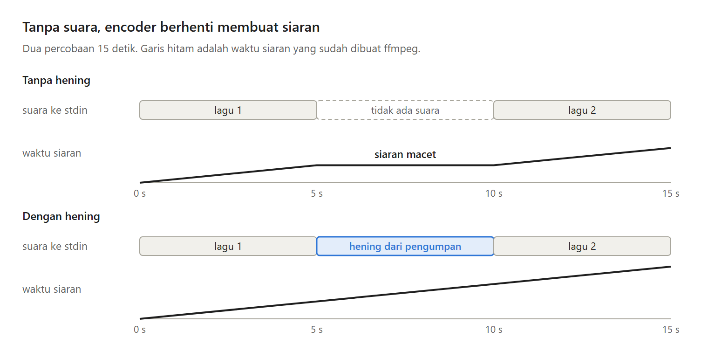
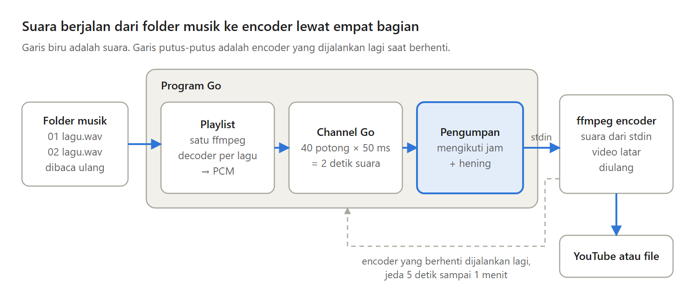

Radio live 24 jam tidak boleh berhenti di antara dua lagu. Kalau setiap lagu disiarkan oleh ffmpeg-nya sendiri, setiap pergantian lagu memutus koneksi ke YouTube.

Di Bagian 2 seri Membuat Radio Live 24 Jam, satu ffmpeg terus bersiaran, sementara program Go membuka lagu demi lagu dan menulis suaranya tepat waktu.

---

Kenapa tidak memakai playlist bawaan ffmpeg?

ffmpeg punya concat, yang membaca beberapa file berurutan dari sebuah daftar. Masalahnya, daftar itu dibaca sekali saat ffmpeg mulai, dan semua file harus punya format yang sama.

Jadi encoder dijalankan sekali, dan suaranya datang dari program kita lewat stdin, yaitu input standar sebuah program.

---

Saya mencoba apa yang terjadi kalau suara berhenti datang. Selama suara berhenti, waktu siaran di ffmpeg ikut berhenti. Encoder tidak membuat gambar tanpa suara, dan bagi YouTube itu terlihat seperti siaran yang macet.

Jadi suara tidak boleh berhenti. Di antara dua lagu, program menulis hening, yaitu suara mentah yang semua angkanya nol.

---

Suara juga harus ditulis mengikuti jam. Program baru tahu kapan hening dibutuhkan kalau ia tahu berapa banyak suara yang seharusnya sudah ditulis sekarang.

Setiap detik, program menulis tepat satu detik suara, setengah detik lebih awal, supaya encoder tidak pernah menunggu. Membuka lagu berikutnya butuh waktu, dan jam inilah yang tahu persis berapa banyak hening untuk menutup celah itu.

---

Suara mengalir lewat empat bagian:

- Playlist membaca folder musik sebelum setiap lagu, jadi lagu baru ikut diputar tanpa restart.
- Channel Go, saluran milik Go, menampung 2 detik suara, supaya lagu berikutnya sudah dibuka saat lagu sekarang masih terdengar.
- Pengumpan menulis suara ke encoder mengikuti jam, dan hening saat channel kosong.
- Encoder, ffmpeg yang terus bersiaran, dijalankan lagi saat berhenti, dengan jeda yang makin panjang.

---

Dua opsi encoder ditemukan lewat percobaan.

ffmpeg biasanya menganalisis beberapa detik pertama input sebelum mulai. Suara dari stdin datang mengikuti jam, jadi analisis itu ikut menunggu, dan siaran baru mulai sekitar 10 detik kemudian. Dengan analisis sekecil mungkin, siaran mulai sekitar 1,6 detik.

Opsi -shortest punya buffer bawaan 10 detik, yang menahan penulisan suara sampai 11 detik. Dengan buffer 0,5 detik, siaran berjalan tepat waktu.

---

Encoder dihentikan dengan menutup stdin, cara yang berlaku di Linux maupun Windows. Kalau program mati mendadak, OS menutup stdin itu, dan ffmpeg ikut berhenti, bukan terus mengirim video tanpa suara. Saat encoder dijalankan lagi, lagu berlanjut tepat dari tempatnya.

Kelemahannya: layar masih diam, encoder yang dijalankan lagi tetap memutus siaran beberapa detik, dan lagu berganti tanpa crossfade.

---

Ini Bagian 2 dari seri Membuat Radio Live 24 Jam, lengkap dengan kode Go dan test-nya.

Artikel lengkapnya ada di sini:
https://medium.com/@archetipe/seri-membuat-radio-live-24-jam-bagian-2-memutar-musik-tanpa-henti-dengan-go-dan-ffmpeg-a168392511dd
