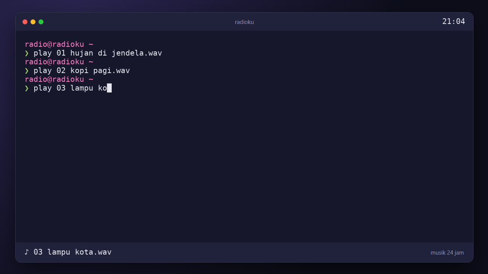
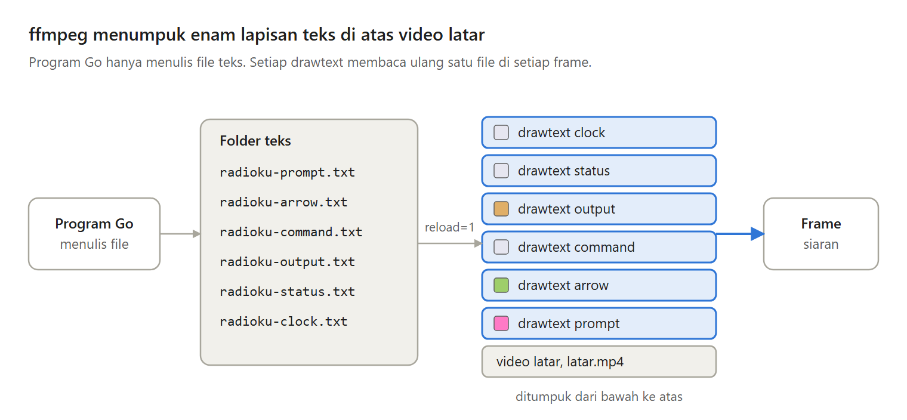
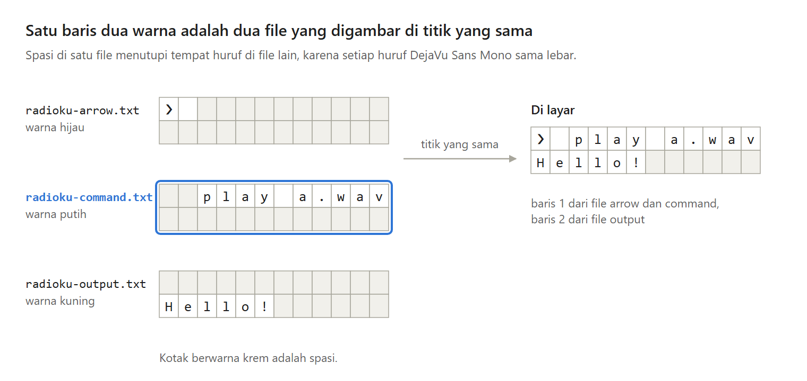

Radio yang hanya memutar musik punya satu masalah: layarnya diam. Penonton tidak tahu lagu apa yang sedang diputar.

Di Bagian 3 seri Membuat Radio Live 24 Jam, layarnya hidup: jam, judul lagu, dan sebuah terminal yang mengetik sendiri setiap kali lagu berganti, semuanya digambar ffmpeg di atas video latar.

---

Ada tiga cara memasukkan teks yang berubah ke siaran:

- Video latar baru untuk setiap lagu. Siaran terputus setiap kali lagu berganti.
- Aplikasi penyusun layar seperti OBS, yang butuh layar dan tampilan grafis.
- Filter drawtext dari ffmpeg, yang menggambar tulisan di setiap frame dari sebuah file. Program cukup mengganti isi file.

Seri ini memilih drawtext. Kelemahannya, setiap drawtext menggambar tulisannya 30 kali per detik, berubah atau tidak, dan itu memakan CPU.

---

Layarnya disusun dari lapisan yang ditumpuk ffmpeg di setiap frame: video latar di paling bawah, empat lapisan terminal untuk empat warna, satu lapisan judul lagu, dan satu lapisan jam.

Program Go hanya menulis file teks, dan ffmpeg membacanya ulang di setiap frame. Keduanya tidak pernah saling memanggil.

---

Video latar dibuat sekali dari sebuah halaman HTML. Ruang kosong untuk teks live harus berada di koordinat yang sama persis dengan angka di program, dan HTML memberi koordinat itu dalam piksel. Browser headless, yaitu browser yang berjalan tanpa jendela, memotretnya.

Kenapa tidak menggambar jendela itu dengan filter ffmpeg? Setiap filter berjalan di setiap frame, sedangkan gambar yang diam cukup digambar sekali.

---

Setiap drawtext hanya punya satu warna. Jadi satu baris terminal yang berwarna-warni dipecah menjadi beberapa file, satu file untuk setiap warna.

Di setiap file, huruf berwarna lain diganti spasi, dan semua file digambar dari titik yang sama. Karena setiap huruf di font monospace sama lebar, spasi di satu file tepat menutupi tempat huruf di file lain.

---

File berubah kapan saja, sedangkan ffmpeg membacanya 30 kali per detik. Supaya tidak terbaca setengah jadi, isi baru ditulis ke file sementara, lalu diganti namanya menjadi file aslinya. Di Linux, penggantian nama ini terjadi dalam satu langkah.

Windows tidak bekerja seperti itu. Di percobaan saya, ffmpeg di Windows gagal membuka file yang sedang diganti namanya, dan siaran berhenti. Jadi layar ini dibuat untuk Linux.

---

Terminalnya meniru orang yang mengetik, 25 huruf per detik, lalu jeda sebentar seperti menekan Enter.

Kelemahannya: judul lagu muncul sekitar 2 detik lebih awal, karena lagu dibuka sebelum terdengar. Huruf Cina dan Jepang selebar dua huruf biasa, jadi kolomnya bergeser. Dan layarnya belum menjawab penonton di live chat.

---

Ini Bagian 3 dari seri Membuat Radio Live 24 Jam, lengkap dengan kode Go dan test-nya.

Artikel lengkapnya ada di sini:
https://medium.com/@archetipe/seri-membuat-radio-live-24-jam-bagian-3-menulis-teks-live-di-atas-video-8b573689e3d0
