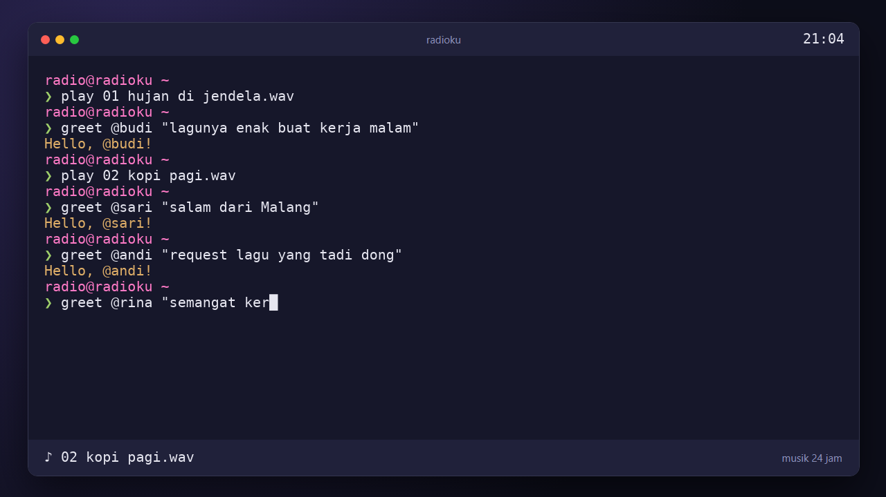
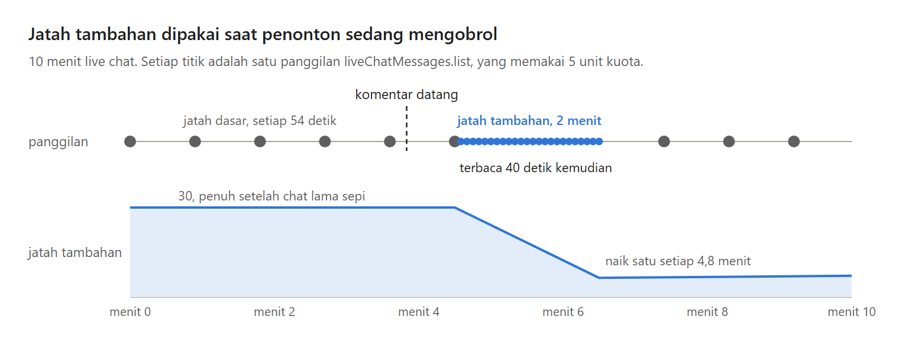
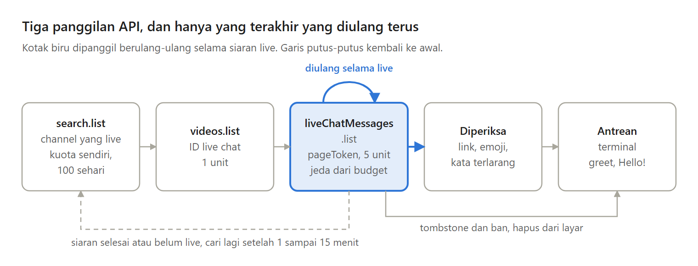

Radio live 24 jam biasanya diputar sambil bekerja, dan penontonnya jarang menulis komentar. Bagaimana kalau radionya menjawab?

Di Bagian 4 seri Membuat Radio Live 24 Jam, program Go membaca live chat, lalu terminal di layar mengetik greet @nama dan menjawab Hello, @nama!

---

Sapaan di layar memberi alasan untuk berkomentar. Penonton melihat namanya diketik, dan tahu bahwa siaran ini benar-benar live.

Tapi sapaan hanya terasa kalau datangnya cepat. Jadi latency siaran di YouTube Studio diatur ke Ultra-low, yaitu jeda kurang dari 5 detik untuk kebanyakan penonton. Kelemahannya, YouTube menyebut penonton lebih mungkin mengalami buffering.

---

Ada dua cara membaca live chat dari luar YouTube:

- YouTube Data API, cara resmi dengan dokumentasi. Setiap panggilan memakai kuota, dan kuota bawaannya 10.000 unit sehari.
- Meniru jendela chat di youtube.com. Tanpa kuota dan secepat browser, tetapi formatnya tidak resmi, dan Persyaratan Layanan YouTube melarang akses otomatis tanpa izin tertulis.

Seri ini memakai cara resmi. Yang dikorbankan adalah kecepatan.

---

Satu kali membaca live chat memakai 5 unit. Dengan 10.000 unit, program hanya boleh membaca 2.000 kali sehari, atau sekali setiap 43,2 detik kalau dibagi rata.

Masalahnya, live chat radio kebanyakan sepi, lalu tiba-tiba ramai. Jadi kuota dibagi dua. Jatah dasar 1.600 panggilan, satu setiap 54 detik. Jatah tambahan 300 panggilan, untuk membaca secepat yang diminta YouTube selama 2 menit setelah ada komentar baru.

---

Bukankah 54 detik terlalu lama untuk sebuah sapaan?

Untuk percakapan, memang. Komentar pertama setelah chat sepi bisa menunggu selama itu. Komentar sesudahnya terbaca jauh lebih cepat, karena jatah tambahan sudah dipakai.

Test dengan jam palsu mensimulasikan satu hari penuh. Chat yang sepi memakai tepat 1.600 panggilan, dan chat yang terus ramai 1.898 panggilan, masih di bawah kuota.

---

Live chat sebuah siaran punya ID sendiri, dan pembaca chat mencarinya dengan tiga panggilan. search.list mencari siaran yang sedang live di channel, videos.list mencari ID live chat-nya, lalu liveChatMessages.list dibaca berulang-ulang.

Komentar di jawaban pertama dilewati, karena menyapa orang yang sudah pergi hanya membuat layar ramai.

---

Semua yang tampil di layar adalah wajah channel-mu, 24 jam sehari. Jadi setiap komentar melewati lima aturan.

Komentar yang dihapus moderator ikut hilang, bahkan saat sedang diketik. Penulis yang diblokir hilang seluruhnya. Kata terlarang tidak pernah diketik. Link dibuang, karena siaran 24 jam adalah papan iklan gratis bagi spammer. Emoji juga dibuang, karena font monospace tidak punya gambarnya.

---

Kelemahannya, kode ini baru diuji dengan YouTube Data API palsu, belum dengan siaran sungguhan. Antrean membuang komentar tertua saat lebih dari 10 komentar menunggu. Dan semuanya masih berjalan di PC.

Ini Bagian 4 dari seri Membuat Radio Live 24 Jam, lengkap dengan kode Go dan test-nya.

Artikel lengkapnya ada di sini:
https://medium.com/@archetipe/seri-membuat-radio-live-24-jam-bagian-4-menyapa-penonton-dari-live-chat-f023bc5cbb6d
