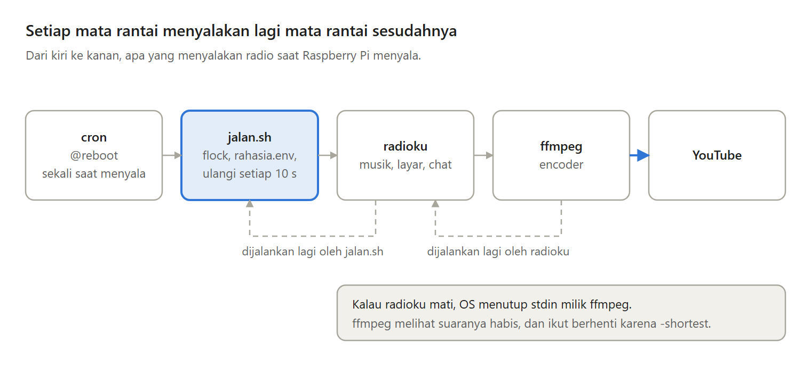
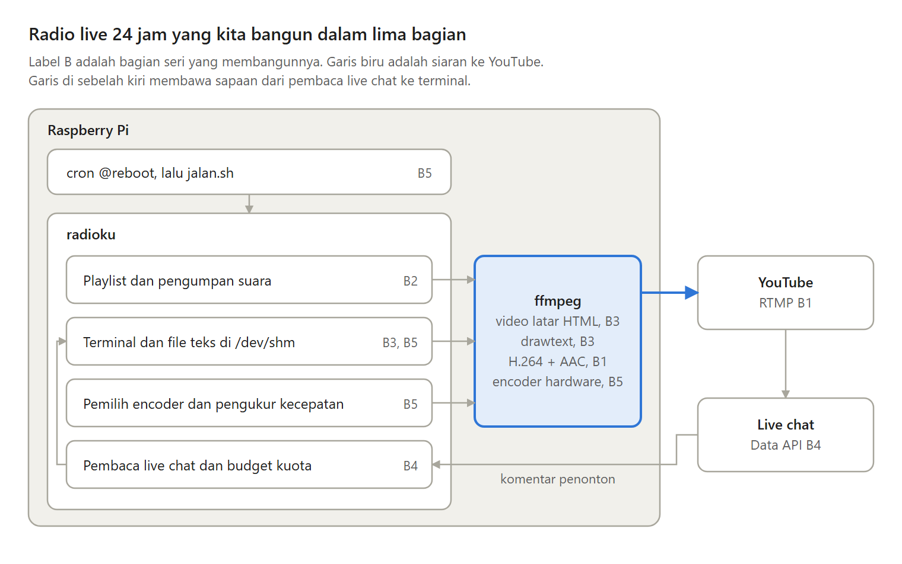

Radio live 24 jam yang sesungguhnya tidak berjalan di PC. Ia berjalan berbulan-bulan di komputer kecil, tanpa diawasi.

Di Bagian 5, bagian terakhir seri Membuat Radio Live 24 Jam, radio pindah ke Raspberry Pi. Kita memilih encoder dengan mencobanya, mengukur apakah Pi tertinggal dari waktu siaran, lalu membuat radio menyala sendiri.

---

Setiap detik, Pi membuka 30 frame video latar, menggambar enam lapisan teks di atasnya, dan memadatkan gambar dan suara. Yang terberat adalah H.264, dan Raspberry Pi 3 dan 4 punya encoder H.264 hardware untuk itu.

Tapi Pi 5 tidak punya, dan PC juga tidak. Daftar model harus diperbarui untuk setiap model baru, jadi program mencoba setiap encoder dengan satu detik video percobaan, dan memakai yang pertama berhasil.

---

Siaran harus dibuat secepat waktu berjalan. Pi yang hanya sanggup membuat 0,9 detik siaran dalam satu detik membuat siaran makin tertinggal, dan penonton melihat buffering.

ffmpeg memang melaporkan speed, tetapi itu rata-rata sejak mulai. Setelah seminggu tepat waktu, perlambatan hampir tidak menggesernya. Jadi program menghitung kecepatan sendiri dari dua laporan yang berjarak 30 detik.

---

Di Raspberry Pi 3B+ saya, siaran yang mirip tertinggal di 30 fps, dengan kecepatan 0,92x, dan tepat waktu di 24 fps. Gambar radio hampir diam, jadi penonton hampir tidak bisa membedakannya.

Catatannya, power supply Pi itu lemah, dan CPU-nya tertahan di 600 MHz. Perintah vcgencmd get_throttled menjawab 0x50005, bukan 0x0. Periksa power supply dan kabelnya sebelum menyalahkan program.

---

Kartu SD hanya tahan ditulis dalam jumlah tertentu, sedangkan kursor yang berkedip saja menulis file teks sekitar 170.000 kali sehari.

Jadi file teks ditulis ke /dev/shm, folder Linux yang isinya ada di RAM. Isinya hilang saat Pi dimatikan, tetapi program menulis semuanya lagi setiap kali mulai.

---

Radio harus menyala sendiri setelah listrik padam. systemd bisa melakukannya, tetapi file unit-nya dipasang dengan sudo. Seri ini memakai cron dengan baris @reboot, yang menjalankan sebuah script sekali saat Pi menyala.

Script itu mengunci file supaya hanya satu salinan yang berjalan, karena satu stream key hanya membawa satu siaran, lalu menjalankan radio lagi setiap kali berhenti.

---

Lima bagian, satu radio. Desainnya juga punya kelemahan. Radio berhenti saat listrik atau internet rumah putus, upload-nya sekitar 50 GB sebulan, sapaan bisa terlambat hampir satu menit, dan siaran terputus beberapa detik setiap kali ffmpeg dijalankan lagi.

Program di artikel ini juga belum saya jalankan di Pi. Pilihannya mengikuti siaran yang sudah berjalan di Pi saya, tetapi kodenya baru diuji di PC.

---

Ini Bagian 5, bagian terakhir seri Membuat Radio Live 24 Jam, dengan rangkuman seluruh seri dan kapan sebaiknya memilih OBS, layanan siaran berbayar, VPS, atau Raspberry Pi 5.

Artikel lengkapnya ada di sini:
https://medium.com/@archetipe/seri-membuat-radio-live-24-jam-bagian-5-menjalankan-radio-di-raspberry-pi-dan-menutup-seri-b01d427bcadc
