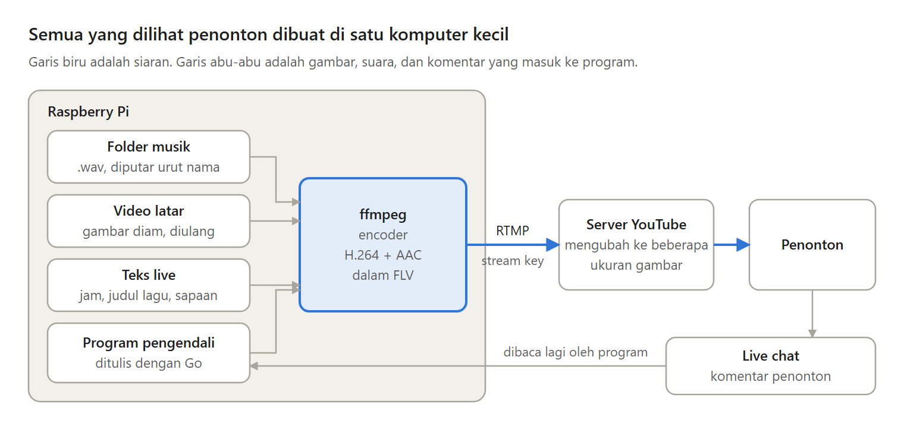
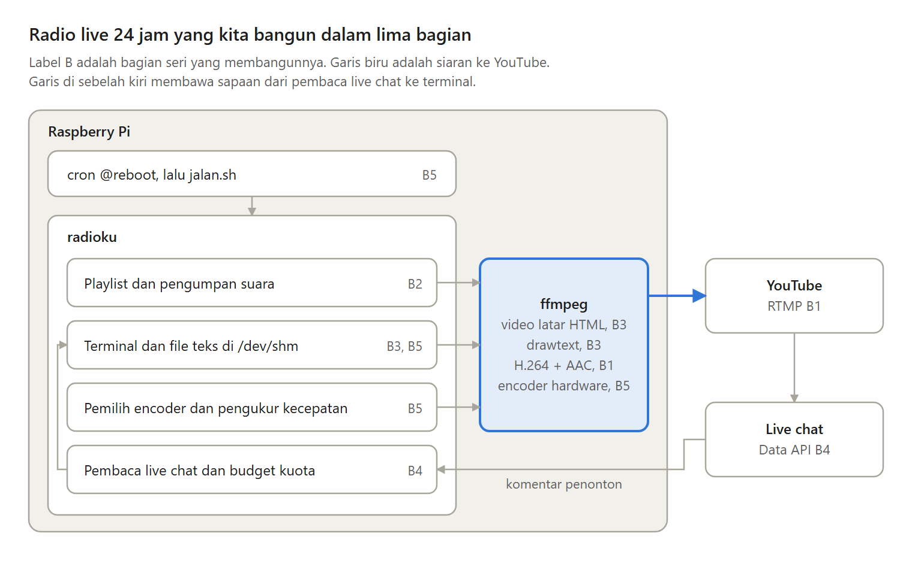

Pernah lihat channel YouTube yang memutar musik santai 24 jam tanpa henti? Ternyata siaran seperti itu bisa berjalan di sebuah Raspberry Pi, komputer kecil seukuran kartu nama.

Dalam lima bagian, saya membangun radio live 24 jam seperti itu dari nol dengan Go dan ffmpeg. Ini ringkasan seluruh serinya.

---

Kenapa live, dan bukan video musik satu jam biasa?

Siaran live punya live chat, isinya bisa berubah tanpa upload ulang, dan radionya selalu hidup saat penonton kembali besok.

Yang dikorbankan: sebuah komputer harus menyala terus, upload berjalan setiap detik, dan siaran yang lebih panjang dari 12 jam tidak selalu tersimpan.

---

Bagian 1 membedah radio live 24 jam, anjuran YouTube untuk encoder, dan siaran pertama dari satu perintah ffmpeg.

Bagian 2 memutar playlist tanpa henti ke satu ffmpeg, dengan pengumpan yang menulis suara mengikuti jam.

Bagian 3 menulis teks live di atas video dengan drawtext, dari file teks yang dibaca ulang di setiap frame.

---

Bagian 4 membaca live chat lewat YouTube Data API, membagi kuota hariannya dengan hati-hati, lalu menyapa setiap penonton di layar.

Bagian 5 memindahkan radio ke Raspberry Pi, memilih encoder hardware dengan mencobanya, mengukur apakah Pi tertinggal dari waktu siaran, dan menyalakan radio sendiri saat Pi menyala.

---

Desain ini juga punya kelemahan.

Radio berhenti saat listrik padam atau internet rumah putus. Dengan gambar yang hampir diam, upload-nya sekitar 50 GB sebulan. Sapaan bisa terlambat hampir satu menit karena kuota API. Dan siaran terputus beberapa detik setiap kali ffmpeg dijalankan lagi.

---

Ada satu kelemahan lagi yang bukan soal teknis.

Radio live 24 jam menahan penonton yang sudah datang, tetapi tidak mendatangkan penonton baru. Orang tetap harus menemukannya lebih dulu, misalnya lewat video biasa di channel yang sama.

---

Kalau tidak ingin mengurus komputer sendiri, ada pilihan lain:

- OBS di PC, kalau layarmu butuh banyak lapisan dan PC-mu memang menyala terus.
- Layanan siaran 24 jam berbayar, kalau fiturnya sudah cukup.
- VPS, kalau listrik atau internet di rumahmu sering putus.

---

Seri ini dibaca dari Bagian 1. Setiap bagian membangun di atas bagian sebelumnya, dan kodenya bisa diikuti dari awal sampai akhir.

Mulai dari sini:
https://medium.com/@archetipe/seri-membuat-radio-live-24-jam-bagian-1-apa-itu-radio-live-24-jam-di-youtube-82e7a0195ef2

Semua bagiannya ada di https://medium.com/@archetipe
