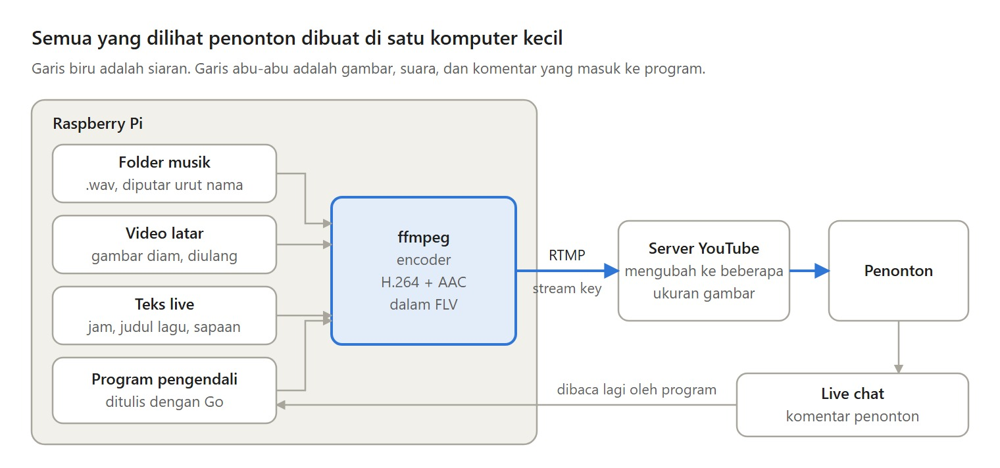
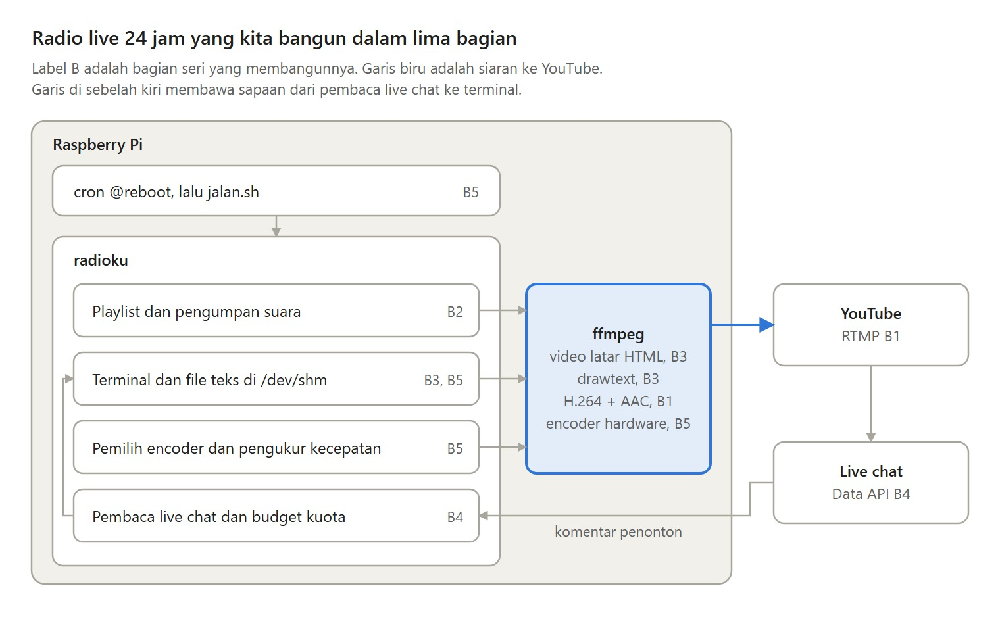

Channel YouTube yang memutar musik santai 24 jam tanpa henti ternyata bisa berjalan di sebuah Raspberry Pi.

Dalam lima bagian, saya membangun radio live 24 jam seperti itu dari nol dengan Go dan ffmpeg. Ini ringkasannya.

---

Kenapa live, bukan video musik biasa? Ada live chat, isinya bisa berubah tanpa upload ulang, dan radionya selalu hidup.

Yang dikorbankan: komputer harus menyala terus dan upload berjalan setiap detik.

---

Bagian 1: anatomi radio dan siaran pertama dari satu perintah ffmpeg.

Bagian 2: playlist tanpa henti ke satu ffmpeg, suara ditulis mengikuti jam.

Bagian 3: teks live di atas video dengan drawtext.

---

Bagian 4: membaca live chat lewat YouTube Data API dan menyapa penonton di layar, dengan kuota yang dibagi hati-hati.

Bagian 5: pindah ke Raspberry Pi, memilih encoder hardware, dan menyala sendiri saat Pi menyala.

---

Kelemahannya: radio berhenti saat listrik atau internet rumah putus, upload sekitar 50 GB sebulan, dan sapaan bisa terlambat hampir satu menit.

Radio 24 jam juga tidak mendatangkan penonton baru. Orang tetap harus menemukannya lebih dulu.

---

Mulai dari Bagian 1:
https://medium.com/@archetipe/seri-membuat-radio-live-24-jam-bagian-1-apa-itu-radio-live-24-jam-di-youtube-82e7a0195ef2

Semua bagiannya ada di https://medium.com/@archetipe
