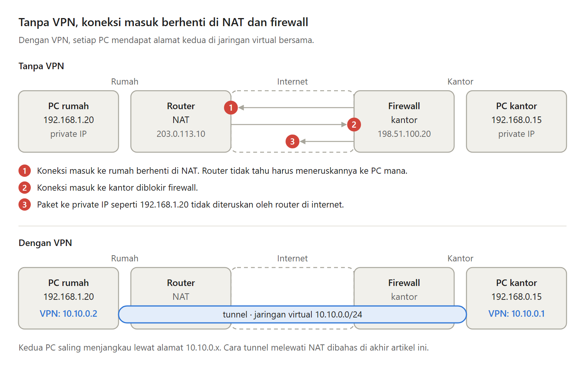
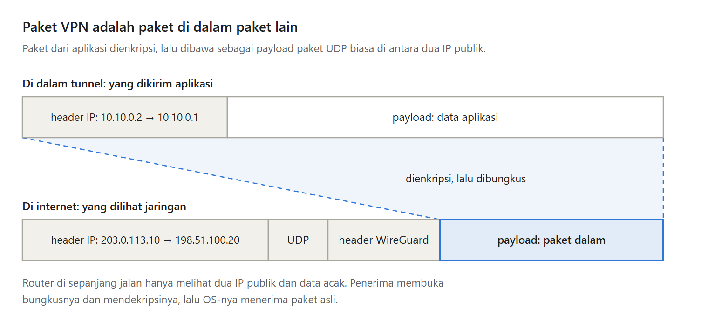

Kata "VPN" sebenarnya dipakai untuk dua hal yang berbeda.

Yang pertama adalah aplikasi untuk menyembunyikan IP-mu atau membuatmu terlihat di negara lain. Yang kedua adalah arti aslinya, yaitu menggabungkan komputer-komputer milikmu di rumah, di kantor, dan di VPS ke dalam satu jaringan privat.

Di balik keduanya, cara kerjanya sama. Ini penjelasannya.

---

Kenapa laptop di rumah tidak bisa langsung menjangkau PC di kantor?

Private IP seperti 192.168.1.20 tidak diteruskan oleh router di internet. NAT di router rumah membuat koneksi dari luar tidak tahu harus ke perangkat mana. Firewall kantor menolak koneksi masuk.

VPN memberi setiap komputer alamat kedua, misalnya 10.10.0.2, di satu jaringan virtual, di mana pun komputernya berada.

---

Di setiap komputer di dalam VPN ada empat bagian:

- Aplikasi, yang tidak tahu ada VPN.
- Virtual network card, network card yang hanya berupa software.
- Program VPN, yang membungkus dan membuka paket.
- Kunci, untuk identitas dan enkripsi.

Tunnel menghubungkan program VPN di dua komputer. Bagi aplikasi, tunnel bekerja seperti kabel langsung.

---

Cara kerja VPN adalah paket di dalam paket.

Paket dari aplikasi dienkripsi, lalu dibungkus menjadi isi dari paket UDP biasa yang ditujukan ke IP publik komputer tujuan. Di sana bungkusnya dibuka, dan paket aslinya diserahkan ke aplikasi.

Ada yang dikorbankan. WireGuard menambah 60 byte per paket di IPv4 dan 80 byte di IPv6, jadi MTU default-nya 1420, bukan 1500.

---

Membungkus saja belum membuat jaringan itu privat. VPN memberi tunnel tiga sifat:

- Enkripsi. ISP atau pemilik Wi-Fi kafe hanya melihat data acak.
- Autentikasi. Komputer tanpa kunci yang diterima tidak bisa bergabung.
- Integritas. Paket yang diubah di tengah jalan dibuang.

---

Tiga protokol yang akan sering kamu temui:

- IPsec, standar sejak tahun 1990-an, ada di kebanyakan router, dan terkenal rumit.
- OpenVPN, sejak 2001, berjalan di atas TLS, bisa memakai UDP atau TCP.
- WireGuard, yang terbaru. Implementasi Linux-nya sekitar 4.000 baris kode, dan masuk kernel Linux sejak 2020. Kriptografinya tetap, jadi tidak ada cipher yang bisa salah diatur.

---

Bagian tersulit dari membuat VPN sendiri adalah harus ada komputer yang bisa dijangkau dari internet.

ISP di Indonesia memakai CGNAT. Router di rumahmu tidak mendapat IP publik, dan port forwarding tidak bisa dilakukan.

Pilihannya ada tiga. Sewa server dengan IP publik, hole punching yang kadang gagal di balik CGNAT, atau relay. Relay tetap berjalan selama koneksi HTTPS keluar diizinkan.

---

Ini Bagian 1 dari seri Membuat VPN Sendiri, sembilan bagian dengan Go dan WireGuard. Mulai dari membawa WireGuard lewat WebSocket dan relay, sampai merawat VPN-nya.

Artikel lengkapnya ada di sini:
https://medium.com/@archetipe/seri-membuat-vpn-sendiri-bagian-1-apa-itu-vpn-virtual-private-network-d83936f629a5
