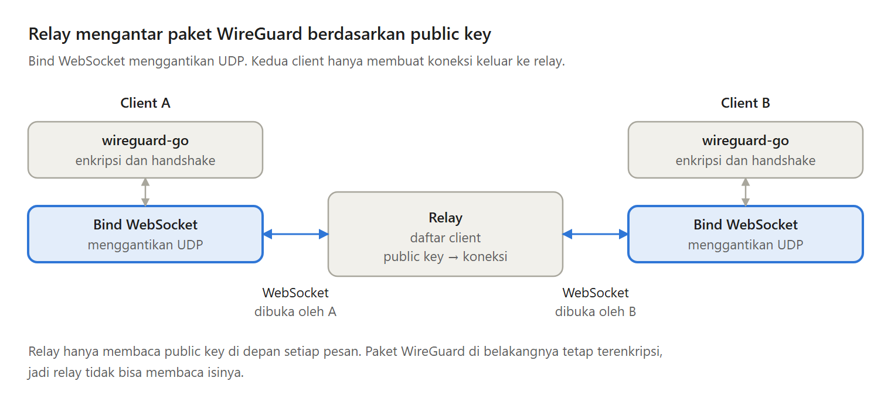
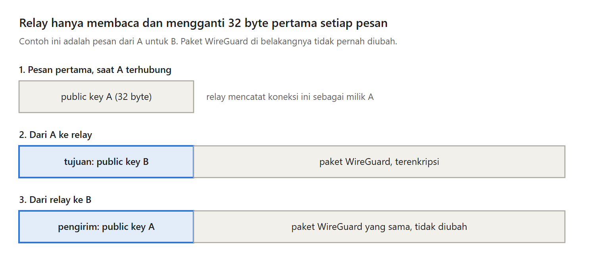

WireGuard biasanya mengirim paket lewat UDP, langsung ke IP publik milik peer-nya. Masalahnya, di balik CGNAT tidak ada peer yang bisa dijangkau, dan firewall kantor sering hanya mengizinkan HTTPS keluar.

Di Bagian 2 seri Membuat VPN Sendiri, paket WireGuard tidak lagi lewat UDP, tetapi lewat WebSocket ke sebuah relay, yaitu server yang meneruskan paket di antara client.

---

Ada tiga jalur untuk membawa paket WireGuard tanpa koneksi masuk:

- Hole punching lewat UDP. Sering berhasil, tetapi sebagian CGNAT menggagalkannya, dan firewall yang memblokir UDP tetap menghalangi.
- Koneksi TCP biasa ke relay. Firewall kantor sering hanya membuka port tertentu, seperti 443.
- WebSocket di atas HTTPS. Bagi firewall, koneksi ini terlihat seperti traffic web biasa.

Seri ini memilih WebSocket, karena hanya pilihan ini yang lolos di balik CGNAT maupun firewall kantor.

---

Ada tiga hal yang dikorbankan:

- Semua paket lewat relay. Perjalanannya lebih jauh, dan kecepatan seluruh VPN dibatasi relay.
- TCP di dalam TCP. Saat jaringan sering kehilangan paket, dua lapisan TCP bisa saling memperlambat.
- Enkripsi dua lapis. HTTPS sampai ke relay, lalu WireGuard dari ujung ke ujung.

Untuk menghubungkan beberapa komputer milik sendiri, ketiganya masih sepadan. Kalau butuh kecepatan setinggi mungkin, jalur UDP langsung tetap lebih baik.

---

Jalur pengirimannya punya empat bagian:

- wireguard-go mengurus enkripsi, handshake, dan pergantian kunci.
- Bind adalah bagian wireguard-go yang mengirim paket ke jaringan. Bind bawaannya memakai UDP, dan kita menggantinya dengan Bind WebSocket.
- Endpoint adalah alamat tujuan sebuah paket. Untuk kita, endpoint adalah public key peer tujuan.
- Relay meneruskan setiap pesan ke koneksi milik public key tujuan.

---

Kenapa public key dipakai sebagai alamat?

Public key sudah unik, jadi kita tidak butuh nomor atau nama tambahan. Alamatnya juga tidak berubah saat komputer pindah jaringan. Laptop yang pindah dari Wi-Fi rumah ke hotspot ponsel cukup membuat koneksi WebSocket baru, dan relay tetap mengenalinya dari public key yang sama.

---

Setiap paket WireGuard dikirim sebagai satu pesan WebSocket, dengan public key sepanjang 32 byte di depannya.

Dari client ke relay, 32 byte itu adalah public key tujuan. Relay menggantinya dengan public key pengirim, lalu meneruskannya. Paket WireGuard di belakangnya tidak diubah.

Relay yang mengisi pengirim, bukan client, supaya client nakal tidak bisa mengaku sebagai client lain.

---

Semuanya bisa dicoba di satu komputer tanpa hak administrator. wireguard-go punya netstack, yaitu network stack yang berjalan di dalam program. Di test-nya, client B menjalankan web server kecil, dan client A memanggilnya lewat tunnel dan relay.

Kelemahannya: relay masih percaya begitu saja pada pesan perkenalan, satu client yang lambat bisa memperlambat pengirimnya, dan koneksi yang putus tidak tersambung lagi.

---

Ini Bagian 2 dari seri Membuat VPN Sendiri, lengkap dengan kode Go dan test-nya.

Artikel lengkapnya ada di sini:
https://medium.com/@archetipe/seri-membuat-vpn-sendiri-bagian-2-membawa-wireguard-lewat-websocket-dan-relay-30bd3a817b26
