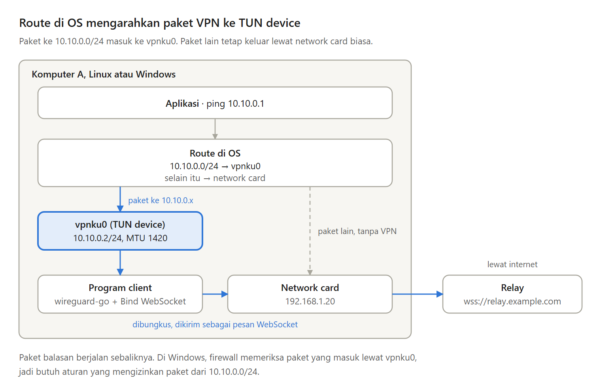

Di Bagian 2, VPN kita hanya hidup di dalam test. Dengan netstack, hanya program yang membuatnya yang bisa memakai alamat VPN. Browser, SSH, atau remote desktop tidak tahu netstack itu ada.

Di Bagian 3 seri Membuat VPN Sendiri, kita memakai virtual network card sungguhan, yaitu network card yang dikenal OS, sehingga semua aplikasi bisa memakai alamat VPN tanpa perlu diubah.

---

Pilihan ini punya tiga kelemahan:

- Butuh hak administrator, karena membuat network card baru adalah urusan OS.
- OS harus diatur. Network card baru belum punya alamat, belum menyala, dan belum punya route.
- Setiap OS berbeda. Linux dan Windows punya cara sendiri untuk membuat dan mengatur network card, jadi kodenya ditulis untuk masing-masing OS.

---

Supaya OS mau mengirim paket ke VPN, ada empat hal yang disiapkan:

- TUN device, virtual network card yang dibuat lewat wireguard-go. Di Windows, wireguard-go memakai Wintun, driver TUN dari proyek WireGuard.
- Alamat dengan prefix, misalnya 10.10.0.2/24.
- Route, aturan lewat network card mana sebuah paket keluar. Dengan prefix /24, OS otomatis membuat route untuk 10.10.0.0/24.
- MTU 1420, seperti WireGuard.

---

Perhatikan bahwa VPN ini hanya menangkap paket ke 10.10.0.0/24. Membuka website tetap lewat jalan biasa, tidak lewat relay.

Inilah bedanya dengan privacy VPN, yang membawa semua traffic ke server provider-nya.

---

Di Windows, ada satu hal tambahan, yaitu firewall.

Windows memasukkan network card baru ke profil Public, yaitu profil untuk jaringan yang belum dipercaya. Profil ini menolak semua koneksi masuk, termasuk ping. Karena itu, kita perlu satu aturan firewall yang mengizinkan paket dari client VPN lain.

---

Relay-nya sekarang berjalan di internet, di sebuah VPS dengan IP publik dan sebuah domain.

Di depannya ada Caddy, web server yang bisa menjadi reverse proxy, otomatis mengambil sertifikat HTTPS untuk domain itu, dan meneruskan koneksi WebSocket tanpa pengaturan tambahan. Relay sendiri hanya mendengarkan di 127.0.0.1, supaya hanya bisa dijangkau lewat Caddy.

---

Di percobaan dengan dua komputer Linux, relay, dan Caddy di dalam container, kedua komputer saling ping lewat alamat 10.10.0.x. Aplikasi apa pun kini bisa menjangkau komputer lain lewat alamat VPN-nya, seperti SSH, remote desktop, atau database.

Kelemahannya: daftar peer masih ditulis tangan di setiap client, relay masih percaya begitu saja pada pesan perkenalan, koneksi yang putus tidak tersambung lagi, dan VPN mati saat terminalnya ditutup.

---

Ini Bagian 3 dari seri Membuat VPN Sendiri, lengkap dengan kode Go untuk Linux dan Windows.

Artikel lengkapnya ada di sini:
https://medium.com/@archetipe/seri-membuat-vpn-sendiri-bagian-3-menjalankan-vpn-dengan-virtual-network-card-sungguhan-c7b5400e7508
