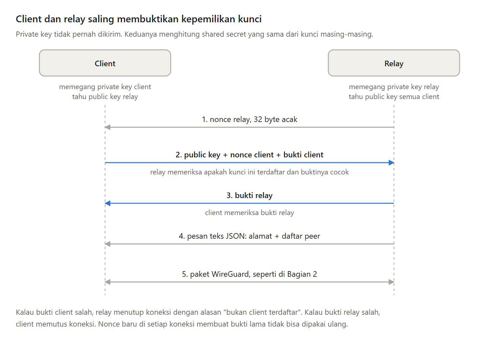

Public key bukan rahasia. Jadi relay VPN yang percaya begitu saja pada public key yang diakui seseorang bisa ditipu.

Di Bagian 4 seri Membuat VPN Sendiri, setiap client harus membuktikan bahwa ia memegang private key-nya, relay membuktikan dirinya balik, lalu relay membagikan daftar client.

---

Kenapa harus dua arah?

Penyusup yang tahu public key client A bisa terhubung ke relay dan mengaku sebagai A. Isi paket tetap tidak terbaca, tetapi A terputus dari VPN.

Lebih serius lagi, client kini menerima daftar peer dari relay. Relay palsu bisa menyelipkan public key milik penyerang ke dalam daftar itu. Jadi relay memeriksa client, dan client memeriksa relay.

---

Ada tiga cara yang umum untuk memeriksa client:

- Password bersama. Satu password yang bocor membuka pintu untuk siapa pun.
- Token untuk setiap client. Berhasil, tetapi setiap client kini menjaga dua rahasia.
- Bukti dari private key WireGuard, tanpa mengirim private key itu.

Seri ini memilih cara ketiga, karena setiap client cukup menjaga satu rahasia. Kelemahannya, relay butuh sepasang kunci sendiri, dan setiap client harus tahu public key relay.

---

Buktinya dibangun dari empat bagian:

- Shared secret, angka rahasia yang sama, yang dihitung sendiri oleh kedua pihak dengan X25519 tanpa pernah dikirim.
- Nonce, angka acak yang hanya dipakai sekali di setiap koneksi.
- HMAC, sidik jari pendek dari sebuah pesan, yang dihitung dengan shared secret sebagai kuncinya.
- Label yang berbeda untuk bukti client dan bukti relay, supaya relay palsu tidak bisa mengembalikan bukti client sebagai buktinya sendiri.

---

Relay mengirim nonce. Client menjawab dengan public key, nonce client, dan bukti client. Relay memeriksa apakah kunci itu terdaftar dan buktinya cocok, lalu mengirim bukti relay, dan client memeriksanya.

Kenapa dua nonce? Nonce relay mencegah bukti client yang direkam diputar ulang. Nonce client mencegah relay palsu memutar ulang bukti relay asli dari koneksi lama.

---

Setelah client lolos, relay mengirim alamat VPN client itu dan daftar client lainnya, sebagai pesan WebSocket jenis teks berisi JSON.

Aturannya: pesan teks untuk kontrol, pesan binary untuk paket WireGuard. Paket WireGuard tidak pernah bisa terbaca sebagai perintah, dan file konfigurasi client kini cukup tiga baris, tanpa daftar peer yang ditulis tangan.

---

Test-nya mencoba menyerang VPN ini: penyusup yang mengaku memakai public key A tanpa private key-nya ditolak, dan relay palsu ditolak oleh client.

Kelemahannya: menambah atau mengeluarkan client masih butuh restart relay, daftar peer hanya dikirim sekali, dan siapa pun yang mencuri private key relay bisa menambahkan client palsu. Jadi private key relay harus dijaga seketat private key client.

---

Ini Bagian 4 dari seri Membuat VPN Sendiri, lengkap dengan kode Go dan test-nya.

Artikel lengkapnya ada di sini:
https://medium.com/@archetipe/seri-membuat-vpn-sendiri-bagian-4-membuktikan-kepemilikan-kunci-dan-membagikan-daftar-client-8cdf54c31af1
