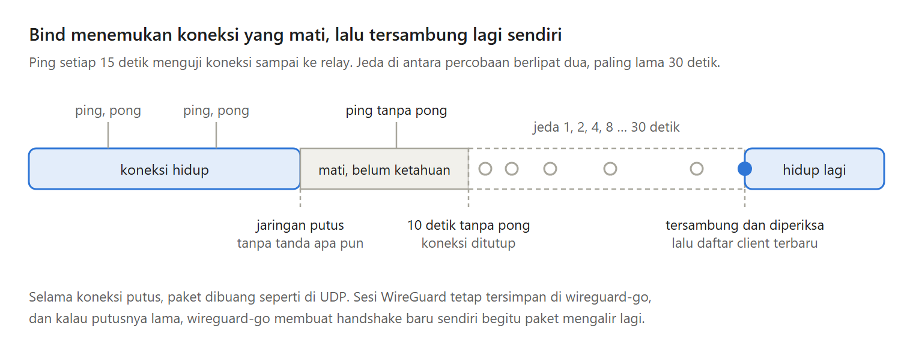
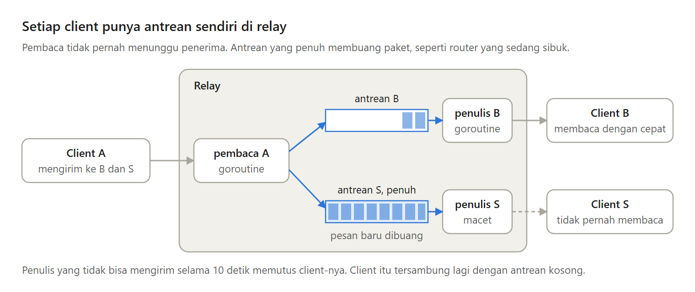

VPN yang bekerja di hari pertama belum tentu bertahan di hari kedua.

Koneksi ke relay pasti putus suatu saat: relay restart, laptop pindah dari Wi-Fi ke hotspot, laptop ditutup semalaman, atau router membuang koneksi yang lama diam. Di Bagian 5 seri Membuat VPN Sendiri, VPN kita belajar bertahan.

---

Putusnya koneksi datang dengan dua cara.

Kalau relay restart, OS menutup koneksinya dan client langsung mendapat error. Kalau jaringan putus di tengah jalan, tidak ada yang memberi tahu siapa pun, dan client terus menunggu paket yang tidak akan pernah datang.

Jadi client punya dua tugas baru: menemukan koneksi yang mati diam-diam, lalu tersambung lagi sendiri.

---

Bukankah TCP sudah punya keepalive?

Ada, tetapi butuh beberapa menit, dan hanya memeriksa sampai pihak terdekat. Kalau relay berada di belakang reverse proxy, keepalive hanya membuktikan proxy-nya hidup, bukan relay-nya.

Karena itu client memakai ping WebSocket setiap 15 detik. Pong yang datang dari relay membuktikan seluruh jalurnya hidup.

---

Kalau pong tidak datang dalam 10 detik, koneksi ditutup, dan client tersambung lagi dengan jeda yang makin panjang: 1 detik, 2, 4, 8, sampai paling lama 30 detik.

Gangguan singkat pulih dalam hitungan detik, dan relay yang mati lama tidak diserbu ribuan percobaan per detik. Sesi WireGuard tidak ikut hilang, jadi begitu tersambung, paket langsung mengalir.

---

Menambah atau mengeluarkan client juga tidak perlu restart relay lagi.

Relay membaca ulang daftar client setiap dua detik, lalu mengirim daftar lengkap ke setiap client lewat koneksi yang sudah terbuka. Client hanya mengubah peer yang berubah, jadi sesi ke client lain tidak terputus.

---

Satu client yang lambat juga tidak boleh menahan yang lain.

Setiap client kini punya antrean sendiri di relay, 256 pesan. Kalau penuh, paket dibuang, seperti router yang sibuk, dan TCP di dalam tunnel mengirim ulang. Client yang lambat hanya merugikan dirinya sendiri.

---

Kelemahannya: relay tetap harus bisa dihubungi saat client pertama kali mulai, paket dibuang saat antrean penuh dan saat tersambung lagi, dan aplikasi UDP seperti panggilan suara akan merasakan gangguan itu.

---

Ini Bagian 5 dari seri Membuat VPN Sendiri, lengkap dengan kode Go dan percobaannya.

Semua bagiannya ada di https://medium.com/@archetipe
