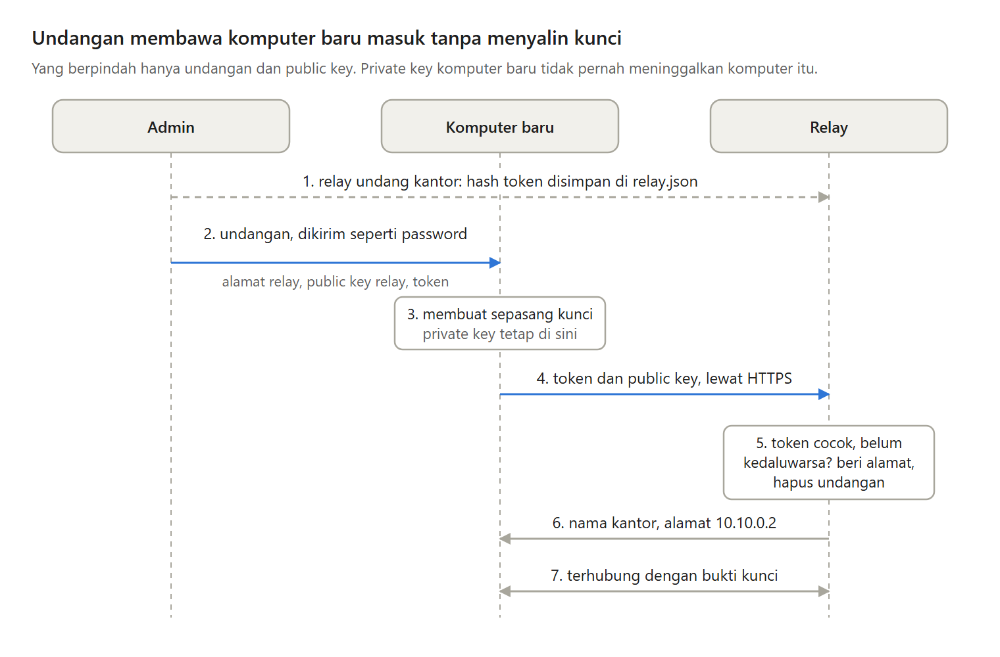

Menambah satu client VPN dengan tangan butuh lima langkah, dan informasinya berpindah dua arah. Public key ditulis sebagai 64 huruf hex, dan satu huruf yang salah membuat client itu ditolak tanpa alasan yang jelas.

Di Bagian 6 seri Membuat VPN Sendiri, admin membuat undangan dengan satu perintah, dan komputer baru bergabung sendiri.

---

Ada tiga cara yang umum untuk memasukkan komputer baru:

- Admin membuat kunci untuk client baru. Private key ikut berpindah lewat chat atau email, dan admin juga tahu private key itu.
- Persetujuan saat pertama terhubung. Admin harus memastikan permintaan itu benar dari komputer baru, dan caranya kembali ke membandingkan 64 huruf hex.
- Undangan sekali pakai, yaitu rahasia berumur pendek yang hanya berlaku sekali.

---

Seri ini memilih undangan. Informasinya hanya berpindah satu arah, dari admin ke komputer baru, dan private key tidak pernah meninggalkan komputer yang membuatnya.

Kelemahannya, undangan adalah rahasia selama masih berlaku. Siapa pun yang memakainya lebih dulu akan bergabung sebagai client. Karena itu, undangan hanya bisa dipakai sekali dan hanya berlaku 24 jam.

---

Undangan berisi tiga hal: alamat relay, public key relay supaya relay palsu tidak bisa berpura-pura, dan token, yaitu 32 byte acak sebagai rahasia sekali pakai. Ketiganya ditulis dengan base64, cara menulis byte apa pun dengan huruf dan angka, menjadi satu baris yang mudah disalin.

Relay tidak menyimpan token, hanya hash-nya. Siapa pun yang sempat melihat file konfigurasi relay tidak bisa memakai undangan yang masih berlaku.

---

Komputer baru membuat sepasang kunci sendiri, lalu mengirim token dan public key-nya ke relay lewat HTTPS. Relay memeriksa token dan masa berlakunya, memberi alamat VPN berikutnya yang masih kosong, mendaftarkan public key itu, dan menghapus undangannya.

Setelah itu, komputer baru terhubung dengan bukti kunci seperti di Bagian 4. Yang berpindah hanya undangan dan public key.

---

Sekarang ada dua program yang mengubah file konfigurasi relay: relay sendiri saat seseorang bergabung, dan perintah admin. Kalau keduanya menulis bersamaan, tulisan terakhir menghapus perubahan yang pertama tanpa ada yang tahu.

Jawabannya: file penanda yang hanya bisa dibuat oleh satu program pada satu waktu. Isi baru ditulis ke file sementara, lalu menggantikan file aslinya dengan satu kali rename, yaitu mengganti nama file.

---

Token yang bisa ditebak akan merusak seluruh cara ini. Token di sini adalah 256 bit acak, jadi menebaknya lewat internet tidak mungkin, berapa kali pun dicoba.

Kelemahannya: undangan harus dikirim lewat jalur yang kamu percaya, perubahan file konfigurasi dengan tangan tidak mengikuti file penanda, dan relay masih dipercaya menentukan siapa client-nya.

---

Ini Bagian 6 dari seri Membuat VPN Sendiri, lengkap dengan kode Go dan percobaannya.

Artikel lengkapnya ada di sini:
https://medium.com/@archetipe/seri-membuat-vpn-sendiri-bagian-6-menambah-client-vpn-dengan-undangan-sekali-pakai-d818d120bc56
