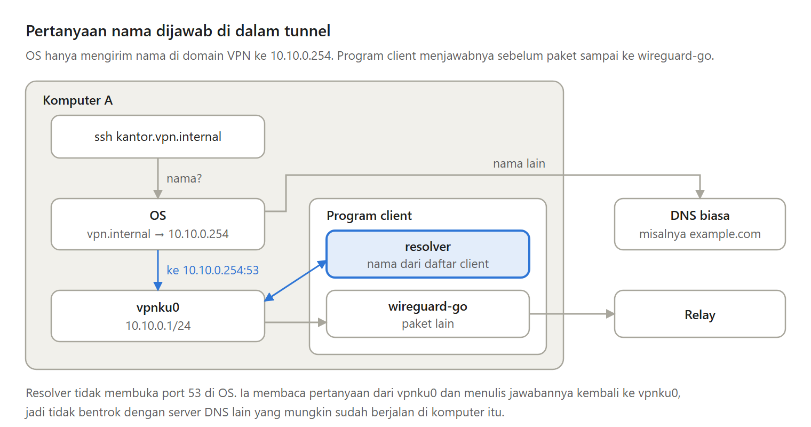

Alamat seperti 10.10.0.2 sulit diingat, apalagi kalau client VPN-mu belasan. Alamat itu juga bisa berubah.

Di Bagian 7 seri Membuat VPN Sendiri, setiap client mendapat nama seperti kantor.vpn.internal, yang dijawab langsung di dalam tunnel, tanpa server nama terpisah.

---

Ada tiga cara yang umum untuk memberi nama di jaringan privat:

- File hosts, yang harus ditulis ulang setiap kali daftar berubah.
- Server DNS di relay, yang membuat semua nama berhenti bekerja saat relay tidak bisa dihubungi.
- Setiap client menjawab sendiri, dari daftar client yang sudah ia pegang.

Seri ini memilih cara ketiga. Jawabannya datang seketika dan tetap bekerja walaupun relay sedang restart.

---

Domainnya juga harus dipilih dengan hati-hati.

Domain karangan seperti .lan bisa saja dibuka ICANN suatu hari. Domain .local sudah dipakai untuk multicast DNS, jadi pertanyaannya tidak pernah sampai ke VPN. Pada 29 Juli 2024, ICANN mencadangkan .internal secara permanen untuk jaringan privat.

Seri ini memakai satu cabangnya saja, vpn.internal, supaya tidak bentrok dengan jaringan kantor yang mungkin sudah memakai .internal.

---

Satu pertanyaan nama berjalan seperti ini:

Aplikasi bertanya alamat kantor.vpn.internal. OS melihat akhiran vpn.internal, lalu mengirim pertanyaannya ke sebuah alamat di dalam VPN. Paket itu masuk ke virtual network card, program client membacanya, menyusun jawabannya, lalu menulis jawaban kembali.

Pertanyaan nama tidak pernah meninggalkan komputer itu.

---

Kenapa tidak menjalankan server DNS biasa di port 53 saja?

Banyak komputer sudah menjalankan server DNS sendiri, seperti dnsmasq atau Pi-hole, di port 53. Program kita akan gagal membuka port yang sama. Resolver di dalam tunnel tidak butuh port sama sekali, karena paketnya memang sudah masuk ke tunnel.

---

OS juga harus tahu bahwa hanya nama vpn.internal yang dikirim ke resolver ini. Caranya disebut split DNS.

Di Linux lewat systemd-resolved, di Windows lewat aturan NRPT. Satu jebakan di Windows: nslookup tidak mengikuti NRPT, jadi untuk mencoba, pakai ping atau Resolve-DnsName.

---

Kelemahannya: resolver ini hanya mengerti IPv4 dan UDP, perubahan alamat bisa terlambat sampai satu menit karena jawaban disimpan sebentar, dan aturan NRPT di Windows belum dicoba di Windows sungguhan.

---

Ini Bagian 7 dari seri Membuat VPN Sendiri, lengkap dengan kode Go dan percobaannya.

Semua bagiannya ada di https://medium.com/@archetipe
