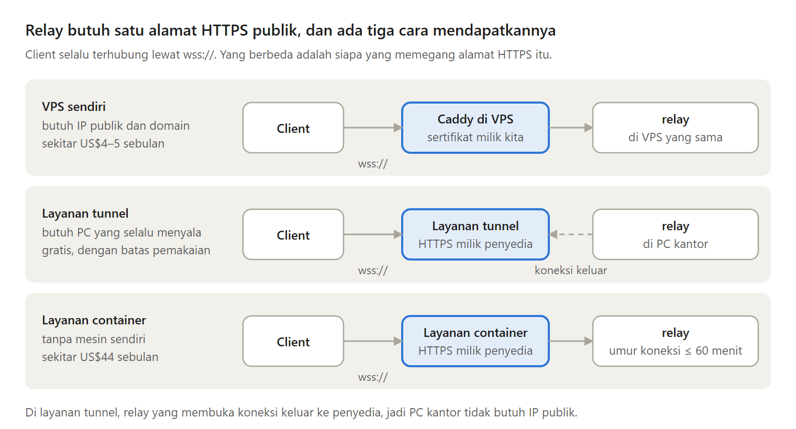
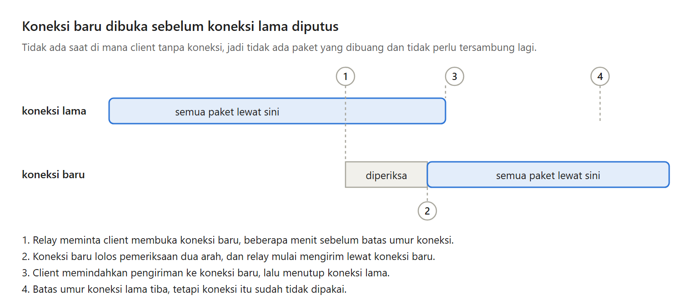

Relay VPN tidak harus berjalan di VPS sendiri.

Yang sebenarnya dibutuhkan relay hanyalah satu alamat HTTPS yang bisa dijangkau dari internet. Di Bagian 8 seri Membuat VPN Sendiri, kita melihat dua tempat lain untuk relay, beserta biaya dan kelemahannya.

---

Ada tiga cara mendapatkan alamat itu:

- VPS sendiri, dengan IP publik, domain, dan reverse proxy untuk HTTPS.
- Layanan tunnel, seperti Cloudflare Tunnel atau Microsoft dev tunnels, untuk relay di komputer mana pun yang selalu menyala.
- Layanan container, seperti Google Cloud Run, tanpa komputer sendiri sama sekali.

Client tidak peduli relay berjalan di mana.

---

Layanan tunnel menghapus tiga kebutuhan sekaligus: IP publik, domain, dan reverse proxy, dan biasanya gratis.

Yang dikorbankan: penyedia melihat siapa berbicara dengan siapa (isi paket tetap terenkripsi WireGuard), ada batas pemakaian, komputer relay harus selalu menyala, dan alamatnya tidak boleh berubah.

---

Layanan container menghapus kebutuhan terakhir, yaitu komputer yang selalu menyala.

Tetapi container yang memegang koneksi WebSocket selalu dihitung aktif. Dihitung dari harga Cloud Run di us-central1, relay yang aktif sebulan penuh sekitar US$44, sedangkan VPS termurah sekitar US$4 sampai US$5 sebulan. Kira-kira sepuluh kali lipat.

---

Layanan container juga membatasi umur koneksi, paling lama 60 menit di Cloud Run. Jadi setiap client diputus paling tidak sekali setiap jam.

Client memang tersambung lagi sendiri, tetapi selama itu paket dibuang, dan semua client yang terhubung pada menit yang sama terputus pada menit yang sama.

---

Jawabannya: membuka koneksi baru sebelum koneksi lama diputus.

Relay yang paling tahu batas umur koneksinya, jadi relay yang meminta client memperbarui koneksi, misalnya setelah 50 menit. Client membuka koneksi baru, pindah, lalu menutup yang lama. Tidak ada saat di mana client tanpa koneksi.

---

Jadi layanan tunnel cocok untuk beberapa komputer dengan traffic kecil, seperti SSH dan remote desktop. Layanan container cocok kalau kamu sama sekali tidak mau mengurus mesin dan rela membayar lebih. Kalau tujuannya hemat, VPS kecil tetap pilihan termurah.

---

Ini Bagian 8 dari seri Membuat VPN Sendiri, lengkap dengan kode Go dan percobaannya.

Semua bagiannya ada di https://medium.com/@archetipe
