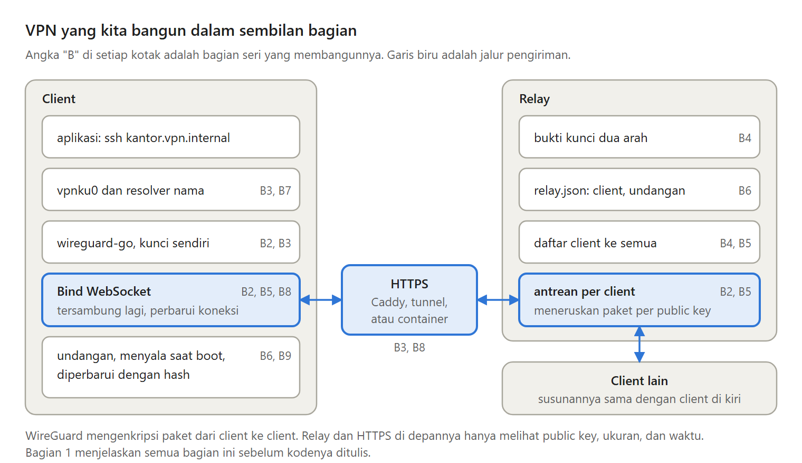

VPN baru berguna kalau sedang menyala. Bayangkan PC kantor yang menyala ulang setelah listrik padam atau pembaruan Windows. Kalau tidak ada yang menjalankan program client, PC itu tidak bisa dijangkau tepat saat kamu membutuhkannya dari rumah.

Bagian 9, bagian terakhir seri Membuat VPN Sendiri, mengurus perawatan itu.

---

Ada dua cara menjalankan program saat komputer menyala:

- Saat pengguna login, seperti shortcut di folder Startup. PC yang menyala ulang berhenti di layar login, dan program tidak pernah jalan.
- Oleh pengelola layanan milik OS, yaitu systemd di Linux dan Task Scheduler di Windows. Program berjalan tanpa ada yang login.

Seri ini memilih cara kedua. Kelemahannya, program berjalan dengan hak tertinggi, jadi file konfigurasinya, yang berisi private key, hanya boleh dibaca administrator.

---

Saat komputer baru menyala, jaringan sering belum siap. Jadi program client terus mencoba dengan jeda yang makin panjang, kecuali kalau relay menolaknya. Penolakan tidak akan berubah dengan mencoba lagi, jadi program berhenti dan mencetak alasannya.

Kelemahannya, alamat relay yang salah ketik membuat program menunggu selamanya. Alasannya tetap tercetak di log setiap kali percobaan gagal.

---

Di Windows, virtual network card butuh file wintun.dll di sebelah program. Dua file yang harus selalu bersama mudah terpisah.

Pilihannya installer, zip berisi dua file, atau DLL di dalam program. Seri ini memilih yang ketiga: Go bisa menyimpan file apa pun di dalam program, dan lisensi Wintun mengizinkannya selama DLL-nya tidak diubah. Programnya menjadi sekitar 427 KB lebih besar.

---

Saat versi baru keluar, program di setiap komputer harus diganti. Seri ini membuat program memperbarui dirinya sendiri dari alamat HTTPS yang kamu kendalikan, setelah memeriksa hash file yang diunduh.

Bukankah hash dari server yang sama tidak membuktikan apa-apa? Hash menolak file yang rusak, terpotong, atau salah versi, tetapi tidak menolak server yang dikuasai orang lain. Untuk itu dibutuhkan digital signature dari kunci admin yang disimpan offline.

---

Windows tidak mengizinkan file program yang sedang berjalan ditimpa, tetapi mengizinkannya diganti namanya. Jadi program lama diberi nama baru lebih dulu, lalu program baru mengambil nama aslinya.

Ada yang belum dijalankan: layanan systemd, task di Task Scheduler, dan DLL di dalam program belum dicoba di komputer sungguhan, karena butuh hak administrator.

---

Dengan bagian ini, seri selesai. Client saling menjangkau lewat nama, bergabung dengan undangan, tersambung lagi sendiri, menyala sendiri, dan relay-nya bisa berjalan di VPS, di belakang layanan tunnel, atau di layanan container.

Setiap kotak di gambar ini menunjukkan bagian seri yang membangunnya.

---

Ini Bagian 9, bagian terakhir dari seri Membuat VPN Sendiri. Kalau kamu baru bergabung, mulailah dari Bagian 1.

Artikel lengkapnya ada di sini:
https://medium.com/@archetipe/seri-membuat-vpn-sendiri-bagian-9-merawat-vpn-dan-menutup-seri-c866177f5c1d
