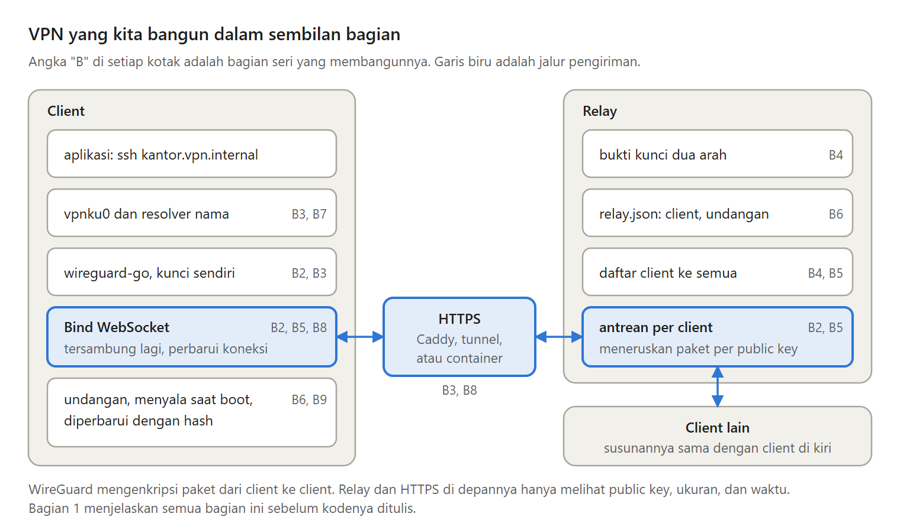

Bisakah komputer di rumah, di kantor, dan di VPS digabung ke dalam satu jaringan privat, padahal semuanya di balik CGNAT dan tidak punya IP publik?

Bisa. Dalam sembilan bagian, saya membangun VPN seperti itu dari nol dengan Go dan WireGuard. Ini ringkasan seluruh serinya.

---

Masalah utamanya, VPN butuh satu sisi yang bisa dijangkau dari internet, padahal di balik CGNAT tidak ada.

Jawabannya adalah relay yang dijangkau lewat HTTPS. Setiap komputer terhubung keluar ke relay lewat WebSocket, dan relay meneruskan paket WireGuard yang sudah terenkripsi tanpa bisa membaca isinya.

Setiap bagian sesudahnya memperbaiki satu kelemahan dari jawaban itu.

---

Bagian 1 menjelaskan apa itu VPN, paket di dalam paket, dan kenapa CGNAT membuat kita memilih relay.

Bagian 2 membawa WireGuard lewat WebSocket ke sebuah relay, dengan Bind buatan sendiri.

Bagian 3 menjalankan VPN dengan virtual network card sungguhan di Linux dan Windows, dengan relay di belakang Caddy.

---

Bagian 4 membuat relay dan client saling membuktikan kepemilikan kunci, lalu relay membagikan daftar client.

Bagian 5 membuat VPN tersambung lagi sendiri, mengikuti perubahan client tanpa restart, dan memberi setiap client antrean sendiri.

Bagian 6 mengganti penyalinan kunci dengan undangan sekali pakai.

---

Bagian 7 memberi setiap client nama seperti kantor.vpn.internal, yang dijawab langsung di dalam tunnel.

Bagian 8 menjalankan relay di belakang layanan tunnel atau di layanan container, dan memperbarui koneksi sebelum diputus.

Bagian 9 membuat VPN menyala sendiri, menjadi satu file untuk setiap OS, dan bisa diperbarui dengan aman.

---

Desain ini juga punya kelemahan.

Semua paket lewat relay, jadi kecepatan seluruh VPN dibatasi relay. WebSocket berjalan di atas TCP, sehingga di jaringan yang sering kehilangan paket, aplikasi TCP di dalam tunnel melambat. Relay melihat siapa berbicara dengan siapa, walaupun tidak bisa membaca isinya. Dan kalau relay mati, seluruh VPN berhenti.

---

VPN ini cocok untuk belajar cara kerja VPN dari dalam, untuk beberapa komputer milik sendiri, dan untuk jaringan yang hanya mengizinkan HTTPS keluar.

Kalau tidak, ada pilihan lain:

- WireGuard biasa, kalau salah satu sisi punya IP publik dan UDP tidak diblokir.
- Tailscale, kalau kamu ingin koneksi langsung secepat mungkin.
- Headscale, kalau kamu ingin cara kerja Tailscale dengan server sendiri.
- ZeroTier, yang menyebut dirinya switch Ethernet yang bisa diprogram.

---

Seri ini dibaca dari Bagian 1. Setiap bagian membangun di atas bagian sebelumnya, dan kodenya bisa diikuti dari awal sampai akhir.

Mulai dari sini:
https://medium.com/@archetipe/seri-membuat-vpn-sendiri-bagian-1-apa-itu-vpn-virtual-private-network-d83936f629a5

Semua bagiannya ada di https://medium.com/@archetipe
