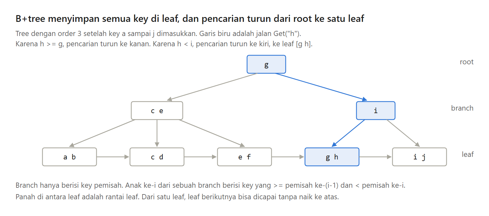
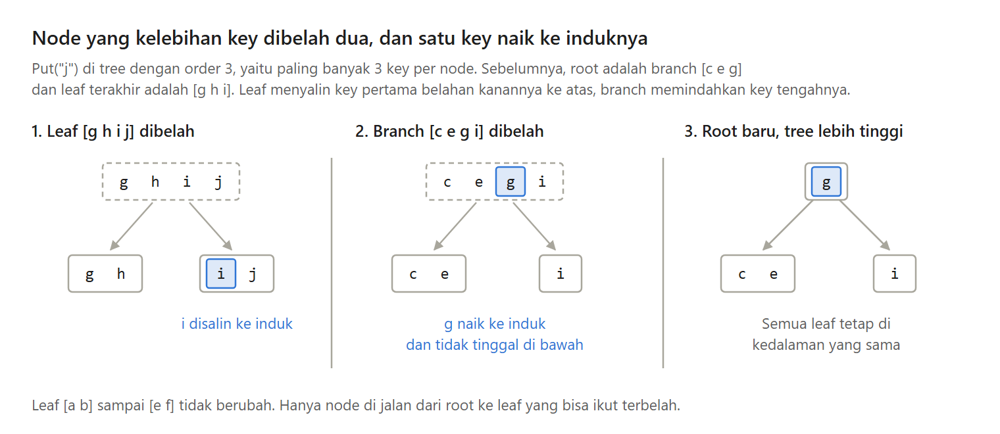
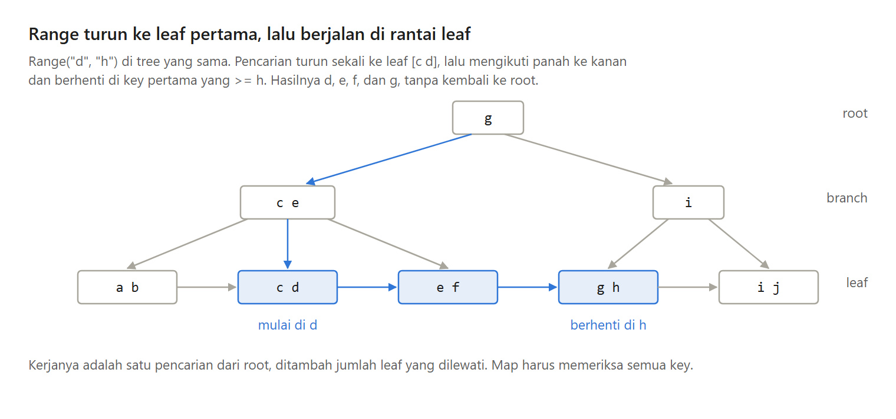

# [Seri Membuat Database Key-Value Sendiri Bagian 2] Struktur dan pencarian di B+tree

*Di bagian kedua, kita membangun B+tree di memori dengan Go, lengkap dengan pencarian, pembelahan node, dan pembacaan rentang key. B+tree itu menggantikan map sebagai index, dan Range yang tadinya memeriksa semua key menjadi sekitar 300 kali lebih cepat.*

Seri ini membangun database key-value kecil bernama `kvku` dengan Go, hanya dengan library standar Go. Di Bagian 1, kita menulis versi pertamanya. Setiap Put menjadi record di ujung sebuah log di disk, dan map di memori menjadi index yang menunjuk ke posisi record terbaru untuk setiap key.

Map itu cepat untuk Get, tetapi tidak menyimpan urutan key. Akibatnya, Range harus memeriksa semua key lalu mengurutkannya, dan mengambil 10 key dari 100.000 key memakan sekitar 16 milidetik. Bagian 2 mengganti map itu dengan B+tree, susunan data yang menyimpan key secara urut.

## Pilihan index yang menyimpan key secara urut

Ada beberapa cara untuk menyimpan key secara urut di memori, dan masing-masing punya kelemahan sendiri. Pilihan paling sederhana adalah slice yang diurutkan, dan pilihan yang paling sering dibahas di buku adalah binary search tree. B+tree adalah pilihan ketiga, yang dipakai banyak database di disk.

### Kenapa tidak memakai slice yang diurutkan saja?

Slice yang diurutkan sudah cukup untuk Get dan Range. Get memakai binary search, yaitu pencarian yang membandingkan key dengan isi tengah slice lalu membuang separuh yang salah, sehingga 1.000.000 key cukup diperiksa sekitar 20 kali. Range mencari key pertama dengan cara yang sama, lalu membaca ke kanan.

Masalahnya ada di Put. Key baru yang masuk di tengah slice membuat semua key di sebelah kanannya bergeser satu tempat. Untuk satu juta key, satu Put bisa menggeser ratusan ribu key, dan setiap Put berikutnya mengulanginya.

### Kenapa tidak memakai binary search tree?

Binary search tree menyimpan satu key di setiap node, dengan dua anak. Anak kiri berisi key yang lebih kecil, dan anak kanan berisi key yang lebih besar. Put hanya menambah satu node, jadi tidak ada key yang bergeser.

Masalahnya, setiap tingkat binary search tree paling banyak hanya melipatgandakan jumlah node, jadi satu juta key butuh setidaknya 20 tingkat. Di memori, 20 langkah itu cepat. Tetapi di Bagian 3, tree kita pindah ke disk, dan setiap tingkat bisa berarti satu kali membaca disk.

### B+tree adalah "banyak key di setiap node"

B+tree menyimpan banyak key di setiap node, misalnya 64, sehingga setiap node punya banyak anak. Jumlah anak per node disebut fan-out. Dengan fan-out 64, root dan dua tingkat branch di bawahnya sudah bisa menunjuk ke 64 × 64 × 64, yaitu 262.144 leaf.

Pilihan ini juga yang dipakai banyak database. Dokumentasi bbolt, database key-value yang ditulis dengan Go, menyebut bahwa bbolt memakai B+tree di dalam satu file. Format file SQLite juga menyebut bahwa tabel dan index-nya disimpan sebagai b-tree di halaman-halaman file.

Kelemahannya, B+tree lebih rumit daripada slice. Node bisa penuh dan harus dibelah, dan kodenya harus menjaga beberapa aturan supaya tree tetap seimbang. Kita juga akan mengukur bahwa Get di B+tree lebih lambat dari Get di map.

## Anatomi B+tree, dari root sampai leaf

B+tree terdiri dari node yang tersusun bertingkat, dan setiap node berisi beberapa key yang urut. Node paling atas disebut root. Node paling bawah disebut leaf, dan node di antara keduanya disebut branch.

Setiap jenis node punya tugas sendiri. Ketiganya adalah:

- **Leaf** berisi key beserta value-nya. Semua key yang tersimpan di tree ada di leaf, dan setiap leaf menunjuk ke leaf berikutnya di sebelah kanannya.
- **Branch** hanya berisi key pemisah dan anak-anaknya. Branch dengan 2 pemisah punya 3 anak.
- **Root** adalah node pertama yang dibaca setiap pencarian. Selama tree masih kecil, root adalah sebuah leaf.

Pemisah menentukan anak mana yang harus dituruni. Anak ke-i berisi key yang lebih besar atau sama dengan pemisah ke-(i-1), dan lebih kecil dari pemisah ke-i. Jumlah key terbanyak di satu node disebut order, dan di contoh berikut order-nya 3.



*Get("h") membaca satu node di setiap tingkat, dari root sampai leaf.*

### B-tree dan B+tree berbeda di tempat value disimpan

Di B-tree, value bisa disimpan di node mana pun, termasuk root dan branch. Di B+tree, value hanya ada di leaf, dan branch hanya berisi pemisah. Akibatnya, key yang menjadi pemisah muncul dua kali, sekali di branch dan sekali di leaf.

B+tree dipilih karena dua hal. Branch yang hanya berisi pemisah lebih kecil, sehingga muat lebih banyak anak di satu node. Leaf yang saling terhubung juga membuat Range cukup turun sekali, lalu berjalan ke kanan.

## Cara kerja Get, Put, dan Range di B+tree

Ketiga operasi dimulai dengan langkah yang sama, yaitu turun dari root ke leaf. Di setiap branch, binary search memilih anak yang benar, lalu langkah itu diulang sampai tiba di leaf. Setelah itu, setiap operasi melakukan tugasnya sendiri.

### Get mencari key di satu leaf

Get turun ke leaf yang seharusnya berisi key, lalu mencari key itu di leaf dengan binary search. Kalau key tidak ada di leaf itu, key tidak ada di tree. Jumlah node yang dibaca sama dengan tinggi tree.

### Put menambah key, lalu membelah node yang kelebihan key

Put turun ke leaf yang benar dan menyisipkan key di tempatnya, supaya leaf tetap urut. Kalau key sudah ada, value-nya diganti. Kalau leaf sekarang berisi lebih dari order, leaf itu dibelah dua.

Leaf dan branch dibelah dengan cara yang sedikit berbeda. Keduanya adalah:

- **Leaf dibelah** menjadi dua leaf. Key pertama leaf kanan disalin ke induknya sebagai pemisah baru, dan tetap ada di leaf, karena semua key harus ada di leaf.
- **Branch dibelah** menjadi dua branch. Key tengahnya naik ke induk, dan tidak tinggal di kedua belahan, karena pemisah hanya dibutuhkan sekali.

Kalau induk ikut kelebihan key, induk itu juga dibelah, dan seterusnya sampai root. Kalau root yang dibelah, root baru dibuat di atasnya, dan tree bertambah tinggi satu tingkat. Karena tree hanya tumbuh di atas, semua leaf selalu berada di kedalaman yang sama.



*Satu Put bisa membelah node dari leaf sampai root. Tree yang tadinya dua tingkat menjadi tiga tingkat.*

Node yang dibelah dibagi di tengah, jadi setiap node selain root setidaknya setengah penuh. Aturan ini menjaga tree tetap pendek. Tree dengan order 64 dan satu juta key paling banyak empat tingkat.

### Range turun sekali, lalu berjalan di rantai leaf

Range turun ke leaf yang berisi key pertama, lalu membaca key ke kanan. Saat sebuah leaf habis, Range pindah ke leaf berikutnya lewat rantai leaf, tanpa kembali ke root. Range berhenti di key pertama yang lebih besar atau sama dengan batas akhirnya.



*Range("d", "h") menghasilkan d, e, f, dan g. Kerjanya sebanding dengan jumlah key yang diminta.*

## Menulis B+tree dengan Go

B+tree kita ada di package baru, `btree`, dalam file `btree/btree.go`. Tree-nya memakai generics, yaitu fitur Go untuk menulis satu kode yang bisa dipakai dengan tipe yang berbeda. `Tree[V]` menyimpan value bertipe `V`, sehingga test bisa memakai `int`, dan `kvku` bisa memakai posisi record bertipe `int64`.

Susunan folder module `kvku` sekarang adalah:

```text
kvku/
  btree/btree.go        B+tree di memori
  btree/btree_test.go   test dan benchmark untuk B+tree
  logkv/logkv.go        log, dengan B+tree sebagai index
  logkv/logkv_test.go   sama persis dengan Bagian 1
  cmd/kvku/main.go      sama persis dengan Bagian 1
```

Seluruh isi `btree/btree.go` adalah:

```go
// Package btree adalah B+tree di memori. Key-nya string yang tersimpan urut,
// dan setiap key punya satu value.
//
// Tree tidak aman dipakai banyak goroutine sekaligus. Yang memakainya harus
// menjaganya dengan mutex sendiri.
package btree

import "slices"

// DefaultOrder adalah jumlah key terbanyak di satu node, kalau New diberi 0.
const DefaultOrder = 64

// node adalah leaf atau branch.
type node[V any] struct {
	leaf bool
	keys []string
	vals []V        // hanya di leaf: vals[i] milik keys[i]
	kids []*node[V] // hanya di branch: len(kids) == len(keys)+1
	next *node[V]   // hanya di leaf: leaf berikutnya di sebelah kanan
}

// Tree adalah satu B+tree.
type Tree[V any] struct {
	root  *node[V]
	order int // jumlah key terbanyak di satu node
	n     int // jumlah key di seluruh tree
}

// New membuat tree kosong. order adalah jumlah key terbanyak di satu node,
// paling kecil 3.
func New[V any](order int) *Tree[V] {
	if order == 0 {
		order = DefaultOrder
	}
	order = max(order, 3)
	return &Tree[V]{root: &node[V]{leaf: true}, order: order}
}

// child mengembalikan nomor anak yang harus dituruni untuk mencari key.
// Anak ke-i berisi key yang >= keys[i-1] dan < keys[i].
func child(keys []string, key string) int {
	i, found := slices.BinarySearch(keys, key)
	if found {
		i++ // key yang sama dengan pemisah ada di anak sebelah kanan
	}
	return i
}

// Get mengembalikan value untuk key. ok bernilai false kalau key tidak ada.
func (t *Tree[V]) Get(key string) (value V, ok bool) {
	n := t.root
	for !n.leaf {
		n = n.kids[child(n.keys, key)]
	}
	if i, found := slices.BinarySearch(n.keys, key); found {
		return n.vals[i], true
	}
	return value, false
}

// Put menyimpan value untuk key, atau menimpa value yang lama.
func (t *Tree[V]) Put(key string, value V) {
	sep, right := t.insert(t.root, key, value)
	if right != nil {
		// Root terbelah, jadi tree bertambah tinggi satu tingkat.
		t.root = &node[V]{keys: []string{sep}, kids: []*node[V]{t.root, right}}
	}
}

// insert menaruh key di bawah n. Kalau n terbelah, insert mengembalikan
// key pemisah dan node baru di sebelah kanan n.
func (t *Tree[V]) insert(n *node[V], key string, value V) (string, *node[V]) {
	if n.leaf {
		i, found := slices.BinarySearch(n.keys, key)
		if found {
			n.vals[i] = value
			return "", nil
		}
		n.keys = slices.Insert(n.keys, i, key)
		n.vals = slices.Insert(n.vals, i, value)
		t.n++
		if len(n.keys) <= t.order {
			return "", nil
		}
		return splitLeaf(n)
	}
	i := child(n.keys, key)
	sep, right := t.insert(n.kids[i], key, value)
	if right == nil {
		return "", nil
	}
	n.keys = slices.Insert(n.keys, i, sep)
	n.kids = slices.Insert(n.kids, i+1, right)
	if len(n.keys) <= t.order {
		return "", nil
	}
	return splitBranch(n)
}

// splitLeaf membagi leaf yang kelebihan key menjadi dua. Key pertama leaf
// kanan disalin ke induk sebagai pemisah, dan tetap ada di leaf.
func splitLeaf[V any](n *node[V]) (string, *node[V]) {
	mid := len(n.keys) / 2
	right := &node[V]{
		leaf: true,
		keys: slices.Clone(n.keys[mid:]),
		vals: slices.Clone(n.vals[mid:]),
		next: n.next,
	}
	clear(n.vals[mid:]) // supaya value lama bisa dibersihkan garbage collector
	n.keys, n.vals, n.next = n.keys[:mid], n.vals[:mid], right
	return right.keys[0], right
}

// splitBranch membagi branch yang kelebihan key menjadi dua. Key tengah naik
// ke induk dan tidak tinggal di kedua sisi.
func splitBranch[V any](n *node[V]) (string, *node[V]) {
	mid := len(n.keys) / 2
	sep := n.keys[mid]
	right := &node[V]{
		keys: slices.Clone(n.keys[mid+1:]),
		kids: slices.Clone(n.kids[mid+1:]),
	}
	clear(n.kids[mid+1:])
	n.keys, n.kids = n.keys[:mid], n.kids[:mid+1]
	return sep, right
}

// Range memanggil fn untuk setiap key dari from sampai sebelum to, urut
// menurut key. to kosong berarti sampai key terakhir. Range berhenti kalau fn
// mengembalikan false.
func (t *Tree[V]) Range(from, to string, fn func(key string, value V) bool) {
	n := t.root
	for !n.leaf {
		n = n.kids[child(n.keys, from)]
	}
	i, _ := slices.BinarySearch(n.keys, from)
	for ; n != nil; n, i = n.next, 0 {
		for ; i < len(n.keys); i++ {
			if to != "" && n.keys[i] >= to {
				return
			}
			if !fn(n.keys[i], n.vals[i]) {
				return
			}
		}
	}
}

// Len mengembalikan jumlah key di tree.
func (t *Tree[V]) Len() int { return t.n }

// Height mengembalikan jumlah tingkat tree. Tree yang hanya berisi satu
// leaf tingginya 1.
func (t *Tree[V]) Height() int {
	h := 1
	for n := t.root; !n.leaf; n = n.kids[0] {
		h++
	}
	return h
}
```

Kode ini bekerja dalam lima langkah. Langkah-langkahnya adalah:

1. `child` memakai `slices.BinarySearch` untuk memilih anak di sebuah branch. Kalau key sama persis dengan sebuah pemisah, key itu ada di anak sebelah kanan pemisah, karena pemisah adalah key pertama leaf kanan.
2. `Get` turun dengan `child` sampai tiba di leaf, lalu mencari key di leaf itu.
3. `Put` memanggil `insert`, yang turun secara rekursif, yaitu memanggil dirinya sendiri untuk anak yang dipilih. Kalau anak itu terbelah, `insert` menerima pemisah dan node kanan yang baru, lalu menyisipkan keduanya di node saat ini.
4. `splitLeaf` dan `splitBranch` membelah node di tengah. Di leaf, node kanan masuk ke rantai leaf lewat `next`, dan pemisahnya adalah key pertama node kanan. Di branch, key tengah naik dan tidak disalin.
5. Kalau root terbelah, `Put` membuat root baru dengan dua anak. Hanya di sinilah tree bertambah tinggi.

`Tree` sengaja tidak memakai mutex. Di `kvku`, tree hanya dipakai di dalam `logkv`, yang sudah menjaga semua aksesnya dengan `sync.RWMutex`. Banyak Get boleh membaca tree bersamaan, karena tidak ada yang mengubahnya selama Put menunggu.

## Menguji B+tree dengan map sebagai kunci jawaban

B+tree mudah salah di tempat yang jarang dilewati, misalnya saat branch dibelah tepat di pemisah yang sama dengan key yang dicari. Test dengan beberapa key buatan tangan jarang menemukan kesalahan seperti itu. Karena itu, test utama kita memakai map biasa sebagai kunci jawaban.

Test itu menulis 20.000 key acak ke B+tree dan ke map sekaligus, lalu memeriksa bahwa keduanya selalu memberi jawaban yang sama. Untuk Range, key di map diurutkan dengan `slices.Sorted`, dan hasilnya dibandingkan dengan Range dari tree untuk 300 rentang acak. Semua itu diulang untuk order 3, 4, 5, 8, dan 64, karena order kecil membuat tree tinggi dan sering terbelah.

Fungsi `check` di file test memeriksa aturan B+tree setelah setiap test. Keempat aturan itu adalah:

- **Semua leaf ada di kedalaman yang sama.** Tree yang tidak seimbang berarti ada yang salah saat membelah.
- **Key di setiap node urut, dan berada di antara pemisah induknya.** Key yang salah tempat tidak akan ditemukan oleh Get.
- **Setiap node selain root setidaknya setengah penuh, dan tidak lebih dari order.** Aturan ini menjaga tree tetap pendek.
- **Rantai leaf berisi semua key, urut, dan jumlahnya sama dengan Len.** Rantai yang putus membuat Range berhenti terlalu cepat.

File test juga berisi `TestContohKecil`, yang memeriksa bentuk tree di gambar sebelumnya, dan empat benchmark yang membandingkan B+tree dengan map. Seluruh isi `btree/btree_test.go` adalah:

```go
package btree

import (
	"fmt"
	"maps"
	"math/rand/v2"
	"slices"
	"strings"
	"testing"
)

// Sepuluh key masuk ke tree dengan order 3. Setiap tingkat ditulis dari kiri
// ke kanan, supaya bentuk tree bisa dibandingkan dengan gambar di artikel.
func TestContohKecil(t *testing.T) {
	tr := New[int](3)
	for i, k := range strings.Fields("a b c d e f g h i j") {
		tr.Put(k, i+1)
		check(t, tr)
	}
	want := []string{
		"[g]",
		"[c e] [i]",
		"[a b] [c d] [e f] [g h] [i j]",
	}
	if got := levels(tr); !slices.Equal(got, want) {
		t.Fatalf("bentuk tree:\n%s\nseharusnya:\n%s", strings.Join(got, "\n"), strings.Join(want, "\n"))
	}
	if v, ok := tr.Get("h"); !ok || v != 8 {
		t.Fatalf("Get(h) = %d, %v", v, ok)
	}
	if _, ok := tr.Get("k"); ok {
		t.Fatal("k seharusnya tidak ada")
	}
}

// Key yang sama ditulis dua kali: value-nya diganti, jumlah key tetap.
func TestTimpaValue(t *testing.T) {
	tr := New[string](3)
	tr.Put("user:1", "Andi")
	tr.Put("user:1", "Andi Wijaya")
	if v, _ := tr.Get("user:1"); v != "Andi Wijaya" || tr.Len() != 1 {
		t.Fatalf("Get = %q, Len = %d", v, tr.Len())
	}
}

// Puluhan ribu key acak dibandingkan dengan map biasa yang key-nya diurutkan
// dengan slices.Sort. Map itu menjadi kunci jawaban: setiap Get dan Range
// harus memberi hasil yang sama dengannya.
func TestAcakDibandingkanMap(t *testing.T) {
	for _, order := range []int{3, 4, 5, 8, 64} {
		t.Run(fmt.Sprintf("order%d", order), func(t *testing.T) {
			rng := rand.New(rand.NewPCG(1, uint64(order)))
			tr := New[int](order)
			want := map[string]int{}
			for i := range 20_000 {
				k := fmt.Sprintf("k%d", rng.IntN(15_000)) // sebagian key muncul lagi
				tr.Put(k, i)
				want[k] = i
			}
			check(t, tr)
			if tr.Len() != len(want) {
				t.Fatalf("Len %d, seharusnya %d", tr.Len(), len(want))
			}
			for k, v := range want {
				if got, ok := tr.Get(k); !ok || got != v {
					t.Fatalf("Get(%s) = %d, %v; seharusnya %d", k, got, ok, v)
				}
			}
			if _, ok := tr.Get("k15000"); ok {
				t.Fatal("k15000 seharusnya tidak ada")
			}

			sorted := slices.Sorted(maps.Keys(want))
			for range 300 {
				from := fmt.Sprintf("k%d", rng.IntN(16_000))
				to := fmt.Sprintf("k%d", rng.IntN(16_000))
				if rng.IntN(10) == 0 {
					to = "" // sampai key terakhir
				}
				var got []string
				tr.Range(from, to, func(k string, v int) bool {
					if v != want[k] {
						t.Fatalf("Range: %s = %d, seharusnya %d", k, v, want[k])
					}
					got = append(got, k)
					return true
				})
				var exp []string
				for _, k := range sorted {
					if k >= from && (to == "" || k < to) {
						exp = append(exp, k)
					}
				}
				if !slices.Equal(got, exp) {
					t.Fatalf("Range(%s, %s): %d key, seharusnya %d", from, to, len(got), len(exp))
				}
			}
		})
	}
}

// check memeriksa aturan B+tree. Semua leaf ada di kedalaman yang sama, key
// di setiap node urut dan berada di antara pemisah induknya, node selain
// root setidaknya setengah penuh, dan rantai leaf berisi semua key secara urut.
func check[V any](t *testing.T, tr *Tree[V]) {
	t.Helper()
	leafDepth := -1
	var walk func(n *node[V], depth int, lo, hi string)
	walk = func(n *node[V], depth int, lo, hi string) {
		if len(n.keys) > tr.order {
			t.Fatalf("node berisi %d key, lebih dari order %d", len(n.keys), tr.order)
		}
		if n != tr.root && len(n.keys) < tr.order/2 {
			t.Fatalf("node berisi %d key, kurang dari setengah order %d", len(n.keys), tr.order)
		}
		for i, k := range n.keys {
			if i > 0 && k <= n.keys[i-1] {
				t.Fatalf("key %q tidak urut", k)
			}
			if k < lo || (hi != "" && k >= hi) {
				t.Fatalf("key %q di luar batas [%q, %q)", k, lo, hi)
			}
		}
		if n.leaf {
			if leafDepth == -1 {
				leafDepth = depth
			} else if depth != leafDepth {
				t.Fatalf("leaf di kedalaman %d dan %d", leafDepth, depth)
			}
			return
		}
		if len(n.kids) != len(n.keys)+1 {
			t.Fatalf("branch dengan %d key punya %d anak", len(n.keys), len(n.kids))
		}
		for i, kid := range n.kids {
			kidLo, kidHi := lo, hi
			if i > 0 {
				kidLo = n.keys[i-1]
			}
			if i < len(n.keys) {
				kidHi = n.keys[i]
			}
			walk(kid, depth+1, kidLo, kidHi)
		}
	}
	walk(tr.root, 1, "", "")

	n := tr.root
	for !n.leaf {
		n = n.kids[0]
	}
	count, last := 0, ""
	for ; n != nil; n = n.next {
		for _, k := range n.keys {
			if count > 0 && k <= last {
				t.Fatalf("rantai leaf tidak urut di %q", k)
			}
			count, last = count+1, k
		}
	}
	if count != tr.Len() {
		t.Fatalf("rantai leaf berisi %d key, Len %d", count, tr.Len())
	}
}

// levels menulis setiap tingkat tree sebagai satu baris, node demi node.
func levels[V any](tr *Tree[V]) []string {
	var out []string
	for row := []*node[V]{tr.root}; len(row) > 0; {
		var parts []string
		var next []*node[V]
		for _, n := range row {
			parts = append(parts, "["+strings.Join(n.keys, " ")+"]")
			next = append(next, n.kids...)
		}
		out = append(out, strings.Join(parts, " "))
		row = next
	}
	return out
}

// Benchmark berikut membandingkan B+tree dengan map biasa untuk 100.000 key.
func BenchmarkTreeGet(b *testing.B) {
	keys := benchKeys()
	tr := New[int](0)
	for i, k := range keys {
		tr.Put(k, i)
	}
	i := 0
	for b.Loop() {
		tr.Get(keys[i%len(keys)])
		i++
	}
}

func BenchmarkMapGet(b *testing.B) {
	keys := benchKeys()
	m := map[string]int{}
	for i, k := range keys {
		m[k] = i
	}
	i := 0
	for b.Loop() {
		_ = m[keys[i%len(keys)]]
		i++
	}
}

func BenchmarkTreePut(b *testing.B) {
	keys := benchKeys()
	for b.Loop() {
		tr := New[int](0)
		for i, k := range keys {
			tr.Put(k, i)
		}
	}
}

func BenchmarkMapPut(b *testing.B) {
	keys := benchKeys()
	for b.Loop() {
		m := map[string]int{}
		for i, k := range keys {
			m[k] = i
		}
	}
}

func benchKeys() []string {
	rng := rand.New(rand.NewPCG(7, 7))
	keys := make([]string, 100_000)
	for i := range keys {
		keys[i] = fmt.Sprintf("key:%09d", rng.IntN(1_000_000_000))
	}
	return keys
}
```

Hasil test-nya adalah:

```text
$ go test -v ./btree/
=== RUN   TestContohKecil
--- PASS: TestContohKecil (0.00s)
=== RUN   TestTimpaValue
--- PASS: TestTimpaValue (0.00s)
=== RUN   TestAcakDibandingkanMap
=== RUN   TestAcakDibandingkanMap/order3
=== RUN   TestAcakDibandingkanMap/order4
=== RUN   TestAcakDibandingkanMap/order5
=== RUN   TestAcakDibandingkanMap/order8
=== RUN   TestAcakDibandingkanMap/order64
--- PASS: TestAcakDibandingkanMap (0.71s)
    --- PASS: TestAcakDibandingkanMap/order3 (0.14s)
    --- PASS: TestAcakDibandingkanMap/order4 (0.16s)
    --- PASS: TestAcakDibandingkanMap/order5 (0.15s)
    --- PASS: TestAcakDibandingkanMap/order8 (0.12s)
    --- PASS: TestAcakDibandingkanMap/order64 (0.13s)
PASS
ok  	kvku/btree	1.217s
```

Untuk memastikan test ini benar-benar menangkap kesalahan, saya menghapus baris `i++` di fungsi `child`, sehingga key yang sama dengan pemisah dicari di anak yang salah. Test langsung gagal di kelima order. Hasilnya adalah:

```text
$ go test ./btree/
--- FAIL: TestAcakDibandingkanMap (0.06s)
    --- FAIL: TestAcakDibandingkanMap/order3 (0.01s)
        btree_test.go:121: key "k1000" di luar batas ["k100", "k1000")
    --- FAIL: TestAcakDibandingkanMap/order4 (0.01s)
        btree_test.go:121: key "k10003" di luar batas ["", "k10003")
    --- FAIL: TestAcakDibandingkanMap/order5 (0.01s)
        btree_test.go:121: key "k10005" di luar batas ["k10002", "k10005")
    --- FAIL: TestAcakDibandingkanMap/order8 (0.01s)
        btree_test.go:121: key "k10000" di luar batas ["", "k10000")
    --- FAIL: TestAcakDibandingkanMap/order64 (0.01s)
        btree_test.go:121: key "k10049" di luar batas ["", "k10049")
FAIL
FAIL	kvku/btree	0.592s
FAIL
```

### Seberapa cepat B+tree dibandingkan map?

Map tetap lebih cepat untuk Get, dan benchmark menunjukkan selisihnya. Untuk 100.000 key, Get di B+tree memakan sekitar 414 nanodetik, sedangkan Get di map sekitar 38 nanodetik. Mengisi 100.000 key juga sekitar tiga kali lebih lama di B+tree. Hasilnya adalah:

```text
$ go test -run '^$' -bench . -benchtime 2s ./btree/
goos: windows
goarch: amd64
pkg: kvku/btree
cpu: AMD Ryzen 7 5700U with Radeon Graphics         
BenchmarkTreeGet-16    	 5704860	       414.0 ns/op
BenchmarkMapGet-16     	77286471	        38.34 ns/op
BenchmarkTreePut-16    	      54	  45060641 ns/op
BenchmarkMapPut-16     	     168	  14161933 ns/op
PASS
ok  	kvku/btree	10.790s
```

Selisih ini adalah hal yang dikorbankan untuk mendapatkan urutan. Map menghitung tempat key dengan fungsi hash dan langsung melompat ke sana. B+tree harus membandingkan string di beberapa node, dan setiap node yang dibaca bisa berada di tempat yang berbeda di memori.

## Memakai B+tree sebagai index kvku

Package `logkv` hanya berubah di beberapa baris. Field `index` sekarang adalah B+tree yang menyimpan posisi record bertipe `int64`, dan dibuat di `Open` dengan order bawaan 64. Isinya adalah:

```go
type DB struct {
	mu    sync.RWMutex
	f     *os.File
	end   int64              // posisi tepat setelah record utuh yang terakhir
	index *btree.Tree[int64] // key -> posisi record terbarunya di file
}
```

```go
	db := &DB{f: f, index: btree.New[int64](0)}
```

`db.index[key] = db.end` di `Open` dan `Put` menjadi `db.index.Put(key, db.end)`, dan `db.index[key]` di `get` menjadi `db.index.Get(key)`. Perubahan terbesar ada di `Range`, yang tidak lagi mengurutkan semua key. Isinya sekarang adalah:

```go
// Range memanggil fn untuk setiap key dari from sampai sebelum to, urut
// menurut key. to kosong berarti sampai key terakhir. Range berhenti kalau fn
// mengembalikan false. fn tidak boleh memanggil Put.
func (db *DB) Range(from, to string, fn func(key string, value []byte) bool) error {
	db.mu.RLock()
	defer db.mu.RUnlock()
	// B+tree sudah menyimpan key secara urut, jadi Range langsung berjalan
	// dari leaf ke leaf, mulai dari from.
	var err error
	db.index.Range(from, to, func(k string, off int64) bool {
		var value []byte
		_, value, _, err = readRecord(io.NewSectionReader(db.f, off, db.end-off))
		return err == nil && fn(k, value)
	})
	return err
}
```

Bagian lain dari `logkv.go`, termasuk format record dan pemotongan tulisan yang terpotong, sama persis dengan Bagian 1. File test `logkv/logkv_test.go` dan program `cmd/kvku/main.go` juga tidak berubah.

Benchmark `logkv` yang sama sekarang menunjukkan hasilnya. Range 10 key dari 100.000 key turun dari sekitar 16 milidetik di Bagian 1 menjadi sekitar 54 mikrodetik, sekitar 300 kali lebih cepat. Hasilnya adalah:

```text
$ go test -run '^$' -bench . -benchtime 2s ./logkv/
goos: windows
goarch: amd64
pkg: kvku/logkv
cpu: AMD Ryzen 7 5700U with Radeon Graphics         
BenchmarkPut-16          	  629574	      4080 ns/op
BenchmarkPutSync-16      	    4633	    479748 ns/op
BenchmarkOpen100rb-16    	      54	  40082939 ns/op
BenchmarkRange10-16      	   43964	     53916 ns/op
PASS
ok  	kvku/logkv	10.848s
```

Sisa 54 mikrodetik itu sebagian besar adalah 10 kali membaca record dari file, masing-masing dengan system call sendiri. Waktu buka 100.000 key juga sedikit turun, dari sekitar 46 menjadi sekitar 40 milidetik.

Di terminal, file berisi satu juta key yang sama seperti di Bagian 1 sekarang terbuka dalam sekitar 0,3 detik. Satu Range dan satu Get sebagai program terpisah hasilnya adalah:

```text
$ kvku -db besar.kv stats
jumlah key  : 1000000
ukuran file : 40000000 byte
waktu buka  : 306ms
$ kvku -db besar.kv range key:000500000 key:000500005
key:000500000 = nilai 000500000
key:000500001 = nilai 000500001
key:000500002 = nilai 000500002
key:000500003 = nilai 000500003
key:000500004 = nilai 000500004
$ time kvku -db besar.kv get key:000123456
nilai 000123456

real	0m0.364s
user	0m0.015s
sys	0m0.016s
```

Semua test dijalankan lagi 20 kali dengan `-count=20` dan sekali dengan `-race`, dan semuanya lulus.

## Kelemahan B+tree versi memori

B+tree ini sudah menyimpan key secara urut, dan Range tidak lagi memeriksa semua key. Tetapi masih ada empat kelemahan yang perlu kamu tahu. Keempatnya adalah:

- **Tree masih dibangun ulang setiap kali program mulai.** B+tree ini hanya ada di memori, jadi Open tetap membaca seluruh log. Satu Get sebagai program terpisah di file berisi satu juta key masih memakan sekitar 0,36 detik.
- **Semua key masih harus muat di memori.** Setiap key ada di sebuah leaf, ditambah pemisah di branch.
- **Get lebih lambat dari map.** Sekitar 414 nanodetik dibandingkan 38 nanodetik di benchmark, karena urutan key harus dijaga.
- **Belum ada delete.** Menghapus key dari B+tree berarti node bisa menjadi kurang dari setengah penuh, lalu harus meminjam key dari tetangganya atau digabung. Hal ini dibahas di Bagian 4.

## Berikutnya dalam seri ini

B+tree ini masih hidup di memori, sehingga harus dibangun ulang dari log setiap kali program mulai. Di Bagian 3, B+tree itu sendiri disimpan di file. File dibagi menjadi halaman 16 KB, satu node di setiap halaman, dan program cukup membaca halaman meta untuk mulai.

Kita juga menimbang apakah halaman-halaman itu sebaiknya dibaca lewat mmap, yaitu file yang dipetakan langsung ke memori program, atau lewat `ReadAt` biasa dengan cache milik kita sendiri.
