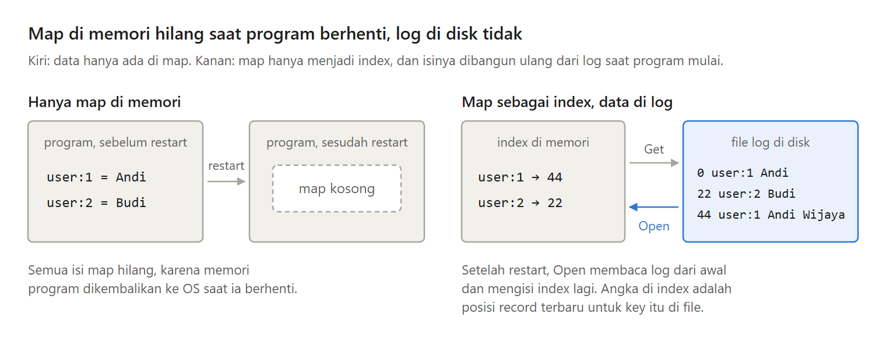
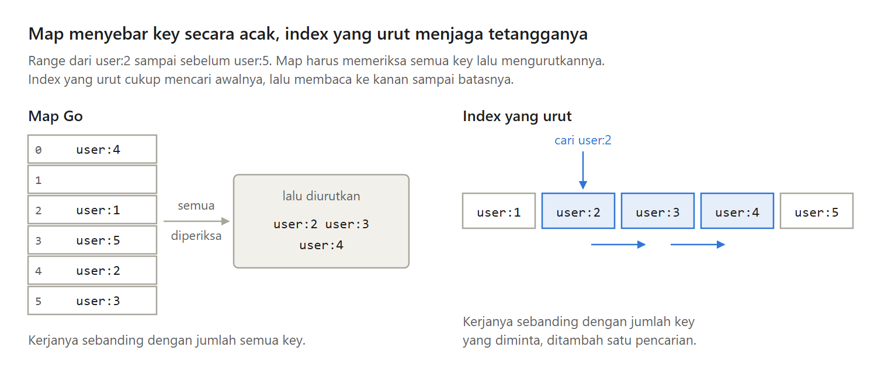

Database biasanya kita pakai, bukan kita buat. Di seri baru ini, kita membuat database key-value sendiri dengan Go, hanya dengan library standar, dalam enam bagian.

Bagian 1 menjawab pertanyaan pertama. Map di Go sudah bisa menyimpan key dan value, jadi apa yang kurang dari map di memori?

---

Isi map hanya ada selama programnya berjalan. Saat program berhenti, mengalami crash, atau di-restart, memorinya dikembalikan ke OS dan semua isi map hilang.

Jadi data ditulis di disk sebagai log, yaitu file yang hanya bertambah di ujungnya. Map di memori hanya menjadi index yang menunjuk ke posisi data di file, dan dibangun ulang dari log setiap kali program mulai.

---

Redis juga menyimpan semua datanya di memori, tetapi tetap menulis ke disk lewat RDB dan AOF supaya datanya selamat dari restart.

Data yang ditulis program juga belum tentu sampai ke disk. Data itu baru ada di memori OS sampai fsync dipanggil. Di laptop saya, satu Put memakan sekitar 4,3 mikrodetik, dan Put lalu fsync sekitar 488 mikrodetik.

---

Map juga tidak menyimpan urutan key. Untuk mengambil semua key dari user:2 sampai user:5, map harus memeriksa semua key lalu mengurutkannya.

Index yang urut cukup mencari key pertama, lalu membaca ke kanan. Di benchmark, mengambil 10 key dari 100.000 key lewat map memakan sekitar 16 milidetik.

---

Versi pertama kita mirip Bitcask, mesin penyimpanan milik Riak. Setiap Put menjadi satu record di ujung log, dengan CRC-32C, yaitu angka pemeriksa untuk menemukan record yang rusak.

Saat file dibuka, record yang terpotong karena listrik padam dibuang. Program yang dihentikan paksa dengan kill -9 meninggalkan 481.805 key yang semuanya utuh, karena setiap tulisannya sudah ada di memori OS.

---

Kelemahannya terlihat saat datanya besar. File dengan satu juta key butuh lebih dari setengah detik hanya untuk dibuka, karena seluruh log dibaca ulang.

Semua key juga harus muat di memori, Range tetap memeriksa semua key, dan log terus membesar karena record lama tidak pernah dihapus.

---

Ini Bagian 1 dari seri Membuat Database Key-Value Sendiri, lengkap dengan kode Go, test, dan hasil benchmark-nya. Di Bagian 2, kita membangun B+tree supaya key tersimpan urut.

https://medium.com/p/d2c94671f110
