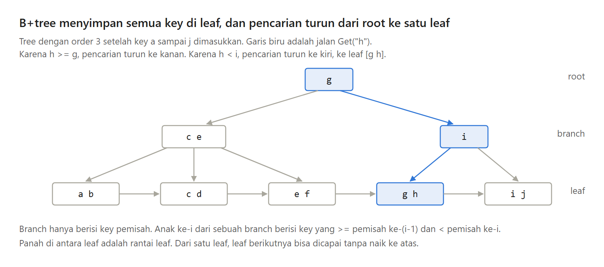
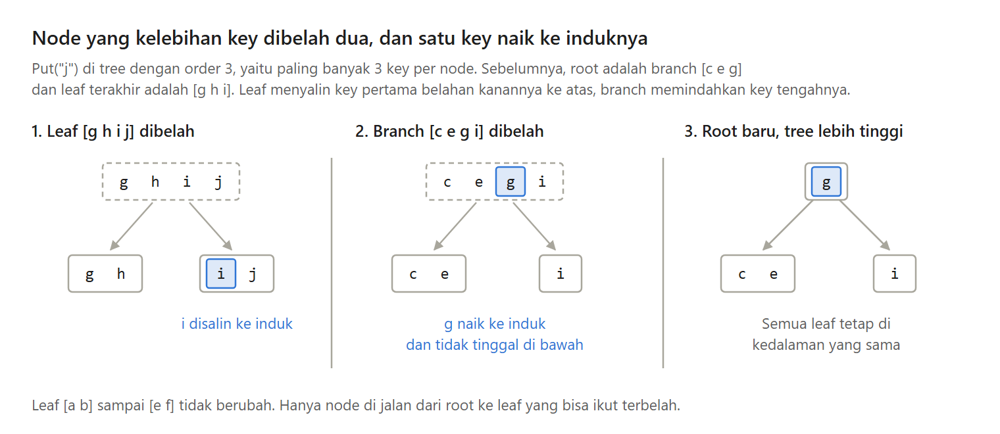

Di Bagian 1, database key-value kita memakai map sebagai index. Map cepat untuk Get, tetapi tidak menyimpan urutan key, jadi Range harus memeriksa semua key lalu mengurutkannya.

Di Bagian 2, kita mengganti map itu dengan B+tree yang kita tulis sendiri dengan Go.

---

Kenapa tidak slice yang diurutkan saja? Get dan Range cukup dengan binary search, tetapi setiap key baru di tengah slice menggeser semua key di kanannya.

Binary search tree tidak menggeser apa pun, tetapi satu key per node berarti setidaknya 20 tingkat untuk satu juta key. Saat tree pindah ke disk, setiap tingkat bisa berarti satu kali membaca disk.

---

B+tree menyimpan banyak key di setiap node. Semua key dan value ada di leaf, branch hanya berisi key pemisah, dan setiap leaf menunjuk ke leaf berikutnya.

Get turun dari root ke satu leaf, membaca satu node per tingkat. Dengan 64 key per node, satu juta key paling banyak butuh empat tingkat.

---

Put menyisipkan key di leaf yang benar. Kalau leaf kelebihan key, leaf dibelah dua dan key pertama belahan kanan disalin ke induknya.

Kalau induknya ikut kelebihan, key tengahnya naik lagi. Kalau root yang dibelah, root baru dibuat di atasnya. Tree hanya tumbuh di atas, jadi semua leaf selalu berada di kedalaman yang sama.

---

Range turun sekali ke leaf yang berisi key pertama, lalu berjalan ke kanan lewat rantai leaf sampai batasnya, tanpa kembali ke root.

Di benchmark, mengambil 10 key dari 100.000 key turun dari sekitar 16 milidetik dengan map menjadi sekitar 54 mikrodetik dengan B+tree.

---

Test utamanya memakai map biasa sebagai kunci jawaban. 20.000 key acak ditulis ke keduanya, lalu setiap Get dan 300 Range acak harus memberi hasil yang sama.

Saat satu baris di pencarian anak sengaja dihapus, test itu langsung gagal di kelima order yang diuji.

---

Yang dikorbankan adalah kecepatan Get. Untuk 100.000 key, Get di B+tree memakan sekitar 414 nanodetik, dan Get di map sekitar 38 nanodetik.

B+tree ini juga masih hidup di memori, jadi masih dibangun ulang dari log setiap kali program mulai.

---

Ini Bagian 2 dari seri Membuat Database Key-Value Sendiri, lengkap dengan kode Go dan test-nya. Di Bagian 3, B+tree disimpan di file dengan halaman 16 KB.

https://medium.com/p/57981f8b7d57
