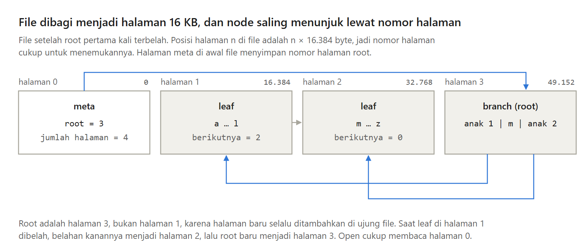
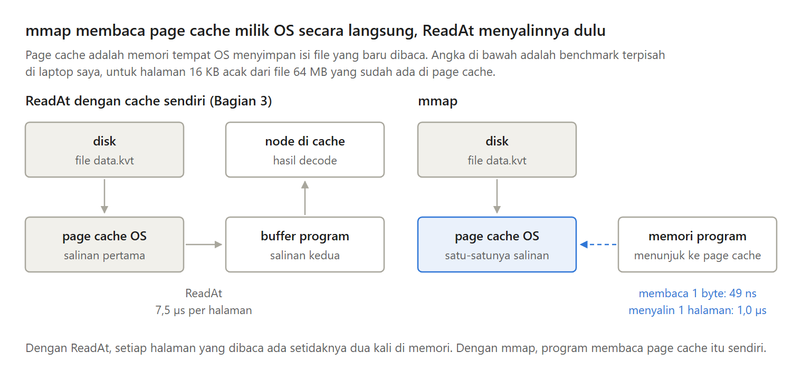
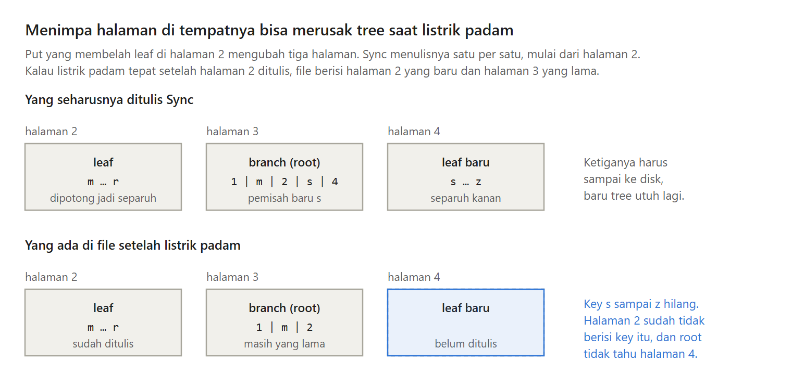

B+tree di Bagian 2 masih hidup di memori, jadi harus dibangun ulang dari seluruh log setiap kali program mulai. Satu Get di file berisi satu juta key masih memakan sekitar 0,36 detik.

Di Bagian 3, B+tree itu sendiri disimpan di file, dibagi menjadi halaman 16 KB, satu node di setiap halaman.

---

Dengan halaman berukuran tetap, posisi sebuah node cukup dihitung dari nomor halamannya. Branch menyimpan nomor halaman anak-anaknya, dan halaman 0 menyimpan nomor halaman root.

Ukuran 16 KB sama dengan ukuran halaman bawaan InnoDB di MySQL. Halaman yang besar berarti banyak anak di setiap branch, jadi tree tetap pendek.

---

Setiap halaman dimulai dengan header 12 byte, lalu entri yang ditulis berurutan. Header-nya membawa CRC-32C, angka pemeriksa untuk seluruh halaman.

Halaman yang tertulis setengah karena listrik padam punya CRC yang tidak cocok, jadi Get mengembalikan error, bukan data yang salah.

---

Lalu kenapa tidak mmap? mmap membuat memori program menunjuk langsung ke page cache milik OS. Di laptop saya, membaca halaman 16 KB lewat ReadAt memakan sekitar 7,5 mikrodetik, dan lewat mmap sekitar 1 mikrodetik.

---

Masalahnya, library standar Go punya syscall.Mmap untuk Linux, tetapi tidak untuk Windows, yang butuh fungsi yang berbeda. Di Windows, file yang sedang dipetakan juga tidak bisa diperkecil, dan di Linux, membaca melewati akhir file menjadi sinyal SIGBUS, bukan error.

Jadi versi ini memakai ReadAt dan cache sendiri. Kelemahannya, setiap halaman ada di memori dua kali.

---

Hasilnya, file berisi satu juta key dibuka tanpa membaca isinya. Get hanya membaca tiga halaman, root, satu branch, dan satu leaf, dan sebagai program terpisah memakan sekitar 0,03 detik.

---

Kelemahan terbesarnya adalah halaman yang ditimpa di tempatnya. Kalau listrik padam di tengah Sync, sebagian halaman sudah baru dan sebagian masih lama, dan key bisa hilang dari tree.

CRC tidak menolong di sini, karena setiap halaman utuh. Hanya saja, halaman-halaman itu berasal dari waktu yang berbeda.

---

Ini Bagian 3 dari seri Membuat Database Key-Value Sendiri, lengkap dengan kode Go, test, dan hasil benchmark-nya. Di Bagian 4, halaman tidak lagi ditimpa, tetapi ditulis di tempat baru.

https://medium.com/p/81f8c661065e
