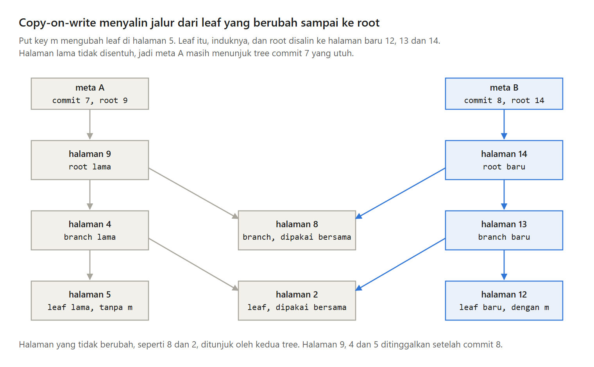
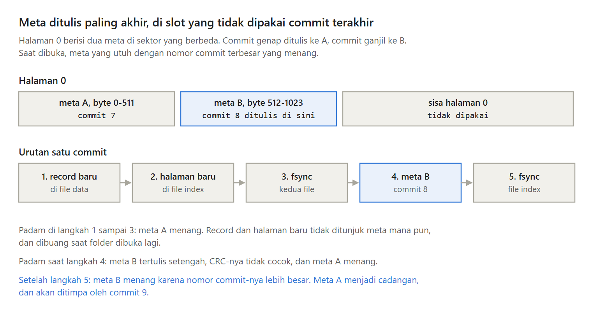
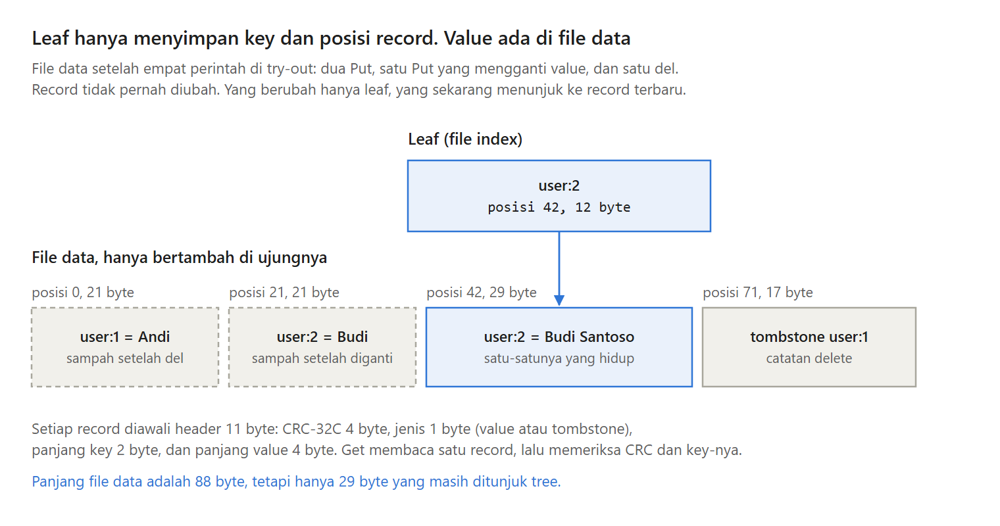

Di Bagian 3, B+tree kita disimpan di halaman 16 KB, tetapi halaman yang berubah ditimpa di tempatnya. Kalau listrik padam di tengah Sync, file bisa berisi leaf baru dengan induk lama, dan sebagian key tidak bisa ditemukan lagi.

Di Bagian 4, kita membuat commit yang atomik. Setelah listrik padam, file berisi commit itu seluruhnya, atau tidak sama sekali.

---

Jawaban yang biasa adalah journal. SQLite memakai rollback journal secara bawaan, dan WAL sebagai pilihan kedua. Kelemahannya, setiap perubahan ditulis dua kali.

Kita memilih copy-on-write, seperti LMDB dan bbolt. Halaman yang berubah ditulis ke halaman baru, induknya ikut disalin, sampai ke root. Halaman lama tidak pernah disentuh.

---

Copy-on-write punya satu akibat yang tidak terlihat dari luar. Rantai leaf harus dilepas.

Leaf yang berubah pindah ke halaman baru, jadi leaf di sebelah kirinya harus disalin juga, lalu tetangganya, sampai leaf paling kiri. Range sekarang menuruni tree dari root, dan kembali ke induknya saat sebuah leaf habis.

---

Meta, yang menyimpan nomor halaman root, sekarang ada dua, A dan B. Commit genap ditulis ke A, commit ganjil ke B, dan saat dibuka, meta yang utuh dengan nomor commit terbesar yang menang.

Urutannya adalah record dan halaman baru, fsync, baru meta, lalu fsync lagi. Sebelum meta tertulis, tidak ada yang menunjuk ke halaman baru.

---

Value juga pindah ke file data yang hanya bertambah di ujungnya. Leaf hanya menyimpan key dan posisi record, jadi value tidak lagi dibatasi 2 KB.

Delete menulis tombstone, catatan bahwa key sudah dihapus. Dengan tombstone, file data saja sudah cukup untuk mengetahui isi database.

---

Delete membuat node menyusut. Node yang isinya kurang dari seperempat halaman, batas yang sama dengan bbolt, digabung dengan saudaranya.

Kalau gabungannya tidak muat, gabungan itu dibelah lagi di tengah, dan hasilnya sama dengan meminjam key dari saudara. Menghapus 4.990 dari 5.000 key membuat tree setinggi tiga tingkat kembali menjadi satu leaf.

---

Lalu saya mencoba merusaknya. Listrik padam disimulasikan di setiap penulisan sebuah commit, 94 titik, dan semuanya kembali ke commit lama yang utuh.

Program anak yang terus menulis juga dihentikan paksa lima kali di saat acak. Setiap kali, folder dibuka di commit yang utuh. Saat meta saya paksa selalu ditulis ke A, test-nya langsung gagal.

---

Ini Bagian 4 dari seri Membuat Database Key-Value Sendiri, lengkap dengan kode Go, test, dan benchmark-nya. Kelemahannya, halaman lama dan value lama tertinggal sebagai sampah. Bagian 5 membereskannya dengan free list dan compaction.

https://medium.com/p/6adc9847b43b
