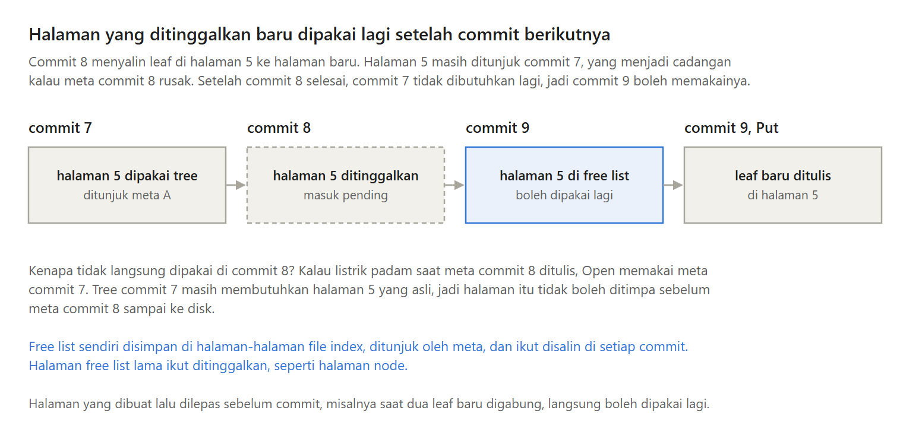
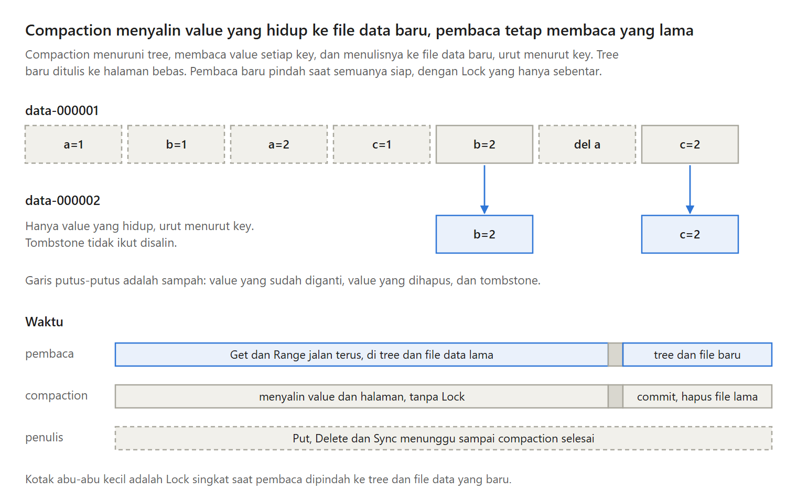
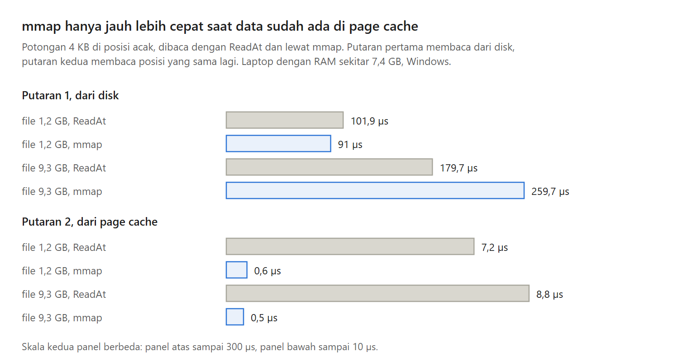

Copy-on-write di Bagian 4 membuat file tidak rusak saat listrik padam. Tetapi setiap commit meninggalkan halaman lama di file index, dan setiap value yang diganti meninggalkan record lama di file data.

Di Bagian 5, kita membereskan sampah itu, lalu mengisi database kita dengan data 9 GB di laptop ber-RAM sekitar 7,4 GB.

---

Halaman yang ditinggalkan dicatat di free list dan dipakai lagi. Tetapi tidak langsung. Halaman yang ditinggalkan commit 8 masih dibutuhkan commit 7, cadangan kalau meta commit 8 rusak. Jadi halaman itu baru dipakai lagi di commit 9.

Hasilnya, 80 commit berturut-turut, file index berhenti di 140 halaman.

---

File data dipadatkan dengan compaction. Value yang masih hidup disalin ke file baru, lalu file lama dihapus.

Kapan? Saat lebih dari 75% file data adalah sampah. Badger menyarankan 50%, yang membuat setiap value ditulis sekitar 2 kali seumur hidupnya. Dengan 75%, sekitar 1,33 kali, tetapi file boleh tumbuh sampai 4 kali data yang hidup.

---

Compaction tidak menghentikan pembaca. Tree lama tidak pernah diubah, jadi Get terus membacanya sementara tree baru ditulis di halaman lain. Pembaca baru pindah dengan Lock yang singkat.

Di test, compaction memakan sekitar 1 detik, dan lebih dari 58.000 Get selesai selama itu. Penulis yang menunggu, dan itu kelemahan yang saya terima.

---

Cache juga sekarang membuang node yang paling lama tidak dipakai (LRU). Dengan 8 juta key, 9,3 GB file data dan 412 MB file index, heap Go hanya sekitar 114 MB dengan cache 4.096 node, dan sekitar 3 MB dengan cache 64 node.

Get dari disk sekitar 441 mikrodetik. Key yang sama dibaca lagi, sekitar 50 mikrodetik.

---

Lalu mmap, yang di Bagian 3 ditunda sampai data melebihi memori. Saya mengukurnya.

Saat data harus diambil dari disk, mmap tidak lebih cepat dari ReadAt, sekitar 90 sampai 260 mikrodetik. Saat data sudah di page cache, mmap sekitar 0,5 mikrodetik dan ReadAt sekitar 8. Yang menentukan bukan besar data, tetapi apakah bagian yang sering dibaca muat di memori.

---

Ini Bagian 5 dari seri Membuat Database Key-Value Sendiri, lengkap dengan kode Go, test listrik padam saat compaction, dan pengukurannya. Bagian 6 membandingkan semuanya dengan bbolt dan Badger.

https://medium.com/p/948816b47681
