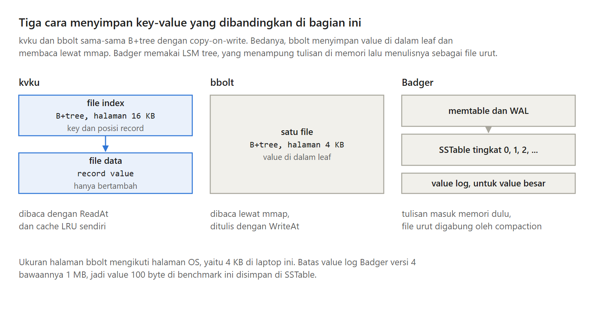
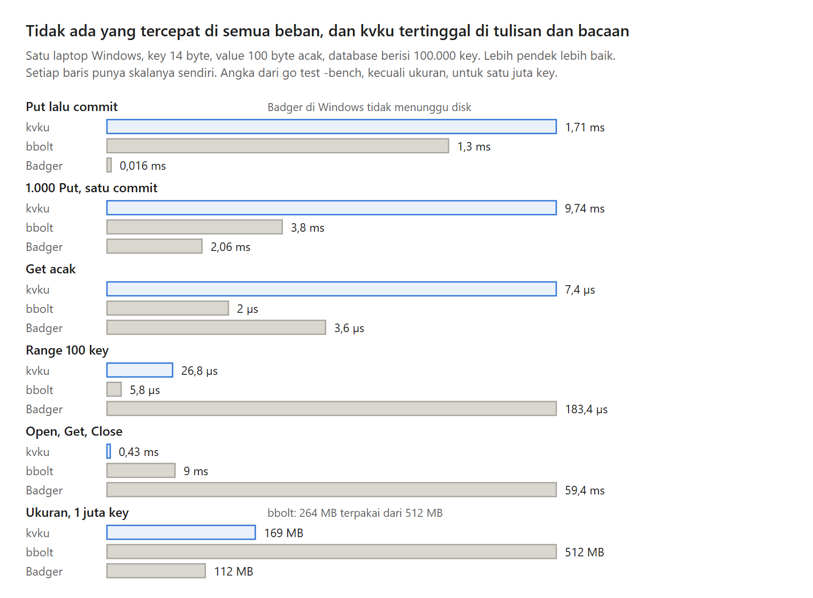

Lima bagian membangun database key-value sendiri, dari log dan map sampai copy-on-write, compaction, dan data 9 GB. Semuanya lulus test listrik padam.

Tetapi test hanya menjawab apakah database kita benar. Di Bagian 6, bagian terakhir, kita mengukur seberapa jauh ia dari bbolt dan Badger, di laptop yang sama.

---

Ketiganya berbeda desain. bbolt adalah B+tree dengan copy-on-write di satu file, value di dalam leaf, dibaca lewat mmap. Badger adalah LSM tree, yang menampung tulisan di memori lalu menulisnya sebagai file urut.

Database kita ada di tengah. B+tree seperti bbolt, value di file terpisah seperti desain WiscKey yang menjadi dasar Badger.

---

Hasilnya tidak menyanjung. Get acak, bbolt 2 mikrodetik, Badger 3,6, database kita 7,4. Seribu Put dalam satu commit, bbolt 3,8 milidetik, database kita 9,7, karena setiap Put adalah satu system call.

Yang menang hanya Open, 0,4 milidetik, dibanding bbolt 9 dan Badger 59, karena hanya halaman 0 dan free list yang dibaca.

---

Ada satu angka yang aneh. Put lalu commit di Badger sekitar 16 mikrodetik, padahal fsync di laptop ini butuh ratusan mikrodetik.

Ternyata, di Windows, SyncWrites Badger berakhir di fungsi msync milik library ristretto, yang untuk Windows hanya berisi komentar TODO dan langsung mengembalikan nil. Commit-nya tidak menunggu disk, jadi angka itu tidak bisa dibandingkan.

---

Mengukur juga menunjukkan apa yang perlu diperbaiki. Range 100 key di versi Bagian 5 sekitar 270 mikrodetik, karena setiap value dibaca dengan satu ReadAt.

Padahal record key yang berurutan sering bersebelahan di file data, apalagi setelah compaction yang menulis urut menurut key. Membaca record yang bersebelahan dengan satu ReadAt membuat Range turun menjadi sekitar 27 mikrodetik.

---

Jadi kapan memakai yang mana? SQLite kalau datamu punya bentuk, dan halaman SQLite sendiri menyebutnya hampir selalu pilihan yang lebih baik untuk penyimpanan lokal dengan sedikit penulis. bbolt kalau bacaan jauh lebih banyak dari tulisan. Badger atau Pebble kalau tulisan banyak dan datanya besar.

Database buatan sendiri? Untuk belajar kenapa mereka memilih apa yang mereka pilih.

---

Ini Bagian 6, bagian terakhir dari seri Membuat Database Key-Value Sendiri, dengan kode benchmark-nya, kelemahan desainnya, dan rekap keenam bagian.

https://medium.com/p/82f2c0ac6a9e
