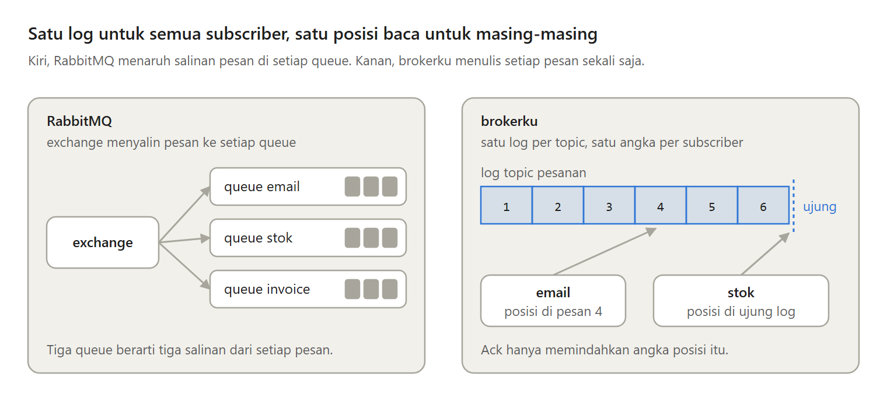
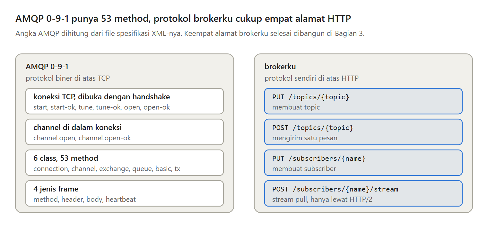
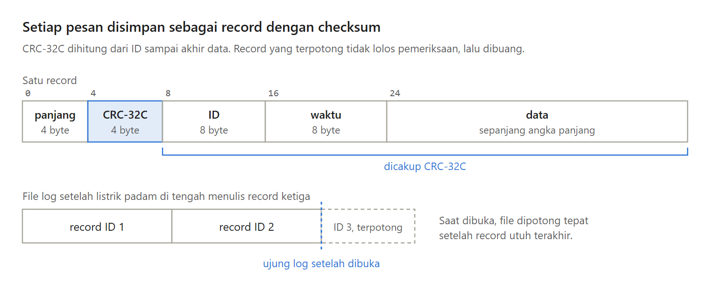

Message broker biasanya kita pakai, bukan kita buat. Di seri baru ini, kita membuat satu sendiri dengan Go, hanya dengan library standar, dalam enam bagian.

Bagian 1 menjawab dua pertanyaan pertama. Broker kita berbicara dengan protokol apa, dan bagaimana pesan disimpan supaya tidak hilang saat broker mati.

---

Broker kita tidak meniru queue di RabbitMQ. RabbitMQ menyalin setiap pesan ke setiap queue, lalu menghapusnya setelah di-ack.

Broker kita menulis setiap pesan sekali di log milik topic-nya, yaitu file yang hanya bertambah di ujungnya. Setiap subscriber cukup punya satu angka, yaitu posisi bacanya, dan ack hanya memindahkan angka itu.

---

Kenapa tidak memakai AMQP 0-9-1 saja, protokol asli RabbitMQ? Client-nya sudah ada untuk banyak bahasa.

Masalahnya, spesifikasinya berisi 6 class dan 53 method, enam langkah pembukaan sebelum pesan pertama, channel, dan empat jenis frame biner. Model-nya juga queue yang dihapus setelah di-ack, bukan log dan posisi baca.

---

Kafka dan NATS juga memakai protokol sendiri yang mengikuti model masing-masing. Broker kita memilih protokol sendiri di atas HTTP, dengan empat alamat saja.

Setiap bahasa sudah punya client HTTP, dan producer bisa mengirim pesan dengan curl. Kelemahannya, tidak ada client siap pakai, jadi program yang terhubung ke RabbitMQ tidak bisa langsung pindah.

---

Pesan baru aman setelah sampai ke disk, dan write yang berhasil belum menjamin itu. Data masih di memori OS sampai fsync dipanggil.

Di laptop saya, menulis satu pesan memakan sekitar 3,6 mikrodetik, dan menulis lalu fsync sekitar 470 mikrodetik. Jadi broker memanggil fsync sekali setiap detik, dan listrik yang padam bisa menghilangkan pesan dari sekitar satu detik terakhir.

---

Setiap pesan disimpan sebagai record, yaitu header 24 byte dan data pesannya. Header berisi panjang data, CRC-32C, ID, dan waktu.

CRC-32C adalah checksum, angka pemeriksa yang dihitung dari isi record. Kafka dan PostgreSQL memakainya untuk tugas yang sama, yaitu menemukan kerusakan yang tidak disengaja.

---

Listrik bisa padam tepat saat sebuah record ditulis, sehingga ujung log berisi record setengah jadi.

Jadi setiap kali log dibuka, broker memeriksa semua record dari awal. Di record pertama yang panjangnya tidak masuk akal, datanya tidak lengkap, atau CRC-nya tidak cocok, file dipotong. Kelemahannya, kerusakan di tengah log ikut membuang semua record setelahnya.

---

Ini Bagian 1 dari seri Membuat Message Broker Sendiri, lengkap dengan kode Go, test, dan hasil benchmark-nya. Di Bagian 2, broker mulai mengingat posisi baca setiap subscriber.

https://medium.com/p/e403943bae69
