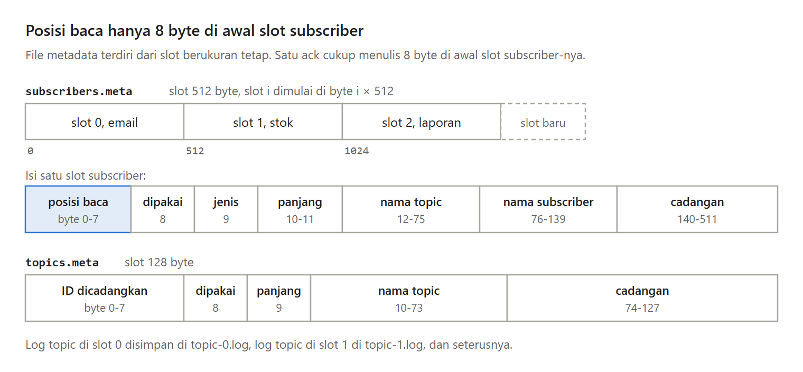
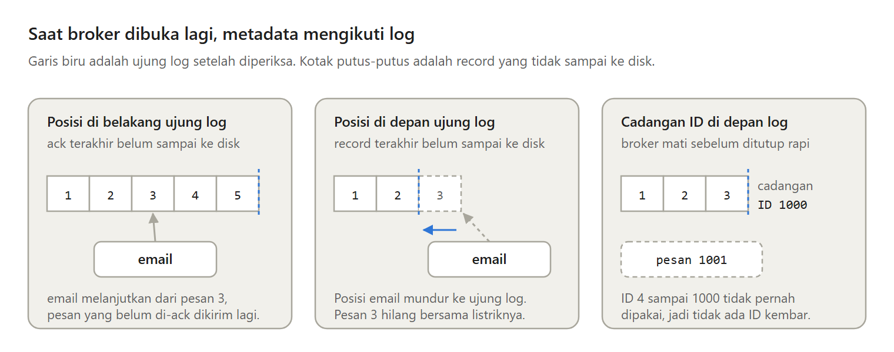

Log pesan dari Bagian 1 menyimpan pesan, tetapi belum tahu siapa yang sudah membaca apa.

Di Bagian 2 seri Membuat Message Broker Sendiri, broker mulai mengingat topic, subscriber, dan posisi baca setiap subscriber. Setelah broker mati dengan cara apa pun, setiap subscriber melanjutkan dari tempat yang benar.

---

Posisi baca cukup satu angka per subscriber, karena pesan di log selalu berurutan. Dokumentasi Kafka menyebut hal yang sama, posisi consumer di setiap partition hanya satu bilangan bulat.

Kafka menyimpan posisi itu sebagai pesan di sebuah topic internal. Untuk broker kecil, menulis ulang satu angka di tempat yang sama jauh lebih sederhana.

---

Ada tiga cara menyimpan angka yang berubah di setiap ack. File JSON yang ditulis ulang lalu di-rename, slot berukuran tetap yang diubah di tempat, atau memory-mapped file.

Rename aman, tetapi setiap ack menulis ulang seluruh daftar. Memory-mapped file paling cepat. Di laptop saya, menulis 8 byte lewat mmap sekitar 2,8 nanodetik, dan lewat WriteAt sekitar 2,8 mikrodetik.

---

Broker ini tetap memilih slot dengan WriteAt. Dengan mmap, OS yang menentukan kapan perubahan sampai ke file, kesalahan akses datang sebagai sinyal SIGBUS yang menghentikan program Go, dan library standar Go tidak menyediakan mmap untuk Windows.

Lagi pula, 2,8 mikrodetik masih kecil dibanding satu fsync, sekitar 470 mikrodetik.

---

Metadata disimpan di dua file berisi slot berukuran tetap. Slot subscriber berukuran 512 byte, dan posisi baca ada di 8 byte pertamanya, jadi satu ack hanya menulis 8 byte.

Setiap detik, broker memanggil fsync untuk semua log lebih dulu, baru untuk metadata, supaya posisi di disk jarang mendahului log di disk.

---

Saat dibuka lagi, log adalah sumber kebenaran. Posisi di belakang ujung log membuat pesan yang ack-nya hilang dikirim lagi. Posisi di depan ujung log dimundurkan, karena record-nya hilang bersama listriknya.

ID juga dicadangkan per 1.000 dan dicatat di disk lebih dulu, supaya ID yang mungkin sudah dilihat consumer tidak pernah dipakai untuk pesan lain.

---

Kelemahannya, listrik padam bisa menghilangkan sekitar satu detik terakhir, ID melompat setelah broker mati mendadak, dan belum ada program lain yang bisa menerima pesan. Itu tugas Bagian 3.

Ini Bagian 2 dari seri Membuat Message Broker Sendiri, lengkap dengan kode Go dan test-nya.

https://medium.com/p/7844af967263
