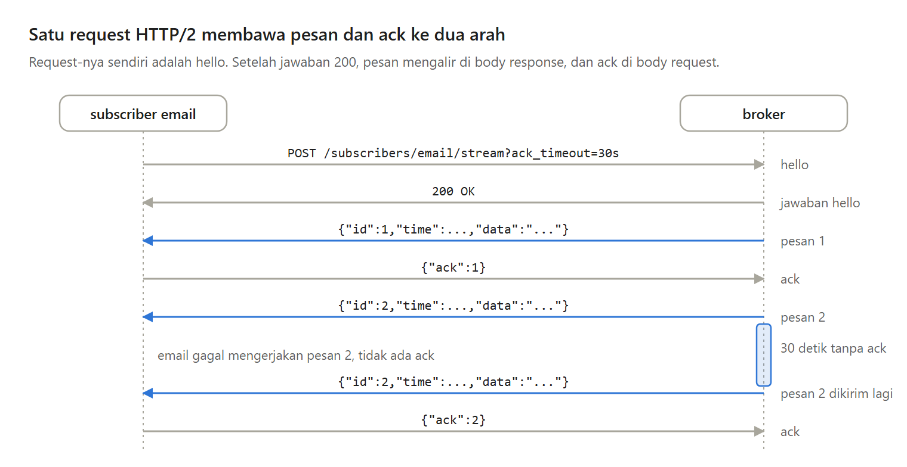
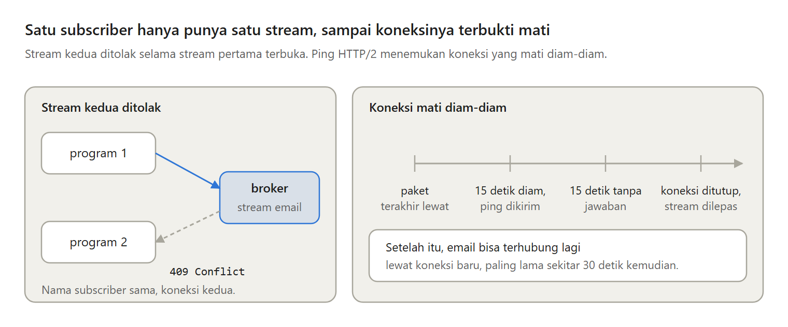

Broker dari Bagian 2 sudah mengingat posisi baca setiap subscriber, tetapi pesannya belum bisa keluar dari program broker.

Di Bagian 3 seri Membuat Message Broker Sendiri, subscriber membuka satu koneksi ke broker, menerima pesan satu per satu, dan mengirim ack untuk setiap pesan yang selesai.

---

Pesan bisa diantar dengan dua cara. Broker datang ke subscriber, yaitu push, atau subscriber datang sendiri, yaitu pull.

Menurut dokumentasi Kafka, consumer di sistem push cenderung kewalahan saat lebih lambat dari producer, sedangkan di sistem pull consumer cukup tertinggal lalu menyusul. Subscriber pull juga hanya butuh koneksi keluar, jadi bisa berjalan di balik NAT.

---

Pesan dan ack lewat satu request HTTP/2. Request-nya sendiri adalah hello, dan setelah jawaban 200, pesan mengalir sebagai baris JSON di body response, sedangkan ack mengalir di body request yang sama.

Stream yang putus membawa pesan yang sedang dipegangnya, dan broker cukup mengirimnya lagi.

---

Kenapa bukan WebSocket? Library standar Go tidak menyediakannya. Kenapa bukan dua request, satu untuk pesan dan satu untuk ack? Ack lalu datang lewat koneksi lain yang mungkin sudah putus.

Kelemahannya, client harus bisa HTTP/2. curl biasa memakai HTTP/1.1 dan ditolak, dan proxy di tengah jalan harus meneruskan HTTP/2.

---

Setiap subscriber hanya memegang satu pesan sampai di-ack. Urutan pesan terjaga dengan sendirinya, tetapi throughput-nya turun. Di laptop saya, satu putaran pesan dan ack sekitar 140 mikrodetik, kira-kira 7.000 pesan per detik per subscriber.

Kalau ack tidak datang dalam 30 detik, sama dengan bawaan JetStream di NATS, pesan yang sama dikirim lagi.

---

Pengiriman ulang berarti pesan yang sama bisa dikerjakan lebih dari sekali. Saat dicoba, subscriber yang butuh 3 detik per pesan dengan timeout ack 1 detik mengerjakan satu pesan tiga kali.

Jadi subscriber harus idempotent, dan timeout ack harus lebih panjang dari pekerjaan yang normal.

---

Satu subscriber hanya boleh punya satu stream. Stream kedua ditolak dengan 409 Conflict, mirip exclusive consumer di RabbitMQ.

Koneksi yang mati diam-diam ditemukan dengan ping HTTP/2. Broker mengirim ping ke koneksi yang diam 15 detik, lalu menutupnya kalau 15 detik berikutnya tidak ada jawaban.

---

Kelemahan terbesar versi ini, pesan yang tidak pernah di-ack dikirim ulang selamanya dan menahan pesan sesudahnya. Di Bagian 4, kita membangun webhook dan percobaan ulang dengan jeda yang makin panjang, lalu melewati pesan setelah 10 kali gagal.

Ini Bagian 3 dari seri Membuat Message Broker Sendiri, lengkap dengan kode Go dan percobaannya.

https://medium.com/p/87222de2c9f8
