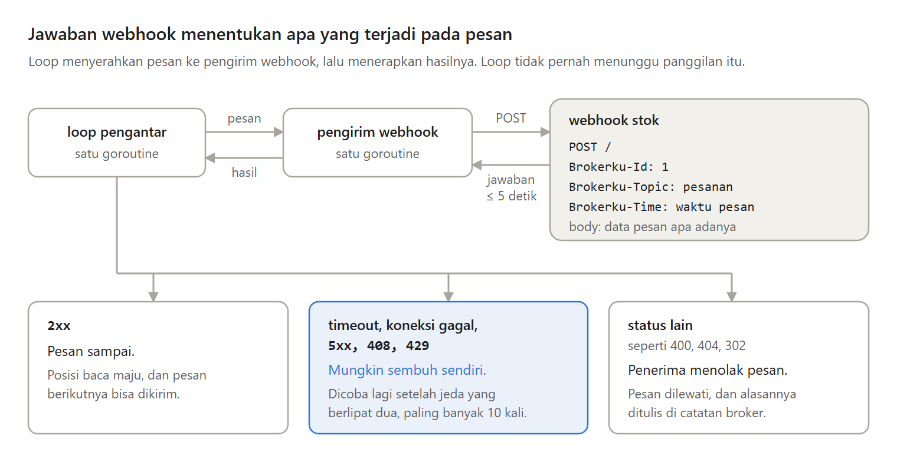
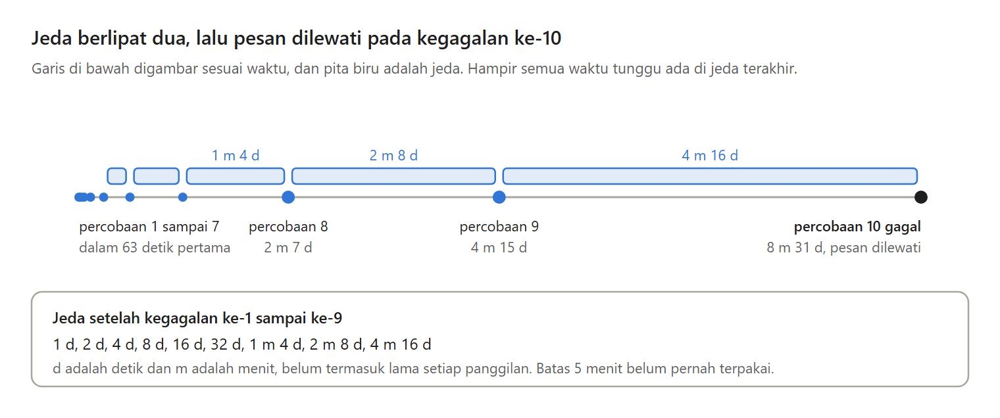

Di Bagian 3, subscriber harus membuka koneksi ke broker dan memegangnya terus. Pesan yang tidak pernah di-ack juga dikirim ulang selamanya, sehingga pesan sesudahnya ikut tertahan.

Di Bagian 4 seri Membuat Message Broker Sendiri, broker mulai mendatangi subscriber lewat webhook, dan belajar kapan harus mencoba lagi dan kapan harus menyerah.

---

Webhook adalah alamat HTTP milik subscriber yang dipanggil broker untuk setiap pesan. Body-nya berisi data pesan apa adanya, dan ID pesan dikirim di header.

Broker hanya mengirim satu pesan ke setiap webhook, lalu menunggu jawabannya sebelum mengirim yang berikutnya. Jadi webhook tidak bisa kewalahan, dan setiap panggilan dibatasi timeout 5 detik.

---

Tidak semua kegagalan layak dicoba lagi. Menurut RFC 9110, 5xx berarti server salah atau tidak mampu, dan 503 biasanya pulih setelah beberapa saat. 408 dan 429 juga sementara.

Status 4xx yang lain, seperti 400 atau 404, berarti request-nya yang salah, dan request yang sama akan ditolak lagi. Jadi broker mencoba lagi timeout, koneksi putus, 5xx, 408, dan 429, dan langsung melewati status lain.

---

Percobaan ulang tidak langsung dikirim. Dokumentasi AWS menyebut percobaan ulang bersifat egois, dan bisa memperburuk server yang sedang kelebihan beban.

Jedanya dimulai dari 1 detik dan berlipat dua, sampai paling lama 5 menit. Google Cloud Storage memakai angka awal yang sama untuk library C++-nya, yaitu 1 detik, pengali 2, dan paling lama 5 menit.

---

Setelah 10 kali gagal, pesan dilewati. Itu sekitar 8,5 menit jeda. Tanpa batas, satu pesan rusak menahan semua pesan sesudahnya, selamanya.

NATS JetStream secara bawaan mencoba tanpa batas, RabbitMQ 4.0 membatasi quorum queue di 20 kali, dan GitHub tidak mengirim ulang sama sekali. Kelemahan pilihan kita, gangguan yang panjang tetap melewati sekitar enam sampai tujuh pesan per jam.

---

Percobaan ulang juga berarti pesan bisa sampai dua kali, karena timeout tidak memberi tahu apakah webhook sudah mengerjakannya.

Jadi webhook harus idempotent, aman menerima pesan yang sama lebih dari sekali. Header ID pesan adalah alatnya, seperti saran Stripe untuk mencatat ID peristiwa yang sudah diproses.

---

Batas yang sama kini juga berlaku untuk stream pull. Ack yang tidak datang dalam timeout ack dihitung sebagai satu kegagalan, lalu pesannya dikirim lagi setelah jeda.

Subscriber yang lambat tetapi sehat cukup meminta timeout ack yang lebih panjang. Pesan yang rusak tidak punya obat lain selain dilewati.

---

Masih ada satu masalah. Hanya ada satu goroutine yang memanggil webhook, jadi webhook yang butuh 4 detik membuat subscriber webhook lain menunggu 8 detik di percobaan saya. Stream pull tidak ikut tertahan.

Ini Bagian 4 dari seri Membuat Message Broker Sendiri, lengkap dengan kode Go, test, dan percobaannya. Di Bagian 5, kita menggantinya dengan worker pool.

https://medium.com/p/6964d35a524b
