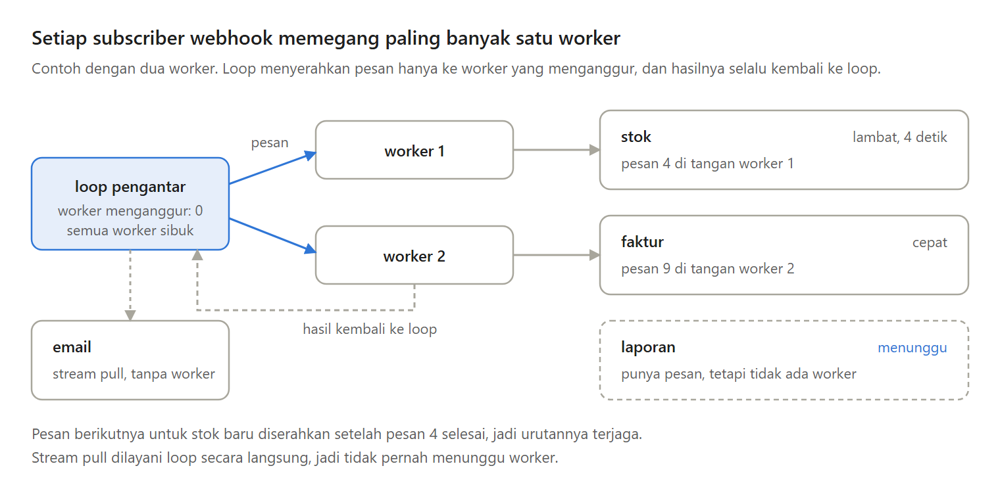
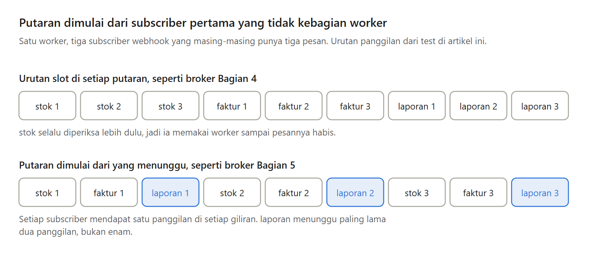
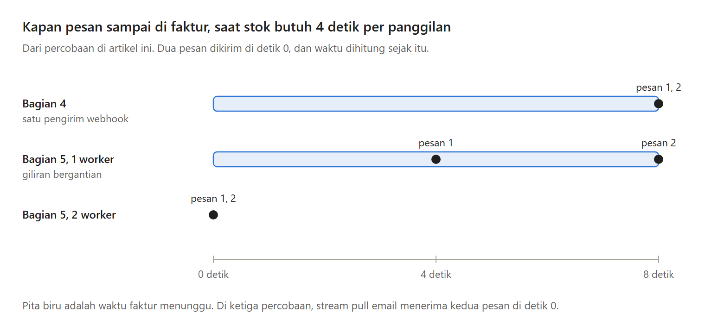

Di Bagian 4, broker saya memanggil webhook lewat satu goroutine saja. Webhook yang butuh 4 detik untuk setiap pesan membuat subscriber webhook lain menunggu 8 detik.

Di Bagian 5 seri Membuat Message Broker Sendiri, satu goroutine itu diganti dengan worker pool.

---

Masalah ini punya nama, head-of-line blocking, saat pekerjaan di depan antrean menahan semua yang di belakangnya. RFC 9113 menyebutnya untuk pipelining di HTTP/1.1, dan jawabannya sama, yaitu beberapa panggilan berjalan bersamaan.

Worker pool adalah sekumpulan goroutine dengan jumlah tetap, yang disebut worker, yang bergantian memanggil webhook. Jumlahnya diatur dengan flag -workers, bawaannya 1.

---

Kenapa bukan satu goroutine untuk setiap subscriber? Itu paling sederhana, tetapi broker dengan 500 subscriber webhook bisa menjalankan 500 panggilan HTTP bersamaan, tanpa batas.

Worker pool memberi batas itu. Kelemahannya, kalau webhook yang lambat lebih banyak daripada worker, subscriber lain kembali menunggu.

---

Urutan pesan tetap dijaga. Setiap subscriber memegang paling banyak satu worker, dan pesan berikutnya baru diserahkan setelah hasil pesan sebelumnya kembali ke loop.

Kafka melakukan hal serupa untuk setiap partisi, sedangkan Stripe tidak menjamin urutan peristiwa sama sekali. Kelemahan pilihan kita, satu subscriber tidak bisa lebih cepat dari satu panggilan setiap kali.

---

Saat semua worker sibuk, siapa yang mendapat giliran? Kalau loop selalu mulai dari slot pertama, subscriber di slot awal yang terus punya pesan akan selalu menang.

Jadi broker mengingat subscriber pertama yang tidak kebagian worker, dan putaran berikutnya dimulai darinya. Test saya dengan satu worker dan tiga subscriber menunjukkan giliran yang bergantian, satu pesan untuk setiap subscriber.

---

Berapa worker yang dibutuhkan? Benchmark dengan delapan webhook yang masing-masing butuh 10 milidetik memberi sekitar 85,8 milidetik per pesan untuk 1 worker, 43,3 untuk 2, 22,0 untuk 4, dan 12,2 untuk 8.

Lebih dari 8 tidak membantu, karena setiap subscriber hanya memegang satu worker.

---

Di percobaan dengan webhook 4 detik, faktur menerima kedua pesan setelah 8 detik di broker Bagian 4, setelah 4 dan 8 detik dengan 1 worker yang bergiliran, dan seketika dengan 2 worker. Subscriber pull menerimanya seketika di ketiga percobaan.

---

Ini Bagian 5 dari seri Membuat Message Broker Sendiri, lengkap dengan kode Go, test, benchmark, dan percobaannya. Di Bagian 6, bagian terakhir, kita menjalankan broker dengan tiga cara dan membandingkannya dengan RabbitMQ, NATS, dan Kafka.

https://medium.com/p/22761fe95d8c
