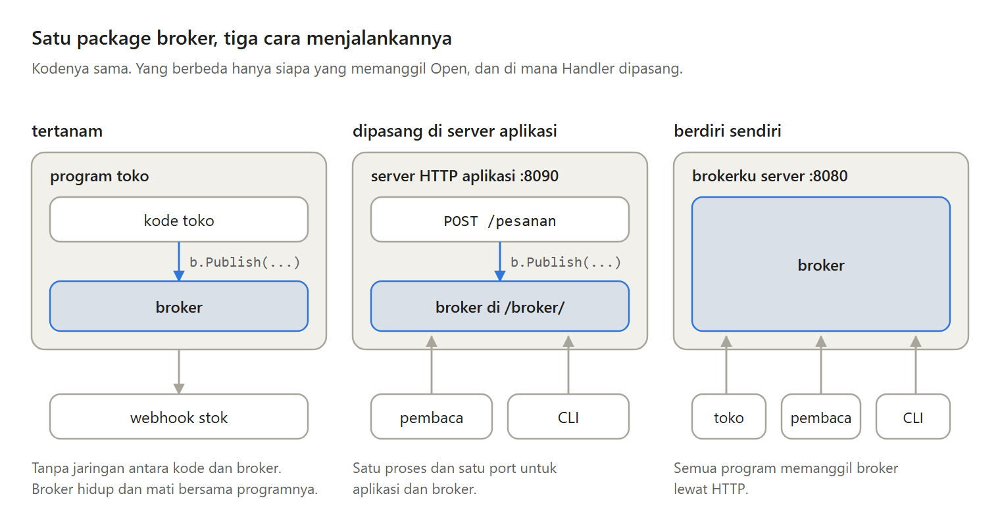
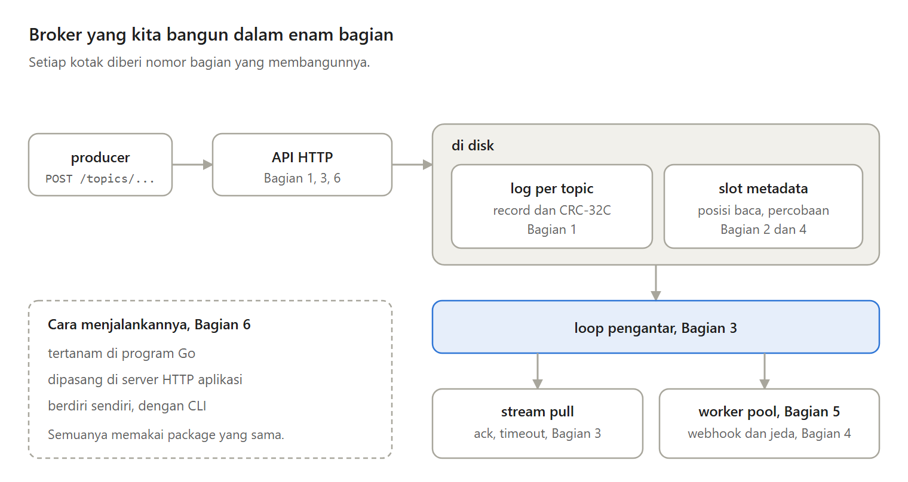
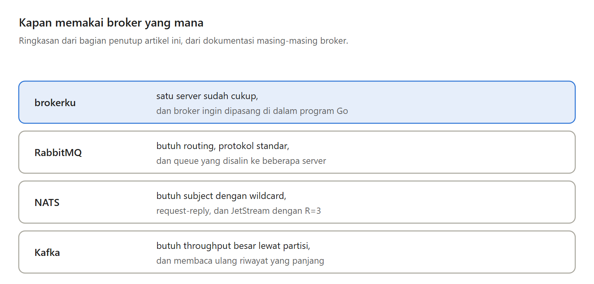

Message broker yang saya bangun dari nol dengan Go sudah menyimpan pesan, mengingat posisi baca, dan mengantar pesan lewat stream pull dan webhook.

Di Bagian 6, bagian terakhir seri Membuat Message Broker Sendiri, broker itu dijalankan dengan tiga cara, lalu seri ditutup dengan kelemahannya.

---

Broker-nya adalah package Go, dan API HTTP hanyalah satu cara memakainya. Jadi ada tiga cara menjalankannya.

Tertanam, program Go memanggil Publish sebagai fungsi biasa. Dipasang di server aplikasi, API broker berada di bawah /broker/ di samping alamat milik aplikasi. Berdiri sendiri, brokerku server berjalan sebagai server, dan CLI, program yang dipakai lewat perintah di terminal, memanggilnya lewat HTTP.

---

Bukankah broker seharusnya selalu berdiri sendiri? Untuk aplikasi kecil dengan satu server, itu berarti satu layanan lagi yang harus dijalankan dan dipantau.

Kelemahan broker yang tertanam, ia hidup dan mati bersama programnya, dan berbagi CPU dan memori dengannya. Karena itu, ketiga cara dibuat mungkin dengan package yang sama.

---

CLI-nya punya perintah topic create, subscriber create, publish, dan subscriber list. Daftar subscriber menunjukkan berapa kali sebuah webhook gagal dan kapan pesannya dicoba lagi, tanpa harus membaca catatan broker.

Di percobaan saya, webhook yang gagal dua kali muncul dengan hitungan 2, lalu kembali ke 0 setelah percobaan ketiga berhasil.

---

Enam bagian, satu broker. Log pesan per topic, posisi baca di slot berukuran tetap, stream pull dengan ack, webhook dengan jeda yang berlipat dua, worker pool yang adil, dan tiga cara menjalankannya. Broker-nya sendiri hanya sekitar 1.400 baris Go, dengan library standar saja.

---

Kelemahan terbesarnya, hanya ada satu server tanpa salinan. Dokumentasi NATS menyebut satu server sebagai satu titik kegagalan, sedangkan Kafka menyebut tiga salinan sebagai pengaturan yang umum di produksi.

Pesan dalam detik terakhir bisa hilang saat listrik padam, log terus membesar, pesan bisa sampai lebih dari sekali, dan API-nya tanpa autentikasi.

---

Pilih RabbitMQ kalau butuh routing dan protokol standar seperti AMQP dan MQTT. Pilih NATS kalau butuh subject dengan wildcard dan request-reply. Pilih Kafka kalau butuh throughput besar lewat partisi dan riwayat pesan yang bisa dibaca ulang.

Rancangan seperti ini cocok kalau satu server cukup dan broker ingin ikut di dalam program Go.

---

Ini Bagian 6, bagian terakhir seri Membuat Message Broker Sendiri, lengkap dengan kode Go, test, dan percobaannya, ditambah rangkuman seluruh seri.

https://medium.com/p/c18c4bb3baab
