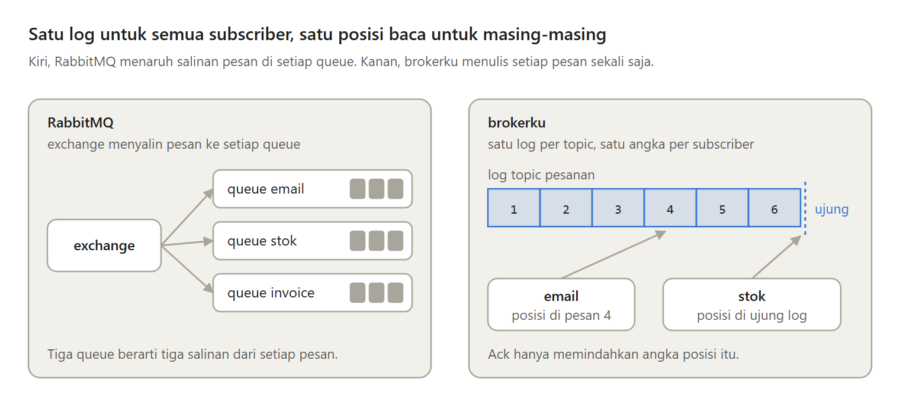
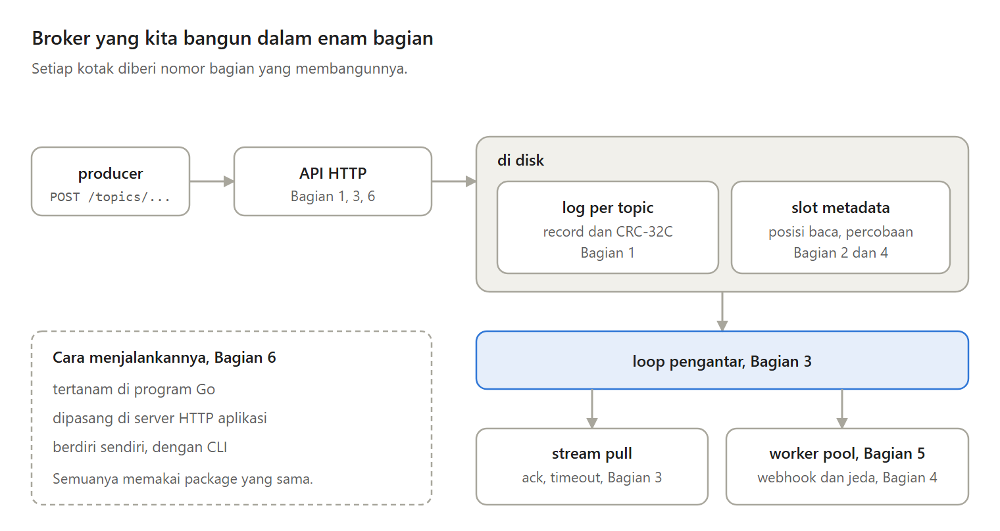
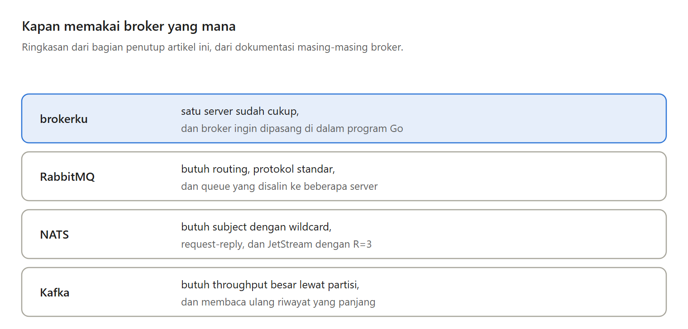

Message broker biasanya kita pakai, bukan kita buat. Seperti RabbitMQ, NATS, atau Kafka.

Dalam enam bagian, saya membangun satu message broker kecil dari nol dengan Go, hanya dengan library standar. Ini ringkasan seluruh serinya, dan apa yang ia ajarkan tentang broker yang sudah matang.

---

Broker kita tidak menyalin pesan ke setiap queue seperti RabbitMQ. Setiap pesan ditulis sekali di log milik topic-nya, yaitu file yang hanya bertambah di ujungnya.

Setiap subscriber cukup punya satu angka, yaitu posisi bacanya, dan ack hanya memindahkan angka itu. Protokolnya bukan AMQP, tetapi beberapa alamat HTTP, supaya producer bisa mengirim pesan dengan curl.

---

Bagian 1 memilih protokol dan menulis log, dengan CRC-32C untuk mengenali record yang terpotong saat listrik padam.

Bagian 2 menyimpan posisi baca di slot berukuran tetap, dan memaksa log ke disk sebelum metadata setiap detik.

Bagian 3 membuka stream pull lewat satu request HTTP/2, dan setiap subscriber memegang satu pesan sampai di-ack.

---

Bagian 4 memanggil webhook, mencoba lagi dengan jeda dari 1 detik yang berlipat dua, dan melewati pesan setelah 10 kali gagal.

Bagian 5 memakai worker pool, supaya webhook yang lambat tidak menahan subscriber lain, tanpa merusak urutan pesan.

Bagian 6 menjalankan broker yang sama dengan tiga cara, yaitu tertanam di program Go, dipasang di server aplikasi, atau berdiri sendiri dengan CLI.

---

Setiap bagian adalah satu keputusan yang juga diambil broker besar. Contohnya fsync, panggilan yang memaksa data sampai ke disk. Di laptop saya, menulis satu pesan sekitar 3,6 mikrodetik, dan menulis lalu fsync sekitar 470 mikrodetik.

Jadi broker kita memanggil fsync sekali setiap detik. Kelemahannya, listrik yang padam bisa menghilangkan pesan dalam detik terakhir, walaupun publish sudah berhasil.

---

Kelemahan terbesarnya, hanya ada satu server tanpa salinan. Menyalin log ke server lain dengan aman butuh algoritma konsensus seperti Raft, dan itu cukup untuk satu seri tersendiri.

Log juga terus membesar tanpa retensi, pesan bisa sampai lebih dari sekali sehingga subscriber harus idempotent, dan API-nya belum punya autentikasi.

---

Jadi kapan memakai broker yang sudah matang?

- RabbitMQ, kalau pesan harus diarahkan dengan aturan, atau butuh protokol standar seperti AMQP dan MQTT.
- NATS, kalau butuh subject dengan wildcard dan request-reply.
- Kafka, kalau butuh throughput besar lewat partisi dan riwayat yang bisa dibaca ulang.

Rancangan seperti ini cocok kalau satu server sudah cukup dan broker ingin ikut di dalam program Go.

---

Yang paling berguna dari seri ini bukan broker-nya, tetapi pertanyaan yang kini bisa kamu ajukan ke broker mana pun. Di mana posisi baca disimpan, kapan data dipaksa ke disk, dan apa yang terjadi pada pesan yang terus gagal.

Seri ini dibaca dari Bagian 1. Mulai dari sini:
https://medium.com/@archetipe/seri-membuat-message-broker-sendiri-bagian-1-protokol-sendiri-atau-amqp-lalu-menyimpan-pesan-di-e403943bae69

Semua bagiannya ada di https://medium.com/@archetipe
