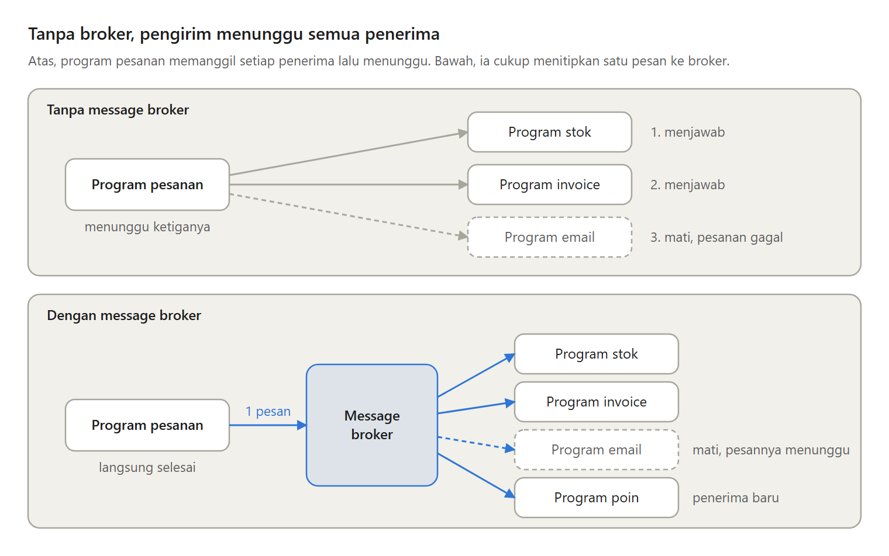
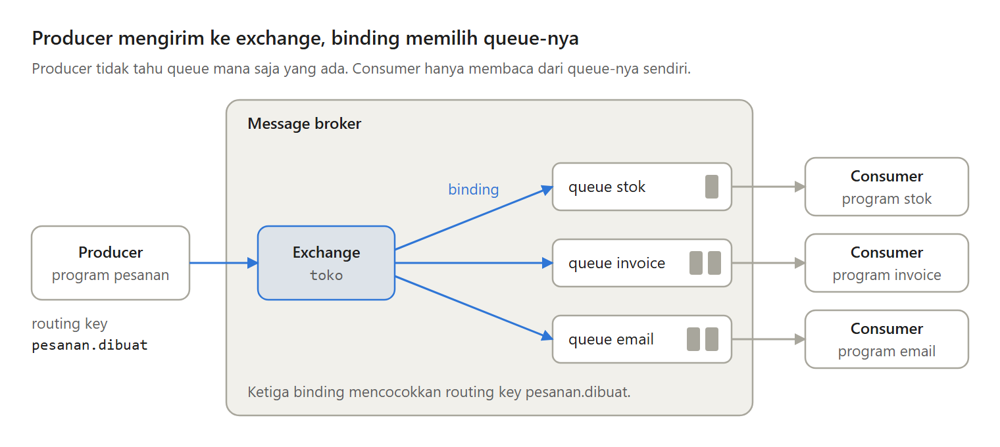
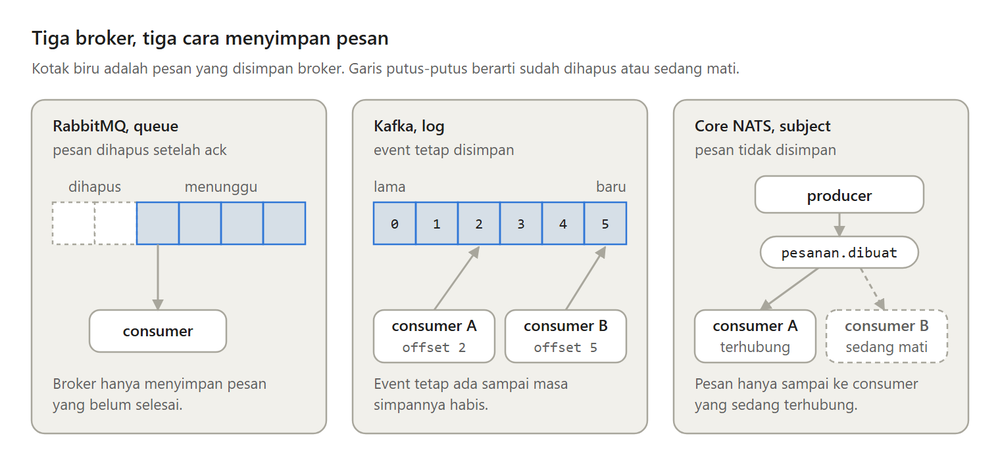

Toko online-mu makin ramai. Setiap pesanan harus mengurangi stok, membuat invoice, dan mengirim email konfirmasi. Lalu suatu hari program email mati, dan pesanan pembeli ikut gagal.

Di sinilah message broker berguna. Ini cara kerjanya, dan kapan kamu justru tidak membutuhkannya.

---

Kalau program pesanan memanggil setiap program secara langsung, muncul empat masalah:

- Satu penerima mati, pengirim ikut gagal.
- Pengirim menunggu penerima yang paling lambat.
- Pengirim harus mengenal semua penerima.
- Lonjakan saat flash sale tidak punya tempat menunggu.

Message broker menjawab keempatnya dengan satu ide. Pengirim tidak lagi memanggil setiap penerima, tetapi menitipkan satu pesan ke perantara.

---

Message broker adalah perantara yang menyimpan pesan. Program pengirim disebut producer, penerimanya consumer.

Producer dan consumer tidak lagi saling bergantung dalam tiga hal:

- Waktu. Consumer tidak harus hidup saat pesan dikirim.
- Alamat. Producer tidak perlu tahu siapa saja consumer-nya.
- Kecepatan. Broker menampung lonjakan, dan consumer mengambil pesan sesuai kemampuannya.

---

Di dalam broker, producer mengirim pesan bersama routing key, misalnya pesanan.dibuat, ke sebuah exchange. Exchange membaca routing key, lalu lewat binding menaruh salinan pesan di setiap queue yang cocok. Consumer mengambil pesan dari queue-nya sendiri.

Producer hanya mengenal exchange, dan consumer hanya mengenal queue-nya. Susunan di antaranya bisa diubah tanpa menyentuh kode producer.

---

Kapan pesan dianggap selesai? Saat consumer mengirim ack ke broker.

Dengan ack otomatis, pesan bisa hilang kalau consumer mati di tengah pekerjaan. Itu at-most-once. Dengan ack manual, pesan tidak hilang, tetapi bisa diantar dua kali. Itu at-least-once.

Broker tidak bisa menjamin exactly-once sendirian. Pola yang umum adalah at-least-once ditambah consumer yang idempotent, yang mencatat pesan yang sudah ia proses.

---

Tiga broker yang akan sering kamu temui menyimpan pesan dengan cara berbeda:

- RabbitMQ adalah queue. Pesan dihapus setelah di-ack.
- Kafka adalah log. Event tetap tersimpan, dan setiap consumer mencatat posisinya sendiri, jadi bisa dibaca ulang.
- Core NATS tidak menyimpan sama sekali. Pesan hanya sampai ke consumer yang sedang mendengar.

---

Message broker juga punya kelemahan. Ia satu server lagi yang harus dirawat, hasilnya tidak langsung terlihat, kesalahan lebih sulit dilacak, dan menyimpan ke database lalu mengirim pesan bukan satu langkah.

Kadang jalan yang lebih sederhana cukup. Panggilan langsung, kalau pengirim butuh jawabannya saat itu juga. Atau tabel di database sebagai queue, kalau jumlah pesannya tidak besar.

---

Artikel lengkapnya membahas juga jenis-jenis exchange, publisher confirm, prefetch, dan kapan message broker cocok untuk aplikasimu:
https://medium.com/@archetipe/apa-itu-message-broker-dan-kapan-kamu-membutuhkannya-e028fda38dd6
