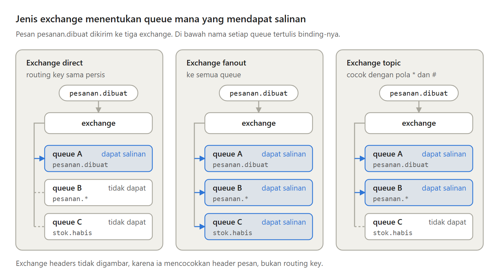
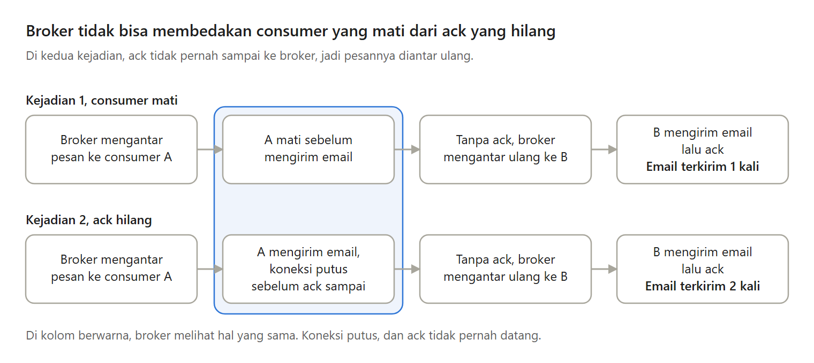

Banyak yang mengira, begitu pesanan dikirim lewat message broker, pesannya pasti sampai. Kenyataannya, pesan masih bisa hilang di empat tempat, dan broker hanya melindungi yang kamu minta untuk dilindungi.

Ini peta keempat tempat itu, memakai nama-nama dari RabbitMQ.

---

Tempat pertama adalah perjalanan dari producer ke broker. Kalau koneksi putus di tengah jalan, producer tidak tahu apakah pesannya sudah diterima.

Jawabannya adalah publisher confirm, yaitu ack dari broker ke producer. Dengan itu, producer tahu kapan ia boleh melupakan pesannya, dan kapan harus mengirim ulang.

---

Tempat kedua adalah exchange. Pesan yang tidak cocok dengan binding mana pun tidak masuk ke queue mana pun, dan RabbitMQ membuangnya.

Jadi jenis exchange penting. Direct butuh routing key yang sama persis, fanout mengirim ke semua queue, dan topic mencocokkan pola, di mana pesanan.* menerima pesanan.dibuat tetapi tidak menerima pesanan.dibuat.ulang.

---

Tempat ketiga adalah broker itu sendiri. Pesan hanya bertahan saat broker di-restart kalau queue-nya durable dan pesannya dikirim sebagai persistent. Butuh keduanya, bukan salah satu.

Itu pun belum cukup. Dokumentasi RabbitMQ menyebut server bisa kehilangan pesan persistent kalau mati sebelum pesan itu sempat ditulis. Untuk data penting, broker dijalankan sebagai cluster dengan beberapa salinan.

---

Tempat keempat adalah consumer. Dengan ack otomatis, pesan dihapus begitu dikirim, dan hilang kalau consumer mati di tengah pekerjaan.

Dengan ack manual, pesan tidak hilang, tetapi bisa diantar dua kali. Broker tidak bisa membedakan consumer yang mati sebelum bekerja dari consumer yang sudah selesai tetapi ack-nya putus di jalan.

---

Lalu ada satu angka yang sering dibiarkan bawaan, yaitu prefetch, jumlah pesan yang boleh dipegang consumer sebelum ack-nya datang.

Prefetch 1 terdengar paling aman, tetapi menurut dokumentasi RabbitMQ menurunkan throughput secara signifikan. Nilai 100 sampai 300 biasanya memberi throughput terbaik. Untuk pekerjaan lama per pesan, seperti membuat PDF invoice, prefetch kecil membagi kerja lebih rata.

---

Jadi, message broker yang aman adalah kumpulan keputusan, yaitu confirm di producer, binding yang benar, queue durable dan pesan persistent, cluster, ack manual, consumer yang idempotent, dan prefetch yang sesuai pekerjaannya.

Artikel lengkapnya membahas semuanya, termasuk kenapa broker tidak bisa menjamin exactly-once sendirian:
https://medium.com/@archetipe/apa-itu-message-broker-dan-kapan-kamu-membutuhkannya-e028fda38dd6
