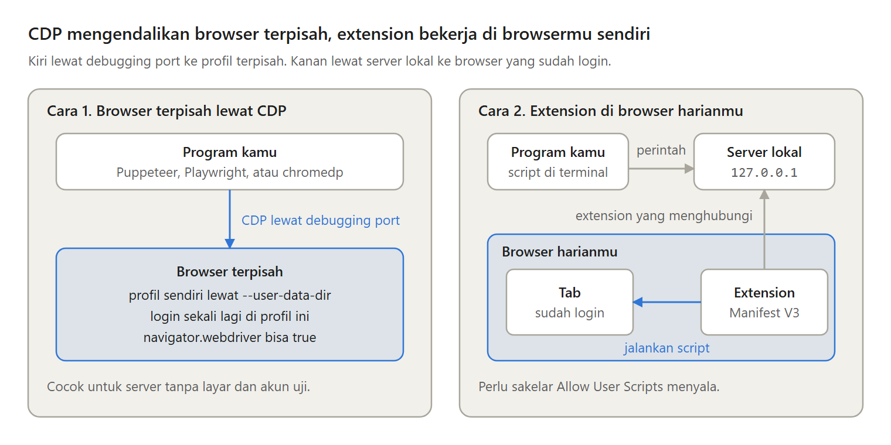
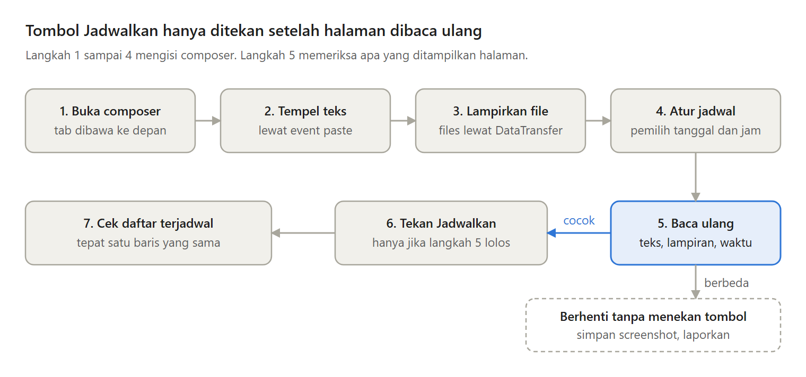

Kamu ingin membagikan artikel ke Threads, X, LinkedIn, dan Facebook setiap minggu pada jam yang sama. Langkah pertama seorang programmer biasanya memanggil API setiap platform.

Masalahnya, jalan itu makin sempit untuk perorangan. Ini cara mengotomasi posting lewat browser, dan kapan sebaiknya tidak.

---

Yang tersisa menurut dokumentasi resmi:

- Medium tidak lagi menerbitkan integration token baru untuk API-nya.
- X memotong US$0,015 untuk setiap post lewat API, atau US$0,20 jika post itu berisi URL.
- Facebook menghentikan izin memposting sebagai pengguna sejak 2018.
- LinkedIn masih membolehkan post atas nama sendiri, tetapi saya tidak menemukan cara menulis artikel panjangnya lewat API.

---

Apa pun yang boleh kamu lakukan dengan tangan, bisa kamu lakukan di browser. Otomasi browser berarti sebuah program menjalankan langkah yang biasa kamu kerjakan dengan mouse dan keyboard, dan kode halaman itu sendiri yang mengirim request.

Tapi pintu ini tidak dibuat untuk program. Halamannya bisa berubah kapan saja, dan beberapa platform melarang otomasi seperti ini di syarat layanannya.

---

Ada dua cara mengendalikan browser sungguhan:

- Browser terpisah lewat Chrome DevTools Protocol, dengan Puppeteer, Playwright, atau chromedp. Profilnya sendiri, login sekali lagi, dan halaman bisa tahu bahwa ia dikendalikan.
- Extension di browser harianmu, yang menjalankan kode lewat chrome.userScripts.execute setelah kamu menyalakan Allow User Scripts.

---

Cara kedua punya empat bagian: program pengirim, server lokal yang hanya mendengarkan di 127.0.0.1, extension, dan tab yang sudah login.

Satu post terjadwal berjalan begini. Buka composer, tempel teks, lampirkan file, atur jadwal, lalu baca ulang teks, lampiran, dan waktu yang ditampilkan halaman. Tombol Jadwalkan hanya ditekan jika semuanya cocok, lalu post dicari di daftar terjadwal.

---

Halaman sungguhan punya kebiasaan sendiri:

- Tab yang tersembunyi diperlambat browser. Frame animasi berhenti, jadi menu tidak terbuka, dan langkah yang mengklik butuh tab di depan.
- Input React butuh setter aslinya. Dengan el.value saja, kotak terlihat terisi, tetapi state React tetap kosong.
- Simpan satu langkah persetujuan manusia sebelum program menjadwalkan.

---

Kelemahannya nyata. Aturan otomasi X menyebut otomasi tanpa API, seperti scripting situsnya, bisa berujung penangguhan akun permanen. LinkedIn melarang bot membuat post. Lalu ada CAPTCHA, halaman yang berubah, dan server lokal yang bisa bertindak sebagai dirimu.

Sering ada jalan yang lebih sederhana: API resmi jika cukup, layanan penjadwal seperti Buffer atau Meta Business Suite, atau menu Schedule bawaan Threads.

---

Artikel lengkapnya, "Mengotomasi posting media sosial lewat browser, dan kapan sebaiknya tidak", membahas juga cara kerja CDP dan userScripts, cara melampirkan file, dan kapan otomasi browser cocok untukmu:
{{MEDIUM_URL}}
