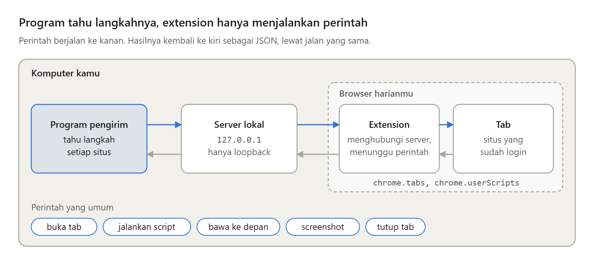

Program yang mengendalikan browser harianmu bisa melakukan apa saja yang bisa kamu lakukan, di setiap situs tempat kamu login.

Itu kekuatannya, dan juga bahayanya. Thread ini tentang keamanan otomasi browser, dari debugging port sampai halaman yang tahu bahwa ia sedang dikendalikan program.

---

Cara yang umum adalah Chrome DevTools Protocol, atau CDP, lewat debugging port, yaitu port yang dibuka browser khusus untuk dikendalikan.

Sejak Chrome 136, flag --remote-debugging-port tidak berlaku untuk profil bawaan Chrome, dan harus disertai --user-data-dir yang menunjuk folder lain. Google mengubahnya karena penyerang memakai debugging port untuk mencuri cookie dari profil pengguna.

---

Cara lainnya adalah extension di browser harianmu. Extension tidak membuka debugging port, tetapi ia butuh program lain yang memberinya perintah.

Jadi ada empat bagian di satu komputer, yaitu program pengirim, server lokal, extension, dan tab yang sudah login. Server lokal itulah pintu yang harus dijaga.

---

Apa pun yang bisa mengirim perintah ke server lokal bisa bertindak sebagai dirimu. Karena itu ada tiga aturan:

- Server hanya mendengarkan di 127.0.0.1, alamat yang hanya bisa dijangkau dari komputer itu sendiri.
- Server hanya menerima extension milikmu.
- Server menolak request yang membawa header Origin.

---

Kenapa header Origin? Halaman web yang kamu buka juga bisa mengirim request ke 127.0.0.1. Menurut MDN, browser menambahkan header Origin pada request dari sebuah halaman ke alamat lain, jadi request seperti itu bisa dikenali dan ditolak.

Dan jangan pernah membuka server ini ke jaringan tanpa token dan TLS.

---

Halaman juga bisa tahu bahwa ia dikendalikan. Menurut MDN, navigator.webdriver bernilai true di Chrome yang dijalankan untuk otomasi, dan isTrusted bernilai false untuk event yang dibuat script, termasuk klik dari click().

Saat halaman meminta CAPTCHA, program harus berhenti dan menyerahkannya kepadamu, bukan mencoba menjawabnya.

---

Jadi otomasi browser cocok jika platformnya tidak memberi API untuk akunmu, post-nya sedikit dan ditulis sendiri, ada manusia yang menyetujui setiap jadwal, dan kamu menerima risiko syarat layanan di akunmu sendiri.

Kurang cocok jika kamu ingin mengirim post dalam jumlah besar. Untuk itu, yang kamu butuhkan bukan browser, tetapi izin resmi dari platformnya.

---

Artikel lengkapnya, "Mengotomasi posting media sosial lewat browser, dan kapan sebaiknya tidak", membahas juga API yang tersisa di setiap platform, satu post yang dijadwalkan langkah demi langkah, dan jalan yang lebih sederhana:
https://medium.com/@archetipe/mengotomasi-posting-media-sosial-lewat-browser-dan-kapan-sebaiknya-tidak-28c172dfa031
