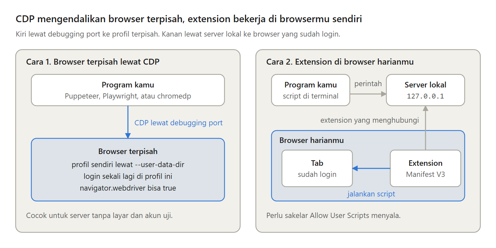

Mau membagikan artikel ke Threads, X, LinkedIn, dan Facebook setiap minggu? Langkah pertama programmer biasanya memanggil API. Masalahnya, jalan itu makin sempit untuk perorangan. Ini cara otomasi posting lewat browser, dan kapan sebaiknya tidak.

---

Menurut dokumentasi resminya, Medium tidak lagi menerbitkan integration token baru. Facebook menghentikan izin memposting sebagai pengguna sejak 2018. LinkedIn membolehkan post atas nama sendiri, tetapi saya tidak menemukan API untuk artikel panjangnya.

---

Di X, setiap post lewat API sekarang dipotong US$0,015, atau US$0,20 jika berisi URL, dari kredit yang dibeli lebih dulu. Murah untuk beberapa post, tetapi tetap butuh akun developer dan kartu pembayaran.

---

Jalan lain adalah browser. Ada dua cara: browser terpisah lewat Chrome DevTools Protocol, seperti Puppeteer, Playwright, atau chromedp, atau extension di browser harianmu yang menjalankan kode lewat chrome.userScripts.execute.

---

Satu post terjadwal berjalan begini. Buka composer, tempel teks, lampirkan file, atur jadwal, lalu baca ulang teks, lampiran, dan waktu yang ditampilkan halaman. Tombol Jadwalkan hanya ditekan jika semuanya cocok, lalu post dicari di daftar terjadwal.

---

Dua pelajaran dari halaman sungguhan. Tab yang tersembunyi diperlambat browser, jadi langkah yang mengklik butuh tab di depan. Input React butuh setter aslinya, karena dengan el.value saja kotak terlihat terisi tetapi state React tetap kosong.

---

Risikonya nyata. Aturan otomasi X menyebut otomasi tanpa API, seperti scripting situsnya, bisa berujung penangguhan akun permanen. Sering lebih tepat memakai API resmi, layanan penjadwal seperti Buffer, atau menjadwalkan dengan tangan.

---

Artikel lengkapnya, "Mengotomasi posting media sosial lewat browser, dan kapan sebaiknya tidak":
{{MEDIUM_URL}}
