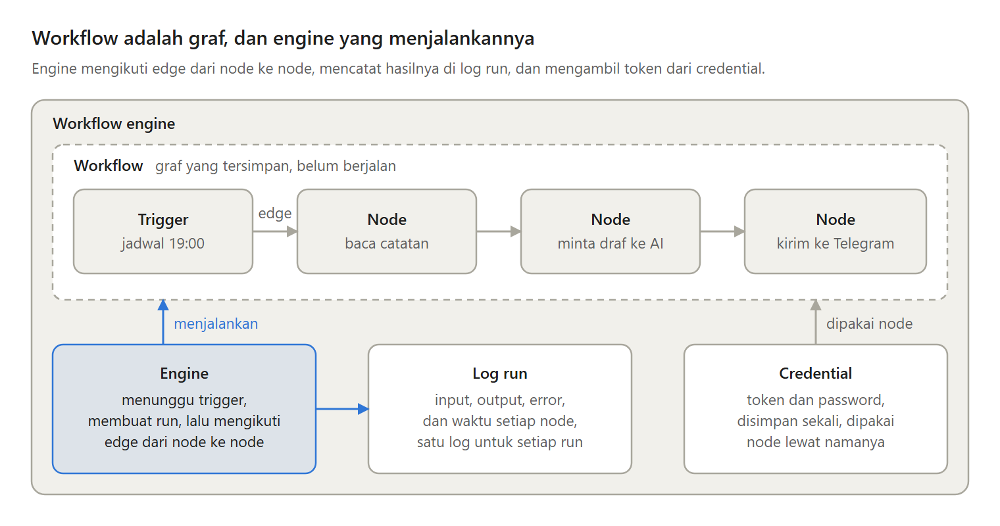
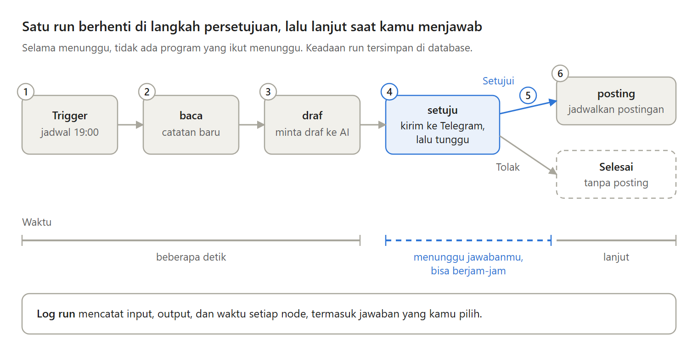

Banyak otomatisasi kecil lahir sebagai script yang dijalankan cron. Setiap malam jam 19:00, script membaca catatan baru, meminta AI membuat draf postingan, lalu mengirimnya ke Telegram.

Lalu suatu malam layanan AI terganggu, dan kamu baru tahu besok. Di sinilah workflow engine berguna. Ini cara kerjanya, dan kapan script dengan cron sebenarnya sudah cukup.

---

Saat ada yang tidak lancar, script dengan cron membawa empat masalah:

- Gagal tanpa jejak. Cron menjalankan script lalu melupakannya.
- Mengulang berarti mengulang semuanya, termasuk langkah yang sudah berhasil.
- Script tidak pandai menunggu manusia. Ia harus tetap hidup berjam-jam.
- Setiap script menulis ulang token, cara mencoba ulang, dan log.

Workflow engine mengerjakan bagian yang sama itu dalam satu program, sehingga kamu cukup menyusun langkah-langkahnya.

---

Workflow adalah graf. Setiap langkah adalah node, dan garis di antaranya adalah edge, yang menentukan node mana yang berjalan berikutnya.

Trigger memulai run, yaitu satu kali workflow berjalan. Engine mengikuti edge dari node ke node, lalu mencatat input, output, error, dan waktu setiap node di log run. Token dan password disimpan sekali sebagai credential.

---

Ada lima jenis trigger yang akan sering kamu temui:

- Manual, saat kamu menekan tombol jalankan.
- Jadwal, sering ditulis dengan format cron.
- Webhook, saat program lain mengirim request ke alamat HTTP milik workflow.
- Perubahan file di sebuah folder.
- Pesan masuk, dari bot Telegram atau dari message broker.

---

Ikuti satu run. Jam 19:00 trigger menyala, node baca mengambil catatan baru, dan node draf meminta AI membuat draf. Node setuju mengirim draf ke Telegram dengan tombol Setujui dan Tolak, lalu run berhenti dan keadaannya disimpan di database.

Dua jam kemudian kamu menekan Setujui, dan engine melanjutkan run itu. Inilah human-in-the-loop. Kelemahannya, run bisa menunggu selamanya, jadi langkah persetujuan butuh batas waktu.

---

Engine bisa mencoba ulang node yang gagal dengan jeda yang makin panjang. Tapi itu hanya aman untuk node yang idempotent, yaitu yang memberi hasil sama walau dijalankan dua kali. Pesan Telegram yang sudah terkirim lalu dicoba ulang membuatmu menerima dua pesan.

Run yang datang bersamaan bisa menunggu di antrean, satu run pada satu waktu. Kelemahannya, run yang menunggu persetujuan menahan semua run di belakangnya.

---

Lima workflow engine yang akan sering kamu temui:

- Zapier, tanpa kode, berjalan di platform Zapier sendiri.
- n8n, editor visual yang bisa kamu jalankan sendiri.
- Node-RED, untuk data yang terus mengalir dari perangkat dan sensor.
- Airflow, workflow sebagai kode Python.
- Temporal, kode biasa yang tetap berlanjut walau server mati.

---

Kelemahannya, workflow engine adalah satu program lagi yang harus dirawat, logika yang rumit sulit dibaca di editor visual, dan workflow-nya terikat pada engine tempat ia dibuat. Script dengan cron tetap cukup untuk pekerjaan yang boleh diulang dari awal.

Artikel lengkapnya, "Apa itu workflow engine, dan kapan script dengan cron saja tidak cukup?":
https://medium.com/p/042e38378751
