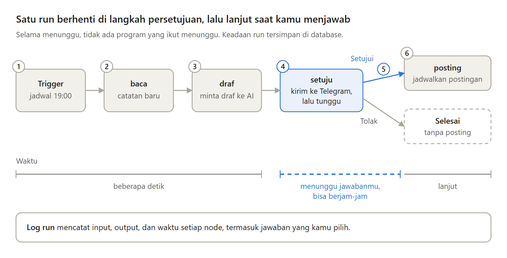

Menambahkan AI ke sebuah otomatisasi terlihat mudah. Satu langkah mengirim prompt, lalu langkah berikutnya memakai jawabannya.

Masalahnya, langkah itu tidak pernah pasti. Ini yang berubah saat AI menjadi satu langkah di dalam workflow, dan kenapa langkah sesudahnya sama pentingnya dengan prompt-nya.

---

Di workflow engine, setiap langkah disebut node. Node biasa, seperti membaca file, memberi hasil yang sama untuk input yang sama.

Node AI tidak. Ia bisa memberi jawaban berbeda untuk input yang sama, dan kadang tidak dalam bentuk yang kamu minta. Jadi node AI sebaiknya diikuti pemeriksaan, entah node yang mengecek bentuk jawabannya, entah persetujuan manusia.

---

Bukankah lebih praktis jika AI langsung memposting drafnya?

Untuk ringkasan yang hanya kamu baca sendiri, memang iya. Tetapi postingan atas namamu langsung dibaca orang lain begitu terbit. Dokumentasi n8n juga menganjurkan persetujuan manusia sebelum AI menjalankan tool yang berisiko, yaitu aksi yang dijalankan AI sendiri, seperti mengirim pesan, mengubah data, atau menghapus data.

---

Mencoba ulang juga berbeda untuk node AI. Node yang gagal biasanya dicoba lagi dengan jeda yang makin panjang, dengan harapan hasilnya sama.

Node AI yang dicoba ulang menghasilkan draf baru, bukan draf yang sama, dan setiap percobaan memakai kuota atau biaya layanan AI. Jadi kamu sendiri yang menentukan node mana yang boleh dicoba ulang, karena engine tidak bisa menebaknya.

---

Di script, jawaban AI hanya ada di variabel, dan hilang begitu script berhenti. Workflow engine menyimpan output setiap node di log run, yaitu catatan satu kali workflow berjalan.

Hasilnya, run yang gagal bisa kamu buka untuk melihat persis catatan apa yang dibaca dan apa jawaban AI. Kelemahannya, log itu ikut menyimpan isi datamu, jadi harus dijaga seperti datanya sendiri, dan ukurannya perlu dibatasi.

---

Lalu di mana engine-nya berjalan? Versi hosted dijalankan pembuatnya di server mereka, tanpa perlu dipasang dan dirawat. Versi self-hosted berjalan di server milikmu.

Untuk workflow yang membawa catatan pribadi ke AI, bedanya penting. Di versi hosted, token dan datamu ikut melewati server pembuatnya. Kelemahan versi self-hosted, kamu yang harus memperbaruinya, membuat backup, dan mengamankannya.

---

Tidak semua otomatisasi dengan AI butuh workflow engine. Script dengan cron cukup jika hasil AI hanya kamu baca sendiri, langkahnya boleh diulang dari awal, dan kegagalannya boleh menunggu sampai besok.

Workflow engine cocok jika jawaban AI harus diperiksa sebelum dipakai, jika ada langkah yang menunggu persetujuanmu, atau jika kamu perlu melihat apa yang terjadi di setiap run.

---

Artikel lengkapnya, "Apa itu workflow engine, dan kapan script dengan cron saja tidak cukup?", membahas juga anatomi workflow engine, satu run dari awal sampai akhir, dan lima workflow engine yang akan sering kamu temui:
https://medium.com/@archetipe/apa-itu-workflow-engine-dan-kapan-script-dengan-cron-saja-tidak-cukup-042e38378751
