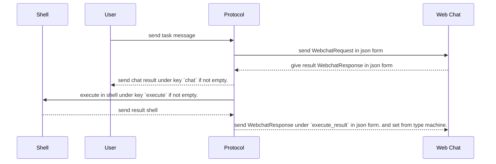

# Web Machine Shell Protocol.
1. give explanation that i have machine and user and same session chat.
2. machine can execute with send chat in `execute` key. And User in `chat` key.
2. force chat response to json.

## Flow Example.


## Webchat Response Rule.
```proto

message WebchatResponse {
    string      execute
    string      chat
}

enum FromType {
    FROM_TYPE_UNSPECIFIED
    FROM_TYPE_EXECUTE
    FROM_TYPE_USER
}

message WebchatRequest {
    string      execute_result
    string      chat
    FromType    from
}

```


