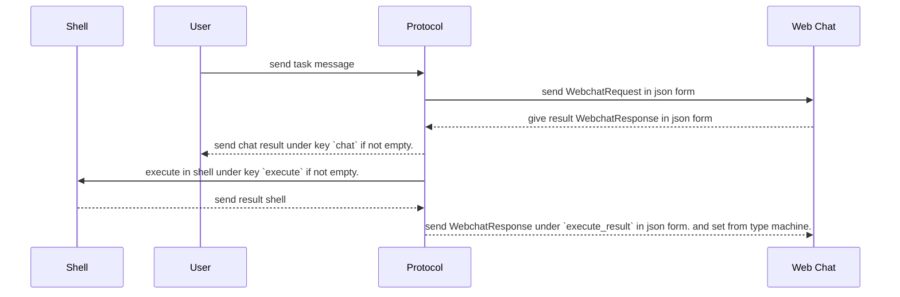
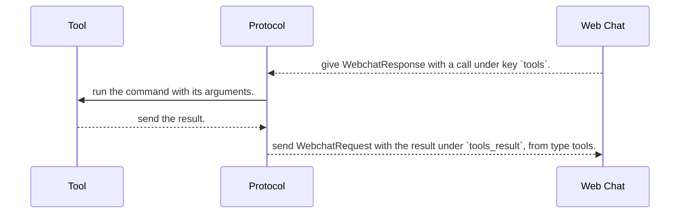

# Web Machine Shell Protocol.
1. give explanation that i have machine and user and same session chat.
2. machine can execute with send chat in `execute` key. And User in `chat` key.
2. force chat response to json.
3. machine can also have tools (knowledge, telegram). AI calls a tool in the `tools` key, and the result comes back in the `tools_result` key.

## Flow Example.


## Tools Flow Example.
Only when a tool is connected to the Remote Shell node.



## Webchat Response Rule.
```proto

message WebchatResponse {
    string      execute
    string      chat
    ToolCall    tools
}

message ToolCall {
    string          tool_name
    string          command
    repeated string arguments
}

enum FromType {
    FROM_TYPE_UNSPECIFIED
    FROM_TYPE_EXECUTE
    FROM_TYPE_USER
    FROM_TYPE_TOOLS
}

message WebchatRequest {
    string      execute_result
    string      chat
    FromType    from
    string      tools_result
}

```

## Tools.
A tool is a node connected to the `Tools` input of the Remote Shell node. The AI can only use the tools that are connected. If nothing is connected, the AI is not told about tools at all, and the protocol works like before.

Tools we have now:

| tool_name | command | arguments | what it does |
|---|---|---|---|
| knowledge | explain | question | what the knowledge says about it, with file:line to cite |
| knowledge | search | words | docs and sections that have all the words |
| knowledge | get | key | one doc or section in full |
| telegram | send | text | send a message to the one chat set on the node |

The AI asks for a tool like this:
```json
{"execute": "", "chat": "", "tools": {"tool_name": "knowledge", "command": "explain", "arguments": ["how is San Tower released?"]}}
```

And the machine answers in the next message:
```json
{"execute_result": "", "chat": "", "from": "FROM_TYPE_TOOLS", "tools_result": "# Knowledge context: how is San Tower released? ..."}
```

Rules:
1. one tool call per answer. If the AI needs more, it calls again in the next answer.
2. `tools` is null when the AI doesn't need a tool.
3. the AI can send `tools` and `execute` together. Both run, and both results come back in one message, from type execute.
4. if the tool name, command or arguments are wrong, `tools_result` says what is wrong, so the AI can fix it.
5. the turn is over when `execute` is empty and `tools` is null.


