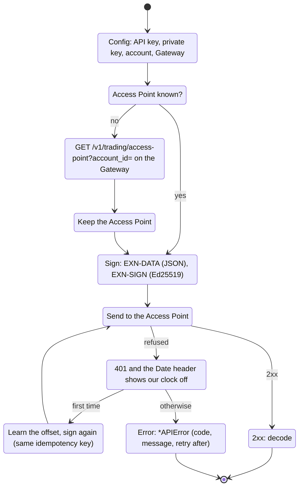
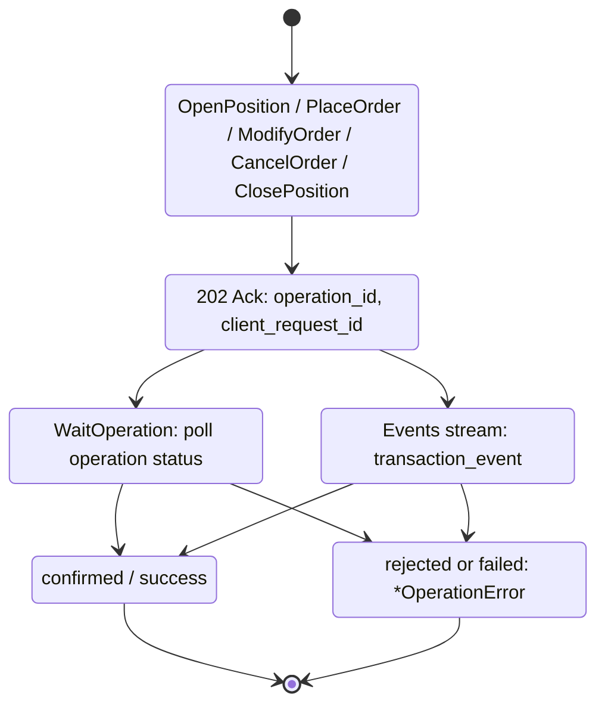

# San Exness.
**Go client for the Exness Trader API**

## General.
1. Exness publishes no Go library (the user, 2026-11-14: "Is exness have golang api ?", then "If it's not, make it in packages/san_exness"). Its API is plain REST and WebSocket, documented at <https://www.exness-api.com> with an OpenAPI file (`/openapi/trading.public.yaml`, version 1.0.2). This package follows that file and the developer portal's guides.
2. Module `github.com/wargasipil/san_exness`, package `san_exness`. Dependencies: `github.com/coder/websocket` (streams; already used by san_tower) and `github.com/urfave/cli/v3` (the CLI only).
3. Two ways to use it:
    - embedded in a Go app: `san_exness.New(Config)`, then the methods (all 17 operations of the API, plus discovery)
    - the CLI `cmd/san_exness`, **read only**: account, instruments, candles, snapshot, history, operation status, live streams. It places no orders; trading is in the package.
4. **Who can use the API** (Exness help centre, "Exness API", checked 2026-11-14): an Exness trading account, fully verified (proof of identity and of address); keys are made in the Personal Area's Key Management. Standard MetaTrader accounts cannot connect. Exness's English help page says it is available only in some regions. **No demo or sandbox was found**: every order is real money. Nothing in this package has been run against a real account yet.

## Flow.


A trading call is finished later:


## 1. Credentials.
Key Management gives an API key identifier (`exnsk-...`, sent as `EXN-API-KEY`) and an Ed25519 private key, in one of two forms, both read by `ParsePrivateKey`:
- Exness-generated: 128 hex characters, the 32-byte seed then the 32-byte public key. The public half must match the seed, or the key is refused.
- Your own key pair: an unencrypted PKCS#8 PEM file (`openssl genpkey -algorithm ED25519`); its public key is registered in Key Management.

Errors about a key never contain it. The CLI reads the key only from `EXN_PRIVATE_KEY` or `--private-key-file`, never from a flag value (it would show in the process list).

## 2. Access Point.
Key Management's DNS widget shows a **Gateway** host. The account's **Access Point** is asked there once (`GET /v1/trading/access-point?account_id=...`, signed) and kept: discovery is rate limited. Every other request and every stream goes to the Access Point. Both must be `https://host` without path, query or credentials; an answer for another account, or without a valid URL, is `ErrBadAccessPoint`. `Config.AccessPoint` skips discovery.

## 3. Signing.
Every request carries `EXN-API-KEY`, `EXN-IDEMPOTENCY-KEY`, `EXN-TIMESTAMP`, `EXN-SIGN-VERSION` (1), `EXN-DATA` and `EXN-SIGN`, set by those exact names. `EXN-DATA` is base64url (no padding) of the JSON `{api_key, idempotency_key, timestamp, sign_version, method, path, body_hash}`: the path with its query exactly as sent, `body_hash` the base64url SHA-256 of the body bytes (no body hashes the empty bytes). `EXN-SIGN` is the Ed25519 signature of those JSON bytes. The query is encoded once (keys sorted) and sent as signed; the client checks that Go would not send the path differently. A signed GET sends an empty `EXN-IDEMPOTENCY-KEY`; other methods a key of 5 to 128 characters of `A-Z a-z 0-9 . _ - ~`. `sign_test.go` checks the portal's own test vector (RFC 8032's public test key): the same `EXN-DATA` and `EXN-SIGN`.

## 4. Clock.
The timestamp must be close to Exness's time, and this PC's clock runs minutes off (autotrade found the same against Binance). Each response's `Date` header gives the server's time; an offset of 2 s or more is kept and added to later timestamps. When a request is refused with 401 and that answer shows the offset has changed by 2 s or more, it is signed and sent once more. A trading request goes again with the same idempotency key, so Exness runs it at most once.

## 5. Requests.
| Method | API operation |
| --- | --- |
| `Account` | GET `/v1/configuration/accounts/{id}/account` |
| `Instruments`, `Instrument(name)` | GET `.../instruments`, `.../instruments/{name}/conditions` |
| `Limits` | GET `.../limits` (configured limits, not what is left) |
| `Candles(CandleQuery)` | GET `/v1/market-data/accounts/{id}/candles` |
| `Snapshot` | GET `/v1/trading/accounts/{id}/snapshot` (open orders and positions, account money) |
| `OpenPosition` | POST `.../positions` |
| `PlaceOrder` (limit, stop, sltp) | POST `.../orders` |
| `ModifyOrder` | PATCH `.../orders/{order_id}` |
| `CancelOrder` | DELETE `.../orders/{order_id}` |
| `ClosePosition` (all, part, close-by) | DELETE `.../positions/{position_id}` |
| `Operation`, `WaitOperation` | GET `.../operations/{operation_id}` |
| `Orders`, `Deals` (`HistoryQuery`) | GET `/v1/history/accounts/{id}/orders`, `.../deals` |
| `Events`, `Ticks` | WebSocket `/v1/server-events/accounts/{id}/ws/events`, `.../ws/ticks` |

Money, prices and volumes are decimal strings (`Decimal`), as the API takes them; market data prices (candles, ticks) are float64, as it sends them. Requests are checked before sending, and refused with `ErrInvalidRequest`: volumes and prices must be positive decimal strings (`"0.10"`, not `1e-1`), ids numbers, instruments `A-Z a-z 0-9 . _ -`; candles take From and either Count (-1000 to 1000, not 0) or To; a history page takes From, or a Cursor that goes alone with the limit; an sltp order takes a position and at least one level; `ModifyOrder.RemoveStopLoss` / `RemoveTakeProfit` send `null` to clear a level.

## 6. Trading is asynchronous.
A trading call returns an `Ack` (202) as soon as Exness accepts it; the result comes later, in operation status (`WaitOperation` polls it, kept 24 hours) or as a `transaction_event` on the Events stream (`TransactionEvent.Err()`). A rejected or failed result is an `*OperationError` with Exness's code (`CodeTradingRuleInsufficientMargin`, ...). An empty idempotency key gets a new one (`NewIdempotencyKey`, `san-` and 26 base32 characters), returned in `Ack.IdempotencyKey`: retry with it, and Exness runs the request once.

## 7. Streams.
`Events` (transactions, account state, instrument updates, HMR periods) and `Ticks` (live bid and ask) are WebSocket connections whose handshake is signed as a GET of their path, with the subprotocol `exness-ws-protocol` (from Exness's own example, which it marks unverified). `Subscribe(id, sub)` sends `{"id":..,"subscribe":{..}}`; ticks are refused on the events stream and the other way round. `Next` returns a `Message` by type, with `Raw` always set: a trading_state_snapshot (the first answer to Transactions), transaction_event, account_state_event (every 2 s), instrument_event, hmr_snapshot / hmr_update, a tick, or an error for a refused command (`StreamError`); an unknown type comes with Raw only. Messages up to 16 MiB are read (snapshots exceed coder/websocket's 32 KiB default). There is no replay: after a drop, dial again, subscribe again and rebuild state from the new snapshot.

## 8. Errors.
A refused request is an `*APIError`: the HTTP status, Exness's `code` and `error_message` (constants `Code...`, names in `CodeNames`), and `RetryAfter` from the `Retry-After` header or a `retry_after` field. A body that is not Exness JSON (an edge layer's HTML 403) gives `Code` 0 and the first 200 characters in `Body`. Redirects are never followed, so signed headers never reach another host. Requests carry a `User-Agent` (`san_exness/<version>`): the troubleshooting guide says an edge layer may refuse requests without one.

## 9. Testing programs that use it.
Package `exnesstest` is a fake Access Point for other programs' tests (San Tower's Exness steps use it): `exnesstest.New(t)` starts an https server that checks every request's signature, headers, body hash, timestamp and idempotency rules as Exness documents them, and keeps an account in memory: 10000 USD, the instruments EURUSD, XAUUSD and USDJPY with a bid and an ask (`AddInstrument`, `SetPrice`), positions (`AddPosition`), pending and SL/TP orders, deals and operations. A trading request gets its ACK and is done at once: confirmed, or rejected with Exness's code (a volume off the step, a stop on the wrong side, an unknown instrument, or `RejectNext(code)`). `Config()` is a client config for it, `Snapshot()` the account, `Calls(prefix)` the requests that reached it. Its key is RFC 8032's public test key, not a credential. It has no streams and no discovery: set `AccessPoint` to its `URL`.

`Client.Now` is the time on Exness's clock as far as the answers' `Date` headers tell (section 4): which candle is still forming is judged by it, not this computer's clock.

## 10. Not done yet.
- No local rate limiter: `Limits` returns the configured limits, and the caller counts requests. 429 answers are returned with `RetryAfter`, not retried.
- Streams do not reconnect by themselves.
- Not run against a real account (no key yet). `TestLiveReadOnly` is ready for when there is one; it reads only.
- San Tower uses it for its Exness connection and steps (`golang/apps/san_tower`, `internal/engine/exness.go`).

## Defaults.
| Setting | Default | Note |
| --- | --- | --- |
| HTTP timeout | 15 s | `Config.HTTPClient` replaces it; redirects are never followed |
| Stream handshake timeout | 15 s | |
| Stream message size | 16 MiB | |
| Clock offset kept from | 2 s | from the `Date` header; one resend on 401 when it changes |
| Idempotency key | `san-` + 26 base32 characters | when none is given |
| `WaitOperation` interval | 1 s | when 0 is given |
| Error body kept | 200 characters | for answers that are not Exness JSON |
| User-Agent | `san_exness/<version>` | `Config.UserAgent` |

## CLI.
Credentials come from the environment, by the names Exness's own examples use (or the flags):
```sh
export EXN_API_KEY="exnsk-..."
export EXN_PRIVATE_KEY_FILE="$HOME/.exness/private.key"   # or EXN_PRIVATE_KEY with the key text
export EXN_ACCOUNT_ID="123456"
export EXN_DISCOVERY_BASE_URL="https://<gateway from the DNS widget>"
# export EXN_API_BASE_URL="https://<access point>"         # skips discovery

san_exness discover
san_exness account
san_exness instruments                 # names
san_exness instruments XAUUSDm         # one instrument's conditions
san_exness limits
san_exness candles --instrument XAUUSDm --timeframe H1 --from 2026-11-14T00:00:00Z --count 24
san_exness candles --instrument EURUSDm --timeframe M15 --from 6h          # up to now
san_exness snapshot
san_exness deals --from 168h --type close
san_exness orders --cursor <next_cursor>
san_exness operation 123 --wait
san_exness stream ticks XAUUSDm EURUSDm
san_exness stream events --transactions --account-state
```
Output is JSON (streams: one message per line, until Ctrl+C).

## Build and test.
```sh
pwsh -NoProfile -File build.ps1    # vet, test, bin/san_exness.exe and bin/san_exness
bash build.sh                      # the same from Linux
go test ./...
EXN_LIVE=1 go test -run Live -v .  # reads a real account (EXN_* set); never trades
```
The tests run against a fake Access Point (`fake_test.go`) that checks every request's signature, headers, body hash, timestamp and idempotency rules as the portal documents them, and a fake WebSocket server for the streams.
