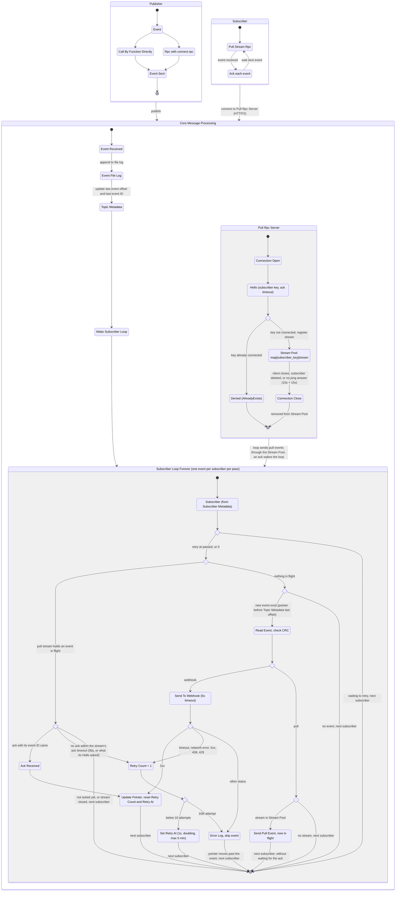
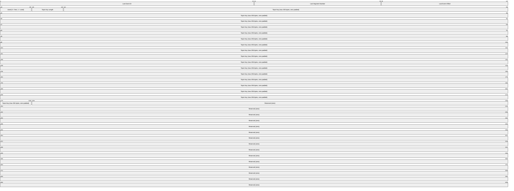
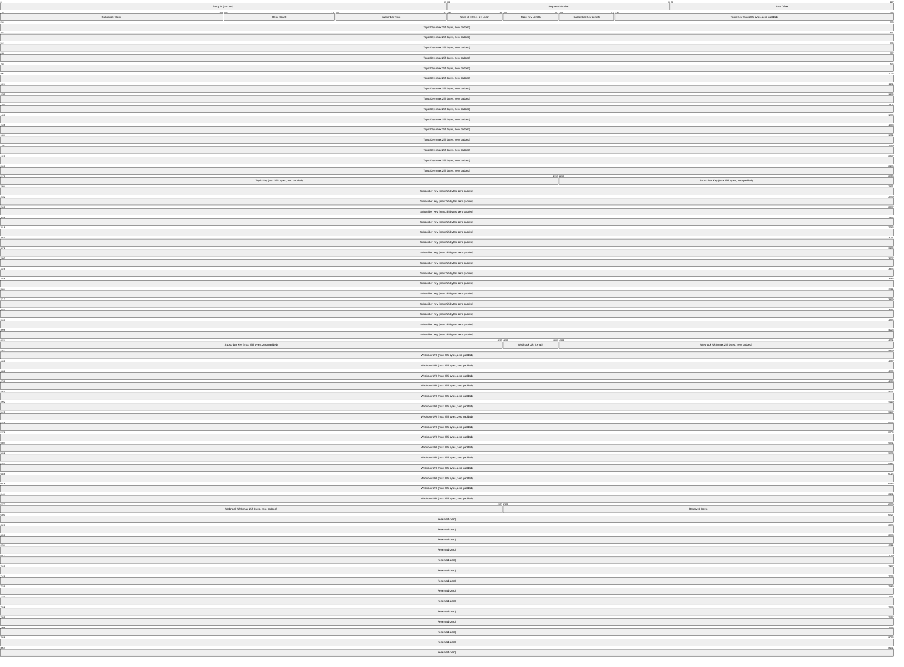
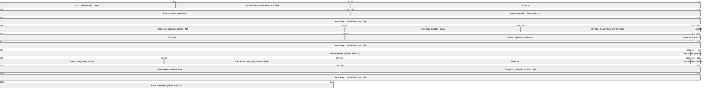

# San Message.
**own message broker**

## General.
1. We Use `https://pkg.go.dev/github.com/edsrzf/mmap-go` for mmap
2. Module is `github.com/wargasipil/san_message`. It replaces `san_message_broker`.
3. San Message can be used 3 ways:
    - embedded in a Go app, calling it by function directly (`Publish`, `CreateTopic`, ...)
    - embedded in an app's own connect-rpc server, as one more service
    - standalone server, `cmd/san_message`

## Flow.


## Topic Metadata (MMap).

1. Topic metadata file size is 4 MB. It is created filled with zeros, so the disk space is reserved, and mapped whole.
2. Every topic has a fixed slot of 512 bytes (4096 bits). Slot `i` starts at byte `i × 512`, so the file holds 8,192 topics.
3. Topic key is max 255 bytes, and only letters, digits, `-` and `_`, because it is also a folder name. Any other key is refused, and so are Windows device names (`CON`, `NUL`, `COM1`, ...), which cannot be folder names there.
4. A removed topic sets `Used` to 0, and a new topic reuses a free slot.
5. When every slot is used, creating a new topic fails with an error. The file is never grown.

## Subscriber Metadata (MMap).


1. We Have 2 Subscriber Type.
    - `webhook`
    - `pull`
2. Subscriber metadata file size is 16 MB. It is created filled with zeros, so the disk space is reserved, and mapped whole.
3. Every subscriber has a fixed slot of 1024 bytes (8192 bits). Slot `i` starts at byte `i × 1024`, so the file holds 16,384 subscribers.
4. Topic key, subscriber key and webhook URI are max 255 bytes each. A longer one is refused.
    - Webhook URI is required for `webhook` type (http or https), and empty for `pull` type.
    - Subscriber key is unique across all topics: one subscriber reads one topic.
5. A removed subscriber sets `Used` to 0, and a new subscriber reuses a free slot.
6. When every slot is used, creating a new subscriber fails with an error. The file is never grown.

## Pull Subscriber.
1. Pull uses a connect-rpc bidirectional stream, so it needs HTTP/2.
2. One event at a time: core sends an event, and sends the next only after its ack (event → ack → event → ack). Sending several events before an ack may come later.
    - The loop does not wait for the ack. The event stays in flight while the loop serves the other subscribers, and each pass checks whether its ack came; an ack wakes the loop.
    - So a subscriber that works on each event before it acks it (a job queue) holds up nobody. San Tower's one-at-a-time workflows queue this way: each run's event is acked when the run ends.
    - An event not acked within the stream's ack timeout is retried like a failed webhook: Retry Count + 1, sent again after the retry wait.
3. One connection per subscriber key. While a stream for a key is open, a new connection with the same key is denied.
4. The server pings each connection (HTTP/2 ping) when it is quiet for 15s. A connection with no answer within 15s is closed and removed from the Stream Pool, so a client that lost its connection can connect again.
5. Hello may ask for a longer ack timeout, `ack_timeout_seconds`: how long the stream may hold an event before it acks it. 0 is the default (30s), the most is 24 hours, more is refused. San Tower's queues ask for 6 hours.
6. A stream that closes takes its event in flight with it, unacked: the pointer has not moved, so the next stream for the key gets the event again.


## Event Log File.



1. Event Log Data saved in folder `event_data/topics/[topic-name]/[segment_number].log`
2. Event log `segment_number` is 1, 2, 3 and so on
3. Every event log data is limited 50mb. if reach limit create new file with incremental `segment_number`
4. On startup, for each topic, read the last log file from the start and check every record's CRC.
   Cut the file off at the first record that is too short or has a bad CRC,
   then set `Last Event Offset` in topic metadata from the last valid record.
   `Last Event ID` becomes the larger of the metadata's and the last valid record's, so an ID that a subscriber may already have seen is never given out twice.
   The log is the source of truth; topic metadata is only a fast copy of where it ends.
5. A subscriber whose `Last Offset` is past the end of the log (possible after a power cut) is moved back to the end.
6. Event data is opaque bytes. San Message never parses it.

## Defaults.
Every default can be changed in `Options`.

| Item | Default |
|---|---|
| Data folder | `event_data` (`topics.meta`, `subscribers.meta`, `topics/`) |
| New subscriber starts at | the end of the log (new events only) |
| Max event size | 1 MB |
| Publish returns | after the write; the log is fsynced and the mmap flushed every 1s and on close |
| Webhook request | POST, body is the event data, headers `X-Event-Id`, `X-Topic`, `X-Event-Created` |
| Webhook result | 2xx delivered; timeout, network error, 5xx, 408, 429 retry; anything else gives up |
| Webhook timeout | 5s |
| Retry wait | 1s, doubling up to 5 min |
| Give up | after 10 attempts: the event is logged and skipped |
| Pull ack timeout | 30s, or what the stream's Hello asks (at most 24 hours) |
| Idle wait | 100ms, or until a publish or a pull ack wakes the loop |
| Old log files | kept; deleting them comes later |

## CLI.
`cmd/san_message` is one binary: `server` runs the broker, `topic` and `subscriber` manage a running one over connect-rpc.

```sh
pwsh build.ps1                    # or bash build.sh: vet, test, build bin/san_message(.exe)

bin/san_message server --listen 127.0.0.1:7070 --data event_data

bin/san_message topic create orders
bin/san_message topic list
bin/san_message topic delete orders          # refused while it has subscribers

bin/san_message subscriber create billing --topic orders --type webhook --webhook-uri https://example.com/hook
bin/san_message subscriber create app --topic orders --type pull
bin/san_message subscriber list [--topic orders]
bin/san_message subscriber delete billing
```

1. `topic` and `subscriber` talk to `--server` (default `http://127.0.0.1:7070`, or `SAN_MESSAGE_SERVER`).
2. The server listens on `127.0.0.1` by default and has no authentication yet, so only open it to a network you trust.
3. In a Go app, `san_message.Open` gives the broker to call directly, `mux.Handle(b.Handler())` mounts it in the app's own connect-rpc server, and `san_message.ConfigureServer(srv)` sets the HTTP/2 and ping settings that server needs.

## Examples.
Runnable programs in `examples/`, run from the package folder:

| Example | Shows |
|---|---|
| `go run ./examples/embedded` | broker inside the program: create topic and webhook subscriber, publish, print what the webhook gets |
| `go run ./examples/mount` | San Message as one more service in an app's own server (`/health` next to it), on `127.0.0.1:7080` |
| `go run ./examples/publisher --topic orders "order 1"` | publish over connect-rpc |
| `go run ./examples/pull_subscriber --subscriber app` | pull stream over h2c: receive, print, ack |
| `go run ./examples/webhook_receiver [--status 500]` | webhook on `127.0.0.1:8081/hook` that prints events; `--status` shows retry and skip |

Try them together:
```sh
go run ./cmd/san_message server
go run ./examples/webhook_receiver
go run ./cmd/san_message topic create orders
go run ./cmd/san_message subscriber create billing --topic orders --type webhook --webhook-uri http://127.0.0.1:8081/hook
go run ./cmd/san_message subscriber create app --topic orders --type pull
go run ./examples/pull_subscriber --subscriber app
go run ./examples/publisher --topic orders "order 1" "order 2"
```

`example_test.go` has the same as `Example` functions, shown by `go doc`.