# XAUUSD research, 2026-11-15

Data-first research on gold (the user, 2026-11-15: "Let's true research about xauusd"). Research only: no orders were placed and none are suggested without a stop-loss and a take-profit (rule #1).

- **Data:** Exness XAUUSD candles (demo account), bid and ask, M15 (107397 candles) and H1 (26874 candles), 2022-05-02 to 2026-11-13 22:00 UTC; 1181 trading days built from H1. Read from san_backtest's cache (covered to 2026-11-14T18:40:31Z); no Exness calls were made for this report.
- **Clock:** every time of day is **WIB (UTC+7, Asia/Jakarta)** (the user, 2026-11-15: "3 my Timezone is jakarta"); sessions are defined in UTC and shown in WIB.
- **Scope:** studies 1-5 (the user, 2026-11-15: "2a"); news (study 6) waits for a calendar.
- **Labels:** **STRONG** = significant after a multiple-testing correction and the same sign in at least 4 of 5 years (for pure size facts such as volatility: held in at least 4 of 5 years); **WEAK** = only one of those, or raw p < 0.01; **NOISE** = indistinguishable from chance. This run: 5 STRONG, 4 WEAK, 4 NOISE.
- **Rerun:** `san_research xauusd --out <this folder> --backtests` (golang/packages/san_research).

## Summary: the most useful facts

1. **STRONG** The most active hour is 20:00 WIB (median H1 range 46 bp, about $27.4 in the last 12 months, 4.0x the quietest hour 04:00 WIB at 12 bp). It was among the top 3 hours in 5 of 5 years. _Gold moves most 19:00-23:00 WIB and least 03:00-06:00 WIB; size stops and targets to the hour (ATR), and expect a quiet-hour target to take much longer._
2. **STRONG** Per hour, the London+New York overlap (19:00-23:00 WIB) moves 1.9x the Asian hours (07:00-14:00 WIB): median H1 range 41 vs 21 bp; the overlap's 4 hours carry 27.5% of all hourly |return|. _Expect stops of the same size to be hit about twice as fast in the WIB evening as in the WIB morning; size stops by the session's ATR, not one fixed number._
3. **WEAK** By WIB hour, 1 of 24 hourly means have raw p < 0.05 (chance alone gives about 1.2) and 0 survive FDR. STRONG hours: none. WEAK: 06:00 (+1.6 bp). _No hour of the day has a reliable direction beyond gold's general uptrend; do not choose long or short by the clock._
4. **STRONG** Levels against the arbitrary-line control (12 tests, FDR): STRONG: prior day high | from above (support): bounce share 65.5% vs control 73.3% (-7.8 points, 4/5 years); Asian high | from below (resistance): bounce share 70.2% vs control 64.0% (+6.2 points, 4/5 years); round 50 | from above (support): bounce share 66.3% vs control 73.3% (-7.0 points, 4/5 years). WEAK: none. _Only the STRONG levels behave differently from any random price line; treat the others as ordinary prices._
5. **NOISE** After a London break of the Asian range, price moved +0.02 AR (+5 bp) in the break direction by the New York close on average (p 0.782); it reached a 1x-range extension first on 43.5% of days and the opposite edge first on 30.8%; 53.6% were fake-outs. _A London break of the Asian range is a coin flip by the New York close; neither follow nor fade it on its own._
6. **STRONG** A long held overnight pays $47.17 per lot ($0.47 for 0.01 lot), x3 on Wednesday; that is 2.0 spreads per night and about 4.4% a year of the position's value. Shorts pay nothing. _Intraday ideas are unaffected; a swing long held for days must earn the swap first, so close longs before the rollover (about 04:00 WIB) or prefer short-side holds._
7. **WEAK** After big candles / big moves: STRONG: none. WEAK: M15 big move: 8-candle move > 4 ATR down, k=1: -0.10 ATR (reverses, n 822, 5/5 years); M15 big move: 8-candle move > 4 ATR down, k=4: -0.21 ATR (reverses, n 822, 5/5 years); H1 big move: 8-candle move > 4 ATR up, k=16: +0.43 ATR (continues, n 182, 4/5 years). _Neither chasing nor fading big candles has a reliable edge; a big candle by itself is not a signal._
8. **WEAK** Spreads are tight and almost flat: median $0.24 in every hour of the last 12 months (one quoted step: 0.16-0.36). The p99 reaches $0.50 at 04:00 WIB around the rollover, and the widest Monday-open candle showed $1.98. In 2022-2024 the spread was a flat $0.20 at nearly all hours, so the hour pattern is recent, not stable. _On this account the spread matters little except around the rollover (about 03:45-06:30 WIB) and the Monday open; avoid entries and tight stops there._

**Approaches:** 2 ideas built on STRONG findings were backtested (real and harsh costs, walk-forward, by year); **none survives** - none is worth a demo forward-test. See [Approach ideas](#approach-ideas-built-only-on-strong-findings).

## 1. When gold moves

Range = high - low of a candle; |return| = |close - open|. Both are in basis points (bp, 1/100 of 1%) of the candle's open, so 2022 (gold near 1,800) and 2026 (near 4,000) compare fairly. Dollar figures use the last 12 months only. Hours are the candle's **open hour in WIB**.

### By hour (WIB)

| WIB hour | H1 bars | H1 range mean bp | H1 range median bp | H1 abs return median bp | M15 range median bp | H1 range median $ (12m) | M15 range median $ (12m) | spread median $ (12m) | M15 range / spread (12m) |
| --- | ---: | ---: | ---: | ---: | ---: | ---: | ---: | ---: | ---: |
| 00 | 1170 | 28.4 | 23.7 | 10.0 | 11.6 | 14.73 | 7.49 | 0.240 | 31.2 |
| 01 | 1158 | 28.0 | 20.3 | 8.3 | 10.2 | 15.33 | 7.02 | 0.240 | 29.3 |
| 02 | 1146 | 25.5 | 18.9 | 7.9 | 9.4 | 14.14 | 6.71 | 0.240 | 27.9 |
| 03 | 1135 | 20.0 | 14.7 | 6.3 | 7.1 | 11.19 | 5.46 | 0.260 | 21.0 |
| 04 | 344 | 16.7 | 11.6 | 4.9 | 5.6 | 11.38 | 5.36 | 0.160 | 33.5 |
| 05 | 810 | 21.9 | 14.4 | 5.3 | 7.0 | 11.82 | 5.43 | 0.260 | 20.9 |
| 06 | 1172 | 22.5 | 14.3 | 6.2 | 7.0 | 13.74 | 6.65 | 0.240 | 27.7 |
| 07 | 1172 | 28.1 | 19.7 | 8.6 | 9.6 | 17.81 | 9.05 | 0.240 | 37.7 |
| 08 | 1172 | 38.3 | 28.7 | 12.8 | 13.6 | 24.39 | 11.55 | 0.260 | 44.4 |
| 09 | 1173 | 28.8 | 21.8 | 9.4 | 10.7 | 17.82 | 8.81 | 0.240 | 36.7 |
| 10 | 1173 | 22.9 | 18.4 | 8.0 | 8.9 | 13.79 | 6.88 | 0.240 | 28.7 |
| 11 | 1173 | 19.0 | 15.3 | 6.1 | 7.6 | 11.23 | 5.65 | 0.240 | 23.6 |
| 12 | 1173 | 28.0 | 21.3 | 9.1 | 10.1 | 18.34 | 8.24 | 0.240 | 34.3 |
| 13 | 1173 | 29.5 | 24.9 | 10.3 | 11.8 | 16.44 | 8.07 | 0.240 | 33.6 |
| 14 | 1173 | 30.7 | 26.8 | 11.5 | 13.0 | 15.26 | 7.81 | 0.240 | 32.5 |
| 15 | 1173 | 30.3 | 25.9 | 10.5 | 12.5 | 15.59 | 7.76 | 0.240 | 32.3 |
| 16 | 1173 | 27.2 | 22.8 | 9.6 | 11.2 | 13.89 | 7.01 | 0.240 | 29.2 |
| 17 | 1173 | 26.2 | 21.7 | 8.7 | 10.7 | 13.64 | 6.59 | 0.240 | 27.5 |
| 18 | 1173 | 28.4 | 22.9 | 9.2 | 11.4 | 14.77 | 7.24 | 0.240 | 30.2 |
| 19 | 1173 | 43.6 | 35.7 | 13.9 | 16.0 | 20.54 | 9.81 | 0.240 | 40.9 |
| 20 | 1173 | 53.4 | 45.9 | 19.6 | 21.8 | 27.37 | 12.90 | 0.240 | 53.8 |
| 21 | 1173 | 52.5 | 45.5 | 19.5 | 21.7 | 25.82 | 12.95 | 0.240 | 54.0 |
| 22 | 1173 | 43.2 | 36.2 | 15.3 | 17.4 | 23.13 | 10.96 | 0.240 | 45.7 |
| 23 | 1173 | 33.1 | 26.9 | 11.5 | 13.3 | 18.27 | 8.64 | 0.240 | 36.0 |

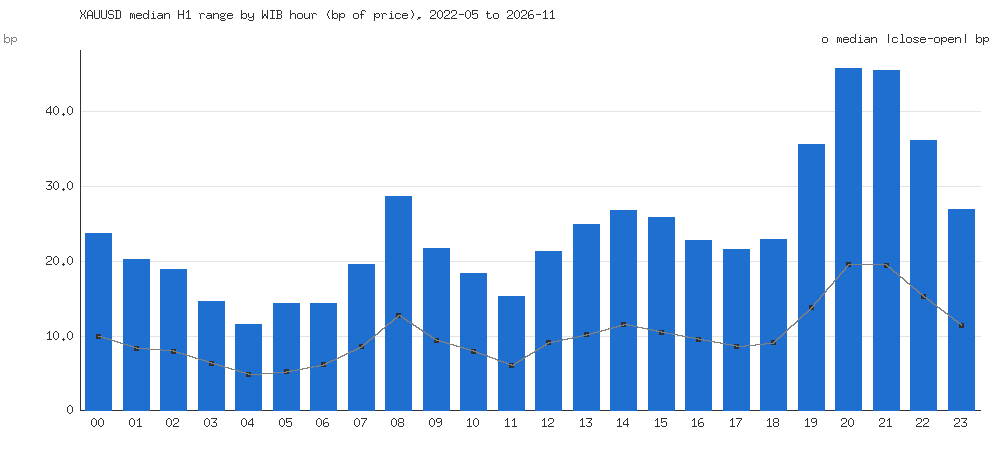

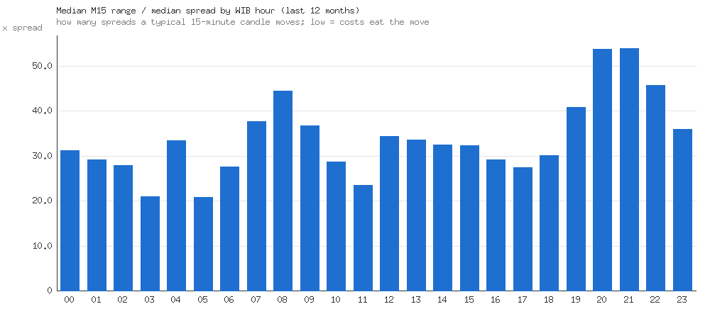

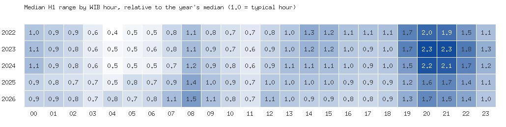

> **STRONG** - The most active hour is 20:00 WIB (median H1 range 46 bp, about $27.4 in the last 12 months, 4.0x the quietest hour 04:00 WIB at 12 bp). It was among the top 3 hours in 5 of 5 years.  
> _For trading:_ Gold moves most 19:00-23:00 WIB and least 03:00-06:00 WIB; size stops and targets to the hour (ATR), and expect a quiet-hour target to take much longer.

> **STRONG** - A typical M15 candle moves 54 median spreads at 21:00 WIB but only 21 at 05:00 WIB (last 12 months); the worst hour fell in 03:00-06:00 WIB in 5 of 5 years.  
> _For trading:_ The median spread is small against the typical move in every hour; what makes the 03:00-06:00 WIB window costly is the move shrinking and the spread spiking (see study 5), so avoid short-term entries there.

### By session

Session blocks are fixed in UTC (no daylight-saving shift; in summer London and New York open one hour earlier in UTC) and shown in WIB. Each hour belongs to one block. "Session range" is the high-low of the whole block on one day.

| session | UTC | WIB | hours | H1 range median bp | H1 abs return median bp | session range median bp | session range median $ (12m) | share of all |return| |
| --- | ---: | ---: | ---: | ---: | ---: | ---: | ---: | ---: |
| Asia | 00:00-07:00 | 07:00-14:00 | 7 | 21.2 | 9.0 | 61.1 | 49.41 | 28.0% |
| Asia+London overlap | 07:00-09:00 | 14:00-16:00 | 2 | 26.4 | 11.1 | 36.7 | 21.68 | 8.6% |
| London | 09:00-12:00 | 16:00-19:00 | 3 | 22.5 | 9.1 | 39.5 | 25.21 | 11.2% |
| London+New York overlap | 12:00-16:00 | 19:00-23:00 | 4 | 40.9 | 17.0 | 86.6 | 50.73 | 27.5% |
| New York | 16:00-21:00 | 23:00-04:00 | 5 | 21.1 | 8.6 | 49.4 | 33.05 | 18.8% |
| Rollover / late | 21:00-00:00 | 04:00-07:00 | 3 | 13.8 | 5.7 | 22.2 | 21.49 | 5.9% |

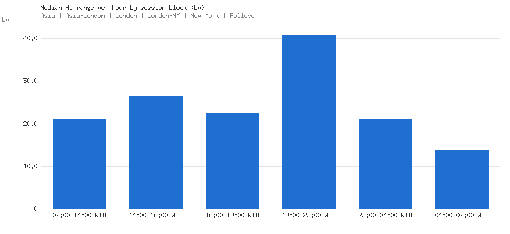

> **STRONG** - Per hour, the London+New York overlap (19:00-23:00 WIB) moves 1.9x the Asian hours (07:00-14:00 WIB): median H1 range 41 vs 21 bp; the overlap's 4 hours carry 27.5% of all hourly |return|.  
> _For trading:_ Expect stops of the same size to be hit about twice as fast in the WIB evening as in the WIB morning; size stops by the session's ATR, not one fixed number.

### By weekday

Two views: H1 candles by their **WIB** weekday (WIB Saturday 00:00-04:00 holds Friday's New York close), and whole **trading days** (Exness server day = UTC date; Sunday-evening bars count as Monday).

| weekday | trading days | daily range median bp | H1 range median bp (WIB day) | range vs other days | p | FDR 5% | same sign years |
| --- | ---: | ---: | ---: | ---: | ---: | ---: | ---: |
| Mon | 237 | 134.5 | 25.8 | -7% | 0.072 | no | 4/5 |
| Tue | 237 | 141.9 | 23.4 | -1% | 0.724 | no | 2/5 |
| Wed | 237 | 135.4 | 23.0 | +0% | 0.949 | no | 3/5 |
| Thu | 237 | 144.2 | 24.8 | +3% | 0.422 | no | 4/5 |
| Fri | 233 | 144.3 | 23.6 | +6% | 0.136 | no | 2/5 |
| Sat (WIB 00-04) | - | - | 20.1 |  |  |  |  |

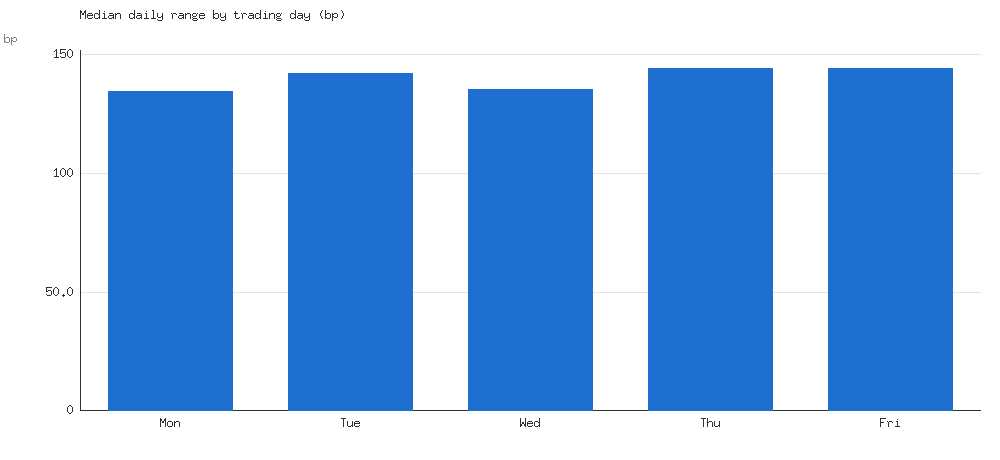

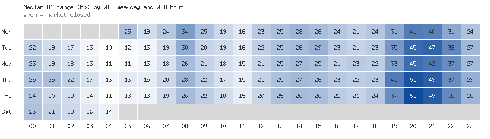

> **NOISE** - The clearest weekday difference in daily range is Mon at -7% vs the other days (p 0.072, not significant after the 5-test FDR correction, same sign in 4/5 years); all weekdays are within 13% of each other.  
> _For trading:_ Weekday barely changes how far gold travels in a day; the hour of day matters about ten times more.

## 2. Direction tendencies

Return = close - open of the candle, in bp of the open. Gold rose from 1897 to 3883 over the period, so the average H1 candle returned **+0.23 bp** (the drift): a bucket must beat 0 by more than chance to matter. Tests: t-statistic of the mean against 0 (normal p-value), a 2,000-resample bootstrap 95% interval, the year-by-year sign, then two corrections over the family of tests: **FDR** (Benjamini-Hochberg, 5%) and **Bonferroni** (5% / number of tests). Label rule: **STRONG** = survives FDR *and* has the same sign in at least 4 of 5 years; **WEAK** = only one of those, or raw p < 0.01; **NOISE** = the rest.

### Mean H1 return by WIB hour (24 tests)

| bucket | n | mean bp | 95% bootstrap CI | t | p | FDR 5% | Bonferroni 5% | same sign years | label |
| --- | ---: | ---: | ---: | ---: | ---: | ---: | ---: | ---: | ---: |
| 00 | 1170 | -0.63 | [-1.80, 0.54] | -1.03 | 0.301 | no | no | 3/5 | **NOISE** |
| 01 | 1158 | 0.25 | [-1.16, 1.50] | 0.37 | 0.711 | no | no | 3/5 | **NOISE** |
| 02 | 1146 | 0.21 | [-1.03, 1.43] | 0.34 | 0.736 | no | no | 3/5 | **NOISE** |
| 03 | 1135 | 0.74 | [-0.29, 1.82] | 1.41 | 0.159 | no | no | 5/5 | **NOISE** |
| 04 | 344 | 1.32 | [-0.11, 2.75] | 1.80 | 0.071 | no | no | 4/5 | **NOISE** |
| 05 | 810 | 0.33 | [-0.90, 1.59] | 0.55 | 0.580 | no | no | 3/5 | **NOISE** |
| 06 | 1172 | 1.61 | [0.46, 2.83] | 2.69 | 0.007 | no | no | 5/5 | **WEAK** |
| 07 | 1172 | 0.64 | [-0.65, 2.06] | 0.96 | 0.337 | no | no | 3/5 | **NOISE** |
| 08 | 1172 | 1.32 | [-0.35, 3.00] | 1.54 | 0.123 | no | no | 4/5 | **NOISE** |
| 09 | 1173 | 0.04 | [-1.18, 1.33] | 0.07 | 0.948 | no | no | 4/5 | **NOISE** |
| 10 | 1173 | 0.13 | [-0.79, 1.05] | 0.28 | 0.779 | no | no | 3/5 | **NOISE** |
| 11 | 1173 | 0.04 | [-0.73, 0.81] | 0.10 | 0.923 | no | no | 2/5 | **NOISE** |
| 12 | 1173 | -0.98 | [-2.30, 0.30] | -1.43 | 0.152 | no | no | 4/5 | **NOISE** |
| 13 | 1173 | 1.11 | [-0.14, 2.34] | 1.74 | 0.081 | no | no | 4/5 | **NOISE** |
| 14 | 1173 | 0.20 | [-0.96, 1.33] | 0.33 | 0.740 | no | no | 2/5 | **NOISE** |
| 15 | 1173 | -0.15 | [-1.43, 1.08] | -0.24 | 0.810 | no | no | 4/5 | **NOISE** |
| 16 | 1173 | -0.00 | [-1.09, 1.02] | -0.00 | 0.999 | no | no | 1/5 | **NOISE** |
| 17 | 1173 | 0.26 | [-0.76, 1.36] | 0.49 | 0.627 | no | no | 3/5 | **NOISE** |
| 18 | 1173 | 1.02 | [-0.23, 2.16] | 1.63 | 0.102 | no | no | 4/5 | **NOISE** |
| 19 | 1173 | 0.57 | [-1.32, 2.46] | 0.58 | 0.560 | no | no | 4/5 | **NOISE** |
| 20 | 1173 | -0.94 | [-2.98, 1.02] | -0.90 | 0.367 | no | no | 4/5 | **NOISE** |
| 21 | 1173 | 0.32 | [-1.69, 2.36] | 0.31 | 0.759 | no | no | 3/5 | **NOISE** |
| 22 | 1173 | -1.75 | [-3.64, 0.10] | -1.77 | 0.076 | no | no | 5/5 | **NOISE** |
| 23 | 1173 | 0.57 | [-0.69, 1.91] | 0.84 | 0.402 | no | no | 4/5 | **NOISE** |

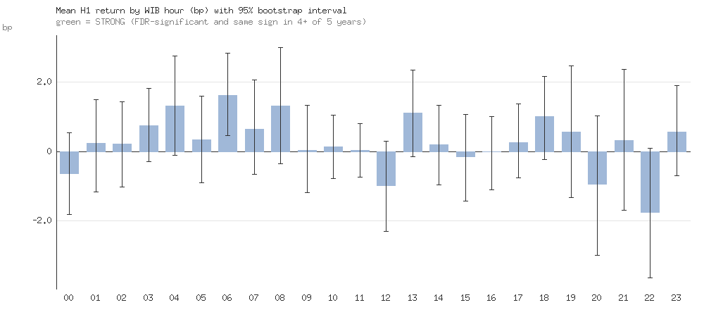

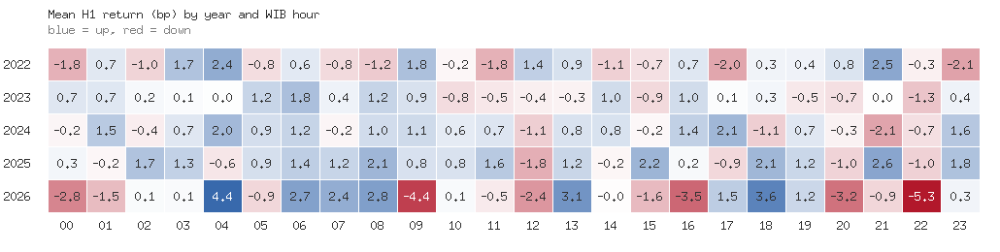

> **WEAK** - By WIB hour, 1 of 24 hourly means have raw p < 0.05 (chance alone gives about 1.2) and 0 survive FDR. STRONG hours: none. WEAK: 06:00 (+1.6 bp).  
> _For trading:_ No hour of the day has a reliable direction beyond gold's general uptrend; do not choose long or short by the clock.

### Mean daily return by weekday (5 tests)

Trading day = Exness server day (UTC); return = the day's close - open.

| bucket | n | mean bp | 95% bootstrap CI | t | p | FDR 5% | Bonferroni 5% | same sign years | label |
| --- | ---: | ---: | ---: | ---: | ---: | ---: | ---: | ---: | ---: |
| Mon | 237 | 3.65 | [-9.79, 17.21] | 0.52 | 0.605 | no | no | 2/5 | **NOISE** |
| Tue | 237 | 6.50 | [-8.55, 21.10] | 0.85 | 0.393 | no | no | 4/5 | **NOISE** |
| Wed | 237 | 13.43 | [-1.80, 28.45] | 1.76 | 0.079 | no | no | 4/5 | **NOISE** |
| Thu | 237 | 3.59 | [-11.43, 18.76] | 0.46 | 0.646 | no | no | 2/5 | **NOISE** |
| Fri | 233 | 6.65 | [-11.34, 23.46] | 0.75 | 0.456 | no | no | 4/5 | **NOISE** |

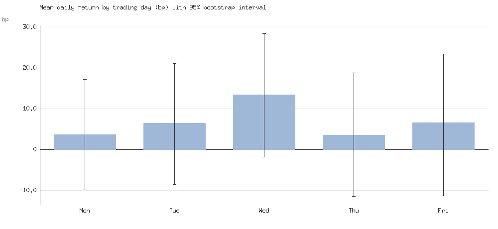

> **NOISE** - By weekday, STRONG: none; WEAK: none. Daily returns are noisy (SD about 109 bp), so 237 days per weekday can only detect a mean of about 14 bp.  
> _For trading:_ Do not pick a trade direction from the weekday.

### Hour x weekday cells (up to 144 tests)

115 cells had at least 100 candles. **7** have raw p < 0.05; chance alone would give about **6**. **0** survive FDR and **0** survive Bonferroni. STRONG cells: none.

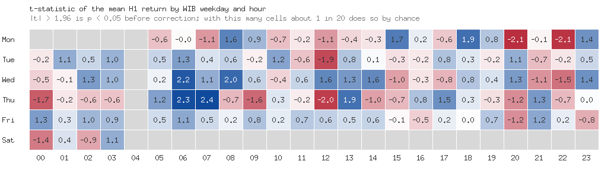

> **NOISE** - Hour x weekday: 7 raw hits of 115 cells vs about 6 expected by chance; 0 survive FDR.  
> _For trading:_ Tables of 'best hour on each weekday' are mostly chance; trust only cells that also survive the correction and hold across years.

Note: the t-test treats candles as independent. Gold's volatility clusters, which makes some p-values look smaller than they are; this is one more reason to require the year-by-year sign check.

## 3. Trend vs mean reversion

Forward returns are measured from the close of the event candle to the close k candles later, **signed in the event's direction** (positive = the move continued, negative = it reversed) and in units of ATR(14) known before the event. Windows that cross a weekend are dropped, and after an event the next 16 candles cannot start another, so samples do not overlap. Baseline: the same forward return after *every* candle is the drift (about 0).

### After big candles and big moves (32 tests)

| tf | condition | dir | k | n | mean fwd ATR | share continued | t | p | FDR 5% | same sign years | label |
| --- | ---: | ---: | ---: | ---: | ---: | ---: | ---: | ---: | ---: | ---: | ---: |
| M15 | big candle: body > 2 ATR | up | 1 | 637 | -0.050 | 46.2% | -0.92 | 0.360 | no | 4/5 | **NOISE** |
| M15 | big candle: body > 2 ATR | up | 4 | 637 | 0.152 | 51.8% | 1.41 | 0.158 | no | 4/5 | **NOISE** |
| M15 | big candle: body > 2 ATR | up | 8 | 635 | 0.218 | 53.9% | 1.51 | 0.130 | no | 3/5 | **NOISE** |
| M15 | big candle: body > 2 ATR | up | 16 | 634 | 0.243 | 52.8% | 1.35 | 0.176 | no | 4/5 | **NOISE** |
| M15 | big candle: body > 2 ATR | down | 1 | 650 | -0.056 | 42.6% | -0.91 | 0.364 | no | 4/5 | **NOISE** |
| M15 | big candle: body > 2 ATR | down | 4 | 650 | -0.167 | 43.4% | -1.59 | 0.111 | no | 4/5 | **NOISE** |
| M15 | big candle: body > 2 ATR | down | 8 | 649 | -0.228 | 44.1% | -1.64 | 0.101 | no | 4/5 | **NOISE** |
| M15 | big candle: body > 2 ATR | down | 16 | 645 | -0.236 | 45.7% | -1.39 | 0.164 | no | 4/5 | **NOISE** |
| M15 | big move: 8-candle move > 4 ATR | up | 1 | 829 | 0.043 | 49.2% | 0.93 | 0.353 | no | 3/5 | **NOISE** |
| M15 | big move: 8-candle move > 4 ATR | up | 4 | 829 | 0.133 | 50.3% | 1.40 | 0.161 | no | 4/5 | **NOISE** |
| M15 | big move: 8-candle move > 4 ATR | up | 8 | 829 | 0.184 | 51.3% | 1.54 | 0.123 | no | 3/5 | **NOISE** |
| M15 | big move: 8-candle move > 4 ATR | up | 16 | 827 | 0.252 | 52.2% | 1.65 | 0.098 | no | 4/5 | **NOISE** |
| M15 | big move: 8-candle move > 4 ATR | down | 1 | 822 | -0.100 | 43.1% | -2.12 | 0.034 | no | 5/5 | **WEAK** |
| M15 | big move: 8-candle move > 4 ATR | down | 4 | 822 | -0.206 | 44.3% | -2.46 | 0.014 | no | 5/5 | **WEAK** |
| M15 | big move: 8-candle move > 4 ATR | down | 8 | 822 | -0.179 | 44.3% | -1.62 | 0.106 | no | 4/5 | **NOISE** |
| M15 | big move: 8-candle move > 4 ATR | down | 16 | 818 | -0.241 | 45.5% | -1.64 | 0.100 | no | 4/5 | **NOISE** |
| H1 | big candle: body > 2 ATR | up | 1 | 218 | -0.004 | 50.0% | -0.04 | 0.968 | no | 3/5 | **NOISE** |
| H1 | big candle: body > 2 ATR | up | 4 | 217 | -0.045 | 47.5% | -0.27 | 0.790 | no | 3/5 | **NOISE** |
| H1 | big candle: body > 2 ATR | up | 8 | 196 | -0.046 | 48.0% | -0.23 | 0.818 | no | 4/5 | **NOISE** |
| H1 | big candle: body > 2 ATR | up | 16 | 176 | 0.018 | 50.6% | 0.07 | 0.943 | no | 2/5 | **NOISE** |
| H1 | big candle: body > 2 ATR | down | 1 | 206 | -0.046 | 44.7% | -0.50 | 0.620 | no | 3/5 | **NOISE** |
| H1 | big candle: body > 2 ATR | down | 4 | 206 | -0.174 | 41.3% | -1.13 | 0.260 | no | 4/5 | **NOISE** |
| H1 | big candle: body > 2 ATR | down | 8 | 186 | -0.339 | 41.4% | -1.64 | 0.101 | no | 4/5 | **NOISE** |
| H1 | big candle: body > 2 ATR | down | 16 | 162 | -0.271 | 40.7% | -1.27 | 0.205 | no | 3/5 | **NOISE** |
| H1 | big move: 8-candle move > 4 ATR | up | 1 | 231 | 0.019 | 51.9% | 0.24 | 0.807 | no | 2/5 | **NOISE** |
| H1 | big move: 8-candle move > 4 ATR | up | 4 | 222 | 0.178 | 48.6% | 1.32 | 0.185 | no | 4/5 | **NOISE** |
| H1 | big move: 8-candle move > 4 ATR | up | 8 | 200 | 0.238 | 46.0% | 1.37 | 0.171 | no | 4/5 | **NOISE** |
| H1 | big move: 8-candle move > 4 ATR | up | 16 | 182 | 0.431 | 53.8% | 2.10 | 0.035 | no | 4/5 | **WEAK** |
| H1 | big move: 8-candle move > 4 ATR | down | 1 | 224 | -0.034 | 43.3% | -0.40 | 0.690 | no | 4/5 | **NOISE** |
| H1 | big move: 8-candle move > 4 ATR | down | 4 | 216 | 0.108 | 44.9% | 0.83 | 0.409 | no | 4/5 | **NOISE** |
| H1 | big move: 8-candle move > 4 ATR | down | 8 | 193 | -0.218 | 37.8% | -1.33 | 0.184 | no | 3/5 | **NOISE** |
| H1 | big move: 8-candle move > 4 ATR | down | 16 | 179 | -0.400 | 40.8% | -1.74 | 0.081 | no | 3/5 | **NOISE** |

3 of 32 tests have raw p < 0.05 (chance: about 1.6). Read the signs with gold's uptrend in mind: up events "continuing" and down events "reversing" are both what a rising market gives anyway.

> **WEAK** - After big candles / big moves: STRONG: none. WEAK: M15 big move: 8-candle move > 4 ATR down, k=1: -0.10 ATR (reverses, n 822, 5/5 years); M15 big move: 8-candle move > 4 ATR down, k=4: -0.21 ATR (reverses, n 822, 5/5 years); H1 big move: 8-candle move > 4 ATR up, k=16: +0.43 ATR (continues, n 182, 4/5 years).  
> _For trading:_ Neither chasing nor fading big candles has a reliable edge; a big candle by itself is not a signal.

### Asian range and the London break

**Asian range** = high/low of the M15 candles opening 00:00-06:45 UTC (**07:00-14:00 WIB**). **London break** = the first M15 candle opening 07:00-11:45 UTC (**14:00-19:00 WIB**) that *closes* above the high (up) or below the low (down). Measured to the **New York close** = the close of the candle opening 20:45 UTC (**04:00 WIB** next day). Return is signed in the break direction, in units of the Asian range (AR). **Extension** = price reaches 1 AR beyond the broken edge before touching the opposite edge; **reversal** = the opposite edge first. **Fake-out** = a close back inside the range within 4 candles (1 hour).

1134 weekdays with a full Asian range; 305 had no London break before 19:00 WIB. Median Asian range 61 bp.

| break | days | mean to NY close (AR) | mean bp | t | p | extension first | reversal first | fake-out | same sign years | label |
| --- | ---: | ---: | ---: | ---: | ---: | ---: | ---: | ---: | ---: | ---: |
| up | 457 | 0.065 | 4.3 | 0.90 | 0.369 | 39.6% | 31.1% | 53.0% | 3/5 | **NOISE** |
| down | 372 | -0.043 | 5.2 | -0.44 | 0.661 | 48.4% | 30.4% | 54.3% | 4/5 | **NOISE** |
| both | 829 | 0.017 | 4.7 | 0.28 | 0.782 | 43.5% | 30.8% | 53.6% | 2/5 | **NOISE** |

Geometry check: of the 616 breaks that reached either level, 58.6% reached the extension first; a driftless random walk from the same break closes would do so 56.5% of the time (z 1.07, p 0.286). The extension is simply closer than the opposite edge.

> **NOISE** - After a London break of the Asian range, price moved +0.02 AR (+5 bp) in the break direction by the New York close on average (p 0.782); it reached a 1x-range extension first on 43.5% of days and the opposite edge first on 30.8%; 53.6% were fake-outs.  
> _For trading:_ A London break of the Asian range is a coin flip by the New York close; neither follow nor fade it on its own.

### Autocorrelation of returns

Close-to-close log returns; H4 is built from H1 (UTC-aligned), D1 is the trading day. A value outside +/-1.96/sqrt(n) is significant at 5% before correction (marked *). Positive = momentum, negative = mean reversion. "years" = years with the same sign at lag 1.

| series | n | lag 1 | lag 2 | lag 3 | lag 5 | lag 10 | 5% band | years (lag 1) |
| --- | ---: | ---: | ---: | ---: | ---: | ---: | ---: | ---: |
| M15 | 107396 | -0.003 | 0.004 | -0.011* | 0.005 | 0.001 | 0.006 | 4/5 |
| H1 | 26873 | -0.013* | -0.006 | 0.008 | 0.004 | 0.014* | 0.012 | 4/5 |
| H4 | 7268 | 0.020 | -0.001 | 0.021 | 0.022 | 0.003 | 0.023 | 5/5 |
| D1 | 1180 | -0.025 | -0.053 | 0.001 | 0.028 | 0.031 | 0.057 | 4/5 |

> **WEAK** - Autocorrelations surviving FDR over 20 tests: M15 lag 3 = -0.011 (WEAK). Even the largest explains well under 1% of the next return's variance.  
> _For trading:_ Past returns alone barely predict the next one; any edge must come from context (session, levels), not from the last candle's direction.

## 4. Key levels

On M15 candles. A **touch** = the previous close and this candle's open are on one side of the level and this candle's high (from below) or low (from above) reaches it; the same level counts again only after 16 candles. Within 16 candles (4 hours, the touching one included): **break** = a close 0.5 ATR(14) beyond the level; **bounce** = price comes back 1 ATR from the level first (by its high/low); both in one candle = unclear; neither = unresolved. Levels: **prior day high/low** (Exness server day, UTC), **Asian high/low** (07:00-14:00 WIB range, used 14:00-04:00 WIB), **round 100** (multiples of 100), **round 50** (odd multiples of 50, e.g. 3,950), and a **control**: arbitrary levels at 50k+17 and 50k+33 (e.g. 3,967, 3,983), which tells how often *any* price line "holds" by these definitions. A level matters only if it beats the control.

| level | approach | touches | bounce | break | unclear/neither | bounce share of resolved | z vs control | p | FDR 5% | fwd 4 (ATR) | fwd 16 (ATR) | same sign years | label |
| --- | ---: | ---: | ---: | ---: | ---: | ---: | ---: | ---: | ---: | ---: | ---: | ---: | ---: |
| control | from below (resistance) | 2221 | 57.9% | 32.5% | 9.6% | 64.0% |  |  |  | -0.057 | -0.017 |  | baseline |
| control | from above (support) | 2281 | 65.7% | 23.9% | 10.3% | 73.3% |  |  |  | -0.101 | -0.186 |  | baseline |
| prior day high | from below (resistance) | 789 | 54.1% | 27.1% | 18.8% | 66.6% | 1.19 | 0.236 | no | 0.121 | 0.147 | 3/5 | **NOISE** |
| prior day high | from above (support) | 279 | 58.4% | 30.8% | 10.8% | 65.5% | -2.61 | 0.009 | yes | -0.081 | -0.182 | 4/5 | **STRONG** |
| prior day low | from below (resistance) | 216 | 53.2% | 39.4% | 7.4% | 57.5% | -1.83 | 0.067 | no | 0.139 | 0.351 | 4/5 | **NOISE** |
| prior day low | from above (support) | 752 | 66.0% | 20.1% | 14.0% | 76.7% | 1.70 | 0.089 | no | -0.015 | 0.010 | 4/5 | **NOISE** |
| Asian high | from below (resistance) | 1055 | 62.2% | 26.4% | 11.5% | 70.2% | 3.30 | 0.0010 | yes | 0.050 | 0.199 | 4/5 | **STRONG** |
| Asian high | from above (support) | 303 | 61.7% | 29.0% | 9.2% | 68.0% | -1.85 | 0.064 | no | -0.049 | -0.559 | 5/5 | **NOISE** |
| Asian low | from below (resistance) | 201 | 59.2% | 32.8% | 8.0% | 64.3% | 0.08 | 0.939 | no | -0.045 | -0.070 | 3/5 | **NOISE** |
| Asian low | from above (support) | 956 | 62.2% | 24.5% | 13.3% | 71.8% | -0.83 | 0.404 | no | -0.019 | -0.010 | 4/5 | **NOISE** |
| round 100 | from below (resistance) | 481 | 58.2% | 29.9% | 11.9% | 66.0% | 0.78 | 0.436 | no | 0.021 | 0.207 | 5/5 | **NOISE** |
| round 100 | from above (support) | 486 | 59.1% | 25.9% | 15.0% | 69.5% | -1.58 | 0.113 | no | -0.081 | 0.024 | 4/5 | **NOISE** |
| round 50 | from below (resistance) | 494 | 54.0% | 34.0% | 11.9% | 61.4% | -1.05 | 0.295 | no | 0.124 | 0.227 | 4/5 | **NOISE** |
| round 50 | from above (support) | 542 | 59.6% | 30.3% | 10.1% | 66.3% | -3.08 | 0.002 | yes | -0.041 | 0.072 | 4/5 | **STRONG** |

fwd k = the close k candles after the touch minus the touch candle's close, in ATR, signed *through* the level (positive = kept going through, negative = turned back).

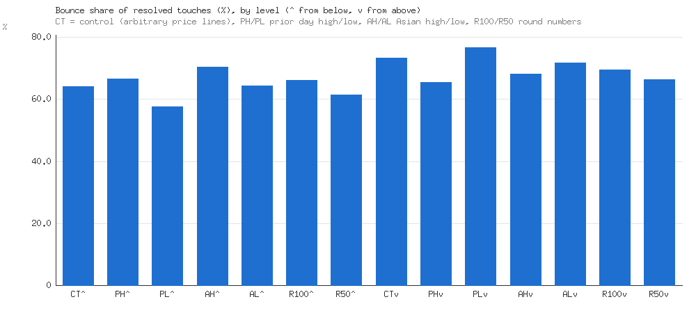

> **STRONG** - Levels against the arbitrary-line control (12 tests, FDR): STRONG: prior day high | from above (support): bounce share 65.5% vs control 73.3% (-7.8 points, 4/5 years); Asian high | from below (resistance): bounce share 70.2% vs control 64.0% (+6.2 points, 4/5 years); round 50 | from above (support): bounce share 66.3% vs control 73.3% (-7.0 points, 4/5 years). WEAK: none.  
> _For trading:_ Only the STRONG levels behave differently from any random price line; treat the others as ordinary prices.

## 5. Costs

### Spread

Spread = ask close - bid close of each M15 candle, in dollars of price (0.24 = 24 cents = $24 per lot per round trip, $0.24 for 0.01 lot). The candle shows the spread at its close only, so short spikes inside a candle are missed; the p90 is the honest "bad case". Most columns use the last 12 months (the current price level and conditions).

| WIB hour | M15 candles (12m) | median $ | p90 $ | p99 $ | share > 2x median | median $ (all years) | p90 $ (all years) |
| --- | ---: | ---: | ---: | ---: | ---: | ---: | ---: |
| 00 | 1024 | 0.240 | 0.280 | 0.360 | 0.2% | 0.200 | 0.260 |
| 01 | 1018 | 0.240 | 0.280 | 0.364 | 0.6% | 0.200 | 0.260 |
| 02 | 1005 | 0.240 | 0.280 | 0.364 | 0.8% | 0.200 | 0.260 |
| 03 | 996 | 0.260 | 0.360 | 0.364 | 0.4% | 0.200 | 0.260 |
| 04 | 337 | 0.160 | 0.360 | 0.500 | 18.4% | 0.200 | 0.240 |
| 05 | 675 | 0.260 | 0.360 | 0.500 | 0.1% | 0.200 | 0.340 |
| 06 | 1031 | 0.240 | 0.360 | 0.500 | 2.2% | 0.200 | 0.280 |
| 07 | 1032 | 0.240 | 0.360 | 0.364 | 0.5% | 0.200 | 0.260 |
| 08 | 1032 | 0.260 | 0.360 | 0.364 | 0.0% | 0.200 | 0.260 |
| 09 | 1032 | 0.240 | 0.360 | 0.363 | 0.3% | 0.200 | 0.260 |
| 10 | 1032 | 0.240 | 0.280 | 0.360 | 0.1% | 0.200 | 0.260 |
| 11 | 1032 | 0.240 | 0.280 | 0.360 | 0.2% | 0.200 | 0.260 |
| 12 | 1032 | 0.240 | 0.280 | 0.360 | 0.1% | 0.200 | 0.260 |
| 13 | 1032 | 0.240 | 0.280 | 0.360 | 0.1% | 0.200 | 0.260 |
| 14 | 1032 | 0.240 | 0.280 | 0.360 | 0.2% | 0.200 | 0.260 |
| 15 | 1030 | 0.240 | 0.280 | 0.360 | 0.4% | 0.200 | 0.260 |
| 16 | 1032 | 0.240 | 0.280 | 0.360 | 0.2% | 0.200 | 0.260 |
| 17 | 1032 | 0.240 | 0.280 | 0.360 | 0.2% | 0.200 | 0.260 |
| 18 | 1032 | 0.240 | 0.280 | 0.363 | 0.4% | 0.200 | 0.260 |
| 19 | 1032 | 0.240 | 0.358 | 0.363 | 0.2% | 0.200 | 0.260 |
| 20 | 1032 | 0.240 | 0.360 | 0.372 | 0.6% | 0.200 | 0.260 |
| 21 | 1032 | 0.240 | 0.288 | 0.364 | 0.6% | 0.200 | 0.260 |
| 22 | 1032 | 0.240 | 0.280 | 0.360 | 0.2% | 0.200 | 0.260 |
| 23 | 1032 | 0.240 | 0.280 | 0.360 | 0.1% | 0.200 | 0.260 |

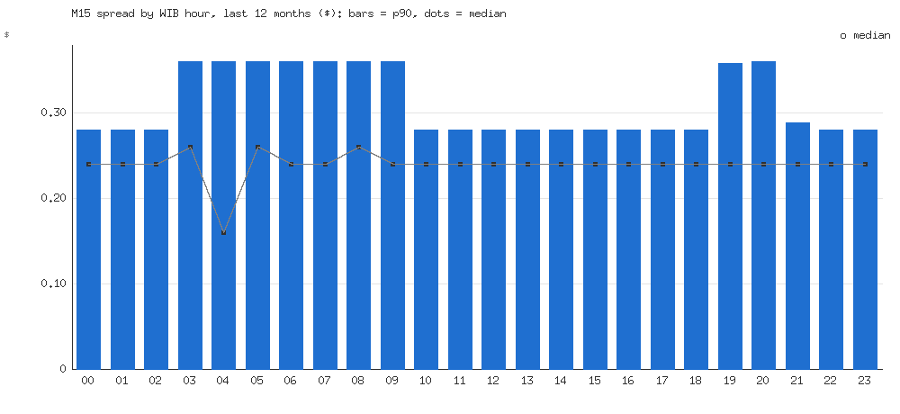

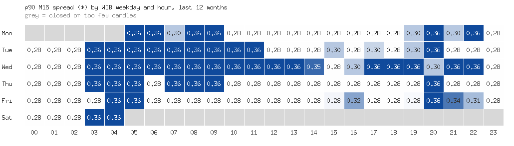

#### Daily rollover window (15-minute slots, last 12 months)

Exness closes gold for about an hour around 17:00 New York (21:00 UTC in summer, 22:00 in winter = 04:00 or 05:00 WIB) and charges the swap then.

| WIB slot | candles | median $ | p90 $ | p99 $ |
| --- | ---: | ---: | ---: | ---: |
| 02:30 | 250 | 0.240 | 0.280 | 0.364 |
| 02:45 | 249 | 0.240 | 0.280 | 0.364 |
| 03:00 | 249 | 0.240 | 0.296 | 0.362 |
| 03:15 | 249 | 0.240 | 0.360 | 0.364 |
| 03:30 | 249 | 0.240 | 0.360 | 0.364 |
| 03:45 | 249 | 0.260 | 0.360 | 0.485 |
| 04:00 | 84 | 0.160 | 0.360 | 0.384 |
| 04:15 | 84 | 0.160 | 0.360 | 0.500 |
| 04:30 | 84 | 0.160 | 0.360 | 0.384 |
| 04:45 | 85 | 0.160 | 0.360 | 0.500 |
| 05:00 | 168 | 0.260 | 0.360 | 0.500 |
| 05:15 | 169 | 0.260 | 0.360 | 0.408 |
| 05:30 | 169 | 0.260 | 0.360 | 0.500 |
| 05:45 | 169 | 0.260 | 0.360 | 0.361 |
| 06:00 | 258 | 0.260 | 0.360 | 0.500 |
| 06:15 | 258 | 0.240 | 0.360 | 0.500 |
| 06:30 | 257 | 0.240 | 0.336 | 0.364 |
| 06:45 | 258 | 0.240 | 0.280 | 0.362 |
| 07:00 | 258 | 0.240 | 0.360 | 0.362 |

#### Monday open

First 4 M15 candles after the weekend (from about 05:00 WIB Monday), last 12 months: median **$0.260**, p90 **$0.360**, max **$1.977** (n 216), against median $0.240 / p90 $0.280 for all other candles.

#### By WIB weekday (last 12 months)

| WIB weekday | candles | median $ | p90 $ |
| --- | ---: | ---: | ---: |
| Mon | 3879 | 0.240 | 0.360 |
| Tue | 4744 | 0.240 | 0.360 |
| Wed | 4784 | 0.240 | 0.360 |
| Thu | 4625 | 0.240 | 0.280 |
| Fri | 4729 | 0.240 | 0.280 |
| Sat | 867 | 0.240 | 0.280 |

#### By year

| year | candles | median $ | p90 $ | median bp of price |
| --- | ---: | ---: | ---: | ---: |
| 2022 | 15920 | 0.200 | 0.200 | 1.14 |
| 2023 | 23534 | 0.200 | 0.200 | 1.03 |
| 2024 | 23693 | 0.200 | 0.200 | 0.84 |
| 2025 | 23620 | 0.160 | 0.160 | 0.48 |
| 2026 | 20627 | 0.260 | 0.360 | 0.59 |

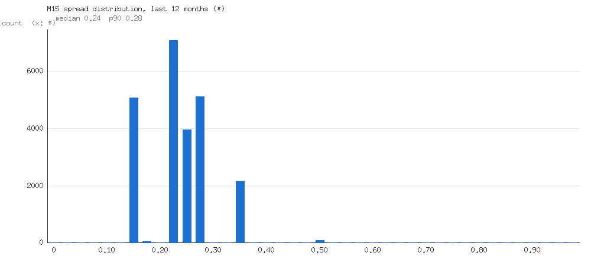

> **WEAK** - Spreads are tight and almost flat: median $0.24 in every hour of the last 12 months (one quoted step: 0.16-0.36). The p99 reaches $0.50 at 04:00 WIB around the rollover, and the widest Monday-open candle showed $1.98. In 2022-2024 the spread was a flat $0.20 at nearly all hours, so the hour pattern is recent, not stable.  
> _For trading:_ On this account the spread matters little except around the rollover (about 03:45-06:30 WIB) and the Monday open; avoid entries and tight stops there.

### Swap (overnight cost)

From the instrument conditions (read from the cache): swap long **-471.7 points**, short **0.0 points**, point 0.001, contract 100 oz. A point here is $0.001 of price, so a night costs a long **$47.17 per lot**. Charged at the daily rollover (17:00 New York = 04:00/05:00 WIB); **Wednesday** charges **3 nights** (the weekend), so a long pays 7 nights per 5-day week.

| lots | long, 1 night $ | long, Wednesday (x3) $ | long, 1 week $ | long, 1 year $ | 1 night as % of median daily range | short, 1 night $ |
| --- | ---: | ---: | ---: | ---: | ---: | ---: |
| 0.01 | -0.47 | -1.42 | -3.30 | -171.70 | 0.5% | 0.00 |
| 0.10 | -4.72 | -14.15 | -33.02 | -1716.99 | 0.5% | 0.00 |
| 1.00 | -47.17 | -141.51 | -330.19 | -17169.88 | 0.5% | 0.00 |

The median daily range over the last 12 months is **$91.90** of price ($9190 per lot). One night of long swap is $0.47 of price, i.e. 0.5% of a typical day's range and 2.0 median spreads. Held for a year a long pays about **4.4% of the position's value** (at 3883), while a short pays nothing.

> **STRONG** - A long held overnight pays $47.17 per lot ($0.47 for 0.01 lot), x3 on Wednesday; that is 2.0 spreads per night and about 4.4% a year of the position's value. Shorts pay nothing.  
> _For trading:_ Intraday ideas are unaffected; a swing long held for days must earn the swap first, so close longs before the rollover (about 04:00 WIB) or prefer short-side holds.

Caveat: these are today's conditions (fetched 2026-11-14). Exness changes swaps over time; the backtests apply today's swap to the whole history.

## Approach ideas (built only on STRONG findings)

Of the STRONG findings, most are about **size** (when gold moves, the swap), not **direction**. No hour, weekday, big-candle or Asian-break effect gives a direction that survives correction. The one STRONG *directional* fact is at a level: **price touching the Asian high from below turns back more often than at an arbitrary price line** (study 4). Two other level findings are STRONG only *relative to the control* (the prior-day high and odd 50s hold *less* well as support from above), but their forward returns still lean towards a bounce, so a trade against them would fight the data; they are not used.

The rules were fixed before the first backtest; the walk-forward run is the only tuning (stop and target multiples, on 3 months, tested on the next month).

### Idea 1: `asian_high_fade` (M15, 14:00-02:45 WIB)

- **Level:** today's Asian high = the highest M15 high of the candles opening 07:00-13:45 WIB (00:00-06:45 UTC), once at least 24 of those 28 candles exist.
- **Entry:** a M15 candle opening 14:00-02:45 WIB whose previous close and own open are below the Asian high, whose high reaches it, and whose close is less than 0.5 ATR(14) above it. **Sell at the next candle's open.** One trade per day on that level, one position at a time.
- **Stop-loss:** Asian high + 1.0 x ATR(14, M15). **Take-profit:** Asian high - 1.0 x ATR(14, M15).
- **Time exit:** anything open is closed at 03:30 WIB (before Exness's Friday close and the rollover spread spike, study 5).
- **Why:** study 4, Asian high from below: bounce share 70.2% vs 64.0% for arbitrary lines, FDR-significant, 4 of 5 years. Short only, so no swap (study 5).

### Idea 2: `asian_high_fade_overlap` (M15, 19:00-22:45 WIB)

- The same rules, but only touches in the **London+New York overlap** (candles opening 19:00-22:45 WIB).
- **Why:** study 1: the overlap moves about twice as far per hour as other sessions (STRONG), so a 1-ATR target should be reached inside the time window more often, and the ATR there already sizes the stop for the bigger moves.

### Benchmark: `control_line_fade`

Not an idea: the same rules as idea 1 on arbitrary lines (50k+17 and 50k+33, study 4's control). An idea is only worth anything if it beats this.

### Settings

Through san_backtest from the cache, 2022-05-02 to 2026-11-14, balance 10000, risk 1% per trade, leverage 1:2000. **real** = Exness's costs per candle (spread from bid/ask, swap); **harsh** = spread 0.40 and slippage 0.10 on every fill; **walk-forward OOS** = 3 months tune / 1 month test, test months chained; years run separately with real costs. Reports: `backtests/<approach>/<run>/` (open the folder in the tower's Backtest Analysis page; each has the decision log, and `real` also has the candles around each trade, from the trade day's 00:00 UTC). Walk-forward tunes stop_atr and target_atr over san_backtest's grid (default x 0.5 ... 1.5, rounded to whole numbers for whole defaults), so in practice it picks 1 or 2 ATR for each.

### Results

**asian_high_fade**

| run | trades | win % | PF | net % | max DD % | avg R | skipped |
| --- | ---: | ---: | ---: | ---: | ---: | ---: | ---: |
| real | 670 | 52.7 | 0.80 | -42.7 | 47.8 | -0.08 | 55 |
| walk-forward OOS | 647 | 52.7 | 0.76 | -46.9 | 54.2 | -0.10 | 36 |
| harsh | 658 | 47.4 | 0.52 | -76.1 | 77.0 | -0.22 | 67 |
| 2022 | 104 | 50.0 | 0.86 | -6.9 | 12.2 | -0.07 | 5 |
| 2023 | 149 | 42.3 | 0.49 | -33.4 | 35.4 | -0.27 | 21 |
| 2024 | 154 | 55.2 | 0.95 | -3.5 | 16.3 | -0.02 | 17 |
| 2025 | 151 | 56.3 | 0.94 | -3.5 | 18.8 | -0.02 | 6 |
| 2026 | 112 | 60.7 | 1.00 | -0.1 | 12.5 | 0.01 | 6 |

**asian_high_fade_overlap**

| run | trades | win % | PF | net % | max DD % | avg R | skipped |
| --- | ---: | ---: | ---: | ---: | ---: | ---: | ---: |
| real | 403 | 52.4 | 0.75 | -38.2 | 40.3 | -0.12 | 61 |
| walk-forward OOS | 402 | 54.2 | 0.73 | -36.9 | 40.9 | -0.12 | 36 |
| harsh | 399 | 48.9 | 0.57 | -58.7 | 59.6 | -0.22 | 65 |
| 2022 | 62 | 56.5 | 0.97 | -0.7 | 7.6 | -0.01 | 5 |
| 2023 | 84 | 50.0 | 0.68 | -12.3 | 15.8 | -0.15 | 26 |
| 2024 | 104 | 54.8 | 0.80 | -8.6 | 14.9 | -0.08 | 16 |
| 2025 | 82 | 50.0 | 0.63 | -13.9 | 17.0 | -0.18 | 10 |
| 2026 | 71 | 50.7 | 0.67 | -10.8 | 14.1 | -0.15 | 4 |

**control_line_fade**

| run | trades | win % | PF | net % | max DD % | avg R | skipped |
| --- | ---: | ---: | ---: | ---: | ---: | ---: | ---: |
| real | 1438 | 55.6 | 0.96 | -17.5 | 41.7 | -0.01 | 105 |
| walk-forward OOS | 1378 | 56.5 | 0.94 | -23.4 | 45.7 | -0.01 | 90 |
| harsh | 1356 | 52.1 | 0.70 | -73.2 | 75.2 | -0.10 | 193 |
| 2022 | 103 | 59.2 | 0.95 | -2.0 | 7.4 | -0.02 | 11 |
| 2023 | 171 | 51.5 | 0.86 | -11.2 | 14.7 | -0.07 | 12 |
| 2024 | 218 | 55.0 | 0.86 | -11.9 | 18.1 | -0.06 | 20 |
| 2025 | 369 | 55.0 | 0.91 | -13.2 | 22.8 | -0.03 | 20 |
| 2026 | 579 | 56.8 | 1.08 | 23.9 | 20.1 | 0.05 | 40 |

### Verdict

Rule (fixed in advance): worth a demo forward-test only if the real run has PF > 1.1 and a profit, the harsh run is still profitable, the walk-forward out-of-sample months are profitable together, at least 4 of the 5 years are profitable, and it beats the control benchmark.

- `asian_high_fade`: **not worth a demo forward-test**. real: net -42.7%, PF 0.80 (FAIL); harsh: net -76.1% (FAIL); walk-forward OOS: net -46.9% over 647 trades (FAIL); profitable years: 0 of 5 (FAIL); vs control: -42.7% vs -17.5% (FAIL).
- `asian_high_fade_overlap`: **not worth a demo forward-test**. real: net -38.2%, PF 0.75 (FAIL); harsh: net -58.7% (FAIL); walk-forward OOS: net -36.9% over 402 trades (FAIL); profitable years: 0 of 5 (FAIL); vs control: -38.2% vs -17.5% (FAIL).

Why a STRONG level fact did not pay: study 4 counts a *break* only on a close 0.5 ATR beyond the level, while a real stop is hit by any wick; and the edge is relative (about 6 points of bounce share over an arbitrary line), while fading the arbitrary line itself already loses money (the control). A better-than-random level is not a profitable fade.

**None of the ideas survives.** That is a valid result: the STRONG facts in this report describe *when* and *how much* gold moves and what holding costs, not a direction a rule can harvest after costs. Use them as filters (time of day, stop size, no long swing holds) for ideas that come from elsewhere, and test those the same way.

## Data limits

- **Exness demo prices.** Demo quotes follow the real feed closely but are not a guarantee of live fills; spreads and swaps are the demo account's.
- **Spread** is the ask - bid at each candle's **close** only; spikes inside a candle (news, rollover) are larger than shown.
- **Volume is tick volume** (number of price updates), not traded ounces; it is not used for any finding here.
- **Candles are UTC** from the API, opening at the UTC hour; WIB = UTC+7 all year (Indonesia has no daylight saving), but London and New York do, so their sessions move one hour in WIB between summer and winter. The fixed UTC session blocks here ignore that shift.
- **Swap** uses today's conditions (long -471.7 points, short 0, triple on Wednesday) for the whole history; Exness changed swaps over the years.
- **Trading day** = Exness server day (UTC date); Sunday-evening candles count as Monday.
- **Multiple testing:** about 230 tests ran across the studies. Each family was corrected on its own (FDR within the family); a stricter global correction would remove some WEAK results and could remove borderline STRONG ones. Candles are not independent (volatility clusters), so p-values are somewhat optimistic; the year-by-year check is the guard.
- **2022 and 2026 are partial years** (from 2022-05-02; to 2026-11-14).
