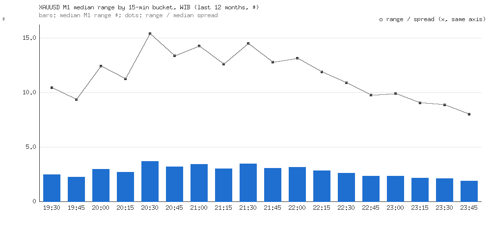
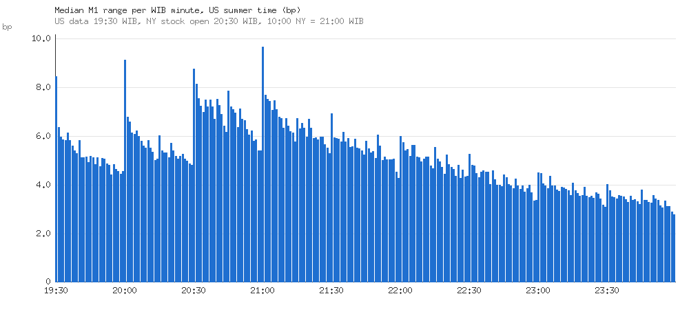
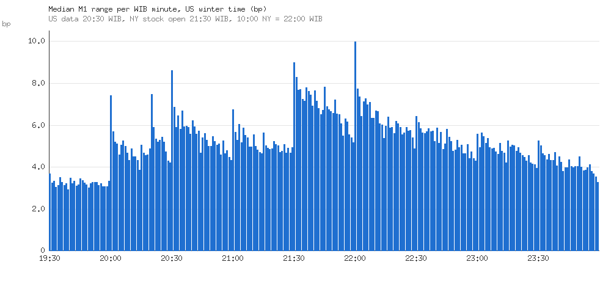
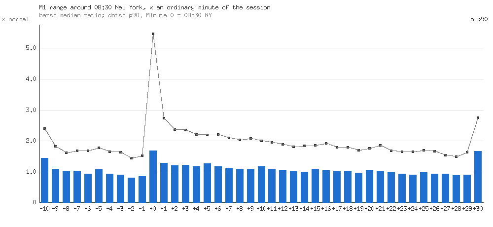

# XAUUSD scalping in San's window (20:00-24:00 WIB), 2026-11-15

Research for a scalping loop (the user, 2026-11-15: "So we find busy hour -> take decission -> open trade -> and waiting that trade close profit or loss") in his own hours (the user, 2026-11-15: "So usually, I take 8 pm and leave 12"). Research only: no orders were placed, and every simulated trade has a stop-loss and a take-profit (rule #1).

- **Data:** Exness XAUUSD M1 candles, bid and ask, 2024-05-01 to 2026-11-13 21:58 UTC (899495 M1 candles, 657 weekday sessions of 19:00-24:00 WIB). **Exness keeps M1 only from 2024-05-01**: a request for 2022-05 returned 2024-05-01 first, so the asked 2022-05 start was not available and the years are 2024 (May-Dec), 2025 and 2026 (to mid-November). H1 from the earlier cache for the trend. S15 candles (bid and ask) for the stop-first check: 2026-10-28 to 2026-11-13 only (Exness keeps S15 about 2.5 weeks). Download for this report: 1,008 read-only Exness candle calls (938 M1, 70 S15; 9 waited out an HTTP 429) through san_backtest's Exness source and Cache, plus 2 one-candle probes; M1 adds 84 MB and S15 7 MB to the cache.
- **Clock:** WIB (UTC+7). US data at 08:30 New York and the NY stock open at 09:30 New York are converted with America/New_York: 19:30 / 20:30 WIB in US summer time (second Sunday of March to first Sunday of November), 20:30 / 21:30 WIB in winter.
- **Labels:** **STRONG** = survives Benjamini-Hochberg FDR 5% across its family of tests and has the same sign in at least 80% of the years (with 3 years: all 3); **WEAK** = only one of those, or raw p < 0.01; **NOISE** = chance. Size facts (volatility, spread) are labelled on their own tests. This run: 6 STRONG, 2 WEAK, 1 NOISE.
- **Rerun:** `san_research scalping --out <this folder>` (golang/packages/san_research; cache only, no network). The M1 download: `san_research fetch --tf M1 --from 2024-05` (read-only candle calls).

## Summary: what matters for scalping 20:00-24:00 WIB

1. **STRONG** In 20:00-24:00 WIB over the last 12 months the median M1 range is $2.81 and the median close spread $0.240 (p90 $0.280, p99 $0.364): a typical minute moves 11.7x the spread. 20:00-20:14 has a median minute range of $2.99, 23:45-23:59 $1.93. The median M1 ATR(14) is $3.05, so one spread is 7.9% of an ATR. _Costs are small against the M1 move here: a scalp with a TP of one M1 ATR (about $3.05) gives up about 7.9% of it to the spread, so cost alone does not rule scalping out in this window; the question is direction._
2. **STRONG** The US data minute (08:30 New York = 19:30 WIB in US summer, 20:30 WIB in winter) is the biggest scheduled spike: its M1 range is 1.68x an ordinary minute of the window at the median and 5.47x at p90; 21.8% of sessions have a release minute >= 3x normal. The close spread there is 1.00x normal at the median, 1.00x at p90 and 2.00x at p99 (Exness quotes the spread in steps, so it widens only on the worst days). The same WIB minute in the other season shows 0.74x (no spike), so it is the New York clock, not the WIB clock. _Do not hold a tight scalp over 08:30 New York (19:30 WIB Mar-Nov, 20:30 WIB Nov-Mar) and do not open one in the minute before: a typical scalp's SL and TP both sit inside that one candle's range on news days._
3. **STRONG** After a short push (295 cells: N 1-10 min, x 1-3 ATR, k 1-15 min, 5 groups), 8 are STRONG and 37 WEAK after FDR. The largest all-direction mean is N=10 x=1 k=3: -0.085 ATR (snaps back), i.e. about $0.38 a trade before costs, against a $0.240 spread. _Even where the pattern is real, the average follow-through (or snap-back) of about $0.38 is no more than two spreads, too little to pay a scalp's round trip; a push alone is not an entry._
4. **NOISE** 20:00-20:15 WIB opening range (median $12.56): of 656 breaks (first close outside it), 639 reached the extension (1x range) or the opposite edge by 24:00; among those the extension came first on 54.5% (opposite 45.5%, of which 0.3% both in one candle), while a random walk from the same closes gives 56.2%: -1.7 points (z -0.88, 2/3 years). The 20:00-20:30 range: +2.2 points; the arbitrary 21:00 and 22:00 ranges: +2.8 and +2.6. _The 20:00 opening range break behaves like a random walk from the break close: following it (TP at 1x range, SL at the other edge) has no edge before costs._
5. **WEAK** After the 08:30 New York minute, does the first move continue? 36 cells (first 1 or 5 minutes, k 1-30 min, all / spike / quiet days): STRONG none; WEAK first 5 min, k=1, quiet: +0.073 ATR (continues, $+0.18, n 486). The clearest spike-day cell: first 1 min, k=1: -0.321 ATR ($-1.29, n 171, p 0.065). _The first move after US data is a coin flip within the next 30 minutes: the release is a risk to step aside from, not a direction signal._
6. **STRONG** M1/M5 return autocorrelation in 20:00-24:00 WIB: surviving FDR over 16 lags: M1 lag 2 = -0.018 (STRONG, 3/3 years); M1 lag 3 = -0.009 (STRONG, 3/3 years); M1 lag 5 = -0.006 (WEAK, 2/3 years); M1 lag 6 = -0.008 (STRONG, 3/3 years); M1 lag 8 = +0.014 (STRONG, 3/3 years). The largest |value| is 0.018, i.e. the last return explains 0.03% of the next one's variance. _The direction of the last minute(s) says next to nothing about the next minute: a tick-level bias this small cannot pay a $0.24 spread._
7. **WEAK** With-trend vs against-trend pushes, 60 cells: STRONG none; WEAK N=1 x=1 k=3: with +0.017 vs against -0.062 ATR (3/3 years); N=1 x=1 k=10: with +0.068 vs against -0.093 ATR (3/3 years); N=1 x=1 k=15: with +0.132 vs against -0.081 ATR (3/3 years); N=3 x=1 k=10: with +0.081 vs against -0.106 ATR (3/3 years); N=3 x=1 k=15: with +0.132 vs against -0.103 ATR (3/3 years); N=5 x=1 k=10: with +0.084 vs against -0.130 ATR (3/3 years); ... 2 more. _A hint only (not surviving FDR): pushes with the H1/H4 trend hold up a little better than pushes against it, mostly because against-trend pushes snap back; too small and too uncertain to pick a scalp's side on._
8. **STRONG** Entries without an edge lose about the spread on every trade: always long, TP 1 / SL 1 M1 ATR, 76 trades a day: win 44.4%, PF 0.83, -0.220 $/trade (-0.112 R; gross -0.023, cost 0.197); random entries: PF 0.84, -0.199 $/trade. With $0.10 slippage per fill: PF 0.70 and 0.73. _Each scalp starts about 0.1 R behind (spread on a 1-ATR stop); without a real direction edge more trades just mean more spread paid, so trade count is a cost, not a goal._

**Verdict:** **No.** No rule passes the pass rule fixed before the run (PF > 1.2 real, > 1.05 with $0.10 slippage per fill, >= 60 trades, net > 0 in all years but one, t > 2). Closest: `strong_push_3m_2atr_down_fade` TP 2 / SL 1 with PF 1.25, +0.499 $/trade (+0.021 R), 1.1 trades a day, PF 1.14 under harsh costs. In this window gold's M1 moves are big against the spread, but nothing found here picks the direction of the next few minutes better than a coin; a scalper's results here would be the spread plus luck. In san_backtest (1% risk a trade, so every trade counts the same in R) the closest rule makes PF 1.01 (+3.0%, max DD 35.2%), walk-forward out-of-sample PF 1.01 (+2.0%), harsh costs PF 0.76 (-60.2%); by year 2024 -1.0%, 2025 -22.1%, 2026 +33.7%: only 2026 made money, so the result is one year's market, not an edge.

## 1. Activity and cost, minute by minute

M1 range = bid high - bid low; |return| = |close - open|; spread = ask - bid at the candle's close (the open's spread is in the cost columns of study 6). Dollar figures use the **last 12 months** (from 2025-11-13), since gold doubled over the history; the bp columns use every session. Times are the candle's open in WIB.

### By 15-minute bucket (WIB)

| WIB | M1 bars | range median bp | range median $ | range p90 $ | |return| median $ | spread median $ | spread p90 $ | spread p99 $ | range / spread | |return| / spread |
| --- | ---: | ---: | ---: | ---: | ---: | ---: | ---: | ---: | ---: | ---: |
| 19:30-19:44 | 9840 | 4.9 | 2.52 | 6.05 | 1.08 | 0.240 | 0.360 | 0.364 | 10.5 | 4.5 |
| 19:45-19:59 | 9852 | 4.3 | 2.26 | 5.17 | 0.96 | 0.240 | 0.280 | 0.364 | 9.4 | 4.0 |
| 20:00-20:14 | 9852 | 5.6 | 2.99 | 6.54 | 1.27 | 0.240 | 0.288 | 0.364 | 12.5 | 5.3 |
| 20:15-20:29 | 9855 | 5.2 | 2.71 | 5.54 | 1.15 | 0.240 | 0.280 | 0.364 | 11.3 | 4.8 |
| 20:30-20:44 | 9855 | 7.0 | 3.71 | 7.54 | 1.59 | 0.240 | 0.360 | 0.364 | 15.4 | 6.6 |
| 20:45-20:59 | 9855 | 6.0 | 3.22 | 6.47 | 1.39 | 0.240 | 0.360 | 0.364 | 13.4 | 5.8 |
| 21:00-21:14 | 9843 | 6.5 | 3.44 | 6.99 | 1.42 | 0.240 | 0.360 | 0.361 | 14.3 | 5.9 |
| 21:15-21:29 | 9846 | 5.7 | 3.03 | 6.18 | 1.29 | 0.240 | 0.280 | 0.364 | 12.6 | 5.4 |
| 21:30-21:44 | 9855 | 6.1 | 3.49 | 7.56 | 1.53 | 0.240 | 0.360 | 0.364 | 14.5 | 6.4 |
| 21:45-21:59 | 9855 | 5.5 | 3.07 | 6.39 | 1.34 | 0.240 | 0.288 | 0.364 | 12.8 | 5.6 |
| 22:00-22:14 | 9855 | 5.7 | 3.16 | 6.96 | 1.37 | 0.240 | 0.288 | 0.364 | 13.2 | 5.7 |
| 22:15-22:29 | 9854 | 5.0 | 2.85 | 6.24 | 1.22 | 0.240 | 0.280 | 0.364 | 11.9 | 5.1 |
| 22:30-22:44 | 9855 | 4.7 | 2.62 | 5.72 | 1.12 | 0.240 | 0.280 | 0.360 | 10.9 | 4.7 |
| 22:45-22:59 | 9855 | 4.2 | 2.35 | 5.24 | 0.98 | 0.240 | 0.280 | 0.360 | 9.8 | 4.1 |
| 23:00-23:14 | 9855 | 4.2 | 2.38 | 5.21 | 0.99 | 0.240 | 0.280 | 0.364 | 9.9 | 4.1 |
| 23:15-23:29 | 9855 | 3.8 | 2.18 | 5.14 | 0.90 | 0.240 | 0.280 | 0.361 | 9.1 | 3.7 |
| 23:30-23:44 | 9855 | 3.7 | 2.13 | 4.86 | 0.90 | 0.240 | 0.280 | 0.360 | 8.9 | 3.7 |
| 23:45-23:59 | 9840 | 3.4 | 1.93 | 4.33 | 0.79 | 0.240 | 0.280 | 0.360 | 8.1 | 3.3 |

### Minute by minute, US summer vs winter time

The same WIB minute is a different New York minute in summer and winter, so the minute profile is split by US time: summer (US DST, March-November: US data 19:30 WIB, NY stock open 20:30 WIB) and winter (data 20:30 WIB, open 21:30 WIB). Values are the median M1 range in bp of price, every session.

Busiest minutes, summer: 21:00 (9.7 bp), 20:00 (9.1 bp), 20:30 (8.8 bp), 19:30 (8.5 bp), 20:31 (8.1 bp), 20:45 (7.8 bp). Winter: 22:00 (10.0 bp), 21:30 (9.0 bp), 20:30 (8.6 bp), 21:31 (8.3 bp), 21:45 (7.8 bp), 21:36 (7.8 bp).

### Spikes at the New York clock minutes

For each session: the minute's M1 range divided by the median M1 range of that session's 19:30-24:00 WIB minutes (1.0 = an ordinary minute). The controls: 19:30 WIB in US winter (07:30 New York, nothing scheduled) and 23:00 WIB (11:00 or 12:00 New York). The spread ratio is that minute's close spread over the session's median spread. A t-test on log(ratio) > 0 with FDR over the rows; years = years with the same sign.

| minute | sessions | range ratio median | range ratio p90 | share >= 3x | spread ratio median | spread ratio p90 | t (log ratio) | years | label |
| --- | ---: | ---: | ---: | ---: | ---: | ---: | ---: | ---: | ---: |
| US data 08:30 NY (release minute) | 657 | 1.68 | 5.47 | 21.8% | 1.00 | 1.00 | 23.4 | 3/3 | **STRONG** |
|   same, US summer only (19:30 WIB) | 471 | 1.70 | 5.44 | 22.9% | 1.00 | 1.00 | 19.3 | 3/3 | **STRONG** |
|   same, US winter only (20:30 WIB) | 186 | 1.65 | 5.47 | 18.8% | 1.00 | 1.00 | 13.5 | 3/3 | **STRONG** |
| 08:31 NY (minute after) | 657 | 1.29 | 2.74 | 8.5% | 1.00 | 1.00 | 15.1 | 3/3 | **STRONG** |
| 08:29 NY (minute before) | 657 | 0.85 | 1.52 | 0.9% | 1.00 | 1.00 | -9.1 | 3/3 | **STRONG** |
| NY stock open 09:30 NY | 657 | 1.71 | 2.60 | 4.7% | 1.00 | 1.00 | 39.0 | 3/3 | **STRONG** |
| 10:00 NY (ISM, sentiment...) | 657 | 1.97 | 3.50 | 15.4% | 1.00 | 1.00 | 40.7 | 3/3 | **STRONG** |
| control: 19:30 WIB in US winter | 185 | 0.74 | 1.29 | 0.5% | 1.00 | 1.00 | -9.1 | 3/3 | **STRONG** |
| control: 23:00 WIB in US summer (12:00 NY) | 471 | 0.95 | 1.48 | 0.0% | 1.00 | 1.00 | -4.4 | 2/3 | **WEAK** |
| control: 23:00 WIB in US winter (11:00 NY) | 186 | 1.11 | 1.83 | 1.6% | 1.00 | 1.00 | 4.3 | 3/3 | **STRONG** |

> **STRONG** - The US data minute (08:30 New York = 19:30 WIB in US summer, 20:30 WIB in winter) is the biggest scheduled spike: its M1 range is 1.68x an ordinary minute of the window at the median and 5.47x at p90; 21.8% of sessions have a release minute >= 3x normal. The close spread there is 1.00x normal at the median, 1.00x at p90 and 2.00x at p99 (Exness quotes the spread in steps, so it widens only on the worst days). The same WIB minute in the other season shows 0.74x (no spike), so it is the New York clock, not the WIB clock.  
> _For trading:_ Do not hold a tight scalp over 08:30 New York (19:30 WIB Mar-Nov, 20:30 WIB Nov-Mar) and do not open one in the minute before: a typical scalp's SL and TP both sit inside that one candle's range on news days.

> **STRONG** - The NY stock open minute (09:30 NY) runs 1.71x an ordinary minute at the median (p90 2.60x); 10:00 NY runs 1.97x.  
> _For trading:_ The stock open and 10:00 data add smaller, regular bursts; widen nothing for them, but expect fills there to slip more.

> **STRONG** - In 20:00-24:00 WIB over the last 12 months the median M1 range is $2.81 and the median close spread $0.240 (p90 $0.280, p99 $0.364): a typical minute moves 11.7x the spread. 20:00-20:14 has a median minute range of $2.99, 23:45-23:59 $1.93. The median M1 ATR(14) is $3.05, so one spread is 7.9% of an ATR.  
> _For trading:_ Costs are small against the M1 move here: a scalp with a TP of one M1 ATR (about $3.05) gives up about 7.9% of it to the spread, so cost alone does not rule scalping out in this window; the question is direction.

## 2. After a short push: continuation or snap-back?

A push is a move over the last N minutes (close to close) larger than x times the M1 ATR(14) times sqrt(N) (the ATR read before the push; sqrt(N) so the bar is equally rare for every N). Signal minutes 20:00-23:59 WIB, at most one event per 15 minutes per session. The forward move is from the push's last close to k minutes later, **signed by the push** (+ = continues, - = snaps back), in M1 ATRs. Groups: all, up pushes, down pushes, with the trend (the push goes the way of both the H1 and the H4 close vs its SMA(20) at 20:00 WIB), against it. FDR (5%) over every cell of the table; years = years (2024 is May-December) with the same sign as the whole. With only 3 years, STRONG needs the same sign in all 3.

### All pushes (both directions)

| push | k min | events | mean signed fwd (ATR) | continued | mean $ (12m) | t | p | FDR 5% | years | label |
| --- | ---: | ---: | ---: | ---: | ---: | ---: | ---: | ---: | ---: | ---: |
| N=1 x=1 | 1 | 6821 | -0.006 | 48.5% | -0.05 | -0.6 | 0.547 | no | 2/3 | **NOISE** |
| N=1 x=1 | 3 | 6783 | -0.014 | 49.4% | +0.01 | -0.9 | 0.377 | no | 2/3 | **NOISE** |
| N=1 x=1 | 5 | 6731 | -0.027 | 48.5% | -0.05 | -1.4 | 0.176 | no | 3/3 | **NOISE** |
| N=1 x=1 | 10 | 6623 | -0.022 | 49.0% | +0.00 | -0.7 | 0.456 | no | 2/3 | **NOISE** |
| N=1 x=1 | 15 | 6471 | +0.000 | 49.0% | +0.06 | 0.0 | 0.999 | no | 2/3 | **NOISE** |
| N=1 x=2 | 1 | 1095 | -0.119 | 42.7% | -0.52 | -3.1 | 0.002 | no | 3/3 | **WEAK** |
| N=1 x=2 | 3 | 1089 | -0.188 | 42.7% | -1.07 | -3.3 | 0.001 | yes | 3/3 | **STRONG** |
| N=1 x=2 | 5 | 1082 | -0.213 | 44.3% | -1.24 | -2.9 | 0.004 | no | 3/3 | **WEAK** |
| N=1 x=2 | 10 | 1073 | -0.195 | 45.0% | -1.19 | -2.0 | 0.043 | no | 3/3 | **WEAK** |
| N=1 x=2 | 15 | 1054 | -0.102 | 46.6% | -0.84 | -0.8 | 0.399 | no | 2/3 | **NOISE** |
| N=1 x=3 | 1 | 241 | -0.203 | 44.0% | -0.84 | -1.7 | 0.083 | no | 3/3 | **NOISE** |
| N=1 x=3 | 3 | 239 | -0.213 | 43.9% | -0.77 | -1.3 | 0.183 | no | 3/3 | **NOISE** |
| N=1 x=3 | 5 | 239 | -0.002 | 49.4% | +0.71 | -0.0 | 0.992 | no | 1/3 | **NOISE** |
| N=1 x=3 | 10 | 236 | +0.090 | 47.9% | +0.50 | 0.3 | 0.755 | no | 2/3 | **NOISE** |
| N=1 x=3 | 15 | 233 | +0.203 | 48.9% | +0.96 | 0.6 | 0.551 | no | 2/3 | **NOISE** |
| N=3 x=1 | 1 | 5831 | -0.007 | 47.7% | -0.09 | -0.7 | 0.471 | no | 2/3 | **NOISE** |
| N=3 x=1 | 3 | 5788 | -0.009 | 49.0% | -0.21 | -0.5 | 0.614 | no | 2/3 | **NOISE** |
| N=3 x=1 | 5 | 5750 | -0.008 | 49.5% | -0.29 | -0.3 | 0.730 | no | 1/3 | **NOISE** |
| N=3 x=1 | 10 | 5654 | -0.003 | 49.5% | -0.28 | -0.1 | 0.936 | no | 2/3 | **NOISE** |
| N=3 x=1 | 15 | 5532 | +0.025 | 49.1% | -0.13 | 0.6 | 0.519 | no | 2/3 | **NOISE** |
| N=3 x=2 | 1 | 796 | -0.140 | 42.0% | -0.38 | -2.9 | 0.003 | no | 3/3 | **WEAK** |
| N=3 x=2 | 3 | 792 | -0.215 | 42.0% | -1.01 | -3.0 | 0.003 | no | 3/3 | **WEAK** |
| N=3 x=2 | 5 | 789 | -0.172 | 45.2% | -1.25 | -1.9 | 0.062 | no | 2/3 | **NOISE** |
| N=3 x=2 | 10 | 779 | -0.155 | 45.3% | -0.88 | -1.3 | 0.182 | no | 2/3 | **NOISE** |
| N=3 x=2 | 15 | 768 | -0.224 | 45.3% | -0.60 | -1.5 | 0.142 | no | 3/3 | **NOISE** |
| N=3 x=3 | 1 | 163 | -0.399 | 38.7% | -1.41 | -3.0 | 0.003 | no | 3/3 | **WEAK** |
| N=3 x=3 | 3 | 163 | -0.217 | 44.2% | -1.79 | -1.0 | 0.313 | no | 3/3 | **NOISE** |
| N=3 x=3 | 5 | 161 | +0.104 | 46.0% | -0.21 | 0.3 | 0.730 | no | 1/3 | **NOISE** |
| N=3 x=3 | 10 | 156 | +0.089 | 42.3% | -0.91 | 0.2 | 0.819 | no | 2/3 | **NOISE** |
| N=3 x=3 | 15 | 156 | +0.119 | 46.8% | -0.40 | 0.3 | 0.793 | no | 2/3 | **NOISE** |
| N=5 x=1 | 1 | 5082 | -0.030 | 46.9% | -0.21 | -2.6 | 0.009 | no | 2/3 | **WEAK** |
| N=5 x=1 | 3 | 5055 | -0.050 | 47.5% | -0.15 | -2.7 | 0.008 | no | 3/3 | **WEAK** |
| N=5 x=1 | 5 | 5020 | -0.044 | 48.0% | -0.27 | -1.8 | 0.067 | no | 3/3 | **NOISE** |
| N=5 x=1 | 10 | 4922 | -0.033 | 48.2% | +0.00 | -1.0 | 0.342 | no | 2/3 | **NOISE** |
| N=5 x=1 | 15 | 4813 | -0.009 | 47.9% | +0.15 | -0.2 | 0.836 | no | 1/3 | **NOISE** |
| N=5 x=2 | 1 | 633 | -0.121 | 42.5% | -0.40 | -2.2 | 0.029 | no | 3/3 | **WEAK** |
| N=5 x=2 | 3 | 630 | -0.221 | 40.8% | -1.19 | -2.6 | 0.008 | no | 3/3 | **WEAK** |
| N=5 x=2 | 5 | 626 | -0.069 | 45.8% | -0.52 | -0.6 | 0.538 | no | 2/3 | **NOISE** |
| N=5 x=2 | 10 | 613 | -0.026 | 47.0% | -0.76 | -0.2 | 0.856 | no | 2/3 | **NOISE** |
| N=5 x=2 | 15 | 606 | -0.150 | 46.5% | -0.90 | -0.8 | 0.396 | no | 3/3 | **NOISE** |
| N=5 x=3 | 1 | 133 | -0.312 | 42.1% | -1.84 | -1.9 | 0.063 | no | 3/3 | **NOISE** |
| N=5 x=3 | 3 | 133 | -0.113 | 48.1% | -0.74 | -0.4 | 0.689 | no | 1/3 | **NOISE** |
| N=5 x=3 | 5 | 131 | -0.352 | 41.2% | -3.34 | -1.1 | 0.252 | no | 3/3 | **NOISE** |
| N=5 x=3 | 10 | 127 | +0.063 | 43.3% | +0.85 | 0.2 | 0.881 | no | 2/3 | **NOISE** |
| N=5 x=3 | 15 | 127 | +0.104 | 44.1% | +0.50 | 0.2 | 0.832 | no | 3/3 | **NOISE** |
| N=10 x=1 | 1 | 3896 | -0.022 | 45.9% | -0.06 | -1.6 | 0.118 | no | 3/3 | **NOISE** |
| N=10 x=1 | 3 | 3881 | -0.085 | 45.9% | -0.38 | -3.7 | 0.0002 | yes | 3/3 | **STRONG** |
| N=10 x=1 | 5 | 3850 | -0.073 | 46.7% | -0.38 | -2.5 | 0.014 | no | 3/3 | **WEAK** |
| N=10 x=1 | 10 | 3779 | -0.048 | 47.2% | -0.47 | -1.2 | 0.237 | no | 2/3 | **NOISE** |
| N=10 x=1 | 15 | 3709 | -0.041 | 47.5% | -0.37 | -0.8 | 0.428 | no | 2/3 | **NOISE** |
| N=10 x=2 | 1 | 444 | -0.171 | 42.1% | -0.35 | -2.4 | 0.017 | no | 3/3 | **WEAK** |
| N=10 x=2 | 3 | 444 | -0.187 | 44.4% | -0.60 | -1.7 | 0.090 | no | 3/3 | **NOISE** |
| N=10 x=2 | 5 | 439 | -0.084 | 44.0% | -0.90 | -0.6 | 0.555 | no | 2/3 | **NOISE** |
| N=10 x=2 | 10 | 432 | +0.167 | 45.8% | -0.22 | 0.8 | 0.397 | no | 1/3 | **NOISE** |
| N=10 x=2 | 15 | 426 | +0.149 | 46.2% | -0.86 | 0.7 | 0.511 | no | 2/3 | **NOISE** |
| N=10 x=3 | 1 | 95 | -0.349 | 43.2% | -2.05 | -1.8 | 0.073 | no | 2/2 | **NOISE** |
| N=10 x=3 | 3 | 95 | -0.256 | 44.2% | -1.44 | -0.7 | 0.481 | no | 1/2 | **NOISE** |
| N=10 x=3 | 5 | 93 | -0.104 | 41.9% | -3.36 | -0.3 | 0.798 | no | 1/2 | **NOISE** |
| N=10 x=3 | 10 | 93 | +0.402 | 41.9% | +3.29 | 0.7 | 0.464 | no | 2/2 | **NOISE** |
| N=10 x=3 | 15 | 93 | +0.445 | 44.1% | +2.92 | 0.7 | 0.508 | no | 2/2 | **NOISE** |

Every cell with its group (up, down, with, against) is in `data/push_cells.csv`; the cells that pass are listed here.

- STRONG (8): N=1 x=2 k=1 down: -0.159 ATR (snaps back, n 620, cont 42.3%, 3/3 years); N=1 x=2 k=3 all: -0.188 ATR (snaps back, n 1089, cont 42.7%, 3/3 years); N=1 x=2 k=3 down: -0.239 ATR (snaps back, n 617, cont 41.7%, 3/3 years); N=3 x=2 k=1 down: -0.195 ATR (snaps back, n 484, cont 38.4%, 3/3 years); N=3 x=2 k=3 down: -0.293 ATR (snaps back, n 482, cont 38.2%, 3/3 years); N=10 x=1 k=3 all: -0.085 ATR (snaps back, n 3881, cont 45.9%, 3/3 years); N=10 x=1 k=3 up: -0.101 ATR (snaps back, n 1863, cont 46.6%, 3/3 years); N=10 x=1 k=3 against: -0.138 ATR (snaps back, n 1208, cont 44.9%, 3/3 years)
- WEAK (37): N=1 x=1 k=5 against: -0.074 ATR (snaps back, n 2142, cont 46.4%, 3/3 years); N=1 x=1 k=15 with: +0.132 ATR (continues, n 2046, cont 51.7%, 3/3 years); N=1 x=2 k=1 all: -0.119 ATR (snaps back, n 1095, cont 42.7%, 3/3 years); N=1 x=2 k=3 against: -0.248 ATR (snaps back, n 358, cont 42.5%, 2/3 years); N=1 x=2 k=5 all: -0.213 ATR (snaps back, n 1082, cont 44.3%, 3/3 years); N=1 x=2 k=5 down: -0.277 ATR (snaps back, n 613, cont 42.7%, 3/3 years); N=1 x=2 k=10 all: -0.195 ATR (snaps back, n 1073, cont 45.0%, 3/3 years); N=1 x=2 k=10 down: -0.259 ATR (snaps back, n 609, cont 43.0%, 3/3 years); N=3 x=2 k=1 all: -0.140 ATR (snaps back, n 796, cont 42.0%, 3/3 years); N=3 x=2 k=3 all: -0.215 ATR (snaps back, n 792, cont 42.0%, 3/3 years); N=3 x=2 k=5 down: -0.317 ATR (snaps back, n 481, cont 42.0%, 3/3 years); N=3 x=2 k=10 down: -0.404 ATR (snaps back, n 477, cont 40.5%, 3/3 years); ... 25 more

> **STRONG** - After a short push (295 cells: N 1-10 min, x 1-3 ATR, k 1-15 min, 5 groups), 8 are STRONG and 37 WEAK after FDR. The largest all-direction mean is N=10 x=1 k=3: -0.085 ATR (snaps back), i.e. about $0.38 a trade before costs, against a $0.240 spread.  
> _For trading:_ Even where the pattern is real, the average follow-through (or snap-back) of about $0.38 is no more than two spreads, too little to pay a scalp's round trip; a push alone is not an entry.

### Autocorrelation inside the window

Close-to-close log returns of 20:00-23:59 WIB, pairs only inside one session and only between contiguous minutes (M5 built from M1, UTC-aligned 5-minute buckets). Positive = momentum, negative = mean reversion. FDR over all lags of both series; years = years with the same sign.

| series | returns | 5% band | lag 1 | lag 2 | lag 3 | lag 4 | lag 5 | lag 6 | lag 7 | lag 8 | lag 9 | lag 10 |
| --- | ---: | ---: | ---: | ---: | ---: | ---: | ---: | ---: | ---: | ---: | ---: | ---: |
| M1 | 156983 | 0.005 | 0.000 | -0.018 | -0.009 | 0.004 | -0.006 | -0.008 | 0.001 | 0.014 | -0.002 | 0.004 |
| M5 | 30873 | 0.011 | 0.005 | 0.005 | 0.011 | -0.001 | 0.005 | 0.007 |  |  |  |  |

> **STRONG** - M1/M5 return autocorrelation in 20:00-24:00 WIB: surviving FDR over 16 lags: M1 lag 2 = -0.018 (STRONG, 3/3 years); M1 lag 3 = -0.009 (STRONG, 3/3 years); M1 lag 5 = -0.006 (WEAK, 2/3 years); M1 lag 6 = -0.008 (STRONG, 3/3 years); M1 lag 8 = +0.014 (STRONG, 3/3 years). The largest |value| is 0.018, i.e. the last return explains 0.03% of the next one's variance.  
> _For trading:_ The direction of the last minute(s) says next to nothing about the next minute: a tick-level bias this small cannot pay a $0.24 spread.

## 3. The 20:00 WIB opening range

The range is the bid high-low of the first 15 (or 30) minutes. A break is the first M1 close outside it before 24:00. After the break, which does the bid touch first: the **extension** (1x the range beyond the broken edge) or the **opposite edge**? A candle that touches both counts as opposite (stop first). Because the break close already sits beyond the edge, the extension is nearer than the opposite edge, so a plain share is misleading: each event's **random-walk baseline** is a driftless walk's chance of reaching the extension first from that close (distance to the opposite edge over the distance between them). The z test compares the extension share **among resolved breaks** (neither by 24:00 left out, since later ranges have less time left) with their mean baseline; the later ranges (21:00, 22:00) are the arbitrary-line control. FDR over the rows.

| range (WIB) | median range $ (12m) | breaks | extension first | opposite first | both in a candle | neither by 24:00 | random-walk baseline (resolved) | edge vs baseline (points, resolved) | z | p | years | label |
| --- | ---: | ---: | ---: | ---: | ---: | ---: | ---: | ---: | ---: | ---: | ---: | ---: |
| 20:00-20:15 | 12.56 | 656 | 53.0% | 44.1% | 0.3% | 2.6% | 56.2% | -1.7 | -0.88 | 0.380 | 2/3 | **NOISE** |
| 20:00-20:30 | 16.52 | 654 | 51.7% | 36.1% | 0.0% | 12.2% | 56.6% | +2.2 | 1.10 | 0.272 | 3/3 | **NOISE** |
| control 21:00-21:15 | 13.70 | 652 | 48.2% | 34.2% | 0.0% | 17.6% | 55.7% | +2.8 | 1.33 | 0.185 | 2/3 | **NOISE** |
| control 22:00-22:15 | 12.75 | 648 | 42.1% | 29.6% | 0.0% | 28.2% | 56.1% | +2.6 | 1.15 | 0.249 | 2/3 | **NOISE** |

> **NOISE** - 20:00-20:15 WIB opening range (median $12.56): of 656 breaks (first close outside it), 639 reached the extension (1x range) or the opposite edge by 24:00; among those the extension came first on 54.5% (opposite 45.5%, of which 0.3% both in one candle), while a random walk from the same closes gives 56.2%: -1.7 points (z -0.88, 2/3 years). The 20:00-20:30 range: +2.2 points; the arbitrary 21:00 and 22:00 ranges: +2.8 and +2.6.  
> _For trading:_ The 20:00 opening range break behaves like a random walk from the break close: following it (TP at 1x range, SL at the other edge) has no edge before costs.

## 4. The US data minute (08:30 New York)

08:30 New York is 19:30 WIB in US summer time and 20:30 WIB in winter (converted with America/New_York, so the switch dates are exact). There is no news calendar here: this is the clock minute on every weekday, release or not. A **spike day** (proxy for a real release) has a release-minute range >= 3 times the median range of the 30 minutes before. The **first move** is the release minute's close minus the previous close (or the first 5 minutes' move); the forward move from that close is signed by it (+ = the first move continues), in M1 ATRs measured before the release. Entering at that close is possible in practice (the next candle's open). FDR over the cells.

Over the last 12 months the release minute's median range is $4.68 (p90 $15.63) and its close spread median $0.260 (p99 $0.500). 171 of 657 weekday sessions (26.0%) are spike days.

Spread around the minute, x the session's median spread:

| minute vs 08:30 NY | median | p90 | p99 |
| --- | ---: | ---: | ---: |
| -1 | 1.00 | 1.00 | 2.00 |
| +0 | 1.00 | 1.00 | 2.00 |
| +1 | 1.00 | 1.00 | 2.00 |
| +2 | 1.00 | 1.00 | 1.50 |
| +5 | 1.00 | 1.00 | 1.44 |

| first move | k min | days | n | mean signed fwd (ATR) | continued | mean $ (12m) | t | p | FDR 5% | years | label |
| --- | ---: | ---: | ---: | ---: | ---: | ---: | ---: | ---: | ---: | ---: | ---: |
| first 1 min | 1 | all | 656 | -0.044 | 50.9% | -0.23 | -0.8 | 0.402 | no | 2/3 | **NOISE** |
| first 1 min | 1 | spike | 171 | -0.321 | 46.2% | -1.29 | -1.8 | 0.065 | no | 3/3 | **NOISE** |
| first 1 min | 1 | quiet | 485 | +0.053 | 52.6% | +0.14 | 1.5 | 0.134 | no | 3/3 | **NOISE** |
| first 1 min | 3 | all | 656 | -0.056 | 49.2% | -0.65 | -0.7 | 0.458 | no | 2/3 | **NOISE** |
| first 1 min | 3 | spike | 171 | -0.326 | 42.7% | -1.94 | -1.4 | 0.159 | no | 2/3 | **NOISE** |
| first 1 min | 3 | quiet | 485 | +0.040 | 51.5% | -0.20 | 0.7 | 0.504 | no | 3/3 | **NOISE** |
| first 1 min | 5 | all | 656 | -0.020 | 50.8% | -0.35 | -0.2 | 0.822 | no | 2/3 | **NOISE** |
| first 1 min | 5 | spike | 171 | -0.117 | 46.8% | -1.41 | -0.5 | 0.640 | no | 1/3 | **NOISE** |
| first 1 min | 5 | quiet | 485 | +0.014 | 52.2% | +0.02 | 0.2 | 0.858 | no | 2/3 | **NOISE** |
| first 1 min | 10 | all | 656 | +0.013 | 50.5% | -0.59 | 0.1 | 0.913 | no | 1/3 | **NOISE** |
| first 1 min | 10 | spike | 171 | -0.122 | 48.5% | -1.87 | -0.4 | 0.718 | no | 1/3 | **NOISE** |
| first 1 min | 10 | quiet | 485 | +0.061 | 51.1% | -0.14 | 0.5 | 0.583 | no | 2/3 | **NOISE** |
| first 1 min | 15 | all | 656 | +0.062 | 51.7% | -1.06 | 0.4 | 0.659 | no | 1/3 | **NOISE** |
| first 1 min | 15 | spike | 171 | -0.058 | 50.3% | -1.75 | -0.1 | 0.882 | no | 1/3 | **NOISE** |
| first 1 min | 15 | quiet | 485 | +0.105 | 52.2% | -0.81 | 0.8 | 0.428 | no | 1/3 | **NOISE** |
| first 1 min | 30 | all | 656 | +0.290 | 51.7% | -0.53 | 1.5 | 0.146 | no | 2/3 | **NOISE** |
| first 1 min | 30 | spike | 171 | +0.243 | 48.5% | -1.33 | 0.5 | 0.647 | no | 2/3 | **NOISE** |
| first 1 min | 30 | quiet | 485 | +0.306 | 52.8% | -0.24 | 1.6 | 0.115 | no | 2/3 | **NOISE** |
| first 5 min | 1 | all | 657 | +0.068 | 53.4% | +0.08 | 1.8 | 0.066 | no | 3/3 | **NOISE** |
| first 5 min | 1 | spike | 171 | +0.055 | 50.9% | -0.21 | 0.5 | 0.599 | no | 2/3 | **NOISE** |
| first 5 min | 1 | quiet | 486 | +0.073 | 54.3% | +0.18 | 2.1 | 0.033 | no | 3/3 | **WEAK** |
| first 5 min | 3 | all | 657 | +0.089 | 53.3% | +0.07 | 1.4 | 0.172 | no | 3/3 | **NOISE** |
| first 5 min | 3 | spike | 171 | +0.079 | 54.4% | +0.20 | 0.4 | 0.665 | no | 3/3 | **NOISE** |
| first 5 min | 3 | quiet | 486 | +0.092 | 52.9% | +0.03 | 1.5 | 0.123 | no | 3/3 | **NOISE** |
| first 5 min | 5 | all | 657 | +0.013 | 49.2% | -0.31 | 0.2 | 0.875 | no | 2/3 | **NOISE** |
| first 5 min | 5 | spike | 171 | -0.018 | 48.0% | -0.46 | -0.1 | 0.934 | no | 2/3 | **NOISE** |
| first 5 min | 5 | quiet | 486 | +0.023 | 49.6% | -0.25 | 0.3 | 0.759 | no | 1/3 | **NOISE** |
| first 5 min | 10 | all | 657 | +0.068 | 51.1% | +0.37 | 0.7 | 0.513 | no | 3/3 | **NOISE** |
| first 5 min | 10 | spike | 171 | +0.142 | 52.6% | -0.32 | 0.5 | 0.604 | no | 1/3 | **NOISE** |
| first 5 min | 10 | quiet | 486 | +0.042 | 50.6% | +0.62 | 0.4 | 0.682 | no | 2/3 | **NOISE** |
| first 5 min | 15 | all | 657 | +0.047 | 49.3% | +0.28 | 0.4 | 0.712 | no | 2/3 | **NOISE** |
| first 5 min | 15 | spike | 171 | -0.028 | 48.5% | -0.82 | -0.1 | 0.934 | no | 2/3 | **NOISE** |
| first 5 min | 15 | quiet | 486 | +0.073 | 49.6% | +0.67 | 0.6 | 0.557 | no | 2/3 | **NOISE** |
| first 5 min | 30 | all | 657 | +0.327 | 51.1% | +1.26 | 1.8 | 0.066 | no | 3/3 | **NOISE** |
| first 5 min | 30 | spike | 171 | +0.435 | 47.4% | +0.58 | 1.0 | 0.325 | no | 3/3 | **NOISE** |
| first 5 min | 30 | quiet | 486 | +0.289 | 52.5% | +1.50 | 1.6 | 0.116 | no | 2/3 | **NOISE** |

> **WEAK** - After the 08:30 New York minute, does the first move continue? 36 cells (first 1 or 5 minutes, k 1-30 min, all / spike / quiet days): STRONG none; WEAK first 5 min, k=1, quiet: +0.073 ATR (continues, $+0.18, n 486). The clearest spike-day cell: first 1 min, k=1: -0.321 ATR ($-1.29, n 171, p 0.065).  
> _For trading:_ The first move after US data is a coin flip within the next 30 minutes: the release is a risk to step aside from, not a direction signal.

## 5. With-trend pushes vs against-trend pushes

Same pushes as study 2. "With" = the push goes the way of both the H1 and the H4 trend (last completed candle's close vs its SMA(20), read before 20:00 WIB); "against" = both trends point the other way; mixed days are left out. The test is the difference of the mean signed forward move (with minus against, in M1 ATRs; + = with-trend pushes continue more), Welch t, FDR over the cells; years = years with the same sign of the difference.

Rows: every push at k = 5 minutes, plus any other cell that is not NOISE.

| push | k min | with n | with mean ATR | against n | against mean ATR | difference | t | p | FDR 5% | years | label |
| --- | ---: | ---: | ---: | ---: | ---: | ---: | ---: | ---: | ---: | ---: | ---: |
| N=1 x=1 | 3 | 2147 | +0.017 | 2160 | -0.062 | +0.079 | 2.0 | 0.041 | no | 3/3 | **WEAK** |
| N=1 x=1 | 5 | 2125 | -0.008 | 2142 | -0.074 | +0.066 | 1.3 | 0.190 | no | 2/3 | **NOISE** |
| N=1 x=1 | 10 | 2086 | +0.068 | 2106 | -0.093 | +0.161 | 2.2 | 0.026 | no | 3/3 | **WEAK** |
| N=1 x=1 | 15 | 2046 | +0.132 | 2057 | -0.081 | +0.214 | 2.4 | 0.015 | no | 3/3 | **WEAK** |
| N=1 x=2 | 5 | 304 | -0.136 | 355 | -0.252 | +0.117 | 0.6 | 0.528 | no | 2/3 | **NOISE** |
| N=1 x=3 | 5 | 61 | -0.029 | 76 | +0.004 | -0.034 | -0.1 | 0.951 | no | 1/3 | **NOISE** |
| N=3 x=1 | 5 | 1819 | +0.033 | 1832 | -0.058 | +0.090 | 1.7 | 0.098 | no | 3/3 | **NOISE** |
| N=3 x=1 | 10 | 1795 | +0.081 | 1797 | -0.106 | +0.188 | 2.4 | 0.017 | no | 3/3 | **WEAK** |
| N=3 x=1 | 15 | 1748 | +0.132 | 1764 | -0.103 | +0.235 | 2.4 | 0.015 | no | 3/3 | **WEAK** |
| N=3 x=2 | 5 | 224 | -0.180 | 270 | -0.124 | -0.057 | -0.3 | 0.796 | no | 1/3 | **NOISE** |
| N=3 x=3 | 5 | 46 | -0.237 | 53 | -0.133 | -0.104 | -0.2 | 0.877 | no | 1/2 | **NOISE** |
| N=5 x=1 | 5 | 1595 | -0.049 | 1584 | -0.047 | -0.002 | -0.0 | 0.979 | no | 2/3 | **NOISE** |
| N=5 x=1 | 10 | 1561 | +0.084 | 1558 | -0.130 | +0.214 | 2.5 | 0.014 | no | 3/3 | **WEAK** |
| N=5 x=1 | 15 | 1521 | +0.107 | 1528 | -0.134 | +0.241 | 2.3 | 0.022 | no | 3/3 | **WEAK** |
| N=5 x=2 | 5 | 180 | -0.007 | 212 | -0.233 | +0.226 | 0.8 | 0.410 | no | 2/3 | **NOISE** |
| N=5 x=3 | 5 | 38 | -0.592 | 43 | -0.804 | +0.212 | 0.3 | 0.756 | no | 1/2 | **NOISE** |
| N=10 x=1 | 5 | 1240 | -0.036 | 1201 | -0.133 | +0.098 | 1.3 | 0.191 | no | 3/3 | **NOISE** |
| N=10 x=2 | 5 | 133 | +0.063 | 136 | -0.142 | +0.205 | 0.6 | 0.533 | no | 3/3 | **NOISE** |
| N=10 x=2 | 15 | 128 | +0.645 | 132 | -0.555 | +1.200 | 2.4 | 0.016 | no | 3/3 | **WEAK** |
| N=10 x=3 | 5 | 27 | +0.135 | 32 | -1.091 | +1.226 | 1.5 | 0.128 | no | 1/1 | **NOISE** |

> **WEAK** - With-trend vs against-trend pushes, 60 cells: STRONG none; WEAK N=1 x=1 k=3: with +0.017 vs against -0.062 ATR (3/3 years); N=1 x=1 k=10: with +0.068 vs against -0.093 ATR (3/3 years); N=1 x=1 k=15: with +0.132 vs against -0.081 ATR (3/3 years); N=3 x=1 k=10: with +0.081 vs against -0.106 ATR (3/3 years); N=3 x=1 k=15: with +0.132 vs against -0.103 ATR (3/3 years); N=5 x=1 k=10: with +0.084 vs against -0.130 ATR (3/3 years); ... 2 more.  
> _For trading:_ A hint only (not surviving FDR): pushes with the H1/H4 trend hold up a little better than pushes against it, mostly because against-trend pushes snap back; too small and too uncertain to pick a scalp's side on.

## 6. Scalp simulation (one position at a time)

Simple simulator inside san_research. A rule is asked at each M1 close from 19:59 to 23:58 WIB while flat; the trade opens at the next candle's open (a buy at the **ask**, a sell at the **bid**, the real spread of that minute), with SL and TP in multiples of the M1 ATR(14) at the signal (rule #1). A long exits on the bid, a short on the ask; a candle that touches both SL and TP counts as the stop (stop first); whatever is still open closes at the 23:59 candle's close (flat at 00:00 WIB). The next entry can come at the exit candle's close. **One position at a time** (San did not pick one vs up to three; with several, the controls would just stack the same edge). Harsh costs add $0.10 slippage against every fill (entry and exit). Money is per 1 oz (= $ per 0.01 lot). R = net / SL distance. "Spread eats" = cost per trade over the gross (before-cost) result per trade, when the gross is positive.

### Every rule and SL/TP pair, best average net first

| rule | TP / SL (ATR) | trades | per day | win % | PF | avg net $ | avg R | avg gross $ | cost $ | spread eats | t | PF harsh | avg net harsh $ | TP / SL / close exits | both in a candle |
| --- | ---: | ---: | ---: | ---: | ---: | ---: | ---: | ---: | ---: | ---: | ---: | ---: | ---: | ---: | ---: |
| strong_push_3m_2atr_down_fade | 2 / 1 | 723 | 1.1 | 34.3% | 1.25 | +0.499 | +0.021 | +0.703 | 0.204 | 29.0% | 1.8 | 1.14 | +0.300 | 33.7% / 65.7% / 0.6% | 0.6% |
| strong_push_3m_2atr_down_fade | 1 / 1.5 | 695 | 1.1 | 60.0% | 1.09 | +0.173 | -0.002 | +0.380 | 0.207 | 54.5% | 0.8 | 0.97 | -0.062 | 59.4% / 39.9% / 0.7% | 1.3% |
| strong_push_1m_2atr_down_fade | 2 / 1 | 758 | 1.2 | 32.5% | 1.06 | +0.123 | -0.031 | +0.332 | 0.209 | 62.9% | 0.6 | 0.96 | -0.088 | 31.9% / 67.4% / 0.7% | 0.7% |
| strong_push_3m_2atr_down_fade | 1 / 1 | 760 | 1.2 | 49.5% | 1.07 | +0.109 | -0.013 | +0.315 | 0.205 | 65.2% | 0.6 | 0.93 | -0.121 | 49.2% / 50.5% / 0.3% | 3.0% |
| fade_1m_2atr | 2 / 1 | 1330 | 2.0 | 31.8% | 1.02 | +0.037 | -0.054 | +0.245 | 0.208 | 84.8% | 0.3 | 0.92 | -0.160 | 31.1% / 68.0% / 0.8% | 0.6% |
| strong_push_1m_2atr_all_fade | 2 / 1 | 1330 | 2.0 | 31.8% | 1.02 | +0.037 | -0.054 | +0.245 | 0.208 | 84.8% | 0.3 | 0.92 | -0.160 | 31.1% / 68.0% / 0.8% | 0.6% |
| strong_push_10m_1atr_against_fade | 2 / 1 | 2707 | 4.1 | 33.0% | 1.01 | +0.027 | -0.022 | +0.222 | 0.195 | 87.7% | 0.2 | 0.91 | -0.169 | 31.8% / 66.6% / 1.7% | 0.1% |
| strong_push_1m_2atr_down_fade | 1 / 1.5 | 758 | 1.2 | 58.6% | 1.00 | -0.002 | -0.025 | +0.207 | 0.209 | > 100% | -0.0 | 0.88 | -0.233 | 58.3% / 41.3% / 0.4% | 1.2% |
| orb_20_15_fade | 1 / 1.5 | 656 | 1.0 | 57.6% | 0.99 | -0.016 | -0.040 | +0.183 | 0.199 | > 100% | -0.1 | 0.84 | -0.248 | 57.6% / 42.4% / 0.0% | 0.3% |
| orb_20_15_fade | 1 / 1 | 656 | 1.0 | 47.3% | 0.97 | -0.039 | -0.055 | +0.161 | 0.199 | > 100% | -0.3 | 0.80 | -0.259 | 47.3% / 52.7% / 0.0% | 0.9% |
| strong_push_1m_2atr_down_fade | 1 / 1 | 758 | 1.2 | 47.2% | 0.97 | -0.041 | -0.056 | +0.167 | 0.209 | > 100% | -0.3 | 0.85 | -0.235 | 47.1% / 52.8% / 0.1% | 3.4% |
| fade_1m_2atr | 1 / 1.5 | 1333 | 2.0 | 58.1% | 0.97 | -0.045 | -0.033 | +0.163 | 0.208 | > 100% | -0.4 | 0.86 | -0.244 | 57.6% / 41.7% / 0.7% | 1.1% |
| strong_push_1m_2atr_all_fade | 1 / 1.5 | 1333 | 2.0 | 58.1% | 0.97 | -0.045 | -0.033 | +0.163 | 0.208 | > 100% | -0.4 | 0.86 | -0.244 | 57.6% / 41.7% / 0.7% | 1.1% |
| strong_push_10m_1atr_against_fade | 1 / 1.5 | 2609 | 4.0 | 58.2% | 0.96 | -0.076 | -0.029 | +0.118 | 0.195 | > 100% | -0.8 | 0.87 | -0.238 | 57.5% / 41.2% / 1.2% | 0.4% |
| strong_push_10m_1atr_all_fade | 2 / 1 | 8607 | 13.1 | 31.1% | 0.95 | -0.079 | -0.079 | +0.118 | 0.197 | > 100% | -1.5 | 0.85 | -0.270 | 29.9% / 68.4% / 1.7% | 0.1% |
| fade_1m_2atr | 1 / 1 | 1334 | 2.0 | 46.9% | 0.94 | -0.080 | -0.064 | +0.127 | 0.207 | > 100% | -0.8 | 0.82 | -0.270 | 46.6% / 53.1% / 0.3% | 2.8% |
| strong_push_1m_2atr_all_fade | 1 / 1 | 1334 | 2.0 | 46.9% | 0.94 | -0.080 | -0.064 | +0.127 | 0.207 | > 100% | -0.8 | 0.82 | -0.270 | 46.6% / 53.1% / 0.3% | 2.8% |
| orb_20_15_fade | 2 / 1 | 656 | 1.0 | 30.6% | 0.94 | -0.092 | -0.081 | +0.107 | 0.199 | > 100% | -0.6 | 0.84 | -0.263 | 30.6% / 69.4% / 0.0% | 0.2% |
| strong_push_10m_1atr_against_fade | 1 / 1 | 3209 | 4.9 | 47.8% | 0.93 | -0.097 | -0.046 | +0.098 | 0.194 | > 100% | -1.3 | 0.81 | -0.290 | 47.3% / 52.0% / 0.7% | 0.8% |
| trend_side | 2 / 1 | 18293 | 27.8 | 31.3% | 0.93 | -0.117 | -0.074 | +0.080 | 0.197 | > 100% | -3.6 | 0.81 | -0.323 | 30.0% / 68.1% / 2.0% | 0.1% |
| strong_push_10m_1atr_all_fade | 1 / 1.5 | 8215 | 12.5 | 56.3% | 0.92 | -0.132 | -0.059 | +0.066 | 0.198 | > 100% | -2.8 | 0.82 | -0.313 | 55.8% / 43.0% / 1.2% | 0.3% |
| strong_push_10m_1atr_up_fade | 2 / 1 | 3944 | 6.0 | 30.1% | 0.91 | -0.136 | -0.109 | +0.060 | 0.196 | > 100% | -2.1 | 0.81 | -0.327 | 28.8% / 69.2% / 2.0% | 0.1% |
| strong_push_10m_1atr_up_fade | 1 / 1.5 | 3676 | 5.6 | 55.7% | 0.91 | -0.138 | -0.069 | +0.059 | 0.197 | > 100% | -2.4 | 0.80 | -0.316 | 55.0% / 43.4% / 1.5% | 0.2% |
| strong_push_10m_1atr_all_fade | 1 / 1 | 10104 | 15.4 | 45.9% | 0.90 | -0.138 | -0.083 | +0.059 | 0.197 | > 100% | -3.9 | 0.78 | -0.331 | 45.4% / 53.9% / 0.7% | 0.7% |
| trend_side | 1 / 1.5 | 22030 | 33.5 | 56.5% | 0.91 | -0.146 | -0.054 | +0.051 | 0.197 | > 100% | -5.6 | 0.79 | -0.347 | 55.9% / 42.5% / 1.6% | 0.2% |
| random | 2 / 1 | 6290 | 9.6 | 30.6% | 0.91 | -0.151 | -0.098 | +0.047 | 0.198 | > 100% | -2.9 | 0.82 | -0.305 | 28.9% / 68.6% / 2.5% | 0.1% |
| fade_5m_1atr | 2 / 1 | 10989 | 16.7 | 30.5% | 0.91 | -0.160 | -0.100 | +0.037 | 0.197 | > 100% | -3.7 | 0.80 | -0.371 | 29.1% / 69.0% / 1.9% | 0.1% |
| strong_push_10m_1atr_up_fade | 1 / 1 | 4531 | 6.9 | 45.1% | 0.87 | -0.161 | -0.099 | +0.036 | 0.197 | > 100% | -3.7 | 0.75 | -0.344 | 44.5% / 54.5% / 0.9% | 0.6% |
| fade_5m_1atr | 1 / 1 | 11808 | 18.0 | 45.3% | 0.88 | -0.164 | -0.095 | +0.033 | 0.197 | > 100% | -5.4 | 0.75 | -0.371 | 44.8% / 54.4% / 0.8% | 0.7% |
| trend_side | 1 / 1 | 31602 | 48.1 | 45.3% | 0.87 | -0.168 | -0.093 | +0.028 | 0.196 | > 100% | -9.6 | 0.73 | -0.373 | 44.8% / 54.1% / 1.0% | 0.4% |
| always_short | 2 / 1 | 29578 | 45.0 | 29.9% | 0.90 | -0.168 | -0.114 | +0.029 | 0.197 | > 100% | -6.9 | 0.78 | -0.376 | 28.7% / 69.4% / 1.9% | 0.1% |
| fade_5m_1atr | 1 / 1.5 | 10103 | 15.4 | 55.9% | 0.89 | -0.174 | -0.066 | +0.024 | 0.198 | > 100% | -4.3 | 0.79 | -0.371 | 55.3% / 43.4% / 1.3% | 0.3% |
| orb_20_15_fade | 0.5 / 1 | 656 | 1.0 | 59.3% | 0.81 | -0.174 | -0.110 | +0.025 | 0.199 | > 100% | -2.2 | 0.64 | -0.365 | 59.3% / 40.7% / 0.0% | 3.5% |
| strong_push_10m_1atr_against_fade | 0.5 / 1 | 4042 | 6.2 | 61.7% | 0.84 | -0.176 | -0.073 | +0.018 | 0.193 | > 100% | -3.7 | 0.69 | -0.364 | 61.7% / 38.1% / 0.2% | 2.8% |
| always_short | 1 / 1.5 | 34514 | 52.5 | 55.3% | 0.88 | -0.183 | -0.074 | +0.015 | 0.198 | > 100% | -9.0 | 0.77 | -0.387 | 54.7% / 43.6% / 1.6% | 0.2% |
| strong_push_10m_1atr_up_fade | 0.5 / 1 | 5565 | 8.5 | 59.2% | 0.79 | -0.195 | -0.110 | +0.002 | 0.197 | > 100% | -6.8 | 0.63 | -0.392 | 59.1% / 40.5% / 0.4% | 1.7% |
| always_short | 1 / 1 | 50205 | 76.4 | 44.1% | 0.85 | -0.198 | -0.117 | -0.000 | 0.197 | gross <= 0 | -14.7 | 0.71 | -0.402 | 43.7% / 55.3% / 1.0% | 0.5% |
| strong_push_10m_1atr_all_fade | 0.5 / 1 | 12585 | 19.2 | 59.9% | 0.81 | -0.199 | -0.100 | -0.002 | 0.197 | gross <= 0 | -8.6 | 0.65 | -0.395 | 59.8% / 39.9% / 0.3% | 2.3% |
| random | 1 / 1 | 7095 | 10.8 | 44.7% | 0.84 | -0.199 | -0.106 | -0.002 | 0.197 | gross <= 0 | -5.7 | 0.73 | -0.369 | 44.0% / 54.6% / 1.4% | 0.4% |
| random | 0.5 / 1 | 7566 | 11.5 | 59.6% | 0.77 | -0.213 | -0.104 | -0.015 | 0.198 | gross <= 0 | -8.3 | 0.59 | -0.436 | 59.4% / 39.9% / 0.7% | 1.2% |
| trend_side | 0.5 / 1 | 49458 | 75.3 | 59.2% | 0.78 | -0.214 | -0.110 | -0.018 | 0.196 | gross <= 0 | -21.1 | 0.61 | -0.413 | 59.1% / 40.4% / 0.5% | 1.4% |
| always_long | 2 / 1 | 29002 | 44.1 | 30.2% | 0.87 | -0.215 | -0.107 | -0.017 | 0.198 | gross <= 0 | -8.6 | 0.76 | -0.420 | 28.9% / 69.2% / 2.0% | 0.1% |
| fade_5m_1atr | 0.5 / 1 | 13568 | 20.7 | 59.3% | 0.79 | -0.215 | -0.110 | -0.018 | 0.197 | gross <= 0 | -10.3 | 0.63 | -0.410 | 59.2% / 40.5% / 0.3% | 2.4% |
| always_long | 1 / 1 | 49957 | 76.0 | 44.4% | 0.83 | -0.220 | -0.112 | -0.023 | 0.197 | gross <= 0 | -16.2 | 0.70 | -0.422 | 43.9% / 55.1% / 1.0% | 0.4% |
| always_long | 1 / 1.5 | 34650 | 52.7 | 55.4% | 0.86 | -0.223 | -0.072 | -0.025 | 0.197 | gross <= 0 | -11.0 | 0.75 | -0.423 | 54.8% / 43.6% / 1.6% | 0.2% |
| random | 1 / 1.5 | 6697 | 10.2 | 54.7% | 0.85 | -0.225 | -0.083 | -0.027 | 0.198 | gross <= 0 | -5.1 | 0.76 | -0.387 | 54.0% / 44.1% / 1.9% | 0.1% |
| strong_push_1m_2atr_down_fade | 0.5 / 1 | 758 | 1.2 | 60.8% | 0.80 | -0.227 | -0.088 | -0.018 | 0.209 | gross <= 0 | -2.3 | 0.64 | -0.450 | 60.8% / 39.2% / 0.0% | 10.9% |
| always_short | 0.5 / 1 | 77644 | 118.2 | 58.1% | 0.76 | -0.230 | -0.127 | -0.032 | 0.198 | gross <= 0 | -29.1 | 0.60 | -0.425 | 58.0% / 41.5% / 0.5% | 1.4% |
| always_long | 0.5 / 1 | 78506 | 119.5 | 58.5% | 0.75 | -0.239 | -0.120 | -0.041 | 0.197 | gross <= 0 | -30.0 | 0.59 | -0.440 | 58.4% / 41.1% / 0.5% | 1.4% |
| momentum_5m_1atr | 1 / 1.5 | 10569 | 16.1 | 55.0% | 0.86 | -0.243 | -0.078 | -0.046 | 0.197 | gross <= 0 | -6.1 | 0.75 | -0.442 | 54.7% / 44.0% / 1.3% | 0.2% |
| momentum_5m_1atr | 2 / 1 | 9226 | 14.0 | 29.5% | 0.86 | -0.244 | -0.122 | -0.046 | 0.197 | gross <= 0 | -5.1 | 0.77 | -0.437 | 28.7% / 69.8% / 1.5% | 0.2% |
| fade_1m_2atr | 0.5 / 1 | 1334 | 2.0 | 59.0% | 0.77 | -0.256 | -0.115 | -0.049 | 0.207 | gross <= 0 | -3.7 | 0.63 | -0.449 | 58.9% / 41.0% / 0.1% | 8.7% |
| strong_push_1m_2atr_all_fade | 0.5 / 1 | 1334 | 2.0 | 59.0% | 0.77 | -0.256 | -0.115 | -0.049 | 0.207 | gross <= 0 | -3.7 | 0.63 | -0.449 | 58.9% / 41.0% / 0.1% | 8.7% |
| momentum_5m_1atr | 1 / 1 | 11467 | 17.5 | 43.4% | 0.81 | -0.275 | -0.130 | -0.078 | 0.197 | gross <= 0 | -8.9 | 0.69 | -0.471 | 43.2% / 56.1% / 0.7% | 0.7% |
| strong_push_3m_2atr_down_fade | 0.5 / 1 | 799 | 1.2 | 60.5% | 0.78 | -0.295 | -0.093 | -0.090 | 0.205 | gross <= 0 | -2.5 | 0.66 | -0.472 | 60.5% / 39.5% / 0.0% | 9.0% |
| momentum_5m_1atr | 0.5 / 1 | 13980 | 21.3 | 57.2% | 0.71 | -0.306 | -0.140 | -0.109 | 0.197 | gross <= 0 | -14.7 | 0.58 | -0.503 | 57.2% / 42.5% / 0.3% | 2.4% |
| orb_20_15_follow | 1 / 1.5 | 656 | 1.0 | 54.1% | 0.79 | -0.340 | -0.098 | -0.141 | 0.198 | gross <= 0 | -2.5 | 0.70 | -0.507 | 54.1% / 45.9% / 0.0% | 0.2% |
| orb_20_15_follow | 0.5 / 1 | 656 | 1.0 | 56.7% | 0.65 | -0.356 | -0.149 | -0.158 | 0.198 | gross <= 0 | -4.3 | 0.51 | -0.559 | 56.7% / 43.3% / 0.0% | 2.1% |
| orb_20_15_follow | 1 / 1 | 656 | 1.0 | 41.8% | 0.70 | -0.416 | -0.165 | -0.218 | 0.198 | gross <= 0 | -3.8 | 0.60 | -0.596 | 41.8% / 58.2% / 0.0% | 0.9% |
| orb_20_15_follow | 2 / 1 | 656 | 1.0 | 27.3% | 0.71 | -0.499 | -0.181 | -0.301 | 0.198 | gross <= 0 | -3.4 | 0.62 | -0.693 | 27.3% / 72.7% / 0.0% | 0.2% |
| momentum_1m_2atr | 1 / 1.5 | 1332 | 2.0 | 52.6% | 0.74 | -0.502 | -0.120 | -0.296 | 0.206 | gross <= 0 | -4.1 | 0.66 | -0.700 | 52.5% / 46.7% / 0.8% | 0.8% |
| momentum_1m_2atr | 1 / 1 | 1334 | 2.0 | 39.3% | 0.68 | -0.527 | -0.212 | -0.322 | 0.206 | gross <= 0 | -5.6 | 0.59 | -0.727 | 39.3% / 60.3% / 0.4% | 2.8% |
| momentum_1m_2atr | 0.5 / 1 | 1334 | 2.0 | 51.0% | 0.56 | -0.571 | -0.233 | -0.365 | 0.206 | gross <= 0 | -7.8 | 0.46 | -0.776 | 51.0% / 48.7% / 0.2% | 7.1% |
| momentum_1m_2atr | 2 / 1 | 1330 | 2.0 | 24.9% | 0.69 | -0.639 | -0.255 | -0.433 | 0.206 | gross <= 0 | -5.1 | 0.62 | -0.815 | 24.4% / 74.4% / 1.1% | 0.6% |

> **STRONG** - Entries without an edge lose about the spread on every trade: always long, TP 1 / SL 1 M1 ATR, 76 trades a day: win 44.4%, PF 0.83, -0.220 $/trade (-0.112 R; gross -0.023, cost 0.197); random entries: PF 0.84, -0.199 $/trade. With $0.10 slippage per fill: PF 0.70 and 0.73.  
> _For trading:_ Each scalp starts about 0.1 R behind (spread on a 1-ATR stop); without a real direction edge more trades just mean more spread paid, so trade count is a cost, not a goal.

### Year by year (real costs, avg net $ per trade and PF)

The 15 best rows of the table above.

| rule | TP / SL | 2024 | 2025 | 2026 | years net > 0 |
| --- | ---: | ---: | ---: | ---: | ---: |
| strong_push_3m_2atr_down_fade | 2 / 1 | -0.073 (PF 0.93) | -0.089 (PF 0.95) | +1.649 (PF 1.51) | 1/3 |
| strong_push_3m_2atr_down_fade | 1 / 1.5 | +0.026 (PF 1.03) | -0.099 (PF 0.93) | +0.583 (PF 1.19) | 2/3 |
| strong_push_1m_2atr_down_fade | 2 / 1 | -0.334 (PF 0.70) | -0.031 (PF 0.98) | +0.602 (PF 1.21) | 1/3 |
| strong_push_3m_2atr_down_fade | 1 / 1 | -0.014 (PF 0.98) | -0.115 (PF 0.91) | +0.468 (PF 1.18) | 1/3 |
| fade_1m_2atr | 2 / 1 | -0.263 (PF 0.75) | -0.029 (PF 0.98) | +0.297 (PF 1.11) | 1/3 |
| strong_push_1m_2atr_all_fade | 2 / 1 | -0.263 (PF 0.75) | -0.029 (PF 0.98) | +0.297 (PF 1.11) | 1/3 |
| strong_push_10m_1atr_against_fade | 2 / 1 | +0.008 (PF 1.01) | -0.097 (PF 0.94) | +0.225 (PF 1.07) | 2/3 |
| strong_push_1m_2atr_down_fade | 1 / 1.5 | -0.163 (PF 0.83) | -0.021 (PF 0.98) | +0.128 (PF 1.05) | 1/3 |
| orb_20_15_fade | 1 / 1.5 | -0.078 (PF 0.91) | -0.097 (PF 0.92) | +0.126 (PF 1.06) | 1/3 |
| orb_20_15_fade | 1 / 1 | -0.187 (PF 0.76) | -0.050 (PF 0.95) | +0.090 (PF 1.05) | 1/3 |
| strong_push_1m_2atr_down_fade | 1 / 1 | -0.139 (PF 0.83) | -0.043 (PF 0.96) | +0.027 (PF 1.01) | 1/3 |
| fade_1m_2atr | 1 / 1.5 | -0.141 (PF 0.85) | -0.045 (PF 0.97) | +0.017 (PF 1.01) | 1/3 |
| strong_push_1m_2atr_all_fade | 1 / 1.5 | -0.141 (PF 0.85) | -0.045 (PF 0.97) | +0.017 (PF 1.01) | 1/3 |
| strong_push_10m_1atr_against_fade | 1 / 1.5 | -0.050 (PF 0.94) | -0.147 (PF 0.90) | +0.005 (PF 1.00) | 1/3 |
| strong_push_10m_1atr_all_fade | 2 / 1 | -0.126 (PF 0.87) | -0.168 (PF 0.89) | +0.073 (PF 1.03) | 1/3 |

### How much "stop first" biases the M1 results

Exness serves S15 candles only from 2026-10-28, so this check covers 2026-10-28 to 2026-11-13 21:57 (17012 minutes of S15 data). For each simulated trade whose exit candle touched both SL and TP, the S15 candles of that minute say which came first.

| rule | TP / SL | trades in the S15 sample | both in one M1 candle | share | S15: TP first | S15: SL first | S15: unresolved |
| --- | ---: | ---: | ---: | ---: | ---: | ---: | ---: |
| random | 2 / 1 | 125 | 0 | 0.0% | 0 | 0 | 0 |
| random | 1 / 1 | 129 | 0 | 0.0% | 0 | 0 | 0 |
| random | 0.5 / 1 | 159 | 0 | 0.0% | 0 | 0 | 0 |
| always_long | 2 / 1 | 538 | 1 | 0.2% | 0 | 0 | 1 |
| always_long | 1 / 1 | 961 | 3 | 0.3% | 1 | 1 | 1 |
| always_long | 1 / 1.5 | 649 | 3 | 0.5% | 1 | 0 | 2 |
| random | 1 / 1.5 | 119 | 0 | 0.0% | 0 | 0 | 0 |
| always_long | 0.5 / 1 | 1500 | 18 | 1.2% | 11 | 4 | 3 |
| momentum_1m_2atr | 1 / 1.5 | 35 | 0 | 0.0% | 0 | 0 | 0 |
| momentum_1m_2atr | 1 / 1 | 35 | 0 | 0.0% | 0 | 0 | 0 |
| momentum_1m_2atr | 0.5 / 1 | 35 | 2 | 5.7% | 1 | 1 | 0 |
| momentum_1m_2atr | 2 / 1 | 35 | 0 | 0.0% | 0 | 0 | 0 |

Over the whole history the share of exits on a both-touched candle is the table's last column; where S15 says the TP came first, the M1 result understates that trade by TP + SL. The bias is small when that share is a few percent.

## The closest rule through san_backtest

No rule passed the simulator's rule, so this is a **cross-check, not a candidate**: the closest rule, `dip_fade_m1` (buy after a 3-minute drop of more than 2 M1 ATR x sqrt 3, SL 1 / TP 2 M1 ATR, 20:00-23:58 WIB, closed at 00:00 WIB), run through san_backtest's engine on M1 with its own fills (entry at the next open, stop first, targets without slippage), $10,000, 1% risk, leverage 2000. Harsh = spread $0.40 + $0.10 slippage (the house harsh setting; the simulator's harsh run kept the real spread). Walk-forward 3m:1m re-tunes sl and tp each month; the out-of-sample line is the honest number. Reports for the tower's Backtest Analysis: `backtests/dip_fade_m1/<run>/`.

| run | trades | win % | PF | net % | max DD % | avg R |
| --- | ---: | ---: | ---: | ---: | ---: | ---: |
| real | 715 | 37.1% | 1.01 | +3.0 | 35.2 | +0.015 |
| walk-forward OOS | 602 | 37.5% | 1.01 | +2.0 | 47.7 | +0.015 |
| harsh | 713 | 36.7% | 0.76 | -60.2 | 68.2 | -0.123 |
| 2024 | 171 | 38.0% | 0.99 | -1.0 | 11.4 | +0.002 |
| 2025 | 303 | 33.7% | 0.87 | -22.1 | 29.7 | -0.075 |
| 2026 | 241 | 40.7% | 1.20 | +33.7 | 10.0 | +0.137 |

## Trade plan

No rule passed, so there is **no trade plan to follow**: trading any of these rules would pay the spread for no edge. What the data does support for any manual scalping in this window:

- Size SL and TP from the M1 ATR(14) (median about $3.05 in the last 12 months), never a fixed dollar figure: 20:00 WIB moves far more than 23:30.
- Stand aside from 2 minutes before to 5 minutes after 08:30 New York (19:28-19:35 WIB in US summer time, 20:28-20:35 WIB in winter): that candle often covers SL and TP at once and its spread widens.
- Keep one position at a time and a daily stop (e.g. 3 losing trades = done for the session); with no edge, more trades only add spread.
- Close everything by 00:00 WIB (no swap, quieter market).

## Engine work for several positions at once (not built)

san_backtest's engine holds one position per strategy. San's loop with up to 3 positions would need, in san_backtest:

- `c.Positions()` on Context: the open positions (id, side, entry, SL, TP, bars held), with `c.Held()` kept as the newest one for old strategies.
- A Signal that opens another position while some are open (today an entry while in a position is ignored), with a `MaxPositions` limit in Config.
- `Close(id)` and `CloseAll(reason)` signals, and per-position stop/target moves (`MoveStop(id, price)`).
- A session-end close in Config (e.g. `FlatAt: 17:00 UTC`) so every strategy is flat at 00:00 WIB without its own code.
- Fills per position in the same candle (two stops hit in one M1 candle), margin across positions, and per-position rows in trades.csv and decisions.jsonl; the tower's Backtest Analysis reads trades.csv by row, so the format can stay.
- Chains: ManageOpen would run once per open position.

Since no rule here has an edge with one position, several positions would only multiply the spread paid; build this only once a single-position rule passes.

## Limits

- M1 history on Exness starts 2024-05-01, so this is about 2.5 years, not the 4.5 of the H1/M15 research; year stability rests on 3 (partial) years.
- The spread is ask - bid at each M1 candle's open (entries) and close (studies); within a minute it can be wider, especially at 08:30 New York. Stops are filled at the level (or at a gapped open) with no extra slippage in the real run; the harsh run adds $0.10 per fill.
- One candle touching both SL and TP counts as the stop; the S15 check above sizes that bias on the only S15 history Exness serves (about 2.5 weeks).
- No news calendar: the US data minute is the clock minute on every weekday; "spike days" are a proxy.
- Exness server holidays and early closes (e.g. US Thanksgiving Friday) drop sessions with fewer than 200 bars.
- The random rule's harsh run uses the same seed, but its draws drift apart from the real run once an exit changes; its harsh row is a fresh random sample, not the same trades.
